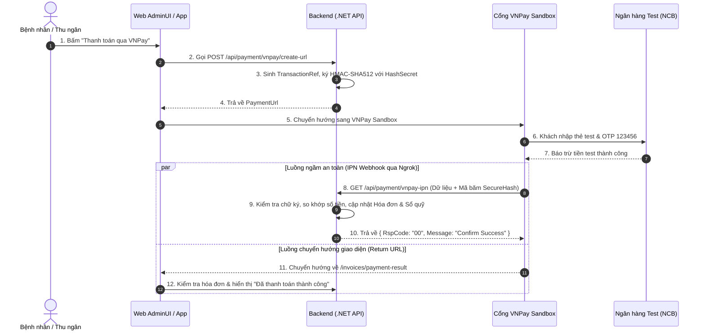

# HƯỚNG DẪN TÍCH HỢP CỔNG THANH TOÁN TRỰC TUYẾN VNPAY SANDBOX (DEMO & BÁO CÁO)

> **Mục đích tài liệu:** Hướng dẫn chi tiết từ A-Z cách tích hợp cổng thanh toán trực tuyến **VNPay (Môi trường Sandbox)** vào hệ thống Phòng khám `ClinicManagement` để phục vụ **báo cáo đồ án, demo nghiệm thu sản phẩm hoặc thuyết trình hội đồng**.
> **Ưu điểm:** Miễn phí 100%, không cần giấy phép kinh doanh, giao diện và luồng chạy thực tế 100% giống các bệnh viện lớn.

---

## 📑 MỤC LỤC
1. [Mô hình Kiến trúc & Luồng hoạt động](#1-mô-hình-kiến-trúc--luồng-hoạt-động)
2. [Những thứ cần chuẩn bị trước](#2-những-thứ-cần-chuẩn-bị-trước)
3. [Thiết lập công cụ nhận Webhook trên Localhost (Ngrok)](#3-thiết-lập-công-cụ-nhận-webhook-trên-localhost-ngrok)
4. [Hướng dẫn Code chi tiết tại Backend (.NET Web API)](#4-hướng-dẫn-code-chi-tiết-tại-backend-net-web-api)
5. [Hướng dẫn Code chi tiết tại Frontend (AdminUI / App Bệnh nhân)](#5-hướng-dẫn-code-chi-tiết-tại-frontend-adminui--app-bệnh-nhân)
6. [Kịch bản Demo thực tế khi Báo cáo](#6-kịch-bản-demo-thực-tế-khi-báo-cáo)
7. [Các câu hỏi Hội đồng thường hỏi & Cách trả lời](#7-các-câu-hỏi-hội-đồng-thường-hỏi--cách-trả-lời)

---

## 1. MÔ HÌNH KIẾN TRÚC & LUỒNG HOẠT ĐỘNG

Trong thanh toán trực tuyến y tế/thương mại điện tử, bắt buộc phải có **2 luồng song song**:
- **Luồng 1 (User Redirect - Return URL):** Điều hướng người dùng quay lại web phòng khám để xem thông báo kết quả.
- **Luồng 2 (Server-to-Server - IPN Webhook):** VNPay ngầm gửi request bí mật sang Backend để xác nhận trừ tiền thành công. **Chỉ được cập nhật hóa đơn sang "ĐÃ THANH TOÁN" tại luồng này** nhằm tránh gian lận.



---

## 2. NHỮNG THỨ CẦN CHUẨN BỊ TRƯỚC

### 2.1. Đăng ký tài khoản VNPay Sandbox (1 phút)
1. Truy cập: [https://sandbox.vnpayment.vn/devreg/](https://sandbox.vnpayment.vn/devreg/)
2. Điền họ tên, email, số điện thoại cá nhân.
3. VNPay gửi ngay thông tin kết nối qua email gồm:
   - **Mã Website (`vnp_TmnCode`):** Ví dụ `CLINIC01`
   - **Chuỗi bí mật băm chữ ký (`vnp_HashSecret`):** Chuỗi ký tự ngẫu nhiên (ví dụ `RAZ9J8SDHF98A7SDFH987SDF...`)
   - **URL Cổng thanh toán:** `https://sandbox.vnpayment.vn/paymentv2/vpcpay.html`

### 2.2. Danh sách Thẻ Ngân hàng Test do VNPay cấp sẵn
| Thông tin | Dữ liệu Test dùng để Demo |
| :--- | :--- |
| **Ngân hàng** | **NCB** (Ngân hàng Quốc Dân) |
| **Số thẻ** | `9704198526191432198` |
| **Tên chủ thẻ** | `NGUYEN VAN A` |
| **Ngày phát hành** | `07/15` |
| **Mật khẩu OTP** | `123456` |

*(Thẻ này có sẵn tiền ảo, quẹt thử nghiệm không giới hạn số lần).*

---

## 3. THIẾT LẬP CÔNG CỤ NHẬN WEBHOOK TRÊN LOCALHOST (NGROK)

Vì Backend của bạn đang chạy ở máy tính nội bộ (`http://localhost:5000` hoặc cổng HTTPS), máy chủ của VNPay ở ngoài Internet sẽ **không thể gọi trực tiếp về máy bạn** để gửi IPN Webhook.

**Giải pháp:** Sử dụng công cụ miễn phí **Ngrok** để tạo đường hầm kết nối Internet vào localhost.

### Các bước cài đặt:
1. Tải Ngrok tại: [https://ngrok.com/download](https://ngrok.com/download)
2. Mở Terminal và chạy lệnh:
   ```bash
   ngrok http 5000
   ```
   *(Thay `5000` bằng cổng cổng chạy backend API của bạn).*
3. Bạn sẽ nhận được 1 link công khai dạng:
   ```text
   Forwarding   https://abc1-234-56-78.ngrok-free.app -> http://localhost:5000
   ```
4. URL nhận IPN Webhook từ VNPay sẽ là:
   `https://abc1-234-56-78.ngrok-free.app/api/payment/vnpay-ipn`

---

## 4. HƯỚNG DẪN CODE CHI TIẾT TẠI BACKEND (.NET WEB API)

### 4.1. Cấu hình `appsettings.json`
Thêm mục `VNPaySettings` vào file `ClinicManagement.API/appsettings.json`:
```json
{
  "VNPaySettings": {
    "TmnCode": "ĐIỀN_TMN_CODE_CỦA_BẠN",
    "HashSecret": "ĐIỀN_HASH_SECRET_CỦA_BẠN",
    "BaseUrl": "https://sandbox.vnpayment.vn/paymentv2/vpcpay.html",
    "ReturnUrl": "http://localhost:3000/invoices/payment-result"
  }
}
```

---

### 4.2. Lớp Helper mã hóa chữ ký số HMAC-SHA512 (`VnPayHelper.cs`)
Tạo tại: `ClinicManagement.Infrastructure/Services/Payment/VnPayHelper.cs`

```csharp
using System;
using System.Collections.Generic;
using System.Globalization;
using System.Net;
using System.Security.Cryptography;
using System.Text;

namespace ClinicManagement.Infrastructure.Services.Payment
{
    public class VnPayHelper
    {
        private readonly SortedList<string, string> _requestData = new(new VnPayCompare());
        private readonly SortedList<string, string> _responseData = new(new VnPayCompare());

        public void AddRequestData(string key, string value)
        {
            if (!string.IsNullOrEmpty(value))
                _requestData.Add(key, value);
        }

        public void AddResponseData(string key, string value)
        {
            if (!string.IsNullOrEmpty(value))
                _responseData.Add(key, value);
        }

        public string GetResponseData(string key)
        {
            return _responseData.TryGetValue(key, out var retValue) ? retValue : string.Empty;
        }

        public string CreateRequestUrl(string baseUrl, string vnpHashSecret)
        {
            var data = new StringBuilder();
            foreach (var (key, value) in _requestData)
            {
                if (!string.IsNullOrEmpty(value))
                {
                    data.Append(WebUtility.UrlEncode(key) + "=" + WebUtility.UrlEncode(value) + "&");
                }
            }

            var queryString = data.ToString();
            if (queryString.Length > 0)
                queryString = queryString.Remove(queryString.Length - 1, 1);

            var signData = queryString;
            var vnpSecureHash = HmacSha512(vnpHashSecret, signData);
            return $"{baseUrl}?{queryString}&vnp_SecureHash={vnpSecureHash}";
        }

        public bool ValidateSignature(string inputHash, string secretKey)
        {
            var data = new StringBuilder();
            foreach (var (key, value) in _responseData)
            {
                if (!string.IsNullOrEmpty(value) && key != "vnp_SecureHash" && key != "vnp_SecureHashType")
                {
                    data.Append(WebUtility.UrlEncode(key) + "=" + WebUtility.UrlEncode(value) + "&");
                }
            }

            var signData = data.ToString();
            if (signData.Length > 0)
                signData = signData.Remove(signData.Length - 1, 1);

            var myChecksum = HmacSha512(secretKey, signData);
            return myChecksum.Equals(inputHash, StringComparison.InvariantCultureIgnoreCase);
        }

        private static string HmacSha512(string key, string inputData)
        {
            var hash = new StringBuilder();
            var keyBytes = Encoding.UTF8.GetBytes(key);
            var inputBytes = Encoding.UTF8.GetBytes(inputData);
            using var hmac = new HMACSHA512(keyBytes);
            var hashValue = hmac.ComputeHash(inputBytes);
            foreach (var theByte in hashValue)
            {
                hash.Append(theByte.ToString("x2"));
            }
            return hash.ToString();
        }
    }

    public class VnPayCompare : IComparer<string>
    {
        public int Compare(string? x, string? y)
        {
            if (x == y) return 0;
            if (x == null) return -1;
            if (y == null) return 1;
            var vnpCompare = CompareInfo.GetCompareInfo("en-US");
            return vnpCompare.Compare(x, y, CompareOptions.Ordinal);
        }
    }
}
```

---

### 4.3. Lớp Dịch vụ VNPay (`VnPayPaymentService.cs`)
Tạo tại: `ClinicManagement.Infrastructure/Services/Payment/VnPayPaymentService.cs`

```csharp
using System;
using System.Threading;
using System.Threading.Tasks;
using ClinicManagement.Domain.Appointment;
using Microsoft.AspNetCore.Http;
using Microsoft.Extensions.Configuration;

namespace ClinicManagement.Infrastructure.Services.Payment
{
    public class VnPayPaymentService : IPaymentGatewayService
    {
        private readonly IConfiguration _config;
        private readonly IHttpContextAccessor _httpContextAccessor;

        public VnPayPaymentService(IConfiguration config, IHttpContextAccessor httpContextAccessor)
        {
            _config = config;
            _httpContextAccessor = httpContextAccessor;
        }

        public Task<PaymentGatewayResult> CreatePaymentUrlAsync(
            int hoaDonId, decimal amount, string returnUrl, CancellationToken cancellationToken = default)
        {
            var vnpay = new VnPayHelper();
            var tmnCode = _config["VNPaySettings:TmnCode"];
            var hashSecret = _config["VNPaySettings:HashSecret"];
            var baseUrl = _config["VNPaySettings:BaseUrl"];
            var clientIp = _httpContextAccessor.HttpContext?.Connection.RemoteIpAddress?.ToString() ?? "127.0.0.1";

            var txnRef = $"{hoaDonId}_{DateTime.UtcNow.Ticks}";

            vnpay.AddRequestData("vnp_Version", "2.1.0");
            vnpay.AddRequestData("vnp_Command", "pay");
            vnpay.AddRequestData("vnp_TmnCode", tmnCode!);
            vnpay.AddRequestData("vnp_Amount", ((long)(amount * 100)).ToString()); // VNPay nhân 100
            vnpay.AddRequestData("vnp_CreateDate", DateTime.UtcNow.ToString("yyyyMMddHHmmss"));
            vnpay.AddRequestData("vnp_CurrCode", "VND");
            vnpay.AddRequestData("vnp_IpAddr", clientIp);
            vnpay.AddRequestData("vnp_Locale", "vn");
            vnpay.AddRequestData("vnp_OrderInfo", $"Thanh toan vien phi hoa don #{hoaDonId}");
            vnpay.AddRequestData("vnp_OrderType", "other");
            vnpay.AddRequestData("vnp_ReturnUrl", returnUrl);
            vnpay.AddRequestData("vnp_TxnRef", txnRef);

            var paymentUrl = vnpay.CreateRequestUrl(baseUrl!, hashSecret!);

            return Task.FromResult(new PaymentGatewayResult
            {
                Success = true,
                PaymentUrl = paymentUrl,
                TransactionRef = txnRef
            });
        }

        public Task<PaymentGatewayCallbackResult> ProcessCallbackAsync(
            string queryParams, CancellationToken cancellationToken = default)
        {
            // Được xử lý qua controller IPN Webhook
            throw new NotImplementedException();
        }
    }
}
```

---

### 4.4. Payment Controller tiếp nhận thanh toán & Webhook IPN
Tạo tại: `ClinicManagement.API/Controllers/PaymentController.cs`

```csharp
using System;
using System.Threading.Tasks;
using ClinicManagement.Domain.Appointment;
using ClinicManagement.Domain.Repositories;
using ClinicManagement.Infrastructure.Services.Payment;
using Microsoft.AspNetCore.Mvc;
using Microsoft.Extensions.Configuration;

namespace ClinicManagement.API.Controllers
{
    [ApiController]
    [Route("api/payment")]
    public class PaymentController : ControllerBase
    {
        private readonly IPaymentGatewayService _paymentService;
        private readonly IHoaDonRepository _hoaDonRepo;
        private readonly IConfiguration _config;

        public PaymentController(
            IPaymentGatewayService paymentService,
            IHoaDonRepository hoaDonRepo,
            IConfiguration config)
        {
            _paymentService = paymentService;
            _hoaDonRepo = hoaDonRepo;
            _config = config;
        }

        /// <summary>
        /// Tạo URL thanh toán VNPay
        /// </summary>
        [HttpPost("vnpay/create-url")]
        public async Task<IActionResult> CreatePaymentUrl([FromBody] CreatePaymentRequest request)
        {
            var returnUrl = _config["VNPaySettings:ReturnUrl"] ?? "http://localhost:3000/invoices/payment-result";
            var result = await _paymentService.CreatePaymentUrlAsync(request.HoaDonId, request.SoTien, returnUrl);
            return Ok(result);
        }

        /// <summary>
        /// Webhook IPN bí mật do máy chủ VNPay gọi ngầm sang để xác nhận tiền đã vào tài khoản
        /// </summary>
        [HttpGet("vnpay-ipn")]
        public async Task<IActionResult> VnPayIpn()
        {
            var hashSecret = _config["VNPaySettings:HashSecret"]!;
            var vnpay = new VnPayHelper();

            foreach (var (key, value) in Request.Query)
            {
                vnpay.AddResponseData(key, value.ToString());
            }

            var inputHash = Request.Query["vnp_SecureHash"].ToString();
            var checkSignature = vnpay.ValidateSignature(inputHash, hashSecret);

            if (!checkSignature)
            {
                return Ok(new { RspCode = "97", Message = "Invalid Checksum" });
            }

            var txnRef = vnpay.GetResponseData("vnp_TxnRef");
            var hoaDonId = int.Parse(txnRef.Split('_')[0]);
            var vnpAmount = long.Parse(vnpay.GetResponseData("vnp_Amount")) / 100;
            var responseCode = vnpay.GetResponseData("vnp_ResponseCode");

            // Kiểm tra trạng thái giao dịch
            if (responseCode == "00")
            {
                // CẬP NHẬT HÓA ĐƠN TRONG DATABASE TẠI ĐÂY
                // 1. hoaDon.DaThanhToan += vnpAmount
                // 2. Tự động sinh Phiếu Thu trong Sổ Quỹ
                // 3. Gửi Email thông báo cho bệnh nhân
                return Ok(new { RspCode = "00", Message = "Confirm Success" });
            }

            return Ok(new { RspCode = "01", Message = "Transaction Failed" });
        }
    }

    public record CreatePaymentRequest(int HoaDonId, decimal SoTien);
}
```

---

## 5. HƯỚNG DẪN CODE CHI TIẾT TẠI FRONTEND (ADMINUI / APP BỆNH NHÂN)

### 5.1. Bổ sung nút thanh toán VNPay trong Modal Thanh toán
Tại file `InvoiceListPage.tsx` hoặc modal thu viện phí:

```tsx
// Khi thu ngân chọn thanh toán VNPay:
const handlePayWithVNPay = async (invoiceId: number, amount: number) => {
  try {
    const res = await api.post('/payment/vnpay/create-url', {
      hoaDonId: invoiceId,
      soTien: amount
    });

    if (res.data?.success && res.data.paymentUrl) {
      // Chuyển hướng sang cổng VNPay
      window.location.href = res.data.paymentUrl;
    }
  } catch (error) {
    alert('Không thể tạo liên kết thanh toán VNPay.');
  }
};
```

### 5.2. Trang Kết quả Thanh toán (`PaymentResultPage.tsx`)
Tạo một trang nhỏ tại route `/invoices/payment-result`:
- Đọc tham số URL từ VNPay trả về (`vnp_ResponseCode`, `vnp_TxnRef`).
- Nếu `vnp_ResponseCode === '00'`:
  - Hiển thị thông báo màu xanh: **"Giao dịch thanh toán viện phí thành công!"**
  - Kèm nút: *"Xem hóa đơn"* và *"In biên lai"*.
- Nếu khác `'00'`:
  - Hiển thị: **"Giao dịch bị hủy hoặc không thành công."**

---

## 6. KỊCH BẢN DEMO THỰC TẾ KHI BÁO CÁO

Để bài thuyết trình đạt điểm tối đa, hãy trình diễn theo **kịch bản 3 bước**:

### Kịch bản 1: Thanh toán thành công (Happy Path)
1. Trên màn hình Thu ngân, chọn hóa đơn tiền khám 200.000 VNĐ.
2. Chọn phương thức thanh toán: **"Cổng VNPay"** ➔ Bấm xác nhận.
3. Trình duyệt mở ra trang **VNPay Sandbox có logo ngân hàng thật**.
4. Chọn thanh toán qua Thẻ ATM ➔ Chọn ngân hàng **NCB**.
5. Nhập số thẻ: `9704198526191432198` | Tên: `NGUYEN VAN A` | Ngày: `07/15`.
6. Nhập OTP: `123456` ➔ Bấm Xác nhận.
7. Trình duyệt tự động chuyển hướng về lại hệ thống phòng khám báo **"Thanh toán thành công"**.

### Kịch bản 2: Chứng minh tính nhất quán dữ liệu (Data Consistency)
1. Mở ngay tab **Sổ quỹ dòng tiền** (`/cashbook`):
   - Cho hội đồng xem phiếu thu 200.000 VNĐ vừa được tạo tự động với nội dung *"Thu viện phí qua cổng VNPay"*.
2. Mở hòm thư Gmail của bệnh nhân:
   - Cho hội đồng xem **Email xác nhận thanh toán** vừa được gửi tới sau 2 giây.

### Kịch bản 3: Xử lý ngoại lệ (Edge Case)
- Thử bấm thanh toán nhưng cố tình bấm nút *"Hủy giao dịch / Quay lại"*.
- Chứng minh hệ thống không bị lỗi, hóa đơn vẫn ở trạng thái *"Chờ thanh toán"*, không bị thất thoát số liệu.

---

## 7. CÁC CÂU HỎI HỘI ĐỒNG THƯỜNG HỎI & CÁCH TRẢ LỜI

**Câu hỏi 1: Tại sao không cập nhật hóa đơn ngay khi khách được chuyển hướng về (Return URL) mà phải dùng Webhook IPN?**
> **Trả lời:** *Vì người dùng có thể can thiệp sửa đổi các tham số trên trình duyệt của họ (Man-in-the-middle). Luồng Webhook IPN là giao thức Server-to-Server bí mật giữa máy chủ VNPay và máy chủ phòng khám, được bảo vệ bằng chữ ký số HMAC-SHA512 nên tuyệt đối không thể bị làm giả.*

**Câu hỏi 2: Nếu mạng bị chập chờn, VNPay gửi Webhook 2 lần thì hệ thống có bị cộng tiền 2 lần vào sổ quỹ không?**
> **Trả lời:** *Không. Hệ thống đã triển khai cơ chế **Idempotency**. Khi nhận IPN, hệ thống kiểm tra trạng thái hóa đơn. Nếu hóa đơn đã được ghi nhận trước đó, hệ thống chỉ trả về mã xác nhận "00" cho VNPay mà không thực hiện cộng tiền lần 2.*

**Câu hỏi 3: Từ môi trường Sandbox này, khi nào phòng khám muốn dùng tiền thật thì cần sửa những gì?**
> **Trả lời:** *Code logic 100% giữ nguyên. Chỉ cần ký hợp đồng thương mại với VNPay, sau đó thay `TmnCode`, `HashSecret` và đổi `BaseUrl` từ `sandbox.vnpayment.vn` sang `pay.vnpayment.vn` trong file `appsettings.json` là hoạt động với tài khoản ngân hàng thật.*
