# SƠ ĐỒ THỰC THỂ QUAN HỆ (ERD - ENTITY RELATIONSHIP DIAGRAM)
## HỆ THỐNG CLINIC MANAGEMENT DESKTOP (EHC HIS)

> **Mô hình ERD chuẩn hóa toàn bộ cấu trúc bảng, khóa chính (PK), khóa ngoại (FK), các trường dữ liệu và quan hệ giữa các Entity trong package `vn.clinicmanagement.domain`.**

---

### 1. SƠ ĐỒ ERD TỔNG THỂ (MERMAID ERD)

```mermaid
erDiagram

    %% ==========================================
    %% 1. PHÂN HỆ TIẾP ĐÓN & HỒ SƠ BỆNH NHÂN
    %% ==========================================
    BenhNhan ||--o{ BaoHiem : "so_huu"
    BenhNhan ||--o{ TienSuBenh : "ghi_nhan"
    BenhNhan ||--o{ BenhNhanCoSo : "dang_ky"
    CoSo ||--o{ BenhNhanCoSo : "tiep_nhan"
    BenhNhan ||--o{ LichHen : "dat_truoc"
    BenhNhan ||--o{ LuotKham : "tham_gia"
    BenhNhan ||--o{ HoaDon : "chi_tra"
    BenhNhan ||--o{ CongNoBenhNhan : "ghi_no"

    BenhNhan {
        int id PK
        string maBenhNhanFormat
        string ho
        string ten
        date ngaySinh
        string gioiTinh
        string dienThoai
        string email
        string soCCCD
        string diaChi
        string ngheNghiep
        string danToc
        string quocTich
        string maTinh
        string maHuyen
        string maXa
        string nguoiLienHeTen
        string nguoiLienHeDienThoai
    }

    BaoHiem {
        int id PK
        int maBenhNhan FK
        string loaiBaoHiem
        string soBaoHiem
        date ngayHetHan
        int mucHuong
        string noiDangKyKCB
    }

    TienSuBenh {
        int id PK
        int maBenhNhan FK
        string loaiTienSu
        string moTa
    }

    BenhNhanCoSo {
        int id PK
        int maBenhNhan FK
        int maCoSo FK
        datetime ngayDangKy
    }

    %% ==========================================
    %% 2. PHÂN HỆ CƠ SỞ VẬT CHẤT & KHOA PHÒNG
    %% ==========================================
    CoSo ||--o{ Khoa : "chia_thanh"
    Khoa ||--o{ PhongKham : "quan_ly"
    CoSo ||--o{ Kho : "so_huu"
    CoSo ||--o{ LuotKham : "dia_diem"

    CoSo {
        int id PK
        string tenCoSo
        string diaChi
        string dienThoai
        string email
        string loaiCoSo
        boolean hoatDong
    }

    Khoa {
        int id PK
        int maCoSo FK
        string tenKhoa
        string moTa
        boolean hoatDong
    }

    PhongKham {
        int id PK
        int maKhoa FK
        string tenPhong
        string viTri
        boolean hoatDong
    }

    %% ==========================================
    %% 3. PHÂN HỆ KHÁM BỆNH & BỆNH ÁN ĐIỆN TỬ (EMR)
    %% ==========================================
    LuotKham ||--o{ ChanDoan : "chuan_doan"
    LuotKham ||--o{ SinhHieu : "do_dac"
    LuotKham ||--o{ ChiDinhDichVu : "chi_dinh"
    LuotKham ||--o{ DonThuoc : "ke_toa"
    LuotKham ||--o{ HoaDon : "phat_sinh"
    LuotKham ||--o{ NhatKyHoSoBenhAn : "truy_vet"
    ICD ||--o{ ChanDoan : "ma_hoa"
    LichHen ||--o| LuotKham : "chuyen_thanh"
    NhanVien ||--o{ LuotKham : "bac_si_kham"
    PhongKham ||--o{ LuotKham : "tai_phong"

    LuotKham {
        int id PK
        int maBenhNhan FK
        int maBacSi FK
        int maLichHen FK
        int maCoSo FK
        int maKhoa FK
        int maPhongKham FK
        string soThuTuDisplay
        datetime thoiGianTiepNhan
        string doiTuongKham
        string hinhThucDieuTri
        string trangThai
        date ngayKham
        datetime thoiGianBatDauKham
        datetime thoiGianKetThucKham
        string lyDoKham
        string quaTrinhBenhLy
        string tienSuBanThan
        string tienSuGiaDinh
        string khamToanThan
        string khamBoPhan
        string tomTatBenhAn
        string huongDieuTri
        string loiDanBacSi
        string ketQuaDieuTri
        string huongXuTri
        date ngayHenTaiKham
        int soNgayNghiHuongBHXH
        string lyDoChuyenTuyen
        boolean emrLocked
        string emrSignature
        datetime emrLockedAt
        int emrLockedBy
    }

    ChanDoan {
        int id PK
        int maLuotKham FK
        int maICD FK
        string loaiChanDoan
        string chanDoanText
        boolean laChinh
    }

    ICD {
        int id PK
        string maICD
        string tenBenh
        string moTa
        boolean hoatDong
    }

    SinhHieu {
        int id PK
        int maLuotKham FK
        int mach
        decimal nhietDo
        int huyetApTamThu
        int huyetApTamTruong
        int nhipTho
        decimal canNang
        decimal chieuCao
        decimal bmi
        decimal spo2
    }

    %% ==========================================
    %% 4. PHÂN HỆ CẬN LÂM SÀNG & DỊCH VỤ KỸ THUẬT
    %% ==========================================
    DanhMucDichVu ||--o{ ChiDinhDichVu : "su_dung"
    ChiDinhDichVu ||--o{ ChiTietKetQuaXetNghiem : "chi_tiet_lab"
    DanhMucDichVu ||--o{ DinhMucVatTuDichVu : "dinh_muc"
    Item ||--o{ DinhMucVatTuDichVu : "vat_tu_tieu_hao"

    DanhMucDichVu {
        int id PK
        string maDichVu
        string tenDichVu
        string loaiDichVu
        decimal donGia
        decimal giaBHYT
        boolean hoatDong
        string moTa
    }

    ChiDinhDichVu {
        int id PK
        int maLuotKham FK
        int maDichVu FK
        int maBacSiChiDinh FK
        int maPhongThucHien FK
        int bacSiThucHien FK
        decimal soLuong
        decimal donGia
        string trangThai
        string ketQua
        string ketLuan
        string danhSachHinhAnhUrl
        datetime thoiGianChiDinh
        datetime thoiGianThucHien
        datetime thoiGianTraKetQua
    }

    ChiTietKetQuaXetNghiem {
        int id PK
        int maChiDinhDichVu FK
        string tenChiSo
        string giaTri
        string donViDo
        string khoangThamChieu
        string danhGia
    }

    DinhMucVatTuDichVu {
        int id PK
        int maDichVu FK
        int maItem FK
        decimal soLuongDinhMuc
    }

    %% ==========================================
    %% 5. PHÂN HỆ ĐƠN THUỐC & DƯỢC LÂM SÀNG
    %% ==========================================
    DonThuoc ||--o{ ChiTietDonThuoc : "bao_gom"
    Item ||--o{ ChiTietDonThuoc : "ke_thuoc"
    NhanVien ||--o{ DonThuoc : "bac_si_ke"
    Kho ||--o{ DonThuoc : "xuat_tai_kho"

    DonThuoc {
        int id PK
        int maLuotKham FK
        int maBacSi FK
        int maCoSo FK
        int maKhoXuat FK
        datetime ngayKe
        string trangThai
        string ghiChu
        string loiDanDonThuoc
        datetime ngayCapThuoc
        int maNguoiCapThuoc FK
    }

    ChiTietDonThuoc {
        int id PK
        int maDonThuoc FK
        int maItem FK
        decimal soLuongKe
        decimal soLuongDaXuat
        string lieuDung
        string tanSuat
        int soNgay
        string huongDan
        decimal donGiaKe
        string duongDung
        decimal sang
        decimal trua
        decimal chieu
        decimal toi
    }

    %% ==========================================
    %% 6. PHÂN HỆ QUẢN TRỊ KHO DƯỢC & VẬT TƯ
    %% ==========================================
    Kho ||--o{ TonKho : "chua"
    Item ||--o{ TonKho : "ton_theo_lo"
    Item ||--o{ DonViTinhQuyDoi : "quy_doi"
    NhaCungCap ||--o{ PhieuNhapKho : "cung_cap"
    Kho ||--o{ PhieuNhapKho : "nhap_vao"
    PhieuNhapKho ||--o{ ChiTietNhapKho : "dong_nhap"
    Item ||--o{ ChiTietNhapKho : "mat_hang_nhap"
    Kho ||--o{ PhieuXuatKho : "xuat_tu"
    PhieuXuatKho ||--o{ ChiTietXuatKho : "dong_xuat"
    TonKho ||--o{ ChiTietXuatKho : "tru_lo_fefo"
    NhaCungCap ||--o{ DonDatHang : "nhan_don"
    DonDatHang ||--o{ ChiTietDonDatHang : "dong_dat"
    Kho ||--o{ Stocktake : "kiem_ke"
    Stocktake ||--o{ StocktakeCount : "dong_kiem_ke"
    TonKho ||--o{ StocktakeCount : "so_khop"
    Kho ||--o{ InventoryTransaction : "ghi_so"
    TonKho ||--o{ InventoryTransaction : "bien_dong"

    Item {
        int id PK
        string maItem
        string tenItem
        string loaiItem
        string hoatChat
        string hamLuong
        string donViCoBan
        string quyCachDongGoi
        decimal giaNhapMacDinh
        decimal giaBanMacDinh
        decimal tonToiThieu
        decimal tonToiDa
        string dangBaoChe
        string nuocSanXuat
        string hangSanXuat
        string soDangKy
        boolean hoatDong
    }

    Kho {
        int id PK
        int maCoSo FK
        string tenKho
        string loaiKho
        string trangThai
        int maNguoiPhuTrach FK
    }

    TonKho {
        int id PK
        int maKho FK
        int maItem FK
        string soLo
        date hanSuDung
        decimal soLuongTon
        decimal giaNhap
        decimal giaBan
    }

    DonViTinhQuyDoi {
        int id PK
        int maItem FK
        string tenDonVi
        decimal tyLeQuyDoi
        decimal giaBan
    }

    NhaCungCap {
        int id PK
        string tenNhaCungCap
        string maSoThue
        string soDienThoai
        string email
        string diaChi
        string trangThai
    }

    PhieuNhapKho {
        int id PK
        string soPhieuNhap
        int maKho FK
        int maNhaCungCap FK
        datetime ngayNhap
        decimal tongTien
        string trangThai
        string ghiChu
    }

    ChiTietNhapKho {
        int id PK
        int maPhieuNhap FK
        int maItem FK
        string soLo
        date hanSuDung
        decimal soLuong
        decimal giaNhap
        decimal giaBan
    }

    PhieuXuatKho {
        int id PK
        string soPhieuXuat
        int maKhoXuat FK
        string loaiXuat
        int maDonThuoc FK
        int maKhoNhan FK
        datetime ngayXuat
        decimal tongTien
        string trangThaiNoiBo
        string ghiChu
    }

    ChiTietXuatKho {
        int id PK
        int maPhieuXuat FK
        int maItem FK
        int maTonKho FK
        decimal soLuong
        decimal donGia
    }

    DonDatHang {
        int id PK
        string soDonDatHang
        int maNhaCungCap FK
        datetime ngayDat
        decimal tongTien
        string trangThai
    }

    ChiTietDonDatHang {
        int id PK
        int maDonDatHang FK
        int maItem FK
        decimal soLuongDat
        decimal soLuongDaNhan
        decimal donGia
    }

    Stocktake {
        int id PK
        int maKho FK
        datetime ngayKiemKe
        string trangThai
        string ghiChu
    }

    StocktakeCount {
        int id PK
        int maStocktake FK
        int maTonKho FK
        decimal soLuongSoSach
        decimal soLuongThucTe
        decimal chenhLech
    }

    InventoryTransaction {
        int id PK
        int maKho FK
        int maItem FK
        int maTonKho FK
        string loaiGiaoDich
        decimal soLuongThayDoi
        decimal tonTruocKhiThayDoi
        decimal tonSauKhiThayDoi
        datetime thoiGian
        string maChungTu
    }

    %% ==========================================
    %% 7. PHÂN HỆ VIỆN PHÍ, HÓA ĐƠN & CÔNG NỢ
    %% ==========================================
    HoaDon ||--o{ ChiTietHoaDon : "chi_tiet"
    HoaDon ||--o{ PhieuThu : "thu_tien"
    HoaDon ||--o| CongNoBenhNhan : "ghi_no"

    HoaDon {
        int id PK
        string soHoaDon
        int maLuotKham FK
        int maBenhNhan FK
        int maCoSo FK
        datetime ngayLap
        decimal tongTien
        decimal soTienBaoHiemChiTra
        decimal soTienBenhNhanChiTra
        decimal daThanhToan
        decimal soTienTamUng
        decimal soTienGiamGia
        decimal chietKhauPhanTram
        string lyDoGiamGia
        decimal soTienHoanTra
        string soHoaDonDienTu
        string maTraCuuHddt
        string trangThai
        string ghiChu
    }

    ChiTietHoaDon {
        int id PK
        int maHoaDon FK
        string loaiDoiTuong
        int maDoiTuong
        string moTa
        decimal soLuong
        decimal donGia
    }

    PhieuThu {
        int id PK
        int maHoaDon FK
        decimal soTien
        datetime ngayThu
        string phuongThuc
        int nguoiThu FK
        string ghiChu
    }

    CongNoBenhNhan {
        int id PK
        int maHoaDon FK
        int maBenhNhan FK
        decimal soTienNo
        decimal soTienDaTra
        date hanThanhToan
        string trangThai
    }

    %% ==========================================
    %% 8. PHÂN HỆ NHÂN SỰ, CA TRỰC & TÍNH LƯƠNG
    %% ==========================================
    ChucVu ||--o{ NhanVien : "dam_nhiem"
    NhanVien ||--o{ NhanVienVaiTro : "co_vai_tro"
    VaiTro ||--o{ NhanVienVaiTro : "gan_cho"
    NhanVien ||--o{ NhanVienKhoa : "thuoc_khoa"
    Khoa ||--o{ NhanVienKhoa : "gom_nhan_vien"
    NhanVien ||--o{ PhanQuyenCoSo : "lam_viec_tai"
    CoSo ||--o{ PhanQuyenCoSo : "co_nhan_su"
    CaTruc ||--o{ LichLamViec : "xep_ca"
    NhanVien ||--o{ LichLamViec : "lich_truc"
    LichLamViec ||--o| ChamCong : "diem_danh"
    NhanVien ||--o{ NghiPhep : "nghi_phep"
    KyLuong ||--o{ BangLuong : "ky_tra_luong"
    NhanVien ||--o{ BangLuong : "nhan_luong"
    BangLuong ||--o{ ChiTietBangLuong : "khoan_muc"
    VaiTro ||--o{ MaTranPhanQuyen : "phan_quyen"

    NhanVien {
        int id PK
        string maNhanVien
        string ho
        string ten
        string soDienThoai
        string email
        string diaChi
        string gioiTinh
        date ngaySinh
        int maChucVu FK
        string username
        string passwordHash
        boolean hoatDong
        datetime dangNhapCuoi
        string chungChiHanhNghe
        date ngayVaoLam
        decimal luongCoBan
        decimal heSoLuong
        decimal phuCap
    }

    ChucVu {
        int id PK
        string tenChucVu
        string moTa
    }

    VaiTro {
        int id PK
        string tenVaiTro
        string moTa
    }

    CaTruc {
        int id PK
        int maLoaiCa
        string tenCa
        time gioBatDau
        time gioKetThuc
        boolean hoatDong
    }

    LichLamViec {
        int id PK
        int maNhanVien FK
        int maCaTruc FK
        int maCoSo FK
        int maKhoa FK
        int maPhongKham FK
        date ngayLamViec
        string trangThai
        string nguonLich
    }

    ChamCong {
        int id PK
        int maLichLamViec FK
        datetime thoiGianCheckIn
        datetime thoiGianCheckOut
        string trangThai
        decimal soGioLam
        decimal soGioDiMuon
        decimal soGioVeSom
    }

    NghiPhep {
        int id PK
        int maNhanVien FK
        string loaiNghiPhep
        date tuNgay
        date denNgay
        string lyDo
        string trangThai
    }

    KyLuong {
        int id PK
        string tenKy
        int thang
        int nam
        date tuNgay
        date denNgay
        boolean daChot
    }

    BangLuong {
        int id PK
        int maKyLuong FK
        int maNhanVien FK
        decimal luongCoBan
        decimal heSoLuong
        decimal tongPhuCap
        decimal tongThuLaoKham
        decimal tongKhauTru
        decimal thucLinh
    }

    ChiTietBangLuong {
        int id PK
        int maBangLuong FK
        string loaiKhoan
        string tenKhoan
        decimal soTien
    }

    MaTranPhanQuyen {
        int id PK
        int maVaiTro FK
        string phanHe
        string hanhDong
        string phamViDuLieu
        boolean duocPhep
    }

    NhatKyHeThong {
        int id PK
        int maNhanVien FK
        string hanhDong
        string chiTiet
        string ipAddress
        datetime thoiGian
    }

    NhatKyHoSoBenhAn {
        int id PK
        int maLuotKham FK
        int maNhanVien FK
        string hanhDong
        string lyDo
        datetime thoiGian
    }

    LichHen {
        int id PK
        int maBenhNhan FK
        int maBacSi FK
        int maCoSo FK
        int maKhoa FK
        datetime thoiGianBatDau
        datetime thoiGianKetThuc
        string trangThai
        string lyDo
        string nguonDat
        decimal chiPhiGiuCho
        boolean daThanhToanGiuCho
        string soPhieuThu
    }
```

