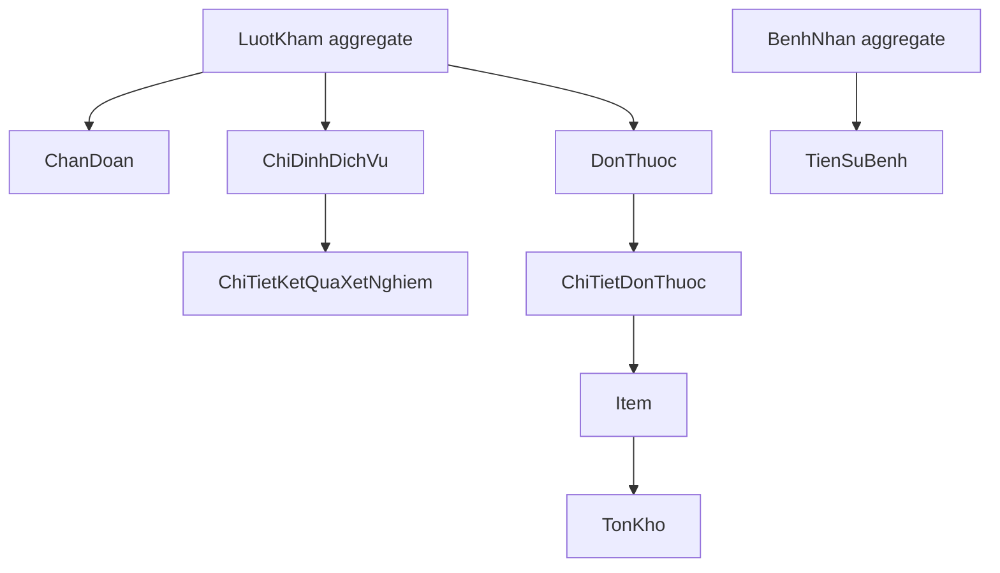

# Ke hoach Domain va Database cho tab Xu tri

## 1. Muc tieu

Hoan thien tab Xu tri theo huong domain-driven, bao dam du lieu chuan, phan quyen ro, transaction an toan va UI co the khai thac day du database.

## 2. Nguyen tac kien truc

- Moi nghiep vu co command/handler rieng.
- Domain entity chi chiu trach nhiem invariant cua chinh no.
- Application kiem tra authorization, orchestration va transaction.
- Repository chi truy van aggregate can thiet.
- DTO request khong nhan cac truong nhay cam nhu `CreatedBy`, `MaBacSi` neu co the lay tu JWT.
- Moi response phuc vu mot use case ro rang.

## 3. Mo hinh aggregate de xuat



## 4. Domain can bo sung

### LuotKham

- `CanEdit()` hoac policy kiem tra trang thai.
- `CompleteExam()` voi dieu kien ro rang.
- `CancelExam()` gioi han theo trang thai.
- Invariant khong cho them du lieu khi da huy/hoan tat.

### ChanDoan

- `Update(...)`.
- Domain service hoac aggregate method doi chuan doan chinh.
- Kiem tra khong co hai chuan doan chinh.

### ChiDinhDichVu

- Hoan chinh state transition: chi dinh -> tiep nhan -> cho ket qua -> co ket qua.
- Khong cho huy sau tiep nhan.
- Kiem tra dich vu co phu hop loai ket qua hay khong.

### DonThuoc

- `Update(...)` chi cho phep khi `TAM`.
- `Approve()` kiem tra don khong rong, thuoc hop le va khong vi pham canh bao.
- `Dispense()` khong tu doi trang thai neu chua tru ton thanh cong.

### TonKho

- Cong/tru co concurrency control.
- Khong cho so luong am.
- Ghi nhan giao dich kho, khong chi sua so du truc tiep.

## 5. DTO/Application can tao

### Chi tiet man hinh bac si

Tao mot DTO duy nhat, vi du `DoctorTreatmentDetailDto`, gom:

- thong tin luot kham va trang thai;
- chuan doan;
- chi dinh dich vu;
- ket qua CLS da phat hanh;
- don thuoc;
- canh bao di ung;
- co duoc sua/co duoc hoan tat.

### Commands

```text
SaveDiagnosisCommand
UpdateDiagnosisCommand
DeleteDiagnosisCommand
CreateServiceOrderCommand
CancelServiceOrderCommand
ReceiveServiceOrderCommand
SaveLabResultCommand
CreatePrescriptionCommand
UpdatePrescriptionCommand
ApprovePrescriptionCommand
CancelPrescriptionCommand
DispensePrescriptionCommand
CompleteExamCommand
CancelExamCommand
```

## 6. API de xuat

```text
GET    /api/LuotKham/{id}
GET    /api/ICD?keyword=
POST   /api/LuotKham/{id}/diagnoses
PUT    /api/LuotKham/{id}/diagnoses/{diagnosisId}
DELETE /api/LuotKham/{id}/diagnoses/{diagnosisId}
GET    /api/DanhMucDichVu
POST   /api/LuotKham/{id}/service-orders
DELETE /api/LuotKham/{id}/service-orders/{orderId}
GET    /api/Items/medicines?keyword=
POST   /api/LuotKham/{id}/prescriptions
PUT    /api/DonThuoc/{id}
POST   /api/DonThuoc/{id}/approve
POST   /api/DonThuoc/{id}/cancel
POST   /api/DonThuoc/{id}/dispense
POST   /api/LuotKham/{id}/complete
POST   /api/LuotKham/{id}/cancel
```

## 7. Database plan

### Can kiem tra truoc

- Chay day du migration theo thu tu.
- Kiem tra schema `LuotKham`, dac biet `MaPhongKham` va foreign key `PhongKham`.
- Kiem tra unique index `ICD.MaICD`.
- Kiem tra filtered unique index chuan doan chinh.
- Kiem tra foreign key va delete behavior cua chi dinh, ket qua, don thuoc.
- Kiem tra enum dang luu dang string co dong bo voi code khong.

### Index de xuat

- `LuotKham(MaBacSi, TrangThai, NgayKham)`.
- `ChanDoan(MaLuotKham, IsDeleted)`.
- `ChiDinhDichVu(MaLuotKham, TrangThai, NgayChiDinh)`.
- `DonThuoc(MaLuotKham, TrangThai, NgayKe)`.
- `TonKho(MaItem, MaKho)`.
- `TienSuBenh(MaBenhNhan, LoaiTienSu, IsDeleted)`.

### Audit va concurrency

- Them audit log cho thay doi y te quan trong.
- Them concurrency token/rowversion cho ton kho va don thuoc neu DB ho tro.
- Khong cho cap phat dong thoi lam am kho.

## 8. Transaction plan

### Tao chi dinh

```text
Kiem tra luot va dich vu
-> tao ChiDinhDichVu
-> tao chi phi neu can
-> commit
```

### Cap phat thuoc

```text
Kiem tra don da duyet
-> khoa/kiem tra ton
-> tru TonKho
-> cap nhat SoLuongDaXuat
-> tao phieu xuat
-> doi trang thai don
-> commit
```

### Hoan tat luot kham

```text
Kiem tra quyen va trang thai
-> kiem tra dieu kien chuan doan
-> kiem tra CLS/don thuoc theo policy
-> CompleteExam()
-> ghi audit
-> commit
```

## 9. Validation va authorization

- Bac si chi thao tac tren luot duoc phan cong.
- Ky thuat vien chi thao tac ket qua CLS.
- Duoc si chi thao tac cap phat.
- Luu user id tu JWT.
- Kiem tra trang thai truoc moi command.
- Kiem tra ownership cua entity con.
- Khong tin gia, nguoi tao, nguoi thuc hien tu client.

## 10. Thu tu trien khai

### P0

1. DTO detail cho DoctorUI.
2. API lay chi tiet luot kham that.
3. Authorization va state guard.
4. CompleteExam command/API.

### P1

1. CRUD chuan doan va tra cuu ICD.
2. CRUD chi dinh dich vu.
3. Tao/sua don thuoc.

### P2

1. CLS tiep nhan va phat hanh ket qua.
2. Duyet don va cap phat.
3. Transaction ton kho.

### P3

1. Audit log.
2. Concurrency.
3. Bao cao/thong ke theo chi tiet.
4. Co che dinh chinh sau hoan tat.
