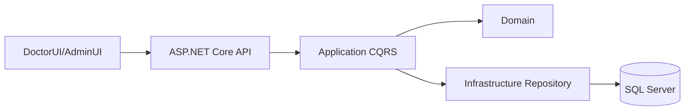

# ClinicManagement - Tong quan he thong

## 1. Muc dich

ClinicManagement la he thong quan ly phong kham, gom backend ASP.NET Core .NET 10, frontend cho bac si va frontend quan tri.

## 2. Cau truc solution

- `ClinicManagement.Domain`: entity, enum, aggregate va quy tac nghiep vu co ban.
- `ClinicManagement.Application`: DTO, CQRS, MediatR command/query va mapping.
- `ClinicManagement.Infrastructure`: EF Core DbContext, migration, configuration va repository.
- `ClinicManagement.API`: controller, authentication, middleware va HTTP endpoint.
- `ClinicManagement.DoctorUI`: giao dien bac si, hang doi, kham benh va xu tri.
- `ClinicManagement.AdminUI`: giao dien quan tri.

## 3. Luong tong quat

## 4. Chuc nang da co

### Xac thuc

- Dang nhap bang JWT.
- Token chua user id, username, email, ho ten va role.
- API co helper doc claims qua `ClaimsPrincipalExtensions`.

### Quan ly benh nhan

- Tao benh nhan.
- Tim kiem benh nhan.
- Lay thong tin ca nhan.
- Quan ly bao hiem.
- Quan ly tien su benh.
- Lay lich su luot kham, don thuoc, dich vu va hoa don theo benh nhan.

### Quan ly luot kham

- Tao luot kham trong qua trinh tiep nhan.
- Gan bac si.
- Lay hang doi theo bac si.
- Bat dau kham.
- Luu ly do kham.
- Luu sinh hieu.
- Luu tien su benh.
- Lay chi tiet luot kham.

### Quan ly khoa, co so, phong kham, nhan vien

- Domain va API da co cac module tuong ung cho co so, khoa, phong kham va nhan vien.
- Du lieu duoc lien ket voi luot kham qua ma co so, ma khoa, ma phong va ma bac si.

### Dich vu, xet nghiem va don thuoc

- Database va domain da co entity cho chi dinh dich vu, ket qua xet nghiem, don thuoc, chi tiet don thuoc, item va ton kho.
- Mot so query doc/thong ke da co.
- Cac command ghi day du cho tab Xu tri chua duoc noi vao API.

## 5. Chuc nang dang hoat dong that

- Hang doi bac si: `GET /api/LuotKham/hang-doi`.
- Bat dau kham: `POST /api/LuotKham/{id}/start-exam`.
- Luu thong tin kham: `POST /api/LuotKham/{id}/examination`.
- Lay chi tiet luot kham: `GET /api/LuotKham/{id}`.
- Lay loai tien su: `GET /api/BenhNhan/loai-tien-su`.
- DoctorUI co form kham, che do Sua, Huy va Luu.

## 6. Chuc nang con dang prototype

Tab Xu tri hien dang hien thi du lieu mau trong `useExam.ts`. Cac nhom chuan doan, chi dinh dich vu, don thuoc va ket qua xet nghiem chua co luong CRUD day du tren DoctorUI.

## 7. Nguyen tac tiep tuc

1. Tai du lieu that theo `luotKhamId`.
2. Chuan hoa mot DTO chi tiet cho man hinh bac si.
3. Trien khai command theo tung aggregate.
4. Kiem tra quyen va trang thai trong backend.
5. Them test integration cho cac luong ghi du lieu.
