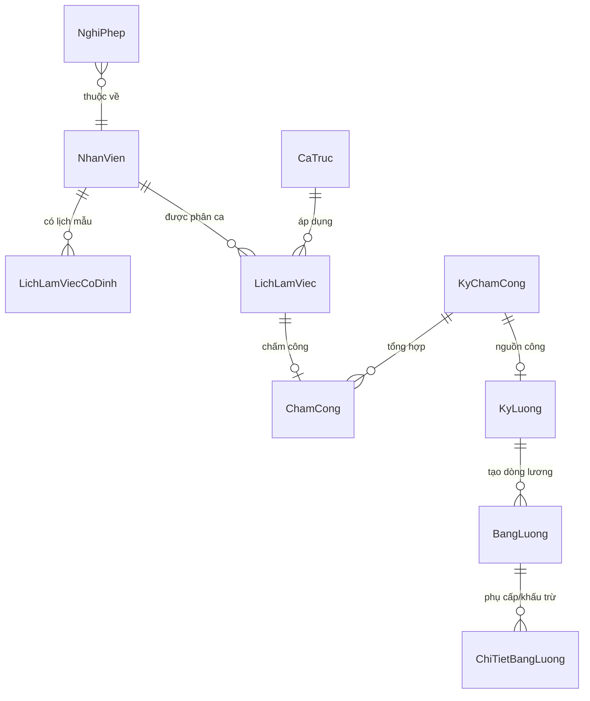
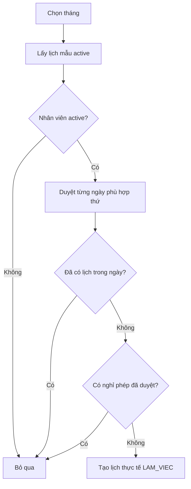

# Flow lịch làm việc, chấm công và tính lương

> **Hệ thống:** Clinic Management
> **Phạm vi:** Lịch làm việc, lịch mẫu, chấm công, giải trình công và bảng lương
> **Kiến trúc:** .NET Clean Architecture, CQRS/MediatR, EF Core, SQL Server, React Admin UI
> **Cập nhật:** 24/09/2026

## 1. Mục tiêu và nguyên tắc

Tài liệu này là tài liệu chuẩn duy nhất cho flow:

```text
Lịch mẫu → Lịch thực tế → Chấm công → Khóa kỳ công → Tính lương → Duyệt/chốt/thanh toán
```

Các nguyên tắc bắt buộc:

1. `LichLamViecCoDinh` là lịch mẫu dài hạn; không sửa lịch mẫu vì một ngoại lệ xảy ra trong một ngày.
2. `LichLamViec` là lịch thực tế theo ngày, dùng để phản ánh nghỉ, đổi ca, đổi phòng và lịch được sinh tự động.
3. Sinh lịch phải idempotent: không tạo trùng, không ghi đè ca đã có và không tạo ca vào ngày có nghỉ phép đã duyệt.
4. Chấm công thiếu check-out không được coi là ca hoàn tất và không được tự động nhận đủ công.
5. Ca bất thường phải được xử lý hoặc giải trình trước khi khóa kỳ chấm công và tính lương.
6. OT chỉ được trả khi có cơ chế đăng ký/phê duyệt OT; thời gian quẹt thẻ tự nó không phải bằng chứng đủ để trả OT.

## 2. Mô hình dữ liệu



### 2.1. Lịch mẫu và lịch thực tế

| Entity | Vai trò |
|---|---|
| `LichLamViecCoDinh` | Lịch lặp theo thứ, ca, phòng và khoảng hiệu lực |
| `LichLamViec` | Ca thực tế của nhân viên trong một ngày |
| `CaTruc` | Giờ bắt đầu, giờ kết thúc và số giờ chuẩn của ca |
| `NghiPhep` | Đơn nghỉ phép, chỉ đơn `DA_DUYET` mới ảnh hưởng sinh lịch |

`LichLamViec` lưu `MaLichLamViecCoDinh` khi được sinh từ lịch mẫu và lưu `NguonLich` để truy vết nguồn tạo:

- `TU_DONG_THEO_LICH_MAU`
- `PHAT_SINH_THU_CONG`
- `DOI_CA`

Trạng thái lịch:

- `LAM_VIEC`
- `NGHI`
- `HUY`

Unique index hiện tại chống trùng bản ghi hoạt động theo:

```text
(MaNhanVien, MaCaTruc, NgayLam) WHERE IsDeleted = 0
```

## 3. Sinh lịch tự động

### 3.1. Sinh lịch tháng

Khi quản lý chọn tháng:

1. Hệ thống lấy lịch mẫu đang active.
2. Chỉ lấy lịch mẫu của nhân viên đang `IsActive = true`.
3. Duyệt toàn bộ ngày trong tháng và đối chiếu `ThuTrongTuan`, `TuNgay`, `DenNgay`.
4. Nếu nhân viên đã có một lịch không hủy trong ngày, bỏ qua.
5. Nếu nhân viên có `NghiPhep.TrangThai = DA_DUYET` bao phủ ngày đó, bỏ qua.
6. Nếu hợp lệ, tạo `LichLamViec` với:
   - `NguonLich = TU_DONG_THEO_LICH_MAU`
   - `TrangThai = LAM_VIEC`
7. Lưu số ca tạo mới và số ca bỏ qua để hiển thị cho quản lý.



UI phải thông báo rõ:

> Các ca đã có lịch trước đó hoặc ngày có đơn nghỉ phép đã duyệt sẽ được bỏ qua an toàn, không ghi đè và không tạo ca trùng.

### 3.2. Ngoại lệ lịch

| Tình huống | Sửa `LichLamViec` | Sửa lịch mẫu |
|---|---:|---:|
| Nghỉ một ngày | Có | Không |
| Đổi ca một ngày | Có | Không |
| Đổi phòng một ngày | Có | Không |
| Thay đổi lịch dài hạn | Không | Có |

## 4. Chấm công theo ca

### 4.1. Check-in

Hệ thống tìm ca ứng viên của nhân viên trong ngày hiện tại và ngày hôm trước để hỗ trợ ca qua đêm.

Cửa sổ check-in:

```text
Thời điểm sớm nhất = Giờ bắt đầu ca - 60 phút
Thời điểm muộn nhất = Giờ kết thúc ca
```

Ca gần giờ bắt đầu nhất được chọn. Nếu đã có ca mở (`CheckIn != null`, `CheckOut == null`), hệ thống từ chối check-in ca mới:

> Nhân viên còn một ca chưa check-out. Vui lòng check-out hoặc gửi yêu cầu điều chỉnh.

Khi check-in:

- Tính `PhutDiMuon`.
- Đặt trạng thái `THIEU_CHECK_OUT`.
- Không coi check-in đơn lẻ là một ca đã hoàn thành.

### 4.2. Check-out

Check-out chỉ được thực hiện trên ca mở gần nhất của nhân viên. Không dùng ca mới để đóng nhầm ca cũ.

Khi check-out:

```text
GioLamThucTe = CheckOut - CheckIn
PhutVeSom = max(0, GioKetThucCa - CheckOut)
```

Trạng thái sau check-out:

- `DI_DUNG_GIO`
- `DI_MUON`
- `VE_SOM`
- `DI_MUON_VE_SOM`

Với `DI_MUON_VE_SOM`, UI phải hiển thị tổng số phút:

```text
PhutViPham = PhutDiMuon + PhutVeSom
```

### 4.3. Ca qua đêm và quên check-out

Ca qua đêm có giờ kết thúc vào ngày kế tiếp. Tuy nhiên, check-out ngày hôm sau không mặc nhiên là OT hợp lệ.

Nếu quên check-out:

- Giữ trạng thái `THIEU_CHECK_OUT`.
- `GioLamThucTe` chưa được coi là số giờ hợp lệ để trả đủ công.
- Không tự động gán `CheckOut = GioKetThucCa`.
- Nhân viên phải gửi `DieuChinhChamCong` kèm lý do.
- Người có quyền phải duyệt điều chỉnh trước khi khóa kỳ.

## 5. Tự động chốt vắng mặt

`AttendanceFinalizationWorker` chạy định kỳ 15 phút và gọi `FinalizeAbsentAsync`.

Một lịch được đánh dấu `VANG_MAT` khi:

- Ca đã kết thúc.
- Không tồn tại bản ghi chấm công.
- Không có đơn nghỉ phép đã duyệt.
- Kỳ chấm công chưa bị khóa.

Ca đã check-in nhưng chưa check-out **không được chuyển thành `VANG_MAT`**; ca đó là `THIEU_CHECK_OUT`.

## 6. Giải trình và khóa kỳ công

Luồng giải trình:

```text
Ca bất thường
    ↓
Nhân viên/quản lý gửi yêu cầu điều chỉnh
    ↓
Người có quyền duyệt hoặc từ chối
    ↓
Cập nhật lại ChamCong
    ↓
Kiểm tra ca bất thường còn lại
    ↓
Khóa KyChamCong
```

Các ca cần rà soát trên UI:

- `THIEU_CHECK_OUT`
- `VANG_MAT`
- `DI_MUON_VE_SOM`
- `CHO_XAC_NHAN`

UI phải có bộ lọc nhanh:

```text
Ca bất thường cần xử lý (X)
```

Trên dòng thiếu check-out, hiển thị liên kết/nút:

```text
Giải trình giờ
```

## 7. Tính lương

### 7.1. Điều kiện tạo bảng lương

Chỉ được tạo bảng lương khi:

1. Kỳ lương đang ở trạng thái `NHAP`.
2. Kỳ lương liên kết một kỳ chấm công.
3. Kỳ chấm công đã khóa (`DaKhoa = true`).
4. Chưa tồn tại các dòng bảng lương của kỳ.

### 7.2. Phân loại ngày công

Các trạng thái được tính là ngày công hoàn tất:

- `DI_DUNG_GIO`
- `DI_MUON`
- `VE_SOM`
- `DI_MUON_VE_SOM`

Không tính là ngày công hoàn tất:

- `CHUA_CHAM_CONG`
- `THIEU_CHECK_OUT`
- `VANG_MAT`

Nghỉ phép loại `KHONG_LUONG` được tính vào ngày nghỉ không lương.

### 7.3. Công thức hiện tại

```text
Đơn giá ngày = Lương cơ bản / 26
Đơn giá giờ = Đơn giá ngày / 8
Lương theo công = Đơn giá ngày × Số ngày công
Khấu trừ nghỉ không lương = Đơn giá ngày × Số ngày nghỉ không lương
Khấu trừ đi muộn/về sớm =
    Đơn giá giờ × (Tổng phút đi muộn + Tổng phút về sớm) / 60
Bảo hiểm = Lương cơ bản × Tỷ lệ bảo hiểm / 100
```

```text
Thực lĩnh =
    Lương theo công
  + Tiền tăng ca
  + Phụ cấp
  - Khấu trừ nghỉ không lương
  - Khấu trừ đi muộn/về sớm
  - Bảo hiểm
  - Khấu trừ khác
```

Nếu kết quả âm:

- `ThucLinh = 0`
- Phần âm được lưu vào `TienNoKyNay`
- Không rollback toàn bộ batch tính lương

### 7.4. Kiểm soát OT

Không được coi công thức sau là cơ chế phê duyệt OT:

```text
GioLamThucTe - SoGioLamCa
```

Để trả OT đúng nghiệp vụ, cần có `OvertimeRequest` với tối thiểu:

- Nhân viên
- Ca/lịch liên quan
- Thời gian OT
- Số giờ được duyệt
- Hệ số OT
- Trạng thái `CHO_DUYET`, `DA_DUYET`, `TU_CHOI`, `HUY`
- Người và thời điểm duyệt

Payroll chỉ được tính:

```text
OT hợp lệ = tổng SoGioDuocDuyet của các yêu cầu DA_DUYET
Tiền OT = Đơn giá giờ × OT hợp lệ × Hệ số OT
```

## 8. Trạng thái cần hiển thị trên UI

| Trạng thái | Hiển thị |
|---|---|
| `THIEU_CHECK_OUT` | Badge vàng cam, `0.0 (Chưa chốt)`, nút `Giải trình giờ` |
| `VANG_MAT` | Badge đỏ trầm |
| `DI_MUON_VE_SOM` | Badge cam và tổng số phút vi phạm bằng font monospace |
| `DI_DUNG_GIO` | Badge xanh |
| `DI_MUON` / `VE_SOM` | Badge cam, hiển thị phút tương ứng |
| `NGHI_PHEP` | Badge vàng |

Không được hiển thị `1.0` công cho ca đang `THIEU_CHECK_OUT`.

## 9. API và mã nguồn chính

| Chức năng | Thành phần |
|---|---|
| Sinh lịch tháng | `GenerateMonthlyScheduleCommand` |
| Sinh lịch theo khoảng | `GenerateLichLamViecCommand` |
| Check-in | `QuetVaoCommandHandler` |
| Check-out | `QuetRaCommandHandler` |
| Chốt vắng mặt | `ChamCongRepository.FinalizeAbsentAsync` |
| Worker chốt vắng | `AttendanceFinalizationWorker` |
| Tính lương | `GeneratePayrollHandler` |
| Đề nghị điều chỉnh | `TaoDieuChinhChamCongCommandHandler` |
| Duyệt điều chỉnh | `DuyetDieuChinhChamCongCommandHandler` |

## 10. Checklist kiểm thử

### Lịch

- [ ] Sinh lịch cho toàn bộ nhân viên active có lịch mẫu.
- [ ] Không sinh ca cho nhân viên inactive.
- [ ] Không sinh trùng khi chạy lại cùng tháng.
- [ ] Không ghi đè lịch thủ công.
- [ ] Bỏ qua ngày có nghỉ phép đã duyệt.
- [ ] Hỗ trợ ca qua đêm.

### Chấm công

- [ ] Check-in sớm tối đa 60 phút.
- [ ] Tính đúng phút đi muộn.
- [ ] Check-in ca mới bị chặn khi ca trước chưa đóng.
- [ ] Quên check-out giữ `THIEU_CHECK_OUT`.
- [ ] Check-out đúng ca và tính phút về sớm.
- [ ] Worker tự tạo `VANG_MAT` sau khi ca kết thúc.
- [ ] Điều chỉnh phải có lý do và người duyệt.

### Tính lương

- [ ] Ca thiếu check-out không nhận đủ một ngày công.
- [ ] Có khấu trừ đi muộn/về sớm.
- [ ] Vắng mặt được tính nghỉ không lương theo chính sách.
- [ ] Kỳ công phải khóa trước khi tính lương.
- [ ] Net âm tạo `TienNoKyNay`, không làm hỏng batch.
- [ ] OT chưa được duyệt không được tính tiền.

## 11. Phạm vi hệ thống

Hệ thống hiện sử dụng:

- `LichLamViecCoDinh` cho lịch mẫu dài hạn.
- `LichLamViec` cho lịch thực tế từng ngày.
- `ChamCong` cho dữ liệu check-in/check-out.
- `KyChamCong` làm nguồn khóa dữ liệu công.
- `KyLuong`, `BangLuong`, `ChiTietBangLuong` cho payroll.

Không sử dụng các mô hình cũ như `LichTruc` hoặc `PhanCong`.
