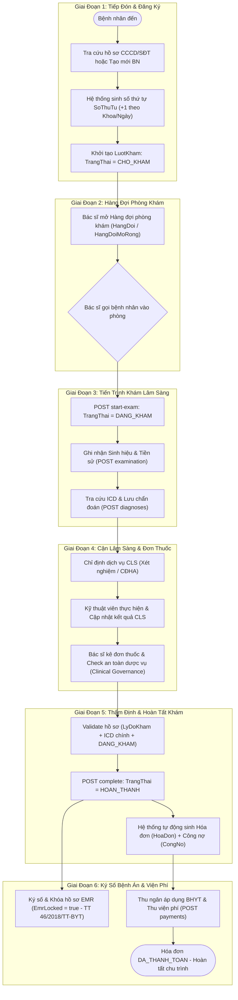
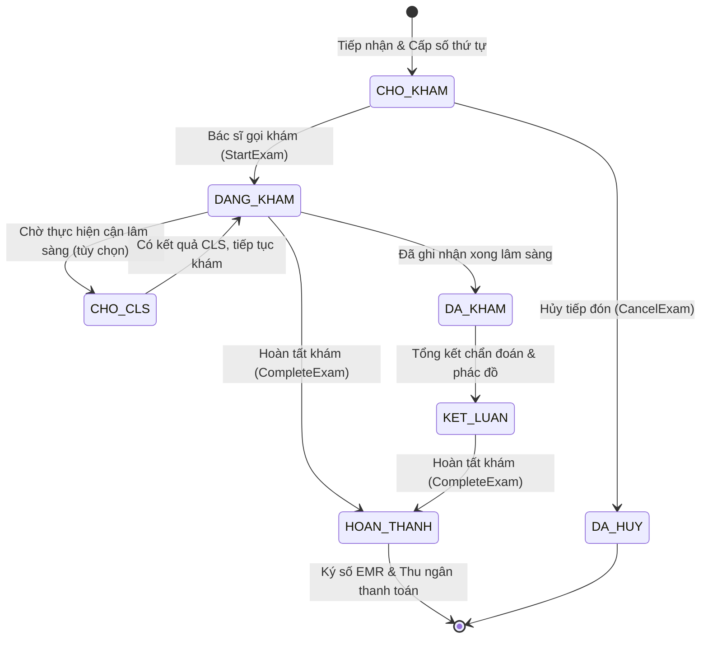

# TÀI LIỆU ĐẶC TẢ FLOW KHÁM CHỮA BỆNH NGOẠI TRÚ (END-TO-END CLINICAL WORKFLOW)

---

## Metadata

| Thuộc tính | Giá trị |
|---|---|
| **Mã tài liệu** | `DOC-CLINICAL-FLOW-E2E` |
| **Tên tài liệu** | Luồng Khám Chữa Bệnh Ngoại Trú & Bệnh Án Điện Tử (EMR) từ Đầu đến Cuối |
| **Phiên bản** | `2.0.0` (Cập nhật sau chuẩn hóa tiếng Việt & EMR Governance) |
| **Ngày cập nhật** | `2026-09-20` |
| **Phạm vi áp dụng** | Phân hệ Khám bệnh, Cận lâm sàng, Dược vụ, Viện phí, Quản trị lâm sàng (HIS/EMR) |
| **Căn cứ pháp lý** | Thông tư 46/2018/TT-BYT (Quy định hồ sơ bệnh án điện tử) & Quyết định 130/QĐ-BYT |

---

## 1. Tổng Quan Kiến Trúc Luồng Khám Chữa Bệnh

Hành trình khám chữa bệnh ngoại trú trong hệ thống `ClinicManagement` được thiết kế theo mô hình kiến trúc hướng miền (**Domain-Driven Design**) và mẫu thiết kế **CQRS (MediatR)**, bảo đảm tính toàn vẹn dữ liệu lâm sàng, kiểm soát quyền truy cập theo phạm vi dữ liệu (**DataScope Engine**) và tuân thủ chặt chẽ các quy định nghiệp vụ y tế.

### Sơ Đồ Tổng Thể Luồng Nghiệp Vụ (End-to-End Flowchart)

---

## 2. Máy Trạng Thái Của Lượt Khám (`TrangThaiLuotKham`)

Vòng đời của thực thể trung tâm `LuotKham` chuyển đổi qua các trạng thái tuần tự được định nghĩa trong `ClinicManagement.Domain.Common.Enums.TrangThaiLuotKham`:

### Bảng Ý Nghĩa Và Quyền Thao Tác Trạng Thái:

| Mã | Enum Value | Ý nghĩa nghiệp vụ | Thao tác cho phép |
|:---:|:---|:---|:---|
| `1` | `CHO_KHAM` | Bệnh nhân đã lấy số, đang chờ ngoài phòng khám | Hủy lượt khám (`CancelExam`), bắt đầu khám (`StartExam`), chuyển bác sĩ (`AssignDoctor`). |
| `2` | `DANG_KHAM` | Bác sĩ đang trực tiếp thăm khám trong buồng bệnh | Nhập sinh hiệu, thêm chẩn đoán, chỉ định CLS, kê đơn thuốc, hoàn tất khám (`CompleteExam`). |
| `3` | `DA_KHAM` | Đã khám xong lâm sàng cơ bản | Chờ bổ sung kết quả cận lâm sàng hoặc chuyển bước kết luận. |
| `4` | `KET_LUAN` | Bác sĩ tổng kết sau khi có đầy đủ kết quả CLS | Nhập kết luận điều trị, hướng dẫn chăm sóc. |
| `5` | `HOAN_THANH` | Đã hoàn tất khám, hóa đơn tự động đã được sinh | Khóa hồ sơ EMR, thu ngân thực hiện thanh toán. **Cấm sửa đổi nội dung lâm sàng.** |
| `6` | `DA_HUY` | Bệnh nhân bỏ khám hoặc nhân viên hủy tiếp nhận | Trạng thái kết thúc, không thể phục hồi lại. |
| `7` | `CHO_CLS` | Tạm dừng chờ bệnh nhân đi làm xét nghiệm/CĐHA | Bệnh nhân di chuyển sang phòng lấy mẫu, phòng chụp chiếu. |

---

## 3. Chi Tiết 10 Bước Vận Hành Trong Luồng Khám

### Bước 1: Tiếp Đón & Đăng Ký Bệnh Nhân (Reception & Registration)
- **Actor:** Điều dưỡng tiếp đón / Nhân viên lễ tân.
- **Thực thi:** `POST /api/BenhNhan` ➔ `TaoBenhNhanCommandHandler.cs`.
- **Nghiệp vụ chi tiết:**
  1. Tiếp nhận giấy tờ tùy thân (CCCD/CMND, thẻ BHYT hoặc số điện thoại).
  2. Tra cứu: Nếu bệnh nhân đã có trong hệ thống, sử dụng hồ sơ cũ; nếu chưa có, tạo bản ghi `BenhNhan` mới kèm thông tin mã định danh nội bộ (`MaBenhNhanNoiBo`).
  3. Ghi nhận tiền sử bệnh lý gia đình, dị ứng thuốc (`TienSuBenh`).
  4. Hệ thống tự động tính số thứ tự:
     $$\text{SoThuTu} = \max(\text{SoThuTu}_{\text{Khoa, Ngày}}) + 1$$
  5. Khởi tạo thực thể `LuotKham`:
     - `TrangThai = TrangThaiLuotKham.CHO_KHAM`
     - `HinhThucDieuTri = HinhThucDieuTri.NGOAI_TRU`
     - `NgayKham = DateTime.UtcNow.Date`
     - Liên kết `MaCoSo`, `MaKhoa`, `MaPhongKham`, `MaBacSi` (nếu bệnh nhân chỉ định hoặc đặt lịch trước).

---

### Bước 2: Quản Lý Hàng Đợi Phòng Khám (Queue & Waiting Room)
- **Actor:** Bác sĩ khám / Điều dưỡng buồng khám.
- **Thực thi:** `GET /api/LuotKham/hang-doi` hoặc `GET /api/LuotKham/hang-doi-list` ➔ `LayHangDoiQueryHandler.cs`.
- **Nghiệp vụ chi tiết:**
  1. Màn hình khám bệnh của bác sĩ tải danh sách bệnh nhân đang chờ theo mã bác sĩ (`MaBacSi`) hoặc theo phòng khám (`MaPhongKham`).
  2. Bộ lọc CSDL loại trừ các lượt khám đã xóa (`!IsDeleted`) và lấy các lượt khám có:
     $$\text{TrangThai} \in \{\text{TrangThaiLuotKham.CHO\_KHAM}, \text{TrangThaiLuotKham.DANG\_KHAM}\}$$
  3. Sắp xếp danh sách theo `SoThuTu` tăng dần để phục vụ theo nguyên tắc đến trước khám trước (FIFO).

---

### Bước 3: Bắt Đầu Phiên Khám (Start Examination)
- **Actor:** Bác sĩ khám.
- **Thực thi:** `POST /api/LuotKham/{id}/start-exam` ➔ `BatDauKhamCommandHandler.cs`.
- **Nghiệp vụ chi tiết:**
  1. Bác sĩ nhấn nút "Bắt đầu khám" cho bệnh nhân được gọi.
  2. **Kiểm tra hợp lệ:**
     - Lượt khám bắt buộc phải đang ở trạng thái `CHO_KHAM`. Nếu đã là `DANG_KHAM`, trả về HTTP 409 Conflict ("Bệnh nhân đang được khám").
  3. Gán quyền phụ trách: `MaBacSi = CurrentUserId` (nếu lượt khám chưa có bác sĩ hoặc do bác sĩ trực tiếp nhận).
  4. Kích hoạt domain method `luotKham.StartExam()`:
     - Đổi `TrangThai = TrangThaiLuotKham.DANG_KHAM`.
     - Lưu mốc thời gian `ThoiGianBatDauKham = DateTime.UtcNow`.

---

### Bước 4: Thăm Khám Lâm Sàng, Ghi Nhận Sinh Hiệu & Tiền Sử (Examination & Vitals)
- **Actor:** Bác sĩ / Điều dưỡng.
- **Thực thi:** 
  - Đọc hồ sơ cũ: `GET /api/LuotKham/benh-nhan/{id}/thong-tin-benh-nhan`, `GET /api/LuotKham/benh-nhan/{id}/ho-so-dieu-tri`
  - Ghi nhận: `POST /api/LuotKham/{id}/examination` ➔ `LuuKetQuaKhamCommandHandler.cs`
- **Nghiệp vụ chi tiết:**
  1. **Lý do khám (`LyDoKham`):** Ghi nhận triệu chứng cơ năng chính khiến bệnh nhân đi khám (bắt buộc trước khi kết thúc ca khám).
  2. **Dấu hiệu sinh tồn (`SinhHieu`):**
     - Huyết áp tâm thu (`HuyetApTamThu`), Huyết áp tâm trương (`HuyetApTamTruong`).
     - Nhịp mạch (`Mach` - lần/phút).
     - Thân nhiệt (`NhietDo` - °C).
     - Chỉ số hô hấp: Độ bão hòa oxy máu (`SpO2` - %).
     - Thể trạng: Chiều cao (`ChieuCao` - cm), Cân nặng (`CanNang` - kg), UI tự động tính chỉ số BMI.
  3. **Tiền sử bệnh (`TienSuBenh`):** Bổ sung các dị ứng mới phát hiện hoặc bệnh lý mãn tính vào hồ sơ bệnh nhân.

---

### Bước 5: Chẩn Đoán Bệnh Theo Mã ICD-10 (Diagnoses)
- **Actor:** Bác sĩ khám.
- **Thực thi:**
  - Tra cứu mã ICD: `GET /api/LuotKham/icd?keyword=...` ➔ `TimKiemICDQueryHandler.cs`
  - Thêm chẩn đoán: `POST /api/LuotKham/{id}/diagnoses` ➔ `TaoChanDoanCommandHandler.cs`
- **Nghiệp vụ chi tiết:**
  1. Bác sĩ tra cứu danh mục ICD-10 tiêu chuẩn Bộ Y tế theo mã hoặc tên bệnh (ví dụ: `I10` - Tăng huyết áp vô căn; `E11` - Đái tháo đường típ 2).
  2. Phân định vai trò chẩn đoán:
     - `LaChanDoanChinh = true`: Chẩn đoán xác định bệnh lý chính.
     - `LaChanDoanChinh = false`: Các chẩn đoán phụ hoặc bệnh lý kèm theo.
  3. *Quy tắc bất biến:* Lượt khám bắt buộc phải có **ít nhất 1 chẩn đoán chính hoặc mã ICD hợp lệ** mới được phép hoàn tất ca khám.

---

### Bước 6: Chỉ Định Cận Lâm Sàng & Cập Nhật Kết Quả (Paraclinical / CLS)
- **Actor:** Bác sĩ khám (chỉ định) ➔ Kỹ thuật viên xét nghiệm/chẩn đoán hình ảnh (thực hiện).
- **Thực thi:**
  - Chỉ định: `POST /api/LuotKham/{luotKhamId}/chi-dinh-dich-vu` ➔ `TaoChiDinhDichVuCommandHandler.cs`
  - Trả kết quả: `PUT /api/LuotKham/{luotKhamId}/chi-dinh-dich-vu/{id}` ➔ `CapNhatChiDinhDichVuCommandHandler.cs`
- **Nghiệp vụ chi tiết:**
  1. Bác sĩ chọn các dịch vụ cần làm từ danh mục `DanhMucDichVu`:
     - Xét nghiệm (Máu, Nước tiểu, Sinh hóa, Huyết học,...).
     - Chẩn đoán hình ảnh (X-Quang, Siêu âm, CT-Scan, MRI, Nội soi,...).
  2. Vòng đời chỉ định (`TrangThaiChiDinhDichVu`):
     $$\text{DaChiDinh} \longrightarrow \text{DangThucHien} \longrightarrow \text{DaCoKetQua} \quad (\text{hoặc } \text{DaHuy})$$
  3. Kỹ thuật viên nhập kết luận (`KetLuan`) và đính kèm đường dẫn kết quả/ảnh chụp (`UrlKetQua` - tích hợp PACS DICOM viewer).
  4. Bác sĩ lâm sàng xem trực tiếp kết quả ngay trên hồ sơ khám bệnh để làm căn cứ điều trị.

---

### Bước 7: Kê Đơn Thuốc & Kiểm Soát An Toàn Dược Vụ (Prescription & Governance)
- **Actor:** Bác sĩ điều trị ➔ Hệ thống kiểm soát lâm sàng (`ClinicalGovernanceService`).
- **Thực thi:** Thực thể `DonThuoc`, `ChiTietDonThuoc` & `ClinicalGovernanceService.CheckDrugInteractionsAsync`.
- **Nghiệp vụ chi tiết:**
  1. Bác sĩ kê đơn thuốc điều trị ngoại trú:
     - Chọn thuốc trong danh mục dược tồn kho.
     - Xác định liều dùng, tần suất (sáng/trưa/chiều/tối), số ngày uống, số lượng cấp và hướng dẫn sử dụng.
  2. **Kiểm tra an toàn tự động (Drug Safety Engine):**
     - **Cảnh báo dị ứng (`CRITICAL`):** Đối soát chéo thành phần hoạt chất (`Ingredient`) của thuốc với tiền sử dị ứng đã lưu của bệnh nhân.
     - **Cảnh báo trùng hoạt chất (`WARNING`):** Phát hiện nếu đơn thuốc có từ 2 loại thuốc cùng một hoạt chất.
  3. Đơn thuốc được tạo ở trạng thái tạm `TrangThaiDonThuoc.TAM` và sẽ được chốt khi hoàn tất lượt khám.

---

### Bước 8: Thẩm Định Hồ Sơ & Hoàn Tất Lượt Khám (Validation & Complete Exam)
- **Actor:** Bác sĩ điều trị / Hệ thống tự động.
- **Thực thi:**
  - Kiểm tra điều kiện: `POST /api/LuotKham/{id}/validate`
  - Hoàn tất: `POST /api/LuotKham/{id}/complete` ➔ `HoanThanhKhamCommandHandler.cs`
- **Nghiệp vụ chi tiết:**
  1. **Thẩm định 3 điều kiện tiên quyết:**
     - Lý do khám (`LyDoKham`) không được rỗng.
     - Lượt khám đang ở trạng thái `DANG_KHAM`.
     - Phải có ít nhất 1 chẩn đoán chính (`LaChanDoanChinh = true` hoặc có mã `MaICD`).
  2. **Đóng phiên khám:**
     - Cập nhật `TrangThai = TrangThaiLuotKham.HOAN_THANH`.
     - Ghi nhận `ThoiGianKetThucKham = DateTime.UtcNow`.
  3. **Tự động sinh Hóa đơn & Công nợ (Automated Invoicing):**
     - Hệ thống tự động khởi tạo thực thể `HoaDon` với mã duy nhất `HD-{yyyyMMddHHmmssfff}`.
     - Tự động quét và gom toàn bộ chi phí phát sinh:
       + Chi phí các dịch vụ Cận lâm sàng hợp lệ (chưa bị hủy) theo bảng giá.
       + Chi phí thuốc kê trong `DonThuoc` ($\text{Số lượng} \times \text{Đơn giá}$).
     - Nếu tổng tiền $> 0$: Khởi tạo bản ghi `CongNoBenhNhan` với hạn thanh toán mặc định 30 ngày (`HanThanhToan = UtcNow + 30 days`), trạng thái `DANG_NO`.

---

### Bước 9: Ký Số & Khóa Hồ Sơ Bệnh Án Điện Tử (EMR Lock - TT 46/2018/TT-BYT)
- **Actor:** Bác sĩ điều trị.
- **Thực thi:** `POST /api/LuotKham/{id}/emr/lock` ➔ `ClinicalGovernanceService.LockEmrAsync`.
- **Nghiệp vụ chi tiết:**
  1. Bác sĩ xác nhận đóng dấu hồ sơ bệnh án điện tử.
  2. Hệ thống sinh mã băm chữ ký điện tử:
     $$\text{Signature} = \text{SIG\_}\{\text{Timestamp}\}\_\{\text{UserId}\}\_\{\text{LuotKhamId}\}$$
  3. Cập nhật các trường đóng băng trên `LuotKham`:
     - `EmrLocked = true`
     - `EmrSignature = signature`
     - `EmrLockedAt = DateTime.UtcNow`
     - `EmrLockedBy = CurrentUserId`
  4. **Tính bất biến (Immutability):** Khi `EmrLocked = true`, toàn bộ các hàm nghiệp vụ `AddChanDoan`, `AddSinhHieu`, `AddChiDinhDichVu`, `CompleteExam` sẽ ném ngoại lệ `InvalidOperationException` để ngăn ngừa mọi hành vi gian lận hồ sơ y khoa.
  5. Tự động ghi vết bất biến vào bảng `EmrAuditLog` với hành động `SIGN`.

---

### Bước 10: Viện Phí & Thanh Toán Thu Ngân (Billing & Settlement)
- **Actor:** Nhân viên thu ngân / Bệnh nhân.
- **Thực thi:** `ClinicManagement.API/Controllers/BillingController.cs`.
- **Nghiệp vụ chi tiết:**
  1. Bệnh nhân di chuyển đến quầy viện phí.
  2. Thu ngân tra cứu hóa đơn tự động của lượt khám: `GET /api/billing/invoices/by-visit/{visitId}`.
  3. Áp dụng quyền lợi bảo hiểm y tế: `POST /api/billing/invoices/{id}/insurance` (`ApDungBaoHiemHoaDonCommand`):
     - Hệ thống phân tách số tiền BHYT chi trả và phần bệnh nhân đồng chi trả.
  4. Ghi nhận thanh toán: `POST /api/billing/invoices/{id}/payments` (`ThanhToanHoaDonCommand`):
     - Hỗ trợ các phương thức: Tiền mặt (`TIEN_MAT`), Chuyển khoản (`CHUYEN_KHOAN`), Thẻ (`THE`).
     - Hóa đơn chuyển trạng thái sang `DA_THANH_TOAN`.
     - Tự động trừ nợ trong bảng `CongNoBenhNhan`.
  5. In phiếu thu viện phí giao cho bệnh nhân. Kết thúc trọn vẹn chu trình điều trị ngoại trú.

---

## 4. Bảng Tham Chiếu Kỹ Thuật (Code Mapping Reference)

### 4.1. Domain Entities & Aggregate Roots

| Thực thể | File nguồn | Vai trò trong luồng |
|---|---|---|
| `LuotKham` | `ClinicManagement.Domain/Examination/LuotKham/LuotKham.cs` | **Aggregate Root trung tâm** quản lý vòng đời phiên khám |
| `BenhNhan` | `ClinicManagement.Domain/Patient/BenhNhan.cs` | Hồ sơ hành chính, mã BN nội bộ và tiền sử bệnh |
| `SinhHieu` | `ClinicManagement.Domain/Examination/SinhHieu.cs` | Dấu hiệu sinh tồn đo được tại buồng khám |
| `ChanDoan` | `ClinicManagement.Domain/Examination/ChanDoan.cs` | Chẩn đoán mã bệnh ICD-10 chính và phụ |
| `ChiDinhDichVu` | `ClinicManagement.Domain/Service/ChiDinhDichVu.cs` | Dịch vụ cận lâm sàng (xét nghiệm, CĐHA) |
| `DonThuoc` | `ClinicManagement.Domain/Prescription/DonThuoc/DonThuoc.cs` | Đơn thuốc điều trị ngoại trú |
| `HoaDon` | `ClinicManagement.Domain/Billing/HoaDon.cs` | Hóa đơn viện phí tự động phát sinh |
| `CongNoBenhNhan` | `ClinicManagement.Domain/Billing/CongNoBenhNhan.cs` | Theo dõi nợ viện phí bệnh nhân (30 ngày) |
| `EmrAuditLog` | `ClinicManagement.Domain/System/EmrAuditLog.cs` | Nhật ký kiểm toán pháp lý theo Thông tư 46 |

### 4.2. Controllers & API Endpoints

| Endpoint | Method | Controller | Mô tả nghiệp vụ |
|---|:---:|---|---|
| `/api/BenhNhan` | `POST` | `BenhNhanController` | Tạo bệnh nhân mới & tự động tạo `LuotKham` |
| `/api/LuotKham/hang-doi` | `GET` | `LuotKhamController` (HangDoi) | Lấy danh sách hàng đợi chờ khám của bác sĩ |
| `/api/LuotKham/hang-doi-list` | `GET` | `LuotKhamController` (HangDoi) | Lấy hàng đợi mở rộng không phân trang cho UI |
| `/api/LuotKham/{id}/start-exam` | `POST` | `LuotKhamController` (StartExam) | Bắt đầu ca khám (`CHO_KHAM` ➔ `DANG_KHAM`) |
| `/api/LuotKham/{id}/examination` | `POST` | `LuotKhamController` (MedicalRecord) | Lưu lý do khám, sinh hiệu, tiền sử bệnh |
| `/api/LuotKham/icd` | `GET` | `LuotKhamController` (ChanDoan) | Tìm kiếm danh mục mã bệnh ICD-10 |
| `/api/LuotKham/{id}/diagnoses` | `POST` | `LuotKhamController` (ChanDoan) | Thêm chẩn đoán chính/phụ cho lượt khám |
| `/api/LuotKham/{id}/chi-dinh-dich-vu` | `POST` | `LuotKhamController` (ChiDinhDichVu) | Chỉ định xét nghiệm, chẩn đoán hình ảnh |
| `/api/LuotKham/{id}/validate` | `POST` | `LuotKhamController` | Thẩm định các điều kiện tiên quyết hoàn tất |
| `/api/LuotKham/{id}/complete` | `POST` | `LuotKhamController` | Hoàn tất khám, tự động sinh Hóa đơn & Công nợ |
| `/api/LuotKham/{id}/emr/lock` | `POST` | `LuotKhamController` | Ký số và khóa vĩnh viễn hồ sơ EMR |
| `/api/billing/invoices/by-visit/{id}` | `GET` | `BillingController` | Lấy hóa đơn viện phí theo mã lượt khám |
| `/api/billing/invoices/{id}/insurance` | `POST` | `BillingController` | Áp dụng tỷ lệ thanh toán BHYT |
| `/api/billing/invoices/{id}/payments` | `POST` | `BillingController` | Thu ngân ghi nhận thanh toán tiền viện phí |

---

## 5. Các Ràng Buộc Nghiệp Vụ Cốt Lõi (Invariants & Governance Rules)

1. **Ràng buộc trạng thái bắt đầu (`StartExam`):**
   - Chỉ cho phép bắt đầu khám khi lượt khám đang ở trạng thái `CHO_KHAM`. Nếu đã là `DANG_KHAM`, hệ thống chặn với mã lỗi HTTP 409 tránh xung đột nhiều bác sĩ cùng mở một bệnh nhân.
2. **Ràng buộc hoàn tất ca khám (`CompleteExam`):**
   - Lượt khám phải đang ở trạng thái `DANG_KHAM`.
   - Bắt buộc phải có lý do khám bệnh (`LyDoKham`).
   - Bắt buộc phải có ít nhất một chẩn đoán chính (`LaChanDoanChinh = true`) hoặc mã ICD-10 hợp lệ.
3. **Bất biến sau khi khóa EMR (`EmrLocked`):**
   - Sau khi ký số đóng hồ sơ, toàn bộ các hàm thêm chẩn đoán, sửa sinh hiệu, thêm chỉ định dịch vụ đều bị vô hiệu hóa (`throw InvalidOperationException`).
4. **Tự động hóa phát sinh viện phí:**
   - Bác sĩ không cần tạo hóa đơn thủ công. Khi gọi `POST complete`, hệ thống tự động bóc tách toàn bộ dịch vụ cận lâm sàng và tiền thuốc để sinh `HoaDon` cùng bản ghi `CongNoBenhNhan`.
