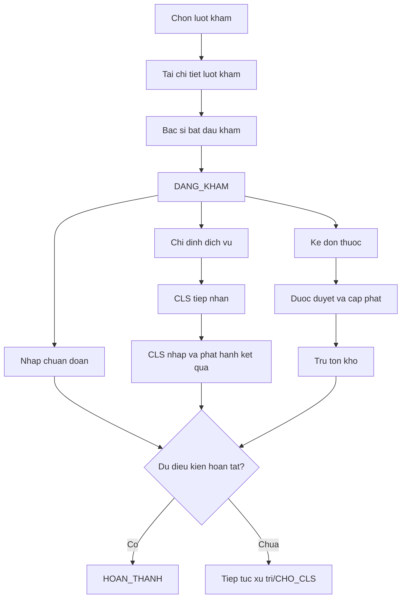

# Tab Xu tri - Mo ta nghiep vu

## 1. Muc tieu

Tab Xu tri la noi bac si ra quyet dinh dieu tri sau khi da thu thap ly do kham, sinh hieu va tien su. Tab gom bon nhom chinh:

1. chuan doan;
2. chi dinh dich vu/can lam sang;
3. ket qua xet nghiem;
4. don thuoc;
5. hoan tat luot kham.

## 2. Quy trinh nghiep vu



## 3. Chuan doan

### Du lieu

- ma ICD;
- ten chuan doan;
- chuan doan chinh/phu;
- ghi chu;
- nguoi tao va thoi diem tao.

### API can co

```text
GET    /api/ICD?keyword=
POST   /api/LuotKham/{id}/diagnoses
PUT    /api/LuotKham/{id}/diagnoses/{diagnosisId}
DELETE /api/LuotKham/{id}/diagnoses/{diagnosisId}
```

### Quy tac

- ICD phai ton tai va dang hoat dong.
- Khong trung ma ICD trong mot luot.
- Moi luot toi da mot chuan doan chinh.
- Khong sua/xoa khi luot da hoan tat, tru khi co quyen dac biet.

## 4. Chi dinh dich vu va xet nghiem

### Du lieu

- danh muc dich vu;
- so luong;
- loai dich vu;
- bac si chi dinh;
- nguoi thuc hien;
- trang thai;
- ket luan va chi tiet ket qua.

### API can co

```text
GET    /api/DanhMucDichVu
POST   /api/LuotKham/{id}/service-orders
DELETE /api/LuotKham/{id}/service-orders/{orderId}
POST   /api/service-orders/{id}/receive
POST   /api/service-orders/{id}/result
```

### Trang thai de xuat

```text
DA_CHI_DINH -> DA_TIEP_NHAN -> CHO_KET_QUA -> DA_CO_KET_QUA
                                      \-> DA_HUY
```

Khong cho xoa chi dinh sau khi da tiep nhan. Ket qua phai do bo phan CLS ghi va phat hanh; DoctorUI chu yeu doc ket qua da phat hanh.

## 5. Don thuoc

### Du lieu

- thuoc/item;
- so luong;
- lieu dung;
- tan suat;
- so ngay;
- duong dung;
- ghi chu;
- gia do server cung cap;
- trang thai don.

### API can co

```text
GET  /api/Items/medicines?keyword=
POST /api/LuotKham/{id}/prescriptions
PUT  /api/DonThuoc/{id}
POST /api/DonThuoc/{id}/approve
POST /api/DonThuoc/{id}/cancel
POST /api/DonThuoc/{id}/dispense
```

### Trang thai

```text
TAM -> DA_DUYET -> DA_XUAT_HET
  \-> HUY
```

Cap phat phai gom kiem tra ton, tru ton, tang so luong da xuat, tao phieu xuat va doi trang thai trong cung transaction. Can kiem tra di ung va tuong tac thuoc truoc khi duyet.

## 6. Hoan tat luot kham

API can co:

```text
POST /api/LuotKham/{id}/complete
POST /api/LuotKham/{id}/cancel
```

Dieu kien can kiem tra:

- luot dang `DANG_KHAM`;
- bac si co quyen tren luot;
- da co chuan doan chinh;
- thong tin kham da duoc luu;
- chi dinh va don thuoc dang o trang thai hop le;
- chinh sach co cho phep con CLS dang xu ly hay khong.

## 7. Hien trang UI

`TreatmentWorkspace.tsx` hien dang dung model `ExamDetail` va du lieu mock tu `useExam.ts`. Cac nut them, xoa, luu va hoan tat chua noi day du voi API. Truoc khi mo rong UI, can go mock va map `LuotKhamDetailDto` thanh mot view model duy nhat.

## 8. Kiem tra nghiep vu bat buoc

- Khong cho bac si thao tac tren luot cua bac si khac.
- Khong cho ghi sau khi luot da hoan tat/huy.
- Khong cho tao hai chuan doan chinh.
- Khong cho xoa dich vu da tiep nhan.
- Khong cho duyet don rong.
- Khong cho cap phat vuot ton.
- Ghi audit cho thay doi chuan doan, chi dinh, don thuoc va hoan tat.
