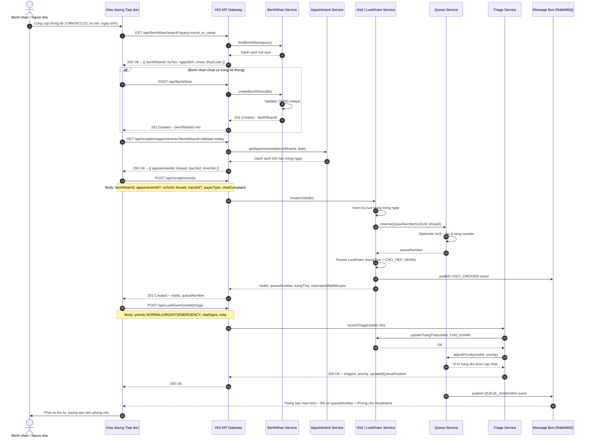

# 01 · FLOW TIẾP ĐÓN VÀ PHÂN LUỒNG BỆNH NHÂN

---

## Metadata

| Trường            | Giá trị                                                            |
|-------------------|--------------------------------------------------------------------|
| **Mã flow**       | FL-001                                                             |
| **Tên flow**      | Tiếp đón và Phân luồng Bệnh nhân                                   |
| **Phiên bản**     | 1.0.0                                                              |
| **Ngày tạo**      | 2026-09-15                                                         |
| **Cập nhật lần cuối** | 2026-09-15                                                     |
| **Tác giả**       | Technical Lead – Clinic Management System                          |
| **Module**        | Reception & Triage                                                 |
| **Trạng thái**    | `DRAFT`                                                            |
| **Liên quan**     | FL-002 (Khám bệnh), FL-003 (Thanh toán), FL-005 (Lịch hẹn)        |

---

## 1. Mô tả tổng quan

Flow **Tiếp đón và Phân luồng** là điểm khởi đầu của toàn bộ hành trình bệnh nhân (patient journey) trong hệ thống HIS. Quy trình bao gồm:

1. Tìm kiếm / đăng ký thông tin bệnh nhân.
2. Kiểm tra lịch hẹn đã đặt trước (nếu có).
3. Tạo lượt khám (visit) và gán số thứ tự hàng đợi.
4. Điều dưỡng/bác sĩ triage thực hiện phân loại ưu tiên.
5. Chuyển bệnh nhân vào phòng chờ theo khoa/phòng phù hợp.

---

## 2. Actors tham gia

| Actor                       | Vai trò                                                                 | Hệ thống tương tác          |
|-----------------------------|-------------------------------------------------------------------------|------------------------------|
| **Bệnh nhân / Người nhà**   | Cung cấp thông tin nhận dạng, mô tả triệu chứng                        | Màn hình kiosk / quầy tiếp đón |
| **Điều dưỡng Tiếp đón**     | Tìm kiếm, tạo mới BN; tạo lượt khám; cấp số thứ tự                    | HIS Web Client (Reception)   |
| **Bác sĩ Triage**           | Đánh giá dấu hiệu sinh tồn, phân loại mức độ ưu tiên                  | HIS Web Client (Triage)      |
| **Hệ thống Hàng đợi**       | Tự động cấp số thứ tự, phân phối BN vào phòng chờ                     | Queue Service (internal)     |
| **Billing / Thu ngân**      | Xác nhận thông tin thanh toán (payerType: CASH / BHYT / CORPORATE)     | HIS Web Client (Billing)     |

---

## 3. Pre-conditions

- Điều dưỡng tiếp đón đã đăng nhập và có quyền `ROLE_RECEPTION`.
- Cơ sở y tế (`coSoId`) và ít nhất một khoa (`khoaId`) đang hoạt động trong hệ thống.
- Dịch vụ hàng đợi (Queue Service) đang chạy và kết nối Redis/DB không bị gián đoạn.
- Đồng hồ hệ thống được đồng bộ NTP (quan trọng cho timestamp lượt khám).

---

## 4. Post-conditions

- Hệ thống tạo thành công bản ghi `LuotKham` với `trangThai = CHO_KHAM`.
- Bệnh nhân được cấp số thứ tự (`queueNumber`) duy nhất trong ngày tại cơ sở.
- Bản ghi triage (`TriageRecord`) được lưu kèm `priority` và `vitalSigns`.
- Nếu có lịch hẹn, bản ghi `Appointment` chuyển sang trạng thái `CHECKED_IN`.
- Sự kiện `VISIT_CREATED` được publish lên message bus để các module khác (Billing, Pharmacy) chuẩn bị.

---

## 5. Sơ đồ trình tự (Sequence Diagram)



---

## 6. Chi tiết API

### 6.1 `GET /api/BenhNhan/search` – Tìm kiếm bệnh nhân

| Thuộc tính   | Giá trị                          |
|--------------|----------------------------------|
| **Method**   | `GET`                            |
| **Auth**     | Bearer JWT – `ROLE_RECEPTION`    |
| **Mô tả**    | Tìm kiếm bệnh nhân theo CMND/CCCD, họ tên, hoặc số điện thoại. Full-text search có hỗ trợ diacritics (không dấu). |

**Query Parameters:**

| Param     | Kiểu     | Bắt buộc | Mô tả                                                    |
|-----------|----------|----------|----------------------------------------------------------|
| `query`   | `string` | ✅       | Từ khóa tìm kiếm (min 3 ký tự)                          |
| `coSoId`  | `uuid`   | ❌       | Lọc theo cơ sở; nếu bỏ qua sẽ tìm toàn hệ thống        |
| `page`    | `int`    | ❌       | Trang hiện tại (default: 0)                              |
| `size`    | `int`    | ❌       | Số bản ghi mỗi trang (default: 20, max: 100)            |

**Response `200 OK`:**

```json
{
  "data": [
    {
      "benhNhanId": "bn-uuid-001",
      "hoTen": "Nguyen Van An",
      "ngaySinh": "1985-03-12",
      "gioiTinh": "NAM",
      "cmnd": "012345678901",
      "soDienThoai": "0901234567",
      "bhytCode": "DN4011002345678",
      "diaChi": "123 Le Loi, Q.1, TP.HCM"
    }
  ],
  "total": 1,
  "page": 0,
  "size": 20
}
```

---

### 6.2 `POST /api/BenhNhan` – Tạo bệnh nhân mới

| Thuộc tính   | Giá trị                          |
|--------------|----------------------------------|
| **Method**   | `POST`                           |
| **Auth**     | Bearer JWT – `ROLE_RECEPTION`    |
| **Mô tả**    | Tạo hồ sơ bệnh nhân mới trong hệ thống. |

**Request Body:**

```json
{
  "hoTen": "Tran Thi Binh",
  "ngaySinh": "1990-07-25",
  "gioiTinh": "NU",
  "cmnd": "079090012345",
  "soDienThoai": "0912345678",
  "email": "binh.tran@example.com",
  "bhytCode": "GD4011009876543",
  "bhytExpiry": "2027-12-31",
  "diaChi": "456 Nguyen Trai, Q.5, TP.HCM",
  "nguoiLienLac": {
    "hoTen": "Tran Van C",
    "quanHe": "Chong",
    "soDienThoai": "0987654321"
  }
}
```

**Response `201 Created`:**

```json
{
  "benhNhanId": "bn-uuid-002",
  "hoTen": "Tran Thi Binh",
  "cmnd": "079090012345",
  "createdAt": "2026-09-15T10:30:00+07:00"
}
```

**Lỗi có thể trả về:**

| HTTP Code | Mô tả                                              |
|-----------|----------------------------------------------------|
| `400`     | Dữ liệu đầu vào không hợp lệ                      |
| `409`     | CMND/CCCD đã tồn tại trong hệ thống               |

---

### 6.3 `GET /api/reception/appointments` – Kiểm tra lịch hẹn *(API MỚI)*

| Thuộc tính   | Giá trị                                      |
|--------------|----------------------------------------------|
| **Method**   | `GET`                                        |
| **Auth**     | Bearer JWT – `ROLE_RECEPTION`                |
| **Mô tả**    | Lấy danh sách lịch hẹn của bệnh nhân trong ngày, lọc theo trạng thái `CONFIRMED`. |

**Query Parameters:**

| Param          | Kiểu     | Bắt buộc | Mô tả                                         |
|----------------|----------|----------|-----------------------------------------------|
| `benhNhanId`   | `uuid`   | ✅       | ID bệnh nhân                                  |
| `date`         | `date`   | ✅       | Ngày kiểm tra (ISO 8601: `YYYY-MM-DD`)        |
| `coSoId`       | `uuid`   | ❌       | Lọc theo cơ sở y tế                           |

**Response `200 OK`:**

```json
{
  "data": [
    {
      "appointmentId": "appt-uuid-001",
      "benhNhanId": "bn-uuid-001",
      "khoaId": "khoa-uuid-noi",
      "khoaName": "Khoa Noi",
      "bacSiId": "bs-uuid-001",
      "bacSiName": "BS. Le Minh Duc",
      "timeSlot": "2026-09-15T09:00:00+07:00",
      "trangThai": "CONFIRMED",
      "ghiChu": "Tai kham sau 1 thang"
    }
  ]
}
```

---

### 6.4 `POST /api/reception/visits` – Tạo lượt khám *(API MỚI)*

| Thuộc tính   | Giá trị                                      |
|--------------|----------------------------------------------|
| **Method**   | `POST`                                       |
| **Auth**     | Bearer JWT – `ROLE_RECEPTION`                |
| **Mô tả**    | Tạo lượt khám mới, gán số thứ tự hàng đợi, khởi tạo trạng thái `CHO_TIEP_NHAN`. |

**Request Body:**

```json
{
  "benhNhanId": "bn-uuid-001",
  "appointmentId": "appt-uuid-001",
  "coSoId": "cs-uuid-001",
  "khoaId": "khoa-uuid-noi",
  "bacSiId": "bs-uuid-001",
  "payerType": "BHYT",
  "chiefComplaint": "Dau nguc, kho tho khi gang suc trong 3 ngay gan day"
}
```

> **Ghi chú field:**
> - `appointmentId`: Tùy chọn. Nếu có, hệ thống sẽ liên kết lượt khám với lịch hẹn và chuyển appointment sang `CHECKED_IN`.
> - `bacSiId`: Tùy chọn. Nếu không chỉ định, hệ thống tự phân công bác sĩ theo thuật toán round-robin.
> - `payerType`: Enum `CASH | BHYT | CORPORATE | INSURANCE_OTHER`.

**Response `201 Created`:**

```json
{
  "visitId": "visit-uuid-001",
  "queueNumber": 42,
  "trangThai": "CHO_TIEP_NHAN",
  "estimatedWaitMinutes": 25,
  "khoaName": "Khoa Noi",
  "bacSiName": "BS. Le Minh Duc",
  "createdAt": "2026-09-15T10:35:00+07:00"
}
```

**Lỗi có thể trả về:**

| HTTP Code | Mô tả                                                                                 |
|-----------|---------------------------------------------------------------------------------------|
| `400`     | Thiếu trường bắt buộc hoặc `khoaId` không thuộc `coSoId`                             |
| `404`     | `benhNhanId`, `coSoId`, hoặc `khoaId` không tồn tại                                  |
| `409`     | Deadlock khi cấp số thứ tự – hệ thống tự retry tối đa 3 lần trước khi trả lỗi       |
| `422`     | Bệnh nhân đã có lượt khám đang hoạt động tại cùng khoa trong ngày                   |

---

### 6.5 `POST /api/LuotKham/{id}/triage` – Phân loại triage *(API MỚI)*

| Thuộc tính     | Giá trị                                      |
|----------------|----------------------------------------------|
| **Method**     | `POST`                                       |
| **Auth**       | Bearer JWT – `ROLE_TRIAGE` hoặc `ROLE_NURSE` |
| **Path Param** | `id` – UUID của lượt khám                    |
| **Mô tả**      | Ghi nhận kết quả triage, cập nhật mức độ ưu tiên, điều chỉnh vị trí hàng đợi. |

**Request Body:**

```json
{
  "priority": "URGENT",
  "vitalSigns": {
    "huyetAp": "140/90",
    "nhipTim": 98,
    "nhietDo": 37.8,
    "spO2": 96,
    "nhipTho": 20,
    "canNang": 65.5
  },
  "note": "Benh nhan kho tho, dau nguc trai, tien su THA va DTD type 2"
}
```

> **Priority Enum:**
> - `NORMAL` – Không khẩn cấp, xếp hàng bình thường.
> - `URGENT` – Khẩn, ưu tiên trước các ca NORMAL.
> - `EMERGENCY` – Cấp cứu, chuyển ngay, bỏ qua hàng đợi.

**Response `200 OK`:**

```json
{
  "triageId": "triage-uuid-001",
  "visitId": "visit-uuid-001",
  "priority": "URGENT",
  "updatedQueuePosition": 3,
  "estimatedWaitMinutes": 8,
  "recordedAt": "2026-09-15T10:38:00+07:00",
  "recordedBy": "dd-uuid-001"
}
```

**Lỗi có thể trả về:**

| HTTP Code | Mô tả                                                            |
|-----------|------------------------------------------------------------------|
| `400`     | `priority` không hợp lệ hoặc `vitalSigns` thiếu trường bắt buộc |
| `404`     | `visitId` không tồn tại                                          |
| `409`     | Lượt khám đã được triage trước đó (idempotent check)            |
| `422`     | Lượt khám không ở trạng thái hợp lệ để triage                   |

---

### 6.6 `POST /api/LuotKham/{id}/cancel` – Hủy lượt khám *(API MỚI)*

| Thuộc tính     | Giá trị                                         |
|----------------|-------------------------------------------------|
| **Method**     | `POST`                                          |
| **Auth**       | Bearer JWT – `ROLE_RECEPTION` hoặc `ROLE_ADMIN` |
| **Path Param** | `id` – UUID của lượt khám                       |
| **Mô tả**      | Hủy lượt khám, giải phóng số thứ tự trong hàng đợi. |

**Request Body:**

```json
{
  "reason": "Benh nhan tu y roi khoi phong cho truoc khi duoc goi"
}
```

**Response `200 OK`:**

```json
{
  "visitId": "visit-uuid-001",
  "trangThai": "HUY",
  "cancelledAt": "2026-09-15T11:00:00+07:00",
  "cancelledBy": "dd-uuid-001"
}
```

**Lỗi có thể trả về:**

| HTTP Code | Mô tả                                                                     |
|-----------|---------------------------------------------------------------------------|
| `400`     | Lượt khám không ở trạng thái có thể hủy (`DANG_KHAM` hoặc `HOAN_THANH`) |
| `404`     | `visitId` không tồn tại                                                   |

---

## 7. Validation Rules

### 7.1 Bệnh nhân (BenhNhan)

| Field          | Rule                                                                                      |
|----------------|-------------------------------------------------------------------------------------------|
| `hoTen`        | Bắt buộc. Tối thiểu 2 ký tự, tối đa 100 ký tự. Không chứa ký tự đặc biệt.              |
| `ngaySinh`     | Bắt buộc. Định dạng `YYYY-MM-DD`. Không được là ngày trong tương lai. Tuổi tối đa 150.  |
| `gioiTinh`     | Bắt buộc. Enum: `NAM`, `NU`, `KHAC`.                                                     |
| `cmnd`         | Bắt buộc. **Unique toàn hệ thống**. Chỉ chứa số, độ dài 9 hoặc 12 ký tự (CMND/CCCD).   |
| `soDienThoai`  | Tùy chọn. Regex: `^(0|84)[0-9]{8,9}$`. Unique theo `coSoId`.                            |
| `bhytCode`     | Tùy chọn. Regex BHYT chuẩn bộ Y tế: `^[A-Z]{2}[0-9]{13}$`. Validate checksum.          |
| `bhytExpiry`   | Bắt buộc nếu có `bhytCode`. Phải sau ngày hiện tại.                                     |

### 7.2 Lượt khám (LuotKham)

| Field            | Rule                                                                               |
|------------------|------------------------------------------------------------------------------------|
| `benhNhanId`     | Bắt buộc. Phải tồn tại trong DB.                                                  |
| `coSoId`         | Bắt buộc. Phải tồn tại và đang hoạt động (`trangThai = ACTIVE`).                 |
| `khoaId`         | Bắt buộc. Phải thuộc `coSoId` và đang mở cửa trong giờ làm việc.                |
| `payerType`      | Bắt buộc. Enum: `CASH`, `BHYT`, `CORPORATE`, `INSURANCE_OTHER`.                  |
| `chiefComplaint` | Bắt buộc. Tối thiểu 10 ký tự, tối đa 500 ký tự.                                 |

### 7.3 State Machine – Trạng thái lượt khám

```
                +-------------------+
   [Tao moi]   |   CHO_TIEP_NHAN   |---- Huy ----------------------------------+
   ----------->|   (Reception)     |                                           |
                +--------+----------+                                           |
                         |                                                      |
                         | Triage hoan tat                                      v
                         v                                           +----------+------+
                +-------------------+                               |      HUY        |
                |    CHO_KHAM       |---- Huy ----------------------|   (Cancelled)   |
                |  (Waiting Room)   |                               +-----------------+
                +--------+----------+
                         |
                         | Bac si goi vao
                         v
                +-------------------+
                |    DANG_KHAM      |
                |   (In Progress)   |
                +--------+----------+
                         |
                         | Ket thuc kham
                         v
                +-------------------+
                |    HOAN_THANH     |
                |   (Completed)     |
                +-------------------+
```

**Bảng chuyển trạng thái hợp lệ:**

| Trạng thái hiện tại | Chuyển sang   | Điều kiện                              | Actor                   |
|---------------------|---------------|----------------------------------------|-------------------------|
| `CHO_TIEP_NHAN`     | `CHO_KHAM`    | Triage được ghi nhận thành công        | Điều dưỡng / Bác sĩ    |
| `CHO_TIEP_NHAN`     | `HUY`         | Bệnh nhân rời đi hoặc yêu cầu hủy     | Điều dưỡng / Admin      |
| `CHO_KHAM`          | `DANG_KHAM`   | Bác sĩ bắt đầu khám (gọi vào phòng)   | Bác sĩ                  |
| `CHO_KHAM`          | `HUY`         | Bệnh nhân không có mặt sau 3 lần gọi  | Điều dưỡng / Admin      |
| `DANG_KHAM`         | `HOAN_THANH`  | Bác sĩ hoàn tất ghi bệnh án           | Bác sĩ                  |
| `HOAN_THANH`        | *(kết thúc)*  | Trạng thái cuối, không thể chuyển     | –                       |
| `HUY`               | *(kết thúc)*  | Trạng thái cuối, không thể chuyển     | –                       |

> **Lưu ý quan trọng:** Mọi yêu cầu chuyển trạng thái không theo bảng trên sẽ bị từ chối với `HTTP 400 Bad Request` và mã lỗi `INVALID_STATE_TRANSITION`.

---

## 8. Xử lý ngoại lệ (Exception Handling)

### 8.1 Bệnh nhân trùng lặp (Duplicate Patient)

- **Điều kiện kích hoạt:** `POST /api/BenhNhan` với `cmnd` đã tồn tại trong DB.
- **HTTP Response:** `409 Conflict`
- **Body:**
  ```json
  {
    "errorCode": "DUPLICATE_PATIENT",
    "message": "Benh nhan voi CMND/CCCD 012345678901 da ton tai trong he thong.",
    "existingBenhNhanId": "bn-uuid-existing"
  }
  ```
- **Xử lý phía client:** Hiển thị dialog xác nhận, cho phép điều dưỡng chọn "Dùng hồ sơ có sẵn" thay vì tạo mới.

### 8.2 Lượt khám trùng (Duplicate Visit) – HTTP 422

- **Điều kiện kích hoạt:** Bệnh nhân đã có lượt khám đang hoạt động (`CHO_TIEP_NHAN` hoặc `CHO_KHAM`) tại cùng khoa trong cùng ngày.
- **HTTP Response:** `422 Unprocessable Entity`
- **Body:**
  ```json
  {
    "errorCode": "DUPLICATE_VISIT",
    "message": "Benh nhan da co luot kham dang hoat dong tai khoa hom nay.",
    "existingVisitId": "visit-uuid-existing",
    "existingQueueNumber": 15
  }
  ```

### 8.3 Deadlock khi cấp số thứ tự (Queue Deadlock) – Retry 3x

- **Điều kiện kích hoạt:** Xung đột optimistic lock khi nhiều request đồng thời tăng counter hàng đợi.
- **Chiến lược:** Retry tự động tối đa **3 lần** với exponential backoff:
  - Lần 1: chờ 100ms
  - Lần 2: chờ 200ms
  - Lần 3: chờ 400ms
- **Nếu vẫn thất bại:** Trả về `HTTP 409 Conflict` với mã `QUEUE_DEADLOCK`.
- **Body:**
  ```json
  {
    "errorCode": "QUEUE_DEADLOCK",
    "message": "He thong hang doi dang ban, vui long thu lai sau vai giay.",
    "retryAfterMs": 1000
  }
  ```

### 8.4 Hủy lượt không đúng trạng thái – HTTP 400

- **Điều kiện kích hoạt:** `POST /api/LuotKham/{id}/cancel` khi lượt đang `DANG_KHAM` hoặc `HOAN_THANH`.
- **HTTP Response:** `400 Bad Request`
- **Body:**
  ```json
  {
    "errorCode": "INVALID_STATE_TRANSITION",
    "message": "Khong the huy luot kham o trang thai DANG_KHAM.",
    "currentTrangThai": "DANG_KHAM",
    "allowedStates": ["CHO_TIEP_NHAN", "CHO_KHAM"]
  }
  ```

### 8.5 Appointment không hợp lệ

- **Điều kiện kích hoạt:** `appointmentId` được truyền vào nhưng `trangThai != CONFIRMED`.
- **HTTP Response:** `422 Unprocessable Entity`
- **Body:**
  ```json
  {
    "errorCode": "APPOINTMENT_NOT_CONFIRMED",
    "message": "Lich hen chua duoc xac nhan hoac da duoc check-in truoc do.",
    "appointmentTrangThai": "CANCELLED"
  }
  ```

---

## 9. Transaction & Concurrency

### 9.1 Transaction Boundaries

Khi tạo lượt khám (`POST /api/reception/visits`), hệ thống thực hiện trong một **database transaction duy nhất**:

1. Kiểm tra lượt trùng (`SELECT FOR UPDATE SKIP LOCKED`).
2. Insert bản ghi `LuotKham`.
3. Tăng `queueCounter` cho `(coSoId, khoaId, date)` bằng **optimistic locking** (field `version`).
4. Nếu có `appointmentId`: cập nhật `Appointment.trangThai = CHECKED_IN`.
5. Commit transaction.
6. Publish event `VISIT_CREATED` lên RabbitMQ (**ngoài transaction** – best effort, có dead-letter queue).

> **Lưu ý:** Bước 6 nằm ngoài DB transaction để tránh giữ lock quá lâu. Nếu publish thất bại, event sẽ được retry qua **Outbox Pattern** (bảng `OutboxEvent`).

### 9.2 Optimistic Locking trên Queue Numbering

Bảng `QueueCounter`:

```sql
CREATE TABLE queue_counter (
    co_so_id    UUID        NOT NULL,
    khoa_id     UUID        NOT NULL,
    ngay        DATE        NOT NULL,
    counter     INT         NOT NULL DEFAULT 0,
    version     BIGINT      NOT NULL DEFAULT 0,   -- optimistic lock field
    PRIMARY KEY (co_so_id, khoa_id, ngay)
);
```

**Logic cấp số (Application Layer):**

```sql
-- 1. Đọc bản ghi hiện tại
SELECT counter, version
  FROM queue_counter
 WHERE co_so_id = :coSoId
   AND khoa_id  = :khoaId
   AND ngay     = :today;

-- 2. Tăng counter với optimistic lock
UPDATE queue_counter
   SET counter = counter + 1,
       version = version + 1
 WHERE co_so_id = :coSoId
   AND khoa_id  = :khoaId
   AND ngay     = :today
   AND version  = :versionVuaDoc;
-- affected_rows = 0 → xung đột → throw OptimisticLockException → retry
```

**Retry policy:**
- Tối đa **3 lần**.
- Backoff: `100ms × 2^(attempt - 1)` (exponential).
- Tất cả retry thất bại → `QueueDeadlockException` → HTTP `409`.

### 9.3 Idempotency

- `POST /api/reception/visits` hỗ trợ header `Idempotency-Key: <uuid>`.
  - Nếu cùng key được gửi lại trong vòng **24 giờ**: trả về response của request gốc mà không tạo lượt mới.
  - Key được lưu trong Redis với TTL 24 giờ.
- `POST /api/LuotKham/{id}/triage` tự động idempotent theo `visitId`:
  - Nếu triage đã tồn tại → trả về `409` kèm dữ liệu triage cũ.

---

## 10. Ghi chú triển khai

- **Queue Service** nên được deploy với ít nhất **2 replicas** để đảm bảo HA. Sử dụng Redis Cluster làm backend phụ trợ cho real-time queue state.
- **Màn hình hàng đợi** (waiting room display) subscribe WebSocket channel `queue.{coSoId}.{khoaId}` để nhận cập nhật real-time khi có BN mới hoặc khi thứ tự thay đổi do EMERGENCY.
- **Audit log:** Mọi thay đổi trạng thái lượt khám phải được ghi vào bảng `LuotKhamAudit` bao gồm: `fromTrangThai`, `toTrangThai`, `changedBy`, `changedAt`, `reason`.
- **Timeout cảnh báo:** Nếu BN ở trạng thái `CHO_TIEP_NHAN` quá **60 phút** mà không được triage, hệ thống tự động gửi cảnh báo cho điều dưỡng trưởng qua notification service.
- **EMERGENCY fast-path:** Khi triage ghi `priority = EMERGENCY`, hệ thống bỏ qua hàng đợi thông thường và gửi ngay cảnh báo tới phòng cấp cứu qua WebSocket `alert.emergency.{coSoId}`.

---

*Tài liệu được tạo bởi HIS Technical Documentation System – v1.0.0*
*Ngày tạo: 2026-09-15 | Cập nhật: 2026-09-15*
