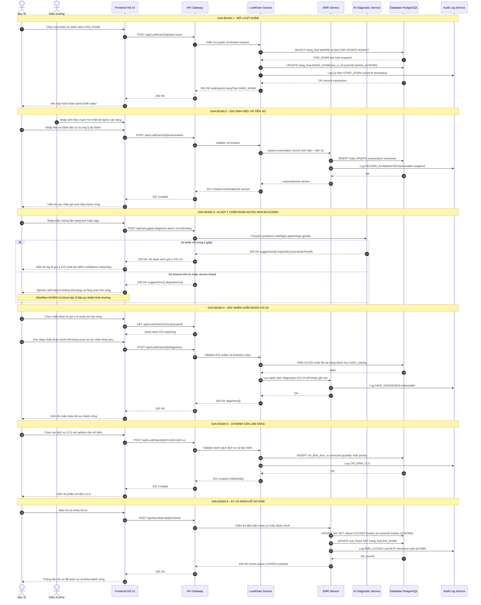

# 02. Flow Khám Bệnh và EMR (Electronic Medical Record)

## Metadata

| Trường            | Giá trị                                           |
|-------------------|---------------------------------------------------|
| **Mã flow**       | FLOW-02                                           |
| **Tên flow**      | Khám Bệnh và Hồ Sơ Bệnh Án Điện Tử (EMR)         |
| **Module**        | Khám Bệnh / EMR                                   |
| **Phiên bản**     | 1.2.0                                             |
| **Ngày tạo**      | 2026-09-15                                        |
| **Ngày cập nhật** | 2026-09-15                                        |
| **Tác giả**       | Technical Lead – HIS Team                         |
| **Trạng thái**    | Draft → Review                                    |
| **Liên kết**      | FLOW-01 (Tiếp nhận), FLOW-03 (CLS), FLOW-05 (Kê đơn) |

---

## 1. Mục Tiêu Nghiệp Vụ

Flow này mô tả toàn bộ quy trình bác sĩ thực hiện khám bệnh, ghi nhận hồ sơ bệnh án điện tử (EMR),
tích hợp AI gợi ý chẩn đoán, chỉ định cận lâm sàng và ký khóa hồ sơ. Đây là flow trung tâm của hệ
thống HIS, yêu cầu tính toàn vẹn dữ liệu cao, hỗ trợ audit trail đầy đủ và khả năng phục hồi khi
dịch vụ AI không khả dụng.

---

## 2. Actor Tham Gia

| Actor                     | Vai trò                                                                  |
|---------------------------|--------------------------------------------------------------------------|
| **Bác sĩ**                | Thực hiện khám, nhập thông tin lâm sàng, xác nhận chẩn đoán, ký hồ sơ  |
| **Điều dưỡng**            | Đo và ghi nhận sinh hiệu (mạch, huyết áp, nhiệt độ, SpO2, cân nặng)    |
| **AI Diagnostic Service** | Dịch vụ gợi ý chẩn đoán ICD-10 dựa trên triệu chứng và sinh hiệu       |
| **Bệnh nhân**             | Đối tượng khám bệnh, cung cấp triệu chứng và tiền sử                   |
| **HIS Backend**           | Xử lý nghiệp vụ, quản lý trạng thái lượt khám, lưu trữ EMR             |

---

## 3. Pre-conditions

- Lượt khám (LuotKham) đã được tạo và có trạng thái **`CHO_KHAM`** (từ Flow-01 Tiếp nhận).
- Bác sĩ đã được phân công vào phòng khám tương ứng với lượt khám.
- Bác sĩ đã đăng nhập, có JWT token hợp lệ với claim `role = DOCTOR`.
- Danh mục ICD-10 đã được đồng bộ và có hiệu lực trong hệ thống.
- Điều dưỡng đã hoàn thành đo sinh hiệu (tùy chọn, có thể bỏ qua nếu bác sĩ tự nhập).

## 4. Post-conditions

- Lượt khám chuyển sang trạng thái **`DA_KHAM`**.
- EMR được tạo đầy đủ: sinh hiệu, tiền sử, chẩn đoán ICD-10, chỉ định CLS.
- EMR được ký khóa (**`LOCKED`**) – không thể chỉnh sửa trừ có quyền đặc biệt.
- Audit trail được ghi đầy đủ cho mỗi thao tác (user, IP, timestamp, before/after).
- Nếu có chỉ định CLS, thông tin được chuyển tiếp sang Flow-03.
- Nếu có kê đơn, thông tin được chuyển tiếp sang Flow-05.

---

## 5. Sequence Diagram



---

## 6. Chi Tiết API

### 6.1. POST `/api/LuotKham/{id}/start-exam`

**Mục đích:** Bắt đầu lượt khám, chuyển trạng thái `CHO_KHAM` → `DANG_KHAM` (atomic).

**Authorization:** `Bearer {JWT}` – role `DOCTOR`

**Path param:**

| Param | Kiểu  | Mô tả        |
|-------|-------|--------------|
| `id`  | `int` | ID lượt khám |

**Response 200 OK:**

```json
{
  "luotKhamId": 1234,
  "trangThai": "DANG_KHAM",
  "bacSiId": 56,
  "startedAt": "2026-09-15T08:30:00+07:00"
}
```

**Lỗi:**

| HTTP Code | Error Code            | Mô tả                                    |
|-----------|-----------------------|------------------------------------------|
| 404       | `LUOT_KHAM_NOT_FOUND` | Không tìm thấy lượt khám                 |
| 409       | `INVALID_STATE`       | Lượt khám không ở trạng thái `CHO_KHAM`  |
| 403       | `FORBIDDEN`           | Bác sĩ không được phân công              |

> **[IMPORTANT]** Thao tác này phải dùng `SELECT … FOR UPDATE NOWAIT` để tránh race condition khi
> nhiều bác sĩ cùng mở lượt khám. Nếu row đang bị lock bởi session khác, trả về 409 ngay lập tức.

---

### 6.2. POST `/api/LuotKham/{id}/examination`

**Mục đích:** Ghi nhận sinh hiệu và tiền sử bệnh nhân.

**Request Body:**

```json
{
  "vitalSigns": {
    "pulse": 78,
    "bloodPressureSystolic": 120,
    "bloodPressureDiastolic": 80,
    "temperature": 36.8,
    "spo2": 98,
    "weight": 65.0,
    "height": 170.0,
    "respiratoryRate": 18
  },
  "medicalHistory": {
    "chiefComplaint": "Đau đầu, sổ mũi 3 ngày",
    "historyOfPresentIllness": "Bệnh nhân đau đầu âm ỉ, kèm sổ mũi...",
    "pastMedicalHistory": "Tiền sử tăng huyết áp",
    "allergies": ["Penicillin"],
    "currentMedications": ["Amlodipine 5mg"]
  },
  "symptoms": ["Đau đầu", "Sổ mũi", "Sốt nhẹ"]
}
```

**Response 201 Created:**

```json
{
  "examinationId": 9876,
  "luotKhamId": 1234,
  "version": 1,
  "createdAt": "2026-09-15T08:35:00+07:00"
}
```

---

### 6.3. GET `/api/LuotKham/{id}/examination`

**Mục đích:** Lấy thông tin sinh hiệu và tiền sử đã ghi của lượt khám.

**Response 200 OK:** Trả về toàn bộ object examination tương tự request body 6.2 kèm metadata
(`examinationId`, `version`, `createdAt`, `updatedAt`).

---

### 6.4. POST `/api/LuotKham/{id}/diagnoses`

**Mục đích:** Lưu danh sách chẩn đoán ICD-10 cho lượt khám.

**Request Body:**

```json
{
  "diagnoses": [
    {
      "icdCode": "J00",
      "icdName": "Viêm mũi họng cấp tính",
      "isPrimary": true,
      "note": "Chẩn đoán chính"
    },
    {
      "icdCode": "I10",
      "icdName": "Tăng huyết áp nguyên phát",
      "isPrimary": false,
      "note": "Bệnh kèm theo"
    }
  ]
}
```

**Response 200 OK:**

```json
{
  "luotKhamId": 1234,
  "diagnoses": [
    { "id": 1, "icdCode": "J00", "isPrimary": true },
    { "id": 2, "icdCode": "I10", "isPrimary": false }
  ],
  "savedAt": "2026-09-15T08:45:00+07:00"
}
```

---

### 6.5. GET `/api/LuotKham/icd?q={keyword}`

**Mục đích:** Tìm kiếm mã ICD-10 theo từ khóa (code hoặc tên bệnh).

**Query params:**

| Param   | Kiểu     | Mô tả                                    |
|---------|----------|------------------------------------------|
| `q`     | `string` | Từ khóa tìm kiếm (tối thiểu 2 ký tự)    |
| `limit` | `int`    | Số kết quả trả về (default: 10, max: 50) |

**Response 200 OK:**

```json
{
  "results": [
    { "code": "J00", "name": "Viêm mũi họng cấp tính", "category": "J00-J06" },
    { "code": "J06", "name": "Nhiễm trùng đường hô hấp trên cấp tính", "category": "J00-J06" }
  ],
  "total": 2,
  "query": "viêm mũi"
}
```

---

### 6.6. POST `/api/ai/suggest-diagnosis` ⭐ API MỚI

**Mục đích:** Gọi AI Diagnostic Service để nhận gợi ý chẩn đoán ICD-10 dựa trên triệu chứng lâm sàng.

**Authorization:** Internal service token (`X-Internal-Token`)

**Request Body:**

```json
{
  "symptoms": ["Đau đầu", "Sổ mũi", "Sốt nhẹ 37.8°C", "Đau họng"],
  "vitalSigns": {
    "temperature": 37.8,
    "pulse": 88,
    "bloodPressureSystolic": 118,
    "bloodPressureDiastolic": 75,
    "spo2": 97
  },
  "patientAge": 35,
  "gender": "MALE",
  "contextHistory": "Tiền sử dị ứng Penicillin, tăng huyết áp",
  "luotKhamId": 1234
}
```

**Response 200 OK – AI khả dụng:**

```json
{
  "suggestions": [
    {
      "icdCode": "J00",
      "icdName": "Viêm mũi họng cấp tính",
      "confidence": 0.87,
      "reasoning": "Triệu chứng sổ mũi, đau họng và sốt nhẹ phù hợp với viêm mũi họng cấp"
    },
    {
      "icdCode": "J06.9",
      "icdName": "Nhiễm trùng đường hô hấp trên cấp tính, không xác định",
      "confidence": 0.72,
      "reasoning": "Sốt và đau đầu kèm triệu chứng hô hấp trên"
    },
    {
      "icdCode": "J11.1",
      "icdName": "Cúm với các biểu hiện hô hấp khác",
      "confidence": 0.55,
      "reasoning": "Cần loại trừ cúm nếu có tiếp xúc dịch tễ"
    }
  ],
  "requestId": "ai-req-20260915-abcd1234",
  "processingTimeMs": 1240,
  "modelVersion": "diag-v2.1.0",
  "degraded": false
}
```

**Response 200 OK – AI timeout / service down:**

```json
{
  "suggestions": [],
  "requestId": null,
  "processingTimeMs": 5000,
  "degraded": true,
  "message": "AI Diagnostic Service không khả dụng. Vui lòng chọn chẩn đoán thủ công."
}
```

> **[WARNING] Timeout policy:** API Gateway đặt hard timeout **5 giây** cho AI Service. Nếu vượt
> quá, trả về `degraded: true`. Workflow khám bệnh **KHÔNG bị block**. AI chỉ là công cụ hỗ trợ.

---

### 6.7. POST `/api/LuotKham/{id}/chi-dinh-dich-vu`

**Mục đích:** Tạo chỉ định cận lâm sàng / dịch vụ cho lượt khám.

**Request Body:**

```json
{
  "chiDinhList": [
    {
      "serviceId": 201,
      "serviceName": "Công thức máu toàn phần (CBC)",
      "quantity": 1,
      "note": "Cần kết quả trong ngày",
      "priority": "NORMAL"
    },
    {
      "serviceId": 305,
      "serviceName": "X-Quang phổi thẳng",
      "quantity": 1,
      "note": "",
      "priority": "URGENT"
    }
  ],
  "diagnoseRef": "J00"
}
```

**Response 201 Created:**

```json
{
  "luotKhamId": 1234,
  "chiDinhIds": [4501, 4502],
  "totalServices": 2,
  "createdAt": "2026-09-15T09:00:00+07:00"
}
```

---

### 6.8. POST `/api/luot-kham/{id}/emr/lock` ⭐ API MỚI

**Mục đích:** Ký và khóa hồ sơ EMR. Sau khi khóa, EMR không thể chỉnh sửa theo đường thông thường.

**Authorization:** `Bearer {JWT}` – role `DOCTOR`, phải là bác sĩ phụ trách lượt khám.

**Response 200 OK:**

```json
{
  "emrId": "EMR-2026-001234",
  "luotKhamId": 1234,
  "status": "LOCKED",
  "lockedBy": {
    "userId": 56,
    "fullName": "BS. Nguyễn Văn An",
    "licenseNumber": "012345"
  },
  "lockedAt": "2026-09-15T09:15:00+07:00",
  "checksum": "sha256:abc123def456..."
}
```

**Điều kiện khóa (Pre-lock validation):**

- Phải có ít nhất 1 chẩn đoán với `isPrimary = true`.
- Lượt khám phải đang ở trạng thái `DANG_KHAM`.
- Bác sĩ ký phải là bác sĩ được giao cho lượt khám đó.

**Lỗi:**

| HTTP Code | Error Code             | Mô tả                                 |
|-----------|------------------------|---------------------------------------|
| 409       | `EMR_ALREADY_LOCKED`   | EMR đã bị khóa trước đó               |
| 422       | `NO_PRIMARY_DIAGNOSIS` | Chưa có chẩn đoán chính               |
| 403       | `FORBIDDEN`            | Bác sĩ không có quyền khóa EMR này    |

---

### 6.9. GET `/api/luot-kham/{id}/emr/audit` ⭐ API MỚI

**Mục đích:** Lấy lịch sử audit trail đầy đủ của EMR theo từng lượt khám.

**Authorization:** `Bearer {JWT}` – role `DOCTOR`, `MANAGER`, `AUDITOR`

**Response 200 OK:**

```json
{
  "emrId": "EMR-2026-001234",
  "auditLogs": [
    {
      "logId": "aud-001",
      "action": "START_EXAM",
      "userId": 56,
      "userFullName": "BS. Nguyễn Văn An",
      "ipAddress": "192.168.1.100",
      "timestamp": "2026-09-15T08:30:00+07:00",
      "before": null,
      "after": { "trangThai": "DANG_KHAM" }
    },
    {
      "logId": "aud-002",
      "action": "SAVE_DIAGNOSES",
      "userId": 56,
      "userFullName": "BS. Nguyễn Văn An",
      "ipAddress": "192.168.1.100",
      "timestamp": "2026-09-15T08:45:00+07:00",
      "before": { "diagnoses": [] },
      "after": { "diagnoses": [{ "icdCode": "J00", "isPrimary": true }] }
    },
    {
      "logId": "aud-003",
      "action": "EMR_LOCKED",
      "userId": 56,
      "userFullName": "BS. Nguyễn Văn An",
      "ipAddress": "192.168.1.100",
      "timestamp": "2026-09-15T09:15:00+07:00",
      "before": { "status": "DRAFT" },
      "after": { "status": "LOCKED", "checksum": "sha256:abc123..." }
    }
  ],
  "totalEntries": 3
}
```

---

## 7. Validation Rules

### 7.1. Chẩn đoán ICD-10

| Rule | Mô tả | HTTP Lỗi |
|------|-------|----------|
| **Duy nhất chẩn đoán chính** | Trong 1 lượt khám, chỉ được phép có đúng 1 chẩn đoán với `isPrimary = true` | `400 MULTIPLE_PRIMARY_DIAGNOSIS` |
| **ICD code hợp lệ** | Mã ICD phải tồn tại trong bảng `icd10_catalog` với `isActive = true` | `400 INVALID_ICD_CODE` |
| **Bắt buộc chẩn đoán chính khi khóa** | Không thể khóa EMR nếu chưa có chẩn đoán chính | `422 NO_PRIMARY_DIAGNOSIS` |
| **Không trùng mã** | Không được nhập 2 dòng chẩn đoán cùng mã ICD trong 1 lượt khám | `400 DUPLICATE_ICD_CODE` |

### 7.2. EMR Lifecycle

| Rule | Mô tả |
|------|-------|
| **Không sửa EMR đã khóa** | Mọi request PUT/PATCH lên EMR đã `LOCKED` đều trả về `409 EMR_ALREADY_LOCKED` |
| **Quyền chỉnh sửa đặc biệt** | Role `SUPER_ADMIN` hoặc `MEDICAL_RECORD_MANAGER` có thể mở khóa tạm thời với lý do ghi rõ và audit log bắt buộc |
| **Chỉ bác sĩ phụ trách** | Chỉ bác sĩ được giao (`bacSiId`) mới có thể ký khóa EMR của lượt khám đó |

### 7.3. AI Diagnostic Service

| Rule | Mô tả |
|------|-------|
| **Timeout 5 giây** | Nếu AI không phản hồi trong 5s, trả về `degraded: true`, `suggestions: []` |
| **Không block workflow** | AI timeout/lỗi không được phép dừng luồng khám bệnh chính |
| **Không bắt buộc dùng gợi ý** | Bác sĩ có thể bỏ qua toàn bộ gợi ý AI và chọn ICD-10 thủ công |
| **Ghi log AI usage** | Mọi lần gọi AI đều được log lại (requestId, các mã ICD đã được chọn từ suggestions) |

---

## 8. Xử Lý Ngoại Lệ

| Tình huống | Phản hồi hệ thống | HTTP Code | Hành động UI |
|------------|-------------------|-----------|---------------|
| EMR đã bị khóa, bác sĩ cố chỉnh sửa | `{ "error": "EMR_ALREADY_LOCKED" }` | 409 | Toast error, disable toàn bộ form |
| Mã ICD không tồn tại | `{ "error": "INVALID_ICD_CODE", "message": "Mã ICD J999 không tồn tại" }` | 400 | Highlight field ICD, thông báo inline |
| AI Service down hoàn toàn | `{ "suggestions": [], "degraded": true }` | 200 | Banner cảnh báo, cho phép nhập thủ công |
| Race condition start-exam | `{ "error": "INVALID_STATE", "message": "Lượt khám đã được bác sĩ khác mở" }` | 409 | Reload danh sách, thông báo conflict |
| Lượt khám không tìm thấy | `{ "error": "LUOT_KHAM_NOT_FOUND" }` | 404 | Redirect về trang danh sách |
| Bác sĩ không có quyền | `{ "error": "FORBIDDEN" }` | 403 | Thông báo lỗi quyền, ghi log cảnh báo |
| Thiếu chẩn đoán chính khi khóa | `{ "error": "NO_PRIMARY_DIAGNOSIS" }` | 422 | Scroll đến section chẩn đoán, highlight |

---

## 9. EMR Versioning & Audit Trail

### 9.1. Nguyên Tắc Append-Only

Hệ thống EMR áp dụng mô hình **append-only log** cho mọi thay đổi. Không có record nào bị DELETE
vật lý; mọi thay đổi đều tạo version mới và ghi vào audit log.

**Schema bảng `emr_audit_log`:**

```sql
CREATE TABLE emr_audit_log (
    log_id          UUID          PRIMARY KEY DEFAULT gen_random_uuid(),
    emr_id          VARCHAR(50)   NOT NULL REFERENCES emr(emr_id),
    luot_kham_id    INT           NOT NULL REFERENCES luot_kham(id),
    action          VARCHAR(50)   NOT NULL,
    -- Enum: START_EXAM | RECORD_VITAL | SAVE_DIAGNOSES | CHI_DINH_CLS
    --       | EMR_LOCKED | EMR_UNLOCKED
    user_id         INT           NOT NULL REFERENCES users(id),
    user_full_name  VARCHAR(200)  NOT NULL,   -- snapshot tại thời điểm log
    ip_address      VARCHAR(45)   NOT NULL,
    timestamp       TIMESTAMPTZ   NOT NULL DEFAULT NOW(),
    before_data     JSONB,                    -- NULL nếu là lần đầu tạo
    after_data      JSONB         NOT NULL,   -- snapshot sau khi thay đổi
    checksum        VARCHAR(70)   NOT NULL    -- SHA-256(after_data) để detect tampering
);

CREATE INDEX idx_audit_emr_id    ON emr_audit_log(emr_id);
CREATE INDEX idx_audit_luotkham  ON emr_audit_log(luot_kham_id);
CREATE INDEX idx_audit_timestamp ON emr_audit_log(timestamp DESC);
```

### 9.2. EMR Version Table

```sql
CREATE TABLE emr_versions (
    version_id       BIGSERIAL     PRIMARY KEY,
    emr_id           VARCHAR(50)   NOT NULL REFERENCES emr(emr_id),
    version_number   INT           NOT NULL,
    content_snapshot JSONB         NOT NULL,  -- toàn bộ nội dung EMR tại version này
    created_by       INT           NOT NULL REFERENCES users(id),
    created_at       TIMESTAMPTZ   NOT NULL DEFAULT NOW(),
    change_reason    TEXT,                    -- bắt buộc nếu chỉnh sửa sau LOCKED
    UNIQUE (emr_id, version_number)
);
```

### 9.3. Checksum Verification

- Khi khóa EMR, hệ thống tính `SHA-256(canonical_json(emr_full_content))` (keys sorted).
- Checksum lưu vào `emr.checksum` và `emr_audit_log.checksum`.
- API `GET /api/luot-kham/{id}/emr/verify-integrity` tính lại và so sánh checksum bất kỳ lúc nào.

> **[CAUTION]** Audit log **phải được ghi trước khi commit transaction chính**. Nếu ghi audit log
> thất bại, toàn bộ transaction phải rollback để không có thay đổi nào thiếu dấu vết kiểm toán.

---

## 10. Transaction & State Machine

### 10.1. State Machine Lượt Khám

```
[TIEP_NHAN] ──► [CHO_KHAM] ──► [DANG_KHAM] ──► [DA_KHAM]
                  (Flow-01)    (start-exam)    (emr/lock)
```

| Transition                   | Điều kiện                                     | API                |
|------------------------------|-----------------------------------------------|--------------------|
| `TIEP_NHAN` → `CHO_KHAM`     | Tiếp nhận hoàn thành (Flow-01)                | (Flow-01)          |
| `CHO_KHAM` → `DANG_KHAM`     | Bác sĩ mở khám, SELECT FOR UPDATE NOWAIT     | `POST /start-exam` |
| `DANG_KHAM` → `DA_KHAM`      | Bác sĩ ký khóa EMR, có chẩn đoán chính       | `POST /emr/lock`   |

### 10.2. Atomic State Transition – start-exam

```sql
-- Đảm bảo atomic, tránh race condition
BEGIN;

  -- Lấy lock ngay lập tức, fail nếu bị lock bởi session khác
  SELECT id, trang_thai, bac_si_id
  FROM luot_kham
  WHERE id = :luotKhamId
  FOR UPDATE NOWAIT;

  -- Nếu trang_thai != 'CHO_KHAM' → RAISE EXCEPTION 'INVALID_STATE'
  -- Nếu phân công bac_si_id không khớp → RAISE EXCEPTION 'FORBIDDEN'

  UPDATE luot_kham
  SET trang_thai = 'DANG_KHAM',
      bac_si_id  = :bacSiId,
      started_at = NOW()
  WHERE id       = :luotKhamId
    AND trang_thai = 'CHO_KHAM';  -- double-check trong UPDATE

  -- Ghi audit log TRƯỚC khi commit
  INSERT INTO emr_audit_log
    (action, luot_kham_id, user_id, ip_address, before_data, after_data, checksum)
  VALUES
    ('START_EXAM', :luotKhamId, :userId, :ipAddress,
     '{"trangThai": "CHO_KHAM"}',
     '{"trangThai": "DANG_KHAM"}',
     sha256('{"trangThai": "DANG_KHAM"}'));

COMMIT;
```

### 10.3. Idempotency Policy

| API                       | Idempotent? | Hành vi khi gọi lại                               |
|---------------------------|-------------|---------------------------------------------------|
| `POST /start-exam`        | Có          | Cùng bác sĩ → 200 với data hiện tại              |
| `POST /examination`       | Có          | Upsert – ghi đè, version tăng dần                |
| `POST /diagnoses`         | Có          | Replace toàn bộ danh sách diagnoses              |
| `POST /emr/lock`          | Không       | Đã LOCKED → 409, client phải xử lý               |
| `POST /chi-dinh-dich-vu`  | Không       | Tạo mới, không merge – client kiểm tra trước     |

---

## 11. Non-Functional Requirements

| NFR                | Yêu cầu                                                                   |
|--------------------|---------------------------------------------------------------------------|
| **Performance**    | `start-exam` < 200ms p95; `suggest-diagnosis` < 5s hard timeout          |
| **Availability**   | Core khám bệnh 99.9% uptime. AI Service degraded không ảnh hưởng SLA     |
| **Security**       | JWT bắt buộc mọi API; EMR encrypted at rest AES-256; TLS 1.3             |
| **Audit**          | 100% actions phải có audit log; lưu tối thiểu **10 năm** per Bộ Y tế    |
| **Concurrency**    | Hỗ trợ tối thiểu 200 bác sĩ đồng thời ghi EMR, không deadlock            |
| **Data Integrity** | SHA-256 checksum cho mọi EMR đã khóa, kiểm tra định kỳ mỗi 24 giờ       |

---

## 12. Circuit Breaker – AI Diagnostic Service

AI Diagnostic Service được bảo vệ bởi pattern **Circuit Breaker** với 3 trạng thái:

```
CLOSED (bình thường) ──[≥5 timeout/60s]──► OPEN (reject ngay)
     ▲                                          │
     │                                     [sau 60s]
     │                                          ▼
     └─────[thành công]───── HALF-OPEN (thử 1 request)
                                  │
                             [thất bại]
                                  │
                                  ▼
                               OPEN (reset timer)
```

| Trạng thái    | Hành vi                                                           |
|---------------|-------------------------------------------------------------------|
| **CLOSED**    | Gọi AI bình thường, timeout cứng 5 giây                           |
| **OPEN**      | Trả về `degraded: true` ngay lập tức, KHÔNG gọi AI thực sự       |
| **HALF-OPEN** | Cho phép 1 request thử nghiệm, đánh giá để chuyển sang CLOSED    |

---

## 13. Ghi Chú Triển Khai

- **AI Service:** Deploy như microservice độc lập, giao tiếp qua internal HTTP. Không expose public.
- **Database:** PostgreSQL 15+, dùng `JSONB` cho `before_data`/`after_data` hỗ trợ query linh hoạt.
- **Caching ICD-10:** ~15.000 mã ICD-10 cache Redis TTL 24h, invalidate thủ công khi cập nhật danh mục.
- **EMR ID format:** `EMR-{YYYY}-{luotKhamId zero-padded 6 chữ số}`, ví dụ `EMR-2026-001234`.
- **Canonical JSON:** Keys sorted theo alphabet trước khi tính SHA-256 để đảm bảo checksum deterministic.
- **Optimistic Locking:** Examination record dùng `version` field; client gửi `version` hiện tại;
  server trả `409 CONFLICT` nếu không khớp, tránh concurrent write giữa điều dưỡng và bác sĩ.

---

*Tài liệu được tạo bởi HIS Technical Lead Team – Phiên bản 1.2.0 – Cập nhật: 2026-09-15*
