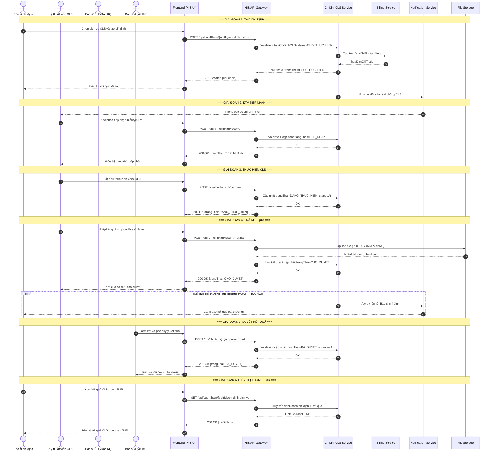
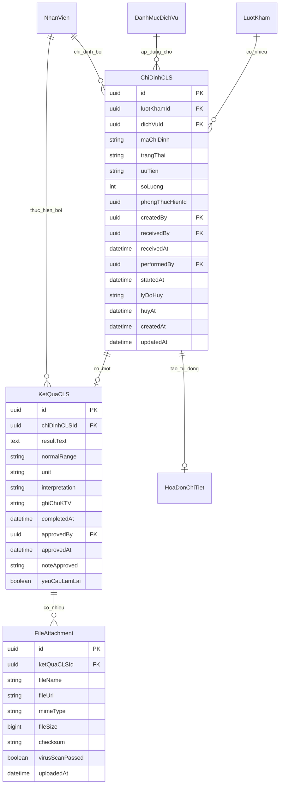

# 03 - FLOW CÀN LÂM SÀNG (CLS)

> **Tài liệu:** Mô tả nghiệp vụ Cận Lâm Sàng trong HIS  
> **Phiên bản:** 1.0.0  
> **Ngày tạo:** 2026-09-15  
> **Tác giả:** Technical Lead  
> **Trạng thái:** Draft  

---

## 1. TỔNG QUAN

Flow Cận Lâm Sàng (CLS) mô tả toàn bộ vòng đời của một chỉ định xét nghiệm (XN) hoặc chẩn đoán hình ảnh (CĐHA) trong hệ thống HIS — từ khi bác sĩ tạo chỉ định, kỹ thuật viên tiếp nhận và thực hiện, đến khi trả kết quả, duyệt kết quả và hiển thị trong hồ sơ bệnh án điện tử (EMR). Flow này tích hợp chặt chẽ với module **Hóa đơn** (Billing) để tự động ghi nhận chi phí dịch vụ.

### 1.1 Phạm vi áp dụng

| Loại CLS         | Mô tả                                               |
|------------------|-----------------------------------------------------|
| Xét nghiệm (XN)  | Máu, nước tiểu, vi sinh, sinh hóa, huyết học, …    |
| Chẩn đoán hình ảnh (CĐHA) | X-Quang, siêu âm, CT-Scan, MRI, nội soi, …  |
| Thăm dò chức năng | Điện tim, đo phế dung, đo thính lực, …            |

---

## 2. ACTOR THAM GIA

| STT | Actor                        | Vai trò                                                                 |
|-----|------------------------------|-------------------------------------------------------------------------|
| 1   | **Bác sĩ chỉ định**          | Khởi tạo chỉ định CLS trong lượt khám; duyệt kết quả sau khi có trả về |
| 2   | **Kỹ thuật viên CLS**        | Tiếp nhận mẫu/yêu cầu; thực hiện XN/CĐHA; nhập/upload kết quả         |
| 3   | **Bác sĩ CLS / Đọc kết quả** | Đọc kết quả (tùy quy trình bệnh viện), nhập nhận xét chuyên sâu        |
| 4   | **Bác sĩ duyệt kết quả**     | Xác nhận/phê duyệt kết quả trước khi cập nhật vào EMR                  |
| 5   | **Hệ thống HIS**             | Orchestrate workflow, gửi notification, cập nhật billing tự động        |

---

## 3. PRE-CONDITIONS & POST-CONDITIONS

### 3.1 Pre-conditions

- Bệnh nhân đã được tiếp nhận và có `luotKhamId` hợp lệ.
- Bác sĩ đã đăng nhập, có vai trò `DOCTOR` và quyền `CHI_DINH_CLS`.
- Dịch vụ CLS tồn tại trong danh mục (`DanhMucDichVu`) với `loaiDichVu = XET_NGHIEM | CDHA | THAM_DO`.
- Bảng giá dịch vụ (`BangGia`) còn hiệu lực tại thời điểm chỉ định.
- Lượt khám ở trạng thái `DANG_KHAM` hoặc `CHO_KIEM_TRA`.

### 3.2 Post-conditions

- Chỉ định CLS được lưu với trạng thái ban đầu `CHO_THUC_HIEN`.
- Dòng hóa đơn (`HoaDonChiTiet`) được tạo tự động với `trangThai = CHO_THANH_TOAN`.
- Kết quả CLS sau duyệt hiển thị trong tab **Kết quả CLS** của EMR.
- Notification được đẩy tới kỹ thuật viên phòng CLS tương ứng.
- Nếu kết quả bất thường (`interpretation = BAT_THUONG`), alert được gửi tới bác sĩ chỉ định.

---

## 4. STATE MACHINE - TRẠNG THÁI CLS

```
CHO_THUC_HIEN ──► TIEP_NHAN ──► DANG_THUC_HIEN ──► CHO_DUYET ──► DA_DUYET
      │                │                │                │
      └────────────────┴────────────────┴────────────────┴──────► HUY
```

| Trạng thái        | Mã                  | Mô tả                                                          |
|-------------------|---------------------|----------------------------------------------------------------|
| Chờ thực hiện     | `CHO_THUC_HIEN`     | Chỉ định vừa tạo, chờ kỹ thuật viên tiếp nhận                |
| Tiếp nhận         | `TIEP_NHAN`         | Kỹ thuật viên đã xác nhận nhận mẫu/yêu cầu                   |
| Đang thực hiện    | `DANG_THUC_HIEN`    | Đang chạy XN/chụp CĐHA                                        |
| Chờ duyệt         | `CHO_DUYET`         | Kết quả đã nhập, chờ bác sĩ phê duyệt                        |
| Đã duyệt          | `DA_DUYET`          | Kết quả chính thức, hiển thị trong EMR                        |
| Hủy               | `HUY`               | Chỉ định bị hủy (bất kỳ giai đoạn nào trước `DA_DUYET`)      |

### 4.1 Quy tắc chuyển trạng thái

| Từ trạng thái    | Sang trạng thái   | Điều kiện                                          | Người thực hiện       |
|------------------|-------------------|----------------------------------------------------|-----------------------|
| `CHO_THUC_HIEN`  | `TIEP_NHAN`       | KTV xác nhận tiếp nhận mẫu                        | Kỹ thuật viên CLS     |
| `CHO_THUC_HIEN`  | `HUY`             | BS chỉ định hoặc admin hủy trước khi tiếp nhận    | Bác sĩ / Admin        |
| `TIEP_NHAN`      | `DANG_THUC_HIEN`  | KTV bắt đầu thực hiện                             | Kỹ thuật viên CLS     |
| `TIEP_NHAN`      | `HUY`             | Lý do hợp lệ (không đủ mẫu, máy hỏng, …)         | Kỹ thuật viên / Admin |
| `DANG_THUC_HIEN` | `CHO_DUYET`       | KTV nhập kết quả + upload file đính kèm           | Kỹ thuật viên CLS     |
| `DANG_THUC_HIEN` | `HUY`             | Sự cố kỹ thuật, mẫu bị hỏng                      | Kỹ thuật viên / Admin |
| `CHO_DUYET`      | `DA_DUYET`        | Bác sĩ phê duyệt kết quả                         | Bác sĩ duyệt          |
| `CHO_DUYET`      | `HUY`             | Kết quả không hợp lệ, cần làm lại                 | Bác sĩ / Admin        |

---

## 5. SEQUENCE DIAGRAM



---

## 6. API CHI TIẾT

### 6.1 POST /api/LuotKham/{visitId}/chi-dinh-dich-vu
> Bác sĩ tạo chỉ định CLS cho lượt khám

**Path Parameters:**

| Tham số   | Kiểu   | Bắt buộc | Mô tả             |
|-----------|--------|----------|-------------------|
| `visitId` | `uuid` | ✅        | ID lượt khám      |

**Request Body:**
```json
{
  "danhSachChiDinh": [
    {
      "dichVuId": "uuid",
      "soLuong": 1,
      "uuTien": "BINH_THUONG",
      "ghiChu": "Xét nghiệm máu toàn phần - nhịn ăn 8 tiếng",
      "phongThucHienId": "uuid"
    },
    {
      "dichVuId": "uuid",
      "soLuong": 1,
      "uuTien": "KHAN_CAP",
      "ghiChu": "Siêu âm bụng tổng quát",
      "phongThucHienId": "uuid"
    }
  ],
  "chanDoanLamSangId": "uuid",
  "lyDoChiDinh": "Nghi ngờ viêm gan B, kiểm tra chức năng gan"
}
```

**Response 201 Created:**
```json
{
  "success": true,
  "data": {
    "danhSachChiDinh": [
      {
        "chiDinhId": "uuid",
        "dichVuId": "uuid",
        "tenDichVu": "Công thức máu toàn phần (CBC)",
        "maChiDinh": "XN-2026-001234",
        "trangThai": "CHO_THUC_HIEN",
        "uuTien": "BINH_THUONG",
        "donGia": 85000,
        "soLuong": 1,
        "thanhTien": 85000,
        "phongThucHien": {
          "phongId": "uuid",
          "tenPhong": "Phòng Xét nghiệm 01"
        },
        "hoaDonChiTietId": "uuid",
        "createdAt": "2026-09-15T12:00:00+07:00",
        "createdBy": "uuid-bac-si"
      }
    ],
    "tongChiPhi": 310000
  },
  "message": "Tạo chỉ định CLS thành công"
}
```

**Response lỗi:**

| HTTP Code | errorCode                  | Mô tả                                      |
|-----------|----------------------------|--------------------------------------------|
| 400       | `DICH_VU_KHONG_HOP_LE`     | dichVuId không tồn tại hoặc không phải CLS |
| 400       | `LUOT_KHAM_KHONG_HOP_LE`   | Lượt khám không ở trạng thái cho phép      |
| 403       | `KHONG_CO_QUYEN_CHI_DINH`  | Bác sĩ không có quyền chỉ định CLS         |
| 409       | `DICH_VU_DA_TON_TAI`       | Dịch vụ đã được chỉ định trong lượt khám   |
| 422       | `BANG_GIA_HET_HIEU_LUC`    | Bảng giá không còn hiệu lực                |

---

### 6.2 GET /api/LuotKham/{visitId}/chi-dinh-dich-vu
> Lấy danh sách chỉ định CLS của lượt khám (bao gồm kết quả nếu đã có)

**Query Parameters:**

| Tham số      | Kiểu     | Mô tả                                         |
|--------------|----------|-----------------------------------------------|
| `loaiCLS`    | `string` | Filter: `XET_NGHIEM`, `CDHA`, `THAM_DO`       |
| `trangThai`  | `string` | Filter theo trạng thái                        |
| `includeKQ`  | `boolean`| Bao gồm kết quả (`true` mặc định)             |

**Response 200 OK:**
```json
{
  "success": true,
  "data": [
    {
      "chiDinhId": "uuid",
      "maChiDinh": "XN-2026-001234",
      "tenDichVu": "Công thức máu toàn phần (CBC)",
      "loaiCLS": "XET_NGHIEM",
      "trangThai": "DA_DUYET",
      "uuTien": "BINH_THUONG",
      "donGia": 85000,
      "ketQua": {
        "resultText": "Hồng cầu: 4.5 T/L, Bạch cầu: 7.2 G/L, Tiểu cầu: 220 G/L",
        "normalRange": "4.0-5.5 T/L",
        "unit": "T/L",
        "interpretation": "BINH_THUONG",
        "attachments": [
          {
            "fileId": "uuid",
            "fileName": "CBC_20260915.pdf",
            "fileUrl": "https://storage.his.vn/results/uuid/CBC_20260915.pdf",
            "fileSize": 245760,
            "mimeType": "application/pdf",
            "uploadedAt": "2026-09-15T13:30:00+07:00"
          }
        ],
        "performedBy": { "userId": "uuid", "hoTen": "KTV Nguyễn Văn A" },
        "performedAt": "2026-09-15T13:00:00+07:00",
        "approvedBy": { "userId": "uuid", "hoTen": "BS Trần Thị B" },
        "approvedAt": "2026-09-15T14:00:00+07:00"
      }
    }
  ]
}
```

---

### 6.3 POST /api/chi-dinh/{id}/receive *(API MỚI)*
> Kỹ thuật viên xác nhận tiếp nhận mẫu hoặc yêu cầu CLS

**Request Body:**
```json
{
  "receivedAt": "2026-09-15T12:30:00+07:00",
  "receivedBy": "uuid-ktv",
  "soMau": "MX-2026-5678",
  "ghiChuTiepNhan": "Mẫu đủ tiêu chuẩn, không tan huyết",
  "mayThucHien": "XN-BECKMAN-01"
}
```

**Response 200 OK:**
```json
{
  "success": true,
  "data": {
    "chiDinhId": "uuid",
    "trangThai": "TIEP_NHAN",
    "receivedAt": "2026-09-15T12:30:00+07:00",
    "receivedBy": { "userId": "uuid", "hoTen": "KTV Nguyễn Văn A" }
  },
  "message": "Tiếp nhận chỉ định thành công"
}
```

**Response lỗi:**

| HTTP Code | errorCode                    | Mô tả                                     |
|-----------|------------------------------|-------------------------------------------|
| 404       | `CHI_DINH_KHONG_TON_TAI`     | Không tìm thấy chỉ định                   |
| 409       | `TRANG_THAI_KHONG_HOP_LE`    | Chỉ định không ở trạng thái CHO_THUC_HIEN|
| 403       | `KHONG_CO_QUYEN`             | Không phải KTV của phòng phụ trách        |

---

### 6.4 POST /api/chi-dinh/{id}/perform *(API MỚI)*
> Kỹ thuật viên bắt đầu thực hiện CLS

**Request Body:**
```json
{
  "performedBy": "uuid-ktv",
  "startedAt": "2026-09-15T13:00:00+07:00",
  "mayThucHien": "XN-BECKMAN-01",
  "ghiChu": "Bắt đầu chạy mẫu lô 3"
}
```

**Response 200 OK:**
```json
{
  "success": true,
  "data": {
    "chiDinhId": "uuid",
    "trangThai": "DANG_THUC_HIEN",
    "startedAt": "2026-09-15T13:00:00+07:00",
    "estimatedCompletionTime": "2026-09-15T14:00:00+07:00"
  },
  "message": "Bắt đầu thực hiện chỉ định"
}
```

---

### 6.5 POST /api/chi-dinh/{id}/result *(API MỚI)*
> Kỹ thuật viên nhập kết quả và upload file đính kèm

**Content-Type:** `multipart/form-data`

**Form Fields:**

| Field           | Kiểu       | Bắt buộc | Mô tả                                                        |
|-----------------|------------|----------|--------------------------------------------------------------|
| `resultText`    | `string`   | ✅        | Nội dung kết quả dạng text                                   |
| `normalRange`   | `string`   | ❌        | Giá trị tham chiếu bình thường                               |
| `unit`          | `string`   | ❌        | Đơn vị đo lường (mg/dL, T/L, G/L, …)                        |
| `interpretation`| `enum`     | ✅        | `BINH_THUONG` \| `CANH_BAO` \| `BAT_THUONG`                  |
| `ghiChuKTV`     | `string`   | ❌        | Ghi chú của kỹ thuật viên                                    |
| `attachments[]` | `file[]`   | ❌        | File đính kèm (PDF, DICOM, JPG, PNG) — tối đa 10 files      |
| `completedAt`   | `datetime` | ✅        | Thời điểm hoàn thành thực hiện                               |

**Request Example (JSON representation):**
```json
{
  "resultText": "Glucose: 7.2 mmol/L (tăng cao)",
  "normalRange": "3.9 - 6.1 mmol/L",
  "unit": "mmol/L",
  "interpretation": "BAT_THUONG",
  "ghiChuKTV": "Bệnh nhân chưa nhịn ăn theo đúng quy định, đề nghị làm lại",
  "completedAt": "2026-09-15T14:00:00+07:00"
}
```

**Response 200 OK:**
```json
{
  "success": true,
  "data": {
    "chiDinhId": "uuid",
    "trangThai": "CHO_DUYET",
    "ketQua": {
      "resultText": "Glucose: 7.2 mmol/L (tăng cao)",
      "interpretation": "BAT_THUONG",
      "attachments": [
        {
          "fileId": "uuid",
          "fileName": "glucose_result_20260915.pdf",
          "fileUrl": "https://storage.his.vn/results/uuid/glucose_result_20260915.pdf",
          "fileSize": 102400,
          "mimeType": "application/pdf",
          "checksum": "sha256:abcdef1234567890",
          "uploadedAt": "2026-09-15T14:00:00+07:00"
        }
      ]
    },
    "alertSent": true
  },
  "message": "Kết quả đã lưu, cần duyệt bởi bác sĩ. Đã gửi cảnh báo kết quả bất thường."
}
```

---

### 6.6 POST /api/chi-dinh/{id}/approve-result *(API MỚI)*
> Bác sĩ phê duyệt kết quả CLS

**Request Body:**
```json
{
  "approvedBy": "uuid-bac-si-duyet",
  "note": "Kết quả đáng tin cậy, cần theo dõi thêm đường huyết",
  "doiChieuLamSang": "Phù hợp với biểu hiện lâm sàng của bệnh nhân",
  "yeuCauLamLai": false
}
```

**Response 200 OK:**
```json
{
  "success": true,
  "data": {
    "chiDinhId": "uuid",
    "trangThai": "DA_DUYET",
    "approvedAt": "2026-09-15T14:30:00+07:00",
    "approvedBy": { "userId": "uuid", "hoTen": "BS Trần Thị B" },
    "emrUpdated": true
  },
  "message": "Kết quả đã được phê duyệt và cập nhật vào EMR"
}
```

**Trường hợp yêu cầu làm lại (yeuCauLamLai = true):**
```json
{
  "success": true,
  "data": {
    "chiDinhId": "uuid-cu",
    "trangThai": "HUY",
    "chiDinhMoiId": "uuid-moi",
    "lyDoHuy": "Kết quả không đủ tin cậy, cần làm lại"
  },
  "message": "Chỉ định cũ đã hủy, chỉ định mới được tạo"
}
```

---

### 6.7 GET /api/BenhNhan/{id}/lab-results
> Lịch sử kết quả xét nghiệm của bệnh nhân (toàn bộ lượt khám)

**Query Parameters:**

| Tham số      | Kiểu       | Mô tả                                 |
|--------------|------------|---------------------------------------|
| `fromDate`   | `date`     | Từ ngày (YYYY-MM-DD)                  |
| `toDate`     | `date`     | Đến ngày (YYYY-MM-DD)                 |
| `loaiCLS`    | `string`   | Filter: `XET_NGHIEM`, `CDHA`          |
| `dichVuId`   | `uuid`     | Filter theo dịch vụ cụ thể            |
| `page`       | `int`      | Trang hiện tại (mặc định 1)           |
| `pageSize`   | `int`      | Số bản ghi/trang (mặc định 20)        |

**Response 200 OK:**
```json
{
  "success": true,
  "data": {
    "benhNhanId": "uuid",
    "hoTen": "Nguyễn Văn X",
    "lichSuKetQua": [
      {
        "chiDinhId": "uuid",
        "luotKhamId": "uuid",
        "ngayKham": "2026-09-15",
        "tenDichVu": "Glucose máu",
        "ketQua": {
          "resultText": "7.2 mmol/L",
          "normalRange": "3.9 - 6.1",
          "unit": "mmol/L",
          "interpretation": "BAT_THUONG"
        },
        "approvedAt": "2026-09-15T14:30:00+07:00"
      }
    ],
    "paging": {
      "page": 1,
      "pageSize": 20,
      "total": 45,
      "totalPages": 3
    }
  }
}
```

---

## 7. UPLOAD FILE KẾT QUẢ - QUY ĐỊNH VÀ VALIDATION

### 7.1 Định dạng được hỗ trợ

| Định dạng | MIME Type                       | Trường hợp sử dụng               | Max Size |
|-----------|---------------------------------|----------------------------------|----------|
| PDF       | `application/pdf`               | Kết quả XN, báo cáo in          | 50 MB    |
| DICOM     | `application/dicom`             | Hình ảnh X-Quang, CT, MRI       | 50 MB    |
| JPEG      | `image/jpeg`                    | Ảnh chụp kết quả, siêu âm       | 50 MB    |
| PNG       | `image/png`                     | Ảnh chụp màn hình kết quả       | 50 MB    |

### 7.2 Quy trình upload file

```
1. Client gửi file qua multipart/form-data
2. API Gateway kiểm tra MIME type (magic bytes, không chỉ extension)
3. Kiểm tra kích thước file (≤ 50 MB)
4. Virus scan hook (ClamAV hoặc tương đương) — async
5. Upload lên Object Storage (S3-compatible)
6. Tạo bản ghi FileAttachment với checksum SHA-256
7. Trả về fileUrl (signed URL có thời hạn 24h)
```

### 7.3 Validation Rules Upload

```
- Tổng dung lượng tất cả file trong 1 lần upload ≤ 200 MB
- Số lượng file tối đa: 10 files/lần
- Tên file: chỉ cho phép ký tự alphanum, dấu gạch ngang, gạch dưới, dấu chấm
- Không cho phép file có extension không khớp MIME type thực tế
- File DICOM phải có DICOM header hợp lệ
- Thời gian upload timeout: 300 giây
```

### 7.4 Xử lý lỗi Upload

| Lỗi                       | HTTP Code | Hành động                                             |
|---------------------------|-----------|-------------------------------------------------------|
| File quá lớn (> 50 MB)    | 413       | Từ chối, thông báo lỗi, không thay đổi trạng thái    |
| Định dạng không hỗ trợ    | 415       | Từ chối, thông báo lỗi                                |
| Virus phát hiện           | 422       | Xóa file, ghi log cảnh báo, thông báo admin           |
| Storage unavailable       | 503       | Rollback transaction, giữ trạng thái `DANG_THUC_HIEN` |
| Upload timeout            | 408       | Retry tối đa 3 lần, sau đó rollback                   |
| Checksum mismatch         | 422       | Từ chối, yêu cầu upload lại                           |

---

## 8. VALIDATION RULES

### 8.1 Tạo chỉ định (POST /chi-dinh-dich-vu)

| Field               | Rule                                                                |
|---------------------|---------------------------------------------------------------------|
| `visitId`           | Phải tồn tại, lượt khám ở trạng thái `DANG_KHAM` hoặc `CHO_KIEM_TRA` |
| `dichVuId`          | Phải tồn tại trong `DanhMucDichVu`, `loaiDichVu` thuộc nhóm CLS   |
| `soLuong`           | `>= 1`, `<= 10`                                                     |
| `uuTien`            | Enum: `BINH_THUONG` \| `CAN_THIET` \| `KHAN_CAP`                   |
| `phongThucHienId`   | Nếu cung cấp, phải là phòng đang hoạt động và có năng lực dịch vụ  |
| Trùng lặp           | Không cho phép chỉ định cùng dịch vụ 2 lần trong 1 lượt khám (cảnh báo, không block) |

### 8.2 Nhập kết quả (POST /chi-dinh/{id}/result)

| Field           | Rule                                                         |
|-----------------|--------------------------------------------------------------|
| `resultText`    | Bắt buộc, tối đa 5000 ký tự                                 |
| `interpretation`| Bắt buộc, chỉ nhận `BINH_THUONG`, `CANH_BAO`, `BAT_THUONG` |
| `unit`          | Tối đa 20 ký tự                                              |
| `normalRange`   | Tối đa 100 ký tự, khuyến nghị định dạng `min - max unit`   |
| `completedAt`   | Không được là tương lai, phải >= `startedAt`                 |
| Trạng thái      | Chỉ cho phép khi chỉ định ở `DANG_THUC_HIEN`               |

### 8.3 Duyệt kết quả (POST /chi-dinh/{id}/approve-result)

| Field         | Rule                                                         |
|---------------|--------------------------------------------------------------|
| `approvedBy`  | Phải có vai trò `DOCTOR` hoặc `BSCLS`                       |
| `note`        | Tùy chọn, tối đa 2000 ký tự                                 |
| Trạng thái    | Chỉ cho phép khi chỉ định ở `CHO_DUYET`                     |
| Tự duyệt      | Bác sĩ chỉ định không được tự duyệt kết quả của chính mình (configurable) |

---

## 9. XỬ LÝ NGOẠI LỆ

### 9.1 Upload lỗi → Rollback

```
Khi upload file thất bại sau khi kết quả text đã được lưu:
1. Xóa bản ghi FileAttachment đã tạo (nếu có)
2. Xóa file khỏi Object Storage (nếu đã upload một phần)
3. KHÔNG thay đổi trangThai của ChiDinhCLS
4. Trả về lỗi 503/408 với hướng dẫn retry
5. Ghi log đầy đủ: userId, chiDinhId, fileSize, errorCode, timestamp
```

### 9.2 Kết quả bất thường → Alert bác sĩ

```
Khi interpretation = BAT_THUONG hoặc CANH_BAO:
1. Gửi in-app notification tới Bác sĩ chỉ định (realtime qua WebSocket)
2. Gửi SMS/email nếu bác sĩ không online trong 15 phút (configurable)
3. Ghi AlertLog với: chiDinhId, benhNhanId, bsChiDinhId, sentAt, deliveredAt
4. Nếu interpretation = BAT_THUONG và uuTien = KHAN_CAP:
   → Đồng thời alert tới Trưởng khoa/Bác sĩ trực
```

### 9.3 Chỉ định bị hủy giữa chừng

```
Khi hủy chỉ định ở trạng thái TIEP_NHAN hoặc DANG_THUC_HIEN:
1. Bắt buộc nhập lý do hủy (tối đa 500 ký tự)
2. Cập nhật trangThai = HUY, huỷAt, huyBy, lyDoHuy
3. Cập nhật HoaDonChiTiet → trangThai = DA_HUY (nếu chưa thanh toán)
4. Hoàn tiền tự động nếu đã thanh toán → tạo PhieuHoanTien
5. Thông báo tới bác sĩ chỉ định về việc hủy
6. Cho phép bác sĩ tạo lại chỉ định mới nếu cần
```

### 9.4 Timeout & Retry Policy

| Thao tác         | Timeout | Retry | Backoff       |
|------------------|---------|-------|---------------|
| Upload file      | 300s    | 3     | Exponential   |
| Virus scan       | 60s     | 2     | Linear (10s)  |
| Billing sync     | 10s     | 5     | Exponential   |
| Notification push| 5s      | 3     | Linear (2s)   |

---

## 10. BILLING INTEGRATION

### 10.1 Tự động tạo dòng hóa đơn

Khi chỉ định CLS được tạo thành công, hệ thống **tự động** tạo `HoaDonChiTiet` trong cùng transaction:

```
Trigger: POST /api/LuotKham/{visitId}/chi-dinh-dich-vu → 201 Created
Action:
  1. Lấy đơn giá từ BangGia hiện hành cho dichVuId
  2. Áp dụng chính sách giảm giá (bảo hiểm, ưu đãi, …)
  3. Tạo HoaDonChiTiet:
     - luotKhamId, dichVuId, chiDinhCLSId
     - soLuong, donGia, tyLeGiamGia, thanhTien
     - trangThai = CHO_THANH_TOAN
     - nhomDichVu = CAN_LAM_SANG
  4. Cập nhật tổng hóa đơn (HoaDon.tongTien)
```

### 10.2 Xử lý hủy chỉ định ảnh hưởng Billing

```
Trạng thái HoaDonChiTiet    │  Hành động khi hủy chỉ định
────────────────────────────┼─────────────────────────────────────────
CHO_THANH_TOAN              │  → DA_HUY (không thu tiền)
DA_THANH_TOAN (một phần)    │  → Tạo PhieuHoanTien, trừ vào tổng HĐ
DA_THANH_TOAN (đầy đủ)      │  → Tạo PhieuHoanTien đầy đủ, ghi nhận refund
```

### 10.3 Cấu trúc dữ liệu Billing liên quan

```json
{
  "HoaDonChiTiet": {
    "id": "uuid",
    "hoaDonId": "uuid",
    "luotKhamId": "uuid",
    "chiDinhCLSId": "uuid",
    "dichVuId": "uuid",
    "tenDichVu": "Công thức máu toàn phần (CBC)",
    "nhomDichVu": "CAN_LAM_SANG",
    "soLuong": 1,
    "donGia": 85000,
    "tyLeGiamGia": 0,
    "soTienGiam": 0,
    "thanhTien": 85000,
    "nguonTaiChinh": "VIEN_PHI",
    "trangThai": "CHO_THANH_TOAN",
    "createdAt": "2026-09-15T12:00:00+07:00"
  }
}
```

---

## 11. SƠ ĐỒ CƠ SỞ DỮ LIỆU (ERD - KEY TABLES)



---

## 12. SECURITY & AUTHORIZATION

| API Endpoint                             | Roles được phép                          |
|------------------------------------------|------------------------------------------|
| POST /api/LuotKham/{visitId}/chi-dinh-dich-vu | `DOCTOR`, `ADMIN`                   |
| GET /api/LuotKham/{visitId}/chi-dinh-dich-vu  | `DOCTOR`, `NURSE`, `KTV`, `ADMIN`   |
| POST /api/chi-dinh/{id}/receive          | `KTV`, `ADMIN`                           |
| POST /api/chi-dinh/{id}/perform          | `KTV`, `ADMIN`                           |
| POST /api/chi-dinh/{id}/result           | `KTV`, `BSCLS`, `ADMIN`                  |
| POST /api/chi-dinh/{id}/approve-result   | `DOCTOR`, `BSCLS`, `ADMIN`               |
| GET /api/BenhNhan/{id}/lab-results       | `DOCTOR`, `NURSE`, `ADMIN`               |

> **Lưu ý bảo mật:**
> - File URL là **Signed URL** có thời hạn 24 giờ, không public.
> - Mọi thao tác đều ghi `AuditLog` với userId, IP, timestamp, action.
> - DICOM viewer trên frontend dùng DICOMweb protocol với auth token.

---

## 13. PERFORMANCE & CACHING

| Endpoint                                   | Cache Strategy                     | TTL    |
|--------------------------------------------|------------------------------------|--------|
| GET /api/LuotKham/{visitId}/chi-dinh-dich-vu | Cache theo visitId, invalidate khi có update | 60s |
| GET /api/BenhNhan/{id}/lab-results         | Cache theo benhNhanId + filter params       | 120s |
| Danh mục dịch vụ CLS                       | Redis cache toàn bộ                | 1 giờ  |
| Bảng giá dịch vụ                           | Redis cache                        | 30 phút|

---

## 14. CHECKLIST TRIỂN KHAI

- [ ] Migration: Thêm bảng `ChiDinhCLS`, `KetQuaCLS`, `FileAttachment`
- [ ] Thêm cột `trangThai` với FK constraint state machine
- [ ] Cấu hình Object Storage (S3/MinIO) và virus scanner
- [ ] Tích hợp WebSocket cho real-time notification
- [ ] Cấu hình alert threshold cho kết quả bất thường
- [ ] Viết unit test cho state machine transitions (coverage ≥ 80%)
- [ ] Viết integration test cho flow upload + rollback
- [ ] Load test: giả lập 100 chỉ định đồng thời
- [ ] Cấu hình RBAC cho các API mới
- [ ] Tài liệu API Swagger/OpenAPI cập nhật

---

*Tài liệu được tạo bởi Technical Lead HIS — Cập nhật lần cuối: 2026-09-15*
