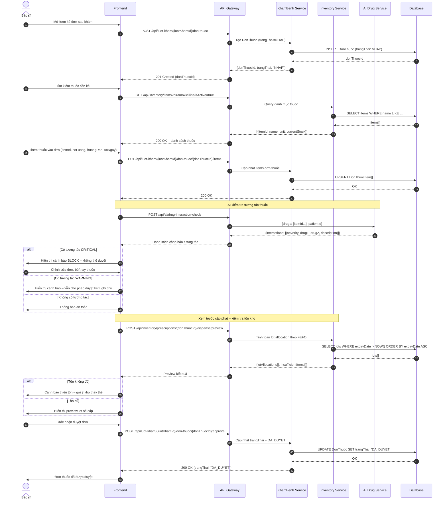
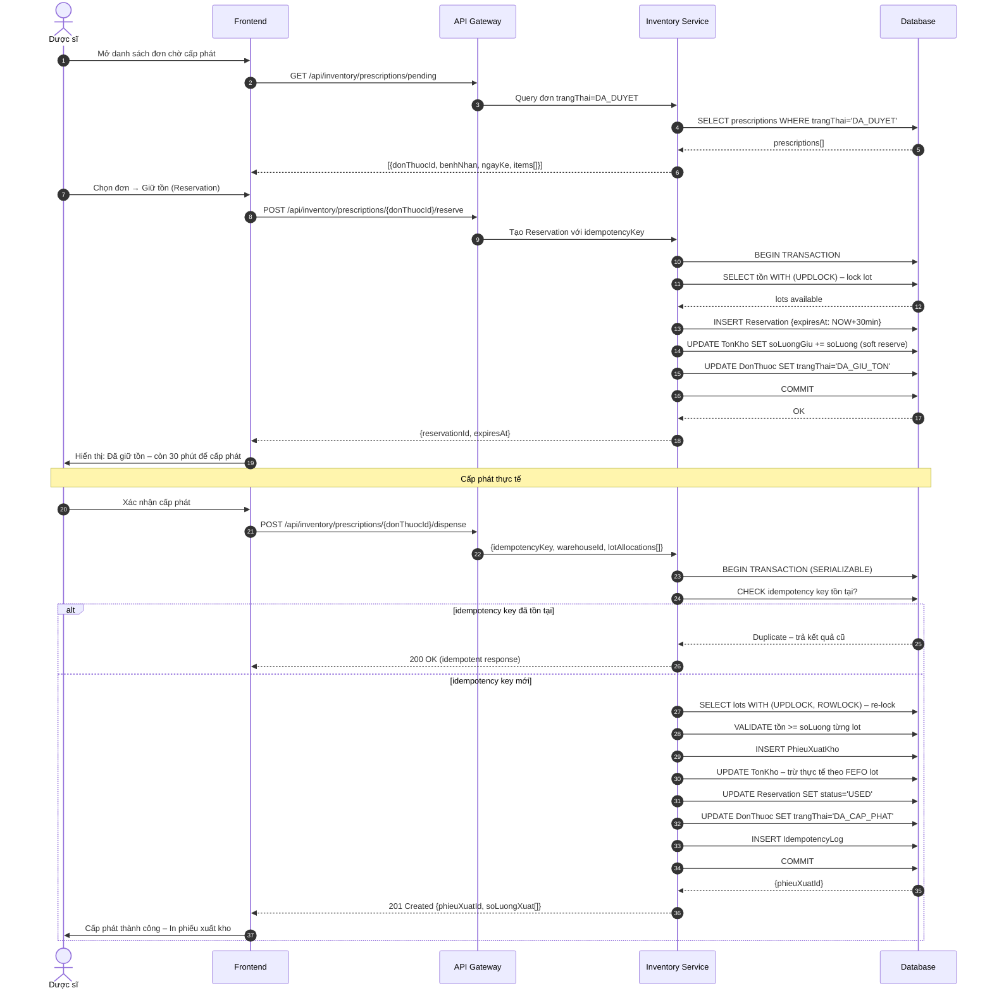

# 04 – FLOW KÊ ĐƠN VÀ KHO DƯỢC

> **Tài liệu nghiệp vụ HIS – Hospital Information System**
> **Module:** Kê đơn thuốc & Quản lý kho dược
> **Version:** 1.0.0
> **Ngày tạo:** 2026-09-15
> **Tác giả:** Technical Lead – Clinic Management System

---

## 1. Tổng quan

Flow này mô tả toàn bộ chu trình từ khi **bác sĩ tạo đơn thuốc** sau buổi khám, qua bước **AI kiểm tra tương tác thuốc**, cho đến khi **dược sĩ/thủ kho cấp phát thực tế** và **trừ tồn kho theo nguyên tắc FEFO** (First Expired, First Out).

Flow được chia thành **2 giai đoạn chính**:
- **Giai đoạn 1 – Kê đơn**: Bác sĩ soạn, kiểm tra và duyệt đơn thuốc.
- **Giai đoạn 2 – Cấp phát kho**: Dược sĩ tiếp nhận đơn đã duyệt, giữ tồn (Reservation), và thực hiện cấp phát.

---

## 2. Actor tham gia

| Actor | Vai trò |
|---|---|
| **Bác sĩ kê đơn** | Tạo đơn thuốc tạm, thêm danh sách thuốc, xem trước cấp phát, duyệt đơn |
| **Dược sĩ / Thủ kho** | Xem đơn chờ cấp phát, giữ tồn Reservation, thực hiện cấp phát thực tế |
| **Bệnh nhân** | Đối tượng thụ hưởng; thông tin hồ sơ dùng để AI kiểm tra tương tác |
| **Hệ thống AI kiểm tra tương tác thuốc** | Dịch vụ ngoài (hoặc internal service), nhận danh sách thuốc + patientId → trả về danh sách cảnh báo tương tác |

---

## 3. Pre-conditions & Post-conditions

### 3.1 Pre-conditions

- Lượt khám (`LuotKham`) đã tồn tại và ở trạng thái **DANG_KHAM** hoặc **HOAN_THANH**.
- Các thuốc cần kê phải tồn tại trong danh mục (`InventoryItem`) với `isActive = true`.
- Kho dược đích (`warehouseId`) phải được xác định và đang hoạt động.
- Dược sĩ phải được phân quyền `ROLE_PHARMACIST` hoặc `ROLE_WAREHOUSE`.

### 3.2 Post-conditions

- `DonThuoc` ở trạng thái `DA_CAP_PHAT`.
- `PhieuXuatKho` được tạo, liên kết với `DonThuoc`.
- Tồn kho của từng lot thuốc được **giảm đúng số lượng** theo FEFO.
- Lịch sử cấp phát được ghi nhận cho báo cáo kiểm kê và kiểm toán.

---

## 4. Trạng thái đơn thuốc (State Machine)

```
NHAP → DANG_KIEM_TRA → DA_DUYET → DA_GIU_TON → DA_CAP_PHAT
                                 ↘ HET_HAN_GIU (nếu Reservation quá 30 phút)
         HUY (bất kỳ lúc nào trước DA_CAP_PHAT)
```

---

## 5. Sequence Diagram

### Giai đoạn 1 – Kê đơn



### Giai đoạn 2 – Cấp phát kho



---

## 6. Chi tiết API

### 6.1 POST `/api/luot-kham/{luotKhamId}/don-thuoc` – Tạo đơn thuốc tạm

**Mục đích:** Khởi tạo đơn thuốc ở trạng thái nháp, liên kết với lượt khám.

**Request:**
```json
{
  "ghiChu": "Đơn thuốc sau khám ngày 15/09/2026",
  "loaiDon": "NGOAI_TRU"
}
```

**Response – 201 Created:**
```json
{
  "donThuocId": "DT-2026-00451",
  "luotKhamId": "LK-2026-01234",
  "trangThai": "NHAP",
  "ngayKe": "2026-09-15T12:10:00+07:00",
  "bacSiId": "BS-001",
  "items": []
}
```

---

### 6.2 PUT `/api/luot-kham/{luotKhamId}/don-thuoc/{donThuocId}/items` – Cập nhật danh sách thuốc

**Mục đích:** Thêm/sửa/xóa danh sách thuốc trong đơn (ghi đè toàn bộ items).

**Request:**
```json
{
  "items": [
    {
      "itemId": "ITEM-AMX-500",
      "soLuong": 21,
      "donVi": "viên",
      "huongDan": "Uống 1 viên x 3 lần/ngày sau ăn",
      "soNgay": 7
    },
    {
      "itemId": "ITEM-IBU-400",
      "soLuong": 10,
      "donVi": "viên",
      "huongDan": "Uống 1 viên x 2 lần/ngày khi đau",
      "soNgay": 5
    }
  ]
}
```

**Response – 200 OK:**
```json
{
  "donThuocId": "DT-2026-00451",
  "trangThai": "NHAP",
  "items": [
    {
      "donThuocItemId": "DTI-001",
      "itemId": "ITEM-AMX-500",
      "tenThuoc": "Amoxicillin 500mg",
      "soLuong": 21,
      "donVi": "viên",
      "huongDan": "Uống 1 viên x 3 lần/ngày sau ăn",
      "soNgay": 7
    }
  ]
}
```

---

### 6.3 POST `/api/ai/drug-interaction-check` – Kiểm tra tương tác thuốc *(API MỚI)*

**Mục đích:** Gọi AI service kiểm tra tương tác giữa các thuốc trong đơn dựa trên hồ sơ bệnh nhân.

**Request:**
```json
{
  "patientId": "BN-2026-00789",
  "drugs": [
    { "itemId": "ITEM-AMX-500", "activeIngredient": "Amoxicillin" },
    { "itemId": "ITEM-WFR-005", "activeIngredient": "Warfarin" }
  ]
}
```

**Response – 200 OK:**
```json
{
  "checkedAt": "2026-09-15T12:11:30+07:00",
  "interactions": [
    {
      "severity": "WARNING",
      "drug1": "Amoxicillin",
      "drug2": "Warfarin",
      "description": "Amoxicillin có thể tăng tác dụng chống đông của Warfarin. Theo dõi INR chặt chẽ.",
      "recommendation": "Theo dõi INR mỗi 3 ngày trong 2 tuần đầu"
    }
  ],
  "overallRisk": "WARNING"
}
```

> **severity levels:**
> - `SAFE` – Không có tương tác đáng kể
> - `WARNING` – Cần theo dõi, vẫn cho phép kê đơn
> - `CRITICAL` – Tương tác nguy hiểm, **block** duyệt đơn

---

### 6.4 POST `/api/inventory/prescriptions/{donThuocId}/dispense/preview` – Xem trước cấp phát *(API MỚI)*

**Mục đích:** Tính toán trước lot allocation theo FEFO, kiểm tra tồn kho mà không thay đổi dữ liệu.

**Request:**
```json
{
  "warehouseId": "WH-01-DUOC-NGOAI"
}
```

**Response – 200 OK:**
```json
{
  "donThuocId": "DT-2026-00451",
  "warehouseId": "WH-01-DUOC-NGOAI",
  "previewAt": "2026-09-15T12:12:00+07:00",
  "lotAllocations": [
    {
      "itemId": "ITEM-AMX-500",
      "tenThuoc": "Amoxicillin 500mg",
      "soLuongYeuCau": 21,
      "lots": [
        {
          "lotId": "LOT-AMX-2024-08",
          "soLo": "LOT240801",
          "hsd": "2026-12-31",
          "soLuongLay": 21
        }
      ],
      "duTon": true
    }
  ],
  "insufficientItems": [],
  "allSufficient": true
}
```

---

### 6.5 POST `/api/inventory/prescriptions/{donThuocId}/reserve` – Giữ tồn Reservation *(API MỚI)*

**Mục đích:** Soft-lock số lượng tồn kho cho đơn được duyệt, tránh cấp trùng khi nhiều dược sĩ cùng xử lý.

**Request:**
```json
{
  "idempotencyKey": "reserve-DT-2026-00451-DS001-20260915",
  "warehouseId": "WH-01-DUOC-NGOAI"
}
```

**Response – 201 Created:**
```json
{
  "reservationId": "RSV-2026-00123",
  "donThuocId": "DT-2026-00451",
  "warehouseId": "WH-01-DUOC-NGOAI",
  "status": "ACTIVE",
  "expiresAt": "2026-09-15T12:42:00+07:00",
  "reservedItems": [
    {
      "itemId": "ITEM-AMX-500",
      "lotId": "LOT-AMX-2024-08",
      "soLuongGiu": 21
    }
  ]
}
```

---

### 6.6 POST `/api/inventory/prescriptions/{donThuocId}/release` – Hủy giữ tồn *(API MỚI)*

**Mục đích:** Giải phóng Reservation khi hủy đơn hoặc dược sĩ chủ động hủy trước khi hết hạn.

**Request:**
```json
{
  "reason": "CANCELLED_BY_PHARMACIST",
  "note": "Bệnh nhân không đến lấy thuốc"
}
```

**Response – 200 OK:**
```json
{
  "reservationId": "RSV-2026-00123",
  "status": "RELEASED",
  "releasedAt": "2026-09-15T12:25:00+07:00"
}
```

---

### 6.7 POST `/api/inventory/prescriptions/{donThuocId}/dispense` – Cấp phát thực tế

**Mục đích:** Thực hiện cấp phát chính thức, trừ tồn kho theo lot FEFO, tạo phiếu xuất kho.

**Request:**
```json
{
  "idempotencyKey": "dispense-DT-2026-00451-DS001-20260915",
  "warehouseId": "WH-01-DUOC-NGOAI",
  "reservationId": "RSV-2026-00123",
  "lotAllocations": [
    {
      "itemId": "ITEM-AMX-500",
      "lots": [
        { "lotId": "LOT-AMX-2024-08", "soLuong": 21 }
      ]
    },
    {
      "itemId": "ITEM-IBU-400",
      "lots": [
        { "lotId": "LOT-IBU-2025-01", "soLuong": 10 }
      ]
    }
  ]
}
```

**Response – 201 Created:**
```json
{
  "phieuXuatId": "PXK-2026-00789",
  "donThuocId": "DT-2026-00451",
  "trangThai": "DA_CAP_PHAT",
  "ngayCapPhat": "2026-09-15T12:30:00+07:00",
  "duocSiId": "DS-001",
  "soLuongXuat": [
    {
      "itemId": "ITEM-AMX-500",
      "tenThuoc": "Amoxicillin 500mg",
      "lotId": "LOT-AMX-2024-08",
      "soLo": "LOT240801",
      "soLuong": 21,
      "donVi": "viên",
      "tonConLai": 179
    }
  ]
}
```

---

### 6.8 GET `/api/inventory/items/{itemId}/lots` – Xem tồn theo lot *(API MỚI)*

**Mục đích:** Tra cứu danh sách lot còn tồn của một mặt hàng, sắp xếp theo FEFO (hạn sử dụng gần nhất trước).

**Response – 200 OK:**
```json
{
  "itemId": "ITEM-AMX-500",
  "tenThuoc": "Amoxicillin 500mg",
  "totalStock": 200,
  "lots": [
    {
      "lotId": "LOT-AMX-2024-08",
      "soLo": "LOT240801",
      "hsd": "2026-12-31",
      "ngayNhap": "2024-08-10",
      "soLuongTon": 179,
      "soLuongGiu": 21,
      "soLuongKhaDung": 158,
      "fefoOrder": 1
    },
    {
      "lotId": "LOT-AMX-2025-03",
      "soLo": "LOT250310",
      "hsd": "2027-06-30",
      "ngayNhap": "2025-03-10",
      "soLuongTon": 500,
      "soLuongGiu": 0,
      "soLuongKhaDung": 500,
      "fefoOrder": 2
    }
  ]
}
```

---

## 7. Transaction & Concurrency – Cấp phát kho

Đây là phần **quan trọng nhất** về tính đúng đắn (correctness) khi nhiều dược sĩ cùng cấp phát đồng thời.

### 7.1 Pseudocode transaction cấp phát

```sql
BEGIN TRANSACTION (ISOLATION LEVEL = SERIALIZABLE)

  -- Bước 1: Kiểm tra idempotency để chống retry tạo trùng
  SELECT id FROM IdempotencyLog
    WHERE key = :idempotencyKey AND action = 'DISPENSE'
  IF FOUND → ROLLBACK; RETURN kết_quả_cũ (200 OK)

  -- Bước 2: Lock lot cần xuất (tránh concurrent update)
  SELECT lot_id, so_luong_ton, so_luong_giu
    FROM TonKhoLot
    WHERE lot_id IN (:lotIds)
    WITH (UPDLOCK, ROWLOCK)   -- SQL Server syntax
    -- PostgreSQL: FOR UPDATE

  -- Bước 3: Kiểm tra tồn thực tế >= số lượng yêu cầu
  FOR EACH lot IN :lotAllocations DO
    IF lot.soLuongTon - lot.soLuongGiu < lot.soLuongXuat THEN
      ROLLBACK; RAISE InsufficientStockException

  -- Bước 4: Kiểm tra lot chưa hết hạn
  FOR EACH lot IN :lotAllocations DO
    IF lot.hsd < CURRENT_DATE THEN
      ROLLBACK; RAISE ExpiredLotException

  -- Bước 5: Tạo phiếu xuất kho
  INSERT INTO PhieuXuatKho (don_thuoc_id, duoc_si_id, ngay_cap_phat, ...)
  RETURNING phieu_xuat_id

  -- Bước 6: Trừ tồn kho thực tế theo FEFO
  FOR EACH lot IN :lotAllocations DO
    UPDATE TonKhoLot
      SET so_luong_ton   = so_luong_ton - lot.soLuongXuat,
          so_luong_giu   = GREATEST(0, so_luong_giu - lot.soLuongGiu)
      WHERE lot_id = lot.lotId

  -- Bước 7: Đánh dấu Reservation đã dùng
  UPDATE Reservation
    SET status = 'USED', used_at = NOW()
    WHERE reservation_id = :reservationId

  -- Bước 8: Cập nhật trạng thái đơn thuốc
  UPDATE DonThuoc
    SET trang_thai = 'DA_CAP_PHAT', ngay_cap_phat = NOW()
    WHERE don_thuoc_id = :donThuocId

  -- Bước 9: Ghi idempotency log
  INSERT INTO IdempotencyLog (key, action, result_payload, created_at)
    VALUES (:idempotencyKey, 'DISPENSE', :resultJson, NOW())

COMMIT

-- Xử lý deadlock
ON DEADLOCK_DETECTED →
  ROLLBACK
  IF retry_count < 3 THEN
    WAIT random(50ms, 200ms)
    retry_count++
    GOTO BEGIN TRANSACTION
  ELSE
    RETURN 503 Service Unavailable {error: "DEADLOCK_MAX_RETRY"}
```

### 7.2 Tại sao cần SERIALIZABLE?

- `READ COMMITTED` (mặc định) không ngăn được **phantom read** – hai dược sĩ đọc cùng lot có đủ tồn, nhưng chỉ một người thực sự cấp được.
- `REPEATABLE READ` ngăn non-repeatable read nhưng không ngăn phantom.
- `SERIALIZABLE` đảm bảo transaction chạy như thể tuần tự – **an toàn tuyệt đối** cho bài toán trừ tồn kho.
- Chi phí: cao hơn, nhưng chấp nhận được vì tần suất cấp phát không quá lớn và thời gian transaction ngắn.

---

## 8. Reservation – Giữ tồn tạm thời

### 8.1 Reservation là gì?

**Reservation** (giữ tồn) là cơ chế **soft-lock** số lượng thuốc trong kho cho một đơn đã được duyệt. Nó không trừ tồn ngay, mà chỉ đánh dấu một phần tồn là "đã được giữ cho đơn X", ngăn dược sĩ khác cấp trùng.

### 8.2 Tại sao cần Reservation?

| Tình huống | Không có Reservation | Có Reservation |
|---|---|---|
| DS_A và DS_B cùng mở đơn thuốc X | Cả hai thấy tồn đủ, đều bắt đầu cấp phát | DS_A giữ tồn trước, DS_B bị từ chối hoặc chờ |
| Hệ thống bận, dược sĩ bấm nhiều lần | Tạo nhiều phiếu xuất trùng nhau | idempotencyKey ngăn duplicate |
| Dược sĩ mở đơn rồi để đó 1 tiếng | Tồn bị "treo" vô thời hạn | Reservation tự hết hạn sau 30 phút |

### 8.3 Vòng đời Reservation

```
ACTIVE (30 phút)
  ├─ Dược sĩ cấp phát thành công → USED
  ├─ Dược sĩ hủy thủ công       → RELEASED
  └─ Hết hạn (cron job mỗi 5p)  → EXPIRED → TonKho được trả lại
```

### 8.4 Job tự động hủy Reservation hết hạn

```
Cron: */5 * * * *  (mỗi 5 phút)

SELECT reservationId, items[] FROM Reservation
  WHERE status = 'ACTIVE' AND expiresAt < NOW()

FOR EACH reservation:
  BEGIN TRANSACTION
    UPDATE TonKhoLot SET soLuongGiu -= soLuongGiu
    UPDATE Reservation SET status = 'EXPIRED'
    UPDATE DonThuoc SET trangThai = 'DA_DUYET'  -- hoàn lại trạng thái cũ
  COMMIT
```

---

## 9. Validation Rules

### 9.1 Khi thêm thuốc vào đơn

| Rule | Điều kiện lỗi | HTTP Status | Error Code |
|---|---|---|---|
| Số lượng hợp lệ | `soLuong <= 0` | 400 | `INVALID_QUANTITY` |
| Thuốc đang hoạt động | `item.isActive = false` | 422 | `ITEM_INACTIVE` |
| Không trùng thuốc trong đơn | `itemId` xuất hiện >= 2 lần | 422 | `DUPLICATE_ITEM` |
| Đơn vị hợp lệ | `donVi` không thuộc danh sách cho phép | 400 | `INVALID_UNIT` |
| Số ngày hợp lệ | `soNgay <= 0 hoặc > 365` | 400 | `INVALID_DAYS` |

### 9.2 Khi cấp phát

| Rule | Điều kiện lỗi | HTTP Status | Error Code |
|---|---|---|---|
| Tồn kho đủ | `soLuongTon - soLuongGiu < soLuongYeuCau` | 422 | `INSUFFICIENT_STOCK` |
| Lot chưa hết hạn | `lot.hsd < TODAY` | 422 | `LOT_EXPIRED` |
| Reservation còn hiệu lực | `reservation.expiresAt < NOW()` | 409 | `RESERVATION_EXPIRED` |
| Đơn ở trạng thái đúng | `trangThai != DA_GIU_TON` | 409 | `INVALID_STATE` |
| Idempotency key hợp lệ | Key trùng + payload khác | 422 | `IDEMPOTENCY_CONFLICT` |

---

## 10. Xử lý ngoại lệ

### 10.1 Tồn kho không đủ

```json
{
  "error": "INSUFFICIENT_STOCK",
  "message": "Không đủ tồn kho để cấp phát",
  "details": {
    "itemId": "ITEM-AMX-500",
    "soLuongYeuCau": 21,
    "soLuongKhaDung": 5,
    "suggestions": [
      {
        "type": "ALTERNATIVE_WAREHOUSE",
        "warehouseId": "WH-02-DUOC-NOI",
        "warehouseName": "Kho Dược Nội trú",
        "soLuongKhaDung": 150
      },
      {
        "type": "ALTERNATIVE_ITEM",
        "itemId": "ITEM-AMX-250",
        "tenThuoc": "Amoxicillin 250mg",
        "note": "Cùng hoạt chất, liều thấp hơn – cần bác sĩ xác nhận"
      }
    ]
  }
}
```

**Xử lý:**
1. Hiển thị cảnh báo cho dược sĩ với danh sách gợi ý.
2. Dược sĩ có thể chọn kho thay thế (tự động tạo phiếu điều chuyển nội bộ).
3. Hoặc liên hệ lại bác sĩ để đổi thuốc thay thế.

### 10.2 Tương tác thuốc CRITICAL

```json
{
  "error": "CRITICAL_DRUG_INTERACTION",
  "message": "Phát hiện tương tác thuốc nguy hiểm – không thể duyệt đơn",
  "interactions": [
    {
      "severity": "CRITICAL",
      "drug1": "Methotrexate",
      "drug2": "Ibuprofen",
      "description": "NSAIDs ức chế thải Methotrexate qua thận, gây độc tính nghiêm trọng",
      "recommendation": "Ngưng Ibuprofen hoặc thay bằng Paracetamol"
    }
  ]
}
```

**Xử lý:**
- Frontend **block** nút "Duyệt đơn" khi `overallRisk = CRITICAL`.
- Bác sĩ **bắt buộc** phải chỉnh sửa đơn (xóa/thay thuốc) trước khi duyệt.
- Mọi cảnh báo CRITICAL được ghi log kiểm toán.

### 10.3 AI Service timeout

```json
{
  "warning": "AI_SERVICE_TIMEOUT",
  "message": "Kiểm tra tương tác thuốc tạm thời không khả dụng",
  "canProceed": true,
  "note": "Bác sĩ chịu trách nhiệm xác nhận an toàn thuốc thủ công"
}
```

**Xử lý:**
- Nếu AI timeout sau **5 giây**, trả `HTTP 200` kèm `warning` (không phải lỗi).
- Frontend hiển thị banner cảnh báo vàng nhưng **không block** bác sĩ duyệt đơn.
- Cảnh báo và xác nhận của bác sĩ được ghi vào log kiểm toán.

### 10.4 Deadlock khi cấp phát đồng thời

- Retry tối đa **3 lần** với jitter ngẫu nhiên 50–200ms.
- Sau 3 lần thất bại → trả `503 Service Unavailable`.
- Client (frontend) tự động retry sau 2 giây với cùng `idempotencyKey`.
- Reservation vẫn còn hiệu lực trong 30 phút nên retry an toàn.

---

## 11. Sơ đồ thực thể liên quan

```
LuotKham (1) ──── (1) DonThuoc
DonThuoc  (1) ──── (N) DonThuocItem
DonThuoc  (1) ──── (1) Reservation
DonThuoc  (1) ──── (1) PhieuXuatKho
PhieuXuatKho (1) ──── (N) PhieuXuatKhoItem
PhieuXuatKhoItem (N) ──── (1) TonKhoLot
TonKhoLot (N) ──── (1) InventoryItem
```

---

## 12. Ghi chú triển khai

> [!IMPORTANT]
> Các API đánh dấu **(API MỚI)** chưa tồn tại trong codebase hiện tại và cần được thiết kế + phát triển trong sprint tiếp theo.

> [!WARNING]
> Reservation job cron phải chạy trên **một instance duy nhất** (sử dụng distributed lock như Redis SETNX hoặc DB advisory lock) để tránh race condition giữa các pod khi scale horizontal.

> [!TIP]
> Idempotency key nên được tạo phía client theo format: `{action}-{donThuocId}-{userId}-{yyyyMMdd}` để đảm bảo uniqueness trong ngày và có thể retry an toàn.

---

*Tài liệu này thuộc bộ tài liệu nghiệp vụ HIS – Clinic Management System.*
*Cập nhật lần cuối: 2026-09-15 bởi Technical Lead.*
