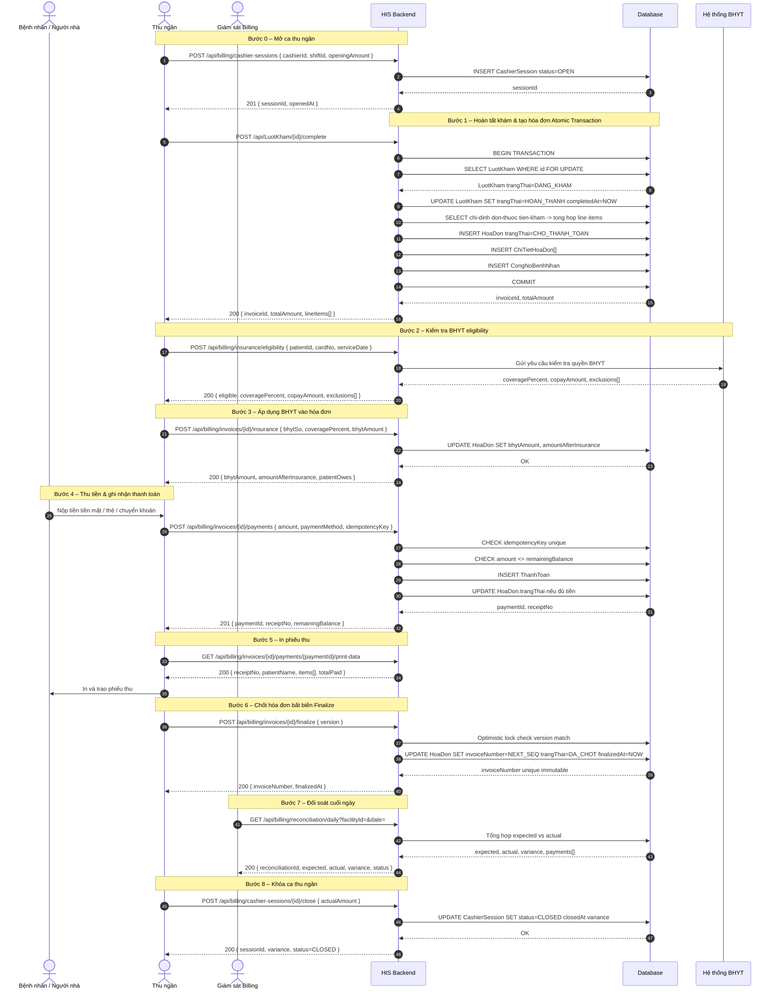
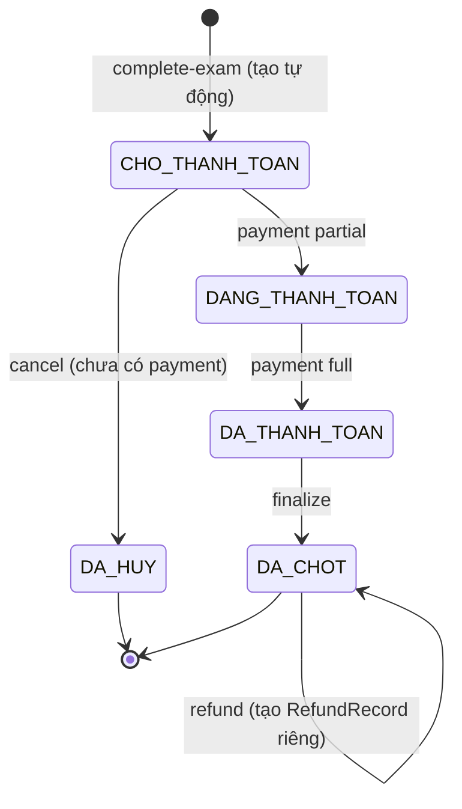

# 05 – FLOW VIỆN PHÍ & THANH TOÁN

> **Module:** Billing & Payment  
> **Phiên bản:** 1.0.0  
> **Ngày tạo:** 2026-09-15  
> **Tác giả:** Technical Lead – HIS  
> **Trạng thái:** Đã duyệt  

---

## 1. Mục đích

Flow này mô tả toàn bộ quy trình thu viện phí và thanh toán trong hệ thống HIS: từ thời điểm bác sĩ hoàn tất khám (tạo hóa đơn tự động), kiểm tra & áp dụng bảo hiểm y tế (BHYT), thu ngân ghi nhận thanh toán, in phiếu thu, chốt hóa đơn bất biến, đến đối soát cuối ngày và khóa ca thu ngân.

---

## 2. Actor Tham Gia

| Actor | Vai trò |
|---|---|
| **Bệnh nhân / Người nhà** | Nộp tiền, nhận phiếu thu, yêu cầu hoàn tiền |
| **Thu ngân (Cashier)** | Mở ca, ghi nhận thanh toán, in phiếu, khóa ca |
| **Giám sát Billing** | Xem báo cáo, đối soát cuối ngày, phê duyệt hoàn tiền |
| **Hệ thống BHYT** | Kiểm tra quyền thụ hưởng BHYT, xác nhận mức chi trả |
| **HIS (Backend)** | Tạo hóa đơn tự động, tính toán chi phí, quản lý transaction |

---

## 3. Pre-conditions & Post-conditions

### 3.1 Pre-conditions

- Lượt khám (`LuotKham`) đang ở trạng thái `DANG_KHAM`.
- Bác sĩ đã kết thúc nhập liệu (chẩn đoán, chỉ định CLS, đơn thuốc).
- Thu ngân đã mở ca (`CashierSession`) trước khi thực hiện thu tiền.
- Thông tin BHYT của bệnh nhân (nếu có) đã được đăng ký trong hệ thống.

### 3.2 Post-conditions

- `LuotKham.trangThai = HOAN_THANH`.
- `HoaDon` ở trạng thái `DA_THANH_TOAN` (hoặc `CHO_THANH_TOAN` nếu chưa thu đủ).
- `HoaDon.invoiceNumber` được cấp phát bất biến sau khi finalize.
- Phiếu thu (`Receipt`) đã in và giao cho bệnh nhân.
- `CashierSession` phản ánh đúng số tiền thực thu.
- Toàn bộ thao tác được ghi vào audit log.

---

## 4. Sequence Diagram – Flow Viện Phí & Thanh Toán



---

## 5. Chi Tiết API

### 5.1 POST /api/LuotKham/{id}/complete

**Mục đích:** Hoàn tất lượt khám và tự động tạo hóa đơn trong một transaction nguyên tử.

**Request:**
```http
POST /api/LuotKham/{id}/complete
Authorization: Bearer {token}
Content-Type: application/json

{
  "completedBy": "BS001",
  "notes": "Bệnh nhân ổn định, tái khám sau 7 ngày"
}
```

**Response 200 OK:**
```json
{
  "luotKhamId": "LK-20260915-0042",
  "trangThai": "HOAN_THANH",
  "completedAt": "2026-09-15T10:30:00+07:00",
  "invoice": {
    "invoiceId": "INV-2026-004821",
    "trangThai": "CHO_THANH_TOAN",
    "totalAmount": 450000,
    "lineItems": [
      { "type": "TIEN_KHAM",  "description": "Tiền khám bệnh",         "amount": 150000 },
      { "type": "CLS",        "description": "Xét nghiệm máu tổng quát","amount": 200000 },
      { "type": "THUOC",      "description": "Paracetamol 500mg x10",   "amount": 100000 }
    ]
  }
}
```

**Response 409 Conflict** (hóa đơn đã tồn tại):
```json
{
  "error": "INVOICE_ALREADY_EXISTS",
  "message": "Lượt khám này đã có hóa đơn. invoiceId: INV-2026-004821",
  "existingInvoiceId": "INV-2026-004821"
}
```

---

### 5.2 GET /api/billing/invoices/by-visit/{visitId}

**Mục đích:** Lấy thông tin hóa đơn theo lượt khám.

**Response 200 OK:**
```json
{
  "invoiceId": "INV-2026-004821",
  "visitId": "LK-20260915-0042",
  "patientId": "BN-0001234",
  "trangThai": "CHO_THANH_TOAN",
  "totalAmount": 450000,
  "bhytAmount": 0,
  "amountAfterInsurance": 450000,
  "amountPaid": 0,
  "remainingBalance": 450000,
  "lineItems": ["..."],
  "createdAt": "2026-09-15T10:30:00+07:00"
}
```

---

### 5.3 POST /api/billing/insurance/eligibility *(API MỚI)*

**Mục đích:** Kiểm tra quyền thụ hưởng BHYT của bệnh nhân trước khi áp dụng.

**Request:**
```json
{
  "patientId": "BN-0001234",
  "cardNo": "DN4030012345678",
  "serviceDate": "2026-09-15",
  "serviceType": "NGOAI_TRU"
}
```

**Response 200 OK:**
```json
{
  "eligible": true,
  "coveragePercent": 80,
  "copayAmount": 90000,
  "maxCoverageAmount": 360000,
  "exclusions": ["THUOC_NGOAI_DANH_MUC"],
  "cardValidFrom": "2026-01-01",
  "cardValidTo": "2026-12-31",
  "checkedAt": "2026-09-15T10:31:00+07:00"
}
```

**Response 422 Unprocessable Entity** (thẻ hết hạn):
```json
{
  "error": "CARD_EXPIRED",
  "message": "Thẻ BHYT đã hết hạn vào 2025-12-31",
  "cardValidTo": "2025-12-31"
}
```

---

### 5.4 POST /api/billing/invoices/{id}/insurance

**Mục đích:** Áp dụng thông tin BHYT vào hóa đơn sau khi đã kiểm tra eligibility.

**Request:**
```json
{
  "bhytSo": "DN4030012345678",
  "coveragePercent": 80,
  "bhytAmount": 360000
}
```

**Response 200 OK:**
```json
{
  "invoiceId": "INV-2026-004821",
  "bhytSo": "DN4030012345678",
  "totalAmount": 450000,
  "bhytAmount": 360000,
  "amountAfterInsurance": 90000,
  "patientOwes": 90000,
  "updatedAt": "2026-09-15T10:32:00+07:00"
}
```

---

### 5.5 POST /api/billing/cashier-sessions *(API MỚI)*

**Mục đích:** Thu ngân mở ca làm việc trước khi bắt đầu nhận thanh toán.

**Request:**
```json
{
  "cashierId": "TN-007",
  "shiftId": "CA_SANG",
  "openingAmount": 1000000,
  "notes": "Mở ca sáng 15/09/2026"
}
```

**Response 201 Created:**
```json
{
  "sessionId": "SES-20260915-007",
  "cashierId": "TN-007",
  "shiftId": "CA_SANG",
  "status": "OPEN",
  "openingAmount": 1000000,
  "openedAt": "2026-09-15T07:00:00+07:00"
}
```

---

### 5.6 POST /api/billing/invoices/{id}/payments

**Mục đích:** Ghi nhận một lần thanh toán. Hỗ trợ idempotency để tránh double-submit.

**Request:**
```json
{
  "amount": 90000,
  "paymentMethod": "TIEN_MAT",
  "paymentReference": "CASH-20260915-1234",
  "idempotencyKey": "a3f9b2c1-4e5d-4f8a-91b2-3c4d5e6f7890",
  "sessionId": "SES-20260915-007",
  "receivedBy": "TN-007"
}
```

**Response 201 Created:**
```json
{
  "paymentId": "PAY-20260915-0091",
  "invoiceId": "INV-2026-004821",
  "receiptNo": "PT-20260915-0091",
  "amount": 90000,
  "paymentMethod": "TIEN_MAT",
  "remainingBalance": 0,
  "invoiceStatus": "DA_THANH_TOAN",
  "paidAt": "2026-09-15T10:35:00+07:00"
}
```

---

### 5.7 POST /api/billing/invoices/{id}/payments/{paymentId}/void *(API MỚI)*

**Mục đích:** Hủy một khoản thanh toán (chỉ trong cùng ngày, trước khi finalize hóa đơn).

**Request:**
```json
{
  "reason": "Nhập sai số tiền",
  "authorizedBy": "GS-001"
}
```

**Response 200 OK:**
```json
{
  "paymentId": "PAY-20260915-0091",
  "status": "VOIDED",
  "reason": "Nhập sai số tiền",
  "voidedAt": "2026-09-15T10:38:00+07:00",
  "voidedBy": "TN-007"
}
```

**Response 409 Conflict** (hóa đơn đã finalize):
```json
{
  "error": "INVOICE_FINALIZED",
  "message": "Không thể hủy thanh toán – hóa đơn đã chốt (invoiceNumber: HD-2026-004821)"
}
```

---

### 5.8 POST /api/billing/invoices/{id}/refunds *(API MỚI)*

**Mục đích:** Hoàn tiền sau khi hóa đơn đã được finalize. Tạo bản ghi RefundRecord riêng, không sửa hóa đơn gốc.

**Request:**
```json
{
  "amount": 90000,
  "reason": "Bệnh nhân trùng lịch khám",
  "refundMethod": "TIEN_MAT",
  "approvedBy": "GS-001"
}
```

**Response 201 Created:**
```json
{
  "refundId": "REF-20260915-0012",
  "invoiceId": "INV-2026-004821",
  "amount": 90000,
  "refundMethod": "TIEN_MAT",
  "status": "COMPLETED",
  "refundedAt": "2026-09-15T11:00:00+07:00"
}
```

---

### 5.9 POST /api/billing/invoices/{id}/finalize *(API MỚI)*

**Mục đích:** Chốt hóa đơn bất biến, cấp `invoiceNumber` duy nhất, khóa mọi thay đổi.

**Request:**
```json
{
  "version": 3
}
```

**Response 200 OK:**
```json
{
  "invoiceId": "INV-2026-004821",
  "invoiceNumber": "HD-2026-004821",
  "trangThai": "DA_CHOT",
  "finalizedAt": "2026-09-15T10:40:00+07:00",
  "finalizedBy": "TN-007"
}
```

**Response 409 Conflict** (optimistic lock thất bại):
```json
{
  "error": "OPTIMISTIC_LOCK_FAILURE",
  "message": "Hóa đơn đã bị cập nhật bởi phiên khác. Vui lòng tải lại.",
  "currentVersion": 4
}
```

---

### 5.10 GET /api/billing/reconciliation/daily *(API MỚI)*

**Mục đích:** Đối soát cuối ngày – so sánh số tiền kỳ vọng và thực thu theo từng phương thức.

**Request:**
```
GET /api/billing/reconciliation/daily?facilityId=FAC-001&date=2026-09-15
```

**Response 200 OK:**
```json
{
  "reconciliationId": "REC-20260915-001",
  "facilityId": "FAC-001",
  "date": "2026-09-15",
  "expected": 15420000,
  "actual": 15380000,
  "variance": -40000,
  "status": "DISCREPANCY",
  "payments": [
    { "method": "TIEN_MAT",      "expected": 8500000, "actual": 8460000, "variance": -40000 },
    { "method": "THE_NGAN_HANG", "expected": 5200000, "actual": 5200000, "variance": 0      },
    { "method": "CHUYEN_KHOAN",  "expected": 1720000, "actual": 1720000, "variance": 0      }
  ],
  "generatedAt": "2026-09-15T17:00:00+07:00"
}
```

---

### 5.11 POST /api/billing/cashier-sessions/{id}/close *(API MỚI)*

**Mục đích:** Khóa ca thu ngân cuối ca / cuối ngày, ghi nhận chênh lệch thực tế.

**Request:**
```json
{
  "actualAmount": 8460000,
  "notes": "Hụt 40k – đang kiểm tra"
}
```

**Response 200 OK:**
```json
{
  "sessionId": "SES-20260915-007",
  "status": "CLOSED",
  "openingAmount": 1000000,
  "expectedAmount": 8500000,
  "actualAmount": 8460000,
  "variance": -40000,
  "closedAt": "2026-09-15T17:10:00+07:00"
}
```

---

## 6. Transaction – Complete Exam & Tạo Hóa Đơn

Toàn bộ thao tác `POST /api/LuotKham/{id}/complete` phải nằm trong **một database transaction duy nhất** (ACID):

```sql
BEGIN TRANSACTION;

  -- 1. Kiểm tra trạng thái hợp lệ (lock hàng để tránh race condition)
  SELECT * FROM LuotKham WHERE id = :id AND trangThai = 'DANG_KHAM' FOR UPDATE;
  -- Nếu không tìm thấy → ROLLBACK + trả 409

  -- 2. Cập nhật trạng thái lượt khám
  UPDATE LuotKham
     SET trangThai  = 'HOAN_THANH',
         completedAt = NOW(),
         completedBy = :userId
   WHERE id = :id;

  -- 3. Tổng hợp line items từ các bảng liên quan
  SELECT type, description, amount
    FROM (
      SELECT 'TIEN_KHAM' AS type, 'Tiền khám bệnh' AS description, tienKham AS amount
        FROM LoaiKham WHERE id = :loaiKhamId
      UNION ALL
      SELECT 'CLS', ten, donGia FROM ChiDinhCLS WHERE luotKhamId = :id
      UNION ALL
      SELECT 'THUOC', tenThuoc, (soLuong * donGia) FROM ChiTietDonThuoc WHERE luotKhamId = :id
    ) AS line_items;

  -- 4. Tạo hóa đơn – UNIQUE constraint(luotKhamId) ngăn trùng lặp
  INSERT INTO HoaDon (luotKhamId, patientId, trangThai, totalAmount, createdAt)
       VALUES (:id, :patientId, 'CHO_THANH_TOAN', :totalAmount, NOW());
  -- Vi phạm UNIQUE(luotKhamId) → ROLLBACK + trả 409

  -- 5. Tạo chi tiết hóa đơn (bulk insert)
  INSERT INTO ChiTietHoaDon (hoaDonId, type, description, amount)
       VALUES (:hoaDonId, :type, :description, :amount);  -- lặp cho mỗi line item

  -- 6. Ghi công nợ bệnh nhân
  INSERT INTO CongNoBenhNhan (patientId, hoaDonId, amount, dueDate, trangThai)
       VALUES (:patientId, :hoaDonId, :totalAmount, NOW(), 'CHUA_THANH_TOAN');

COMMIT;

-- ON EXCEPTION → ROLLBACK
--   LuotKham vẫn giữ trangThai = DANG_KHAM
--   Không có hóa đơn nào được tạo ra
```

> [!IMPORTANT]
> Sử dụng `SELECT ... FOR UPDATE` để ngăn chặn race condition khi hai request đồng thời gọi `complete` cho cùng một lượt khám. Constraint `UNIQUE(luotKhamId)` trên bảng `HoaDon` là tuyến phòng thủ thứ hai.

---

## 7. Idempotency – Tránh Double-Submit Thanh Toán

| Cơ chế | Mô tả |
|---|---|
| **`idempotencyKey`** | UUID do client sinh, gửi kèm mỗi request thanh toán |
| **`paymentReference`** | Mã tham chiếu từ cổng thanh toán (POS, VNPay…) – unique per invoice |
| **Xử lý trùng lặp** | Nếu `idempotencyKey` đã tồn tại → trả lại kết quả cũ (HTTP 200), không tạo bản ghi mới |
| **TTL** | `idempotencyKey` có hiệu lực trong 24 giờ |
| **DB Constraint** | `UNIQUE(invoiceId, paymentReference)` tại tầng database |

**Ví dụ xử lý idempotency:**

```
Client gửi lần 1:  POST /payments { idempotencyKey: "abc-123", amount: 90000 }
→ Server:          201 Created { paymentId: "PAY-001" }

Client retry (mạng lỗi):  POST /payments { idempotencyKey: "abc-123", amount: 90000 }
→ Server:                  200 OK { paymentId: "PAY-001" }   ← Trả lại kết quả cũ, KHÔNG tạo mới
```

---

## 8. Validation Rules

| Rule | Điều kiện | HTTP Error |
|---|---|---|
| Số tiền hợp lệ | `amount > 0` | 422 |
| Không thu vượt tổng | `amountPaid + amount <= amountAfterInsurance` | 422 |
| Phương thức thanh toán | `paymentMethod` ∈ {TIEN_MAT, THE_NGAN_HANG, CHUYEN_KHOAN, BHYT} | 422 |
| Hóa đơn chưa hủy | `HoaDon.trangThai != DA_HUY` | 409 |
| Hóa đơn chưa chốt | Void/Edit chỉ được khi `trangThai != DA_CHOT` | 409 |
| Thẻ BHYT còn hạn | `cardValidTo >= serviceDate` | 422 |
| BHYT không vượt tổng | `bhytAmount <= totalAmount` | 422 |
| Lượt khám đúng trạng thái | Complete chỉ khi `trangThai == DANG_KHAM` | 409 |
| Ca thu ngân đang mở | Thanh toán chỉ khi `CashierSession.status == OPEN` | 403 |

---

## 9. Xử Lý Ngoại Lệ

### 9.1 Hóa đơn trùng (Duplicate Invoice)

```
Nguyên nhân: Hai request đồng thời gọi POST /api/LuotKham/{id}/complete
Xử lý:       Database UNIQUE constraint(luotKhamId) bắt lỗi → ROLLBACK transaction
Response:    HTTP 409 Conflict
             {
               "error": "INVOICE_ALREADY_EXISTS",
               "message": "Lượt khám này đã có hóa đơn.",
               "existingInvoiceId": "INV-2026-004821"
             }
```

### 9.2 Thanh toán vượt mức (Overpayment)

```
Nguyên nhân: Client gửi amount > remainingBalance
Xử lý:       Validation layer kiểm tra trước khi INSERT
Response:    HTTP 422 Unprocessable Entity
             {
               "error": "OVERPAYMENT",
               "remainingBalance": 90000,
               "requestedAmount": 150000
             }
```

### 9.3 Hủy hóa đơn đã thanh toán

```
Nguyên nhân: Staff cố hủy hóa đơn có amountPaid > 0
Xử lý:       System yêu cầu thực hiện refund trước khi hủy
Response:    HTTP 409 Conflict
             {
               "error": "CANNOT_CANCEL_PAID_INVOICE",
               "message": "Hóa đơn đã được thanh toán. Vui lòng tạo hoàn tiền trước.",
               "amountPaid": 90000,
               "refundEndpoint": "POST /api/billing/invoices/{id}/refunds"
             }
```

### 9.4 Optimistic Lock Failure (Finalize)

```
Nguyên nhân: Hai tab / người dùng cùng finalize một hóa đơn
Xử lý:       So sánh version trước khi UPDATE; không khớp → trả lỗi
Response:    HTTP 409 Conflict
             {
               "error": "OPTIMISTIC_LOCK_FAILURE",
               "message": "Hóa đơn đã bị cập nhật. Vui lòng tải lại.",
               "currentVersion": 4
             }
```

### 9.5 BHYT Service Timeout

```
Nguyên nhân: Hệ thống BHYT không phản hồi trong 5 giây
Xử lý:       Trả lỗi 503; cho phép thu tạm thời không qua BHYT (manual override với log)
Response:    HTTP 503 Service Unavailable
             {
               "error": "BHYT_SERVICE_TIMEOUT",
               "message": "Không kết nối được hệ thống BHYT. Thu tạm thời không BHYT?"
             }
```

---

## 10. Audit Trail – Nhật Ký Kiểm Toán

Mọi thao tác liên quan đến viện phí **bắt buộc** ghi vào bảng `BillingAuditLog`:

| Trường | Kiểu | Mô tả |
|---|---|---|
| `id` | UUID | Khóa chính |
| `entityType` | ENUM | INVOICE / PAYMENT / REFUND / SESSION / CASHIER |
| `entityId` | VARCHAR | ID của đối tượng bị tác động |
| `action` | ENUM | CREATE / UPDATE / VOID / FINALIZE / CLOSE / REFUND |
| `actorId` | VARCHAR | ID người thực hiện |
| `actorRole` | VARCHAR | Vai trò: CASHIER / SUPERVISOR / SYSTEM |
| `ipAddress` | VARCHAR | Địa chỉ IP của client |
| `requestId` | UUID | Trace ID của request (distributed tracing) |
| `before` | JSONB | Snapshot trạng thái trước khi thay đổi |
| `after` | JSONB | Snapshot trạng thái sau khi thay đổi |
| `reason` | TEXT | Lý do thực hiện (bắt buộc với VOID / REFUND) |
| `occurredAt` | TIMESTAMP | Thời điểm xảy ra (lưu UTC, hiển thị UTC+7) |

**Ví dụ audit log – Void payment:**
```json
{
  "id": "audit-9f2a-4bc1",
  "entityType": "PAYMENT",
  "entityId": "PAY-20260915-0091",
  "action": "VOID",
  "actorId": "TN-007",
  "actorRole": "CASHIER",
  "ipAddress": "192.168.1.55",
  "requestId": "req-abc-123-xyz",
  "before": { "status": "COMPLETED", "amount": 90000 },
  "after":  { "status": "VOIDED",    "amount": 90000 },
  "reason": "Nhập sai số tiền",
  "occurredAt": "2026-09-15T10:38:00+07:00"
}
```

> [!CAUTION]
> Audit log được giữ tối thiểu **7 năm** theo quy định tài chính y tế. **Không ai có quyền xóa bản ghi audit log**, kể cả admin hệ thống. Bảng `BillingAuditLog` chỉ hỗ trợ INSERT.

---

## 11. Trạng Thái Hóa Đơn (State Machine)



---

## 12. Ghi Chú Kỹ Thuật

- **Số hóa đơn (`invoiceNumber`):** Định dạng `HD-{YYYY}-{SEQ6}`, sinh bởi `SEQUENCE` database, bất biến sau khi finalize.
- **Múi giờ:** Tất cả timestamp lưu UTC, hiển thị UTC+7 tại frontend.
- **Cổng thanh toán:** Tích hợp VNPay / MoMo qua webhook; `paymentReference` là mã giao dịch từ cổng.
- **Retry policy:** Client nên retry tối đa 3 lần với exponential backoff cho các lỗi 5xx; luôn gửi kèm `idempotencyKey`.
- **BHYT offline:** Khi hệ thống BHYT không khả dụng, thu ngân đánh dấu "Tạm thu không BHYT" và bổ sung BHYT sau (trong vòng 30 ngày theo quy định).
- **Performance index:** Index trên `(luotKhamId)`, `(patientId, trangThai)`, `(idempotencyKey)`, `(date, facilityId)` để đảm bảo query nhanh dưới tải cao.
- **Partial payment:** Hệ thống hỗ trợ thanh toán nhiều lần cho một hóa đơn (ví dụ: trả một phần tiền mặt, phần còn lại qua thẻ). `remainingBalance` theo dõi số còn lại.

---

*Tài liệu được tạo bởi hệ thống HIS Technical Documentation. Mọi thay đổi phải được Technical Lead phê duyệt và ghi nhận version.*
