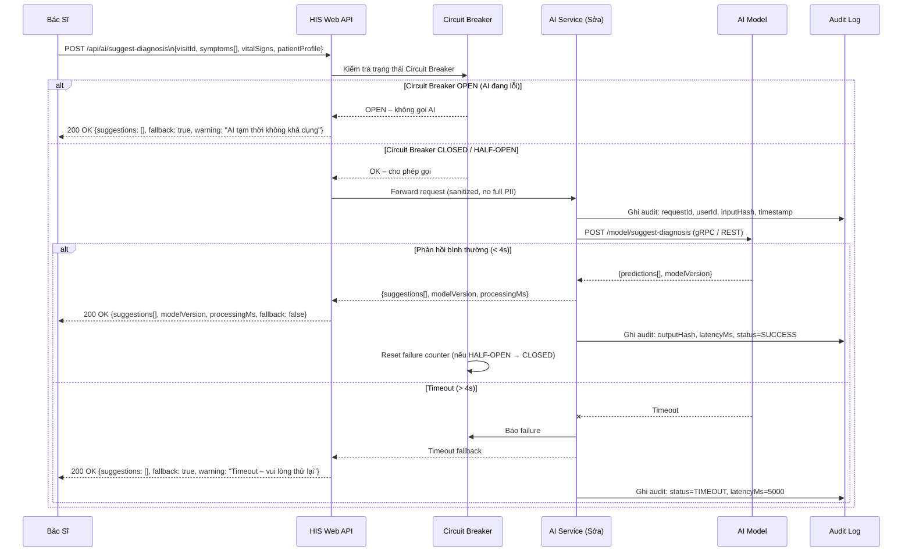
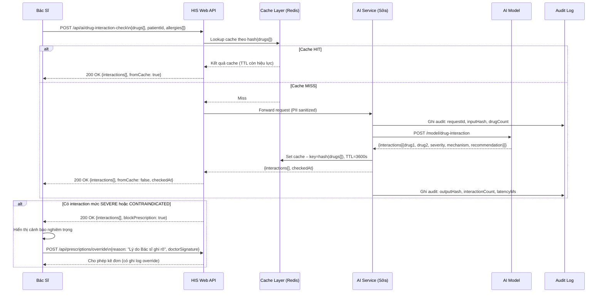
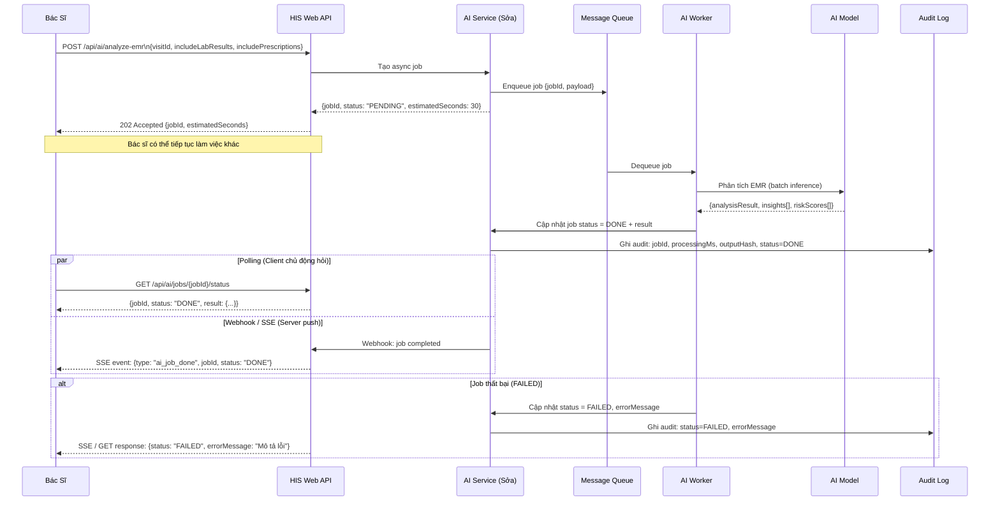
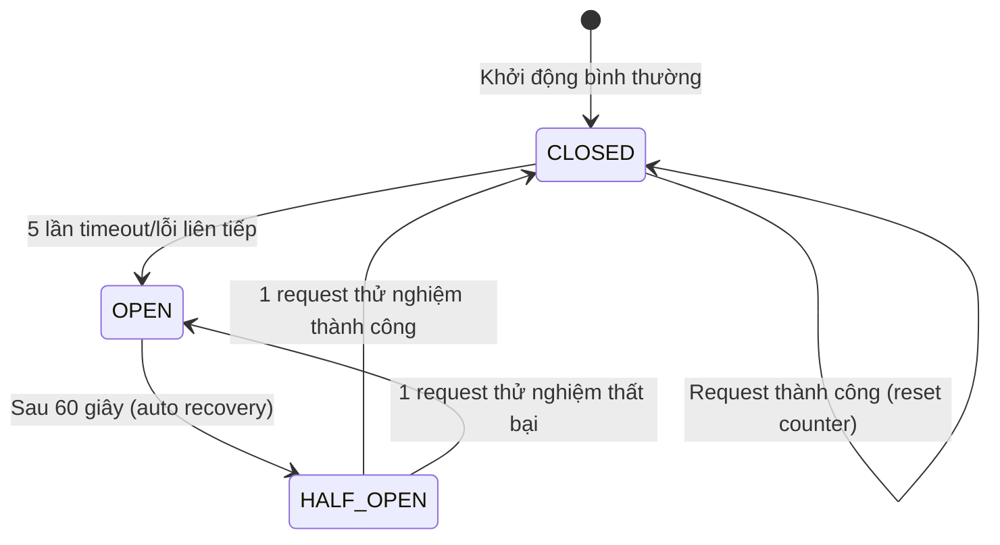

# 06 - FLOW TÍCH HỢP AI (AI INTEGRATION FLOW)

---

## Metadata

| Trường         | Giá trị                                      |
|----------------|----------------------------------------------|
| **Tài liệu**   | Flow tích hợp AI vào HIS                     |
| **Mã flow**    | FLOW-06                                      |
| **Phiên bản**  | 1.0.0                                        |
| **Ngày tạo**   | 2026-09-15                                   |
| **Tác giả**    | Technical Lead – HIS Team                    |
| **Trạng thái** | Draft                                        |

---

## 1. Tổng Quan

Flow này mô tả cách hệ thống HIS tích hợp các tính năng AI (trí tuệ nhân tạo) vào quy trình khám bệnh, bao gồm:

- **Gợi ý chẩn đoán** dựa trên triệu chứng và dấu hiệu sinh tồn (real-time, đồng bộ).
- **Kiểm tra tương tác thuốc** (drug interaction check) trước khi kê đơn (đồng bộ).
- **Phân tích hồ sơ bệnh án điện tử (EMR)** chuyên sâu (bất đồng bộ, async job).

Tất cả tính năng AI được thiết kế theo nguyên tắc **Graceful Degradation**: hệ thống HIS tiếp tục vận hành đầy đủ ngay cả khi toàn bộ AI Service ngừng hoạt động.

---

## 2. Actors Tham Gia

| Actor | Mô tả |
|---|---|
| **Bác sĩ** | Người dùng cuối, tương tác trực tiếp trên HIS Web, yêu cầu gợi ý AI và xác nhận kết quả |
| **HIS Web API** | Backend API chính của hệ thống, điều phối tất cả request, bao gồm gọi AI và trả kết quả cho client |
| **AI Service (Sởa)** | Proxy/Gateway nội bộ đứng trước các mô hình AI. Quản lý Circuit Breaker, retry, caching và audit log |
| **AI Model** | Mô hình học máy thực tế (có thể là service nội bộ hoặc cloud-based), nhận input và trả prediction |
| **Message Queue / Bus** | Hàng đợi bất đồng bộ (ví dụ: RabbitMQ, Kafka) cho các tác vụ AI nặng như phân tích EMR |
| **Cache Layer** | Redis/Memcached lưu cache kết quả AI ngắn hạn (drug interaction, suggest diagnosis) theo hash đầu vào |

---

## 3. Pre-conditions & Post-conditions

### 3.1 Pre-conditions

- Bác sĩ đã đăng nhập thành công và có phiên làm việc hợp lệ.
- Đợt khám (Visit) đã được khởi tạo trong HIS với `visitId` hợp lệ.
- AI Service đang trong trạng thái **CLOSED** (hoạt động bình thường) hoặc **HALF-OPEN** (đang phục hồi).
- Nếu AI Service ở trạng thái **OPEN**, hệ thống vẫn cho phép Bác sĩ tiếp tục khám với chế độ Degraded Mode (không có gợi ý AI).
- Thông tin thuốc và danh mục ICD-10 đã được đồng bộ vào hệ thống.

### 3.2 Post-conditions

- Kết quả AI (nếu có) được hiển thị cho Bác sĩ dưới dạng **gợi ý**, không bắt buộc.
- Mọi request AI được ghi vào **Audit Log** với đầy đủ metadata (không chứa PII đầy đủ).
- Trường hợp tương tác thuốc mức SEVERE/CONTRAINDICATED, đơn thuốc bị **block** cho đến khi Bác sĩ xác nhận override kèm lý do.
- Trạng thái Circuit Breaker được cập nhật liên tục dựa trên kết quả từng request.
- Phản hồi (feedback) của Bác sĩ về độ chính xác AI được lưu để cải thiện mô hình.

---

## 4. Kiến Trúc AI Integration Tổng Quan

```
HIS Web Client
     │
     ▼
HIS Web API  ──────────────► Cache Layer (Redis)
     │                          (cache hit → trả ngay)
     ▼
AI Service (Sởa / Proxy)
     │  - Circuit Breaker
     │  - Retry (exponential backoff)
     │  - PII Sanitization
     │  - Audit Log
     │
     ├──► AI Model (HTTP REST / gRPC)   [Luồng sync]
     │
     └──► Message Queue / Bus           [Luồng async]
               │
               ▼
         AI Model Worker
               │
               ▼
     Webhook / SSE → HIS Web API → Client
```

### 4.1 Giao Thức Giao Tiếp

| Luồng | Giao thức | Timeout | Ghi chú |
|---|---|---|---|
| HIS API → AI Service | HTTP REST (internal) | 5s | Đồng bộ cho suggest/drug-check |
| AI Service → AI Model | HTTP REST hoặc gRPC | 4s | gRPC nếu cùng cluster |
| Async Job | Message Queue (AMQP/Kafka) | N/A | Fire-and-forget |
| Job result notify | Webhook / SSE | N/A | Push khi xong |

### 4.2 Patterns Sử Dụng

| Pattern | Áp dụng cho | Lý do |
|---|---|---|
| **Request-Response (đồng bộ)** | Gợi ý chẩn đoán, Drug-interaction check | Cần kết quả ngay, timeout 5s |
| **Fire-and-Forget + Webhook** | Phân tích EMR chuyên sâu, CDSS đầy đủ | Tác vụ nặng, mất 10–60 giây |
| **Circuit Breaker** | Tất cả AI calls | Tự động fallback khi AI ngã |
| **Cache-Aside** | Drug interaction | Kết quả ổn định theo combo thuốc |

---

## 5. Sequence Diagrams

### 5.1 Luồng 1 – Gợi Ý Chẩn Đoán (Đồng Bộ, Low Latency)



### 5.2 Luồng 2 – Kiểm Tra Tương Tác Thuốc (Đồng Bộ)



### 5.3 Luồng 3 – Phân Tích Hồ Sơ Bệnh Án (Bất Đồng Bộ)



---

## 6. API Chi Tiết

### 6.1 POST /api/ai/suggest-diagnosis

**Mô tả:** Gợi ý chẩn đoán dựa trên triệu chứng và thông tin bệnh nhân. Đồng bộ, timeout 5 giây.

**Request:**

```json
{
  "visitId": "VISIT-20260915-001",
  "symptoms": ["đau đầu", "sốt cao", "cứng cổ", "buồn nôn"],
  "vitalSigns": {
    "temperature": 39.5,
    "bloodPressure": "120/80",
    "heartRate": 98,
    "respiratoryRate": 20,
    "oxygenSaturation": 97
  },
  "patientProfile": {
    "age": 35,
    "gender": "male",
    "tienSu": ["tăng huyết áp", "đái tháo đường type 2"],
    "diUng": ["Penicillin"]
  }
}
```

**Response thành công (200 OK):**

```json
{
  "suggestions": [
    {
      "icdCode": "G03.9",
      "name": "Viêm màng não không đặc hiệu",
      "confidence": 0.82,
      "reasoning": "Triệu chứng sốt cao + cứng cổ + đau đầu phù hợp với viêm màng não"
    },
    {
      "icdCode": "R51",
      "name": "Đau đầu",
      "confidence": 0.65,
      "reasoning": "Triệu chứng đau đầu kèm sốt"
    }
  ],
  "modelVersion": "diag-model-v2.3.1",
  "processingMs": 820,
  "fallback": false,
  "requestId": "req-uuid-abc123"
}
```

**Response fallback (200 OK – AI không khả dụng):**

```json
{
  "suggestions": [],
  "modelVersion": null,
  "processingMs": 0,
  "fallback": true,
  "warning": "AI tạm thời không khả dụng. Vui lòng chẩn đoán thủ công.",
  "requestId": "req-uuid-abc123"
}
```

---

### 6.2 POST /api/ai/drug-interaction-check

**Mô tả:** Kiểm tra tương tác giữa các thuốc trong đơn. Đồng bộ, sử dụng cache.

**Request:**

```json
{
  "drugs": [
    {"itemId": "DRG-001", "name": "Warfarin", "dose": 5, "unit": "mg"},
    {"itemId": "DRG-002", "name": "Aspirin", "dose": 100, "unit": "mg"},
    {"itemId": "DRG-003", "name": "Metformin", "dose": 500, "unit": "mg"}
  ],
  "patientId": "PT-00012345",
  "allergies": ["Penicillin", "Sulfonamide"]
}
```

**Response (200 OK):**

```json
{
  "interactions": [
    {
      "drug1": "Warfarin",
      "drug2": "Aspirin",
      "severity": "SEVERE",
      "mechanism": "Aspirin ức chế kết tập tiểu cầu, tăng nguy cơ xuất huyết khi dùng kèm Warfarin",
      "recommendation": "Tránh phối hợp. Nếu bắt buộc, giám sát INR chặt chẽ và điều chỉnh liều."
    }
  ],
  "checkedAt": "2026-09-15T12:05:30Z",
  "blockPrescription": true,
  "fromCache": false,
  "requestId": "req-uuid-def456"
}
```

**Mức độ severity:**

| Mức | Ý nghĩa | Hành động hệ thống |
|---|---|---|
| `MILD` | Tương tác nhẹ, có thể quản lý | Hiển thị cảnh báo thông tin |
| `MODERATE` | Tương tác trung bình, cần theo dõi | Hiển thị cảnh báo vàng |
| `SEVERE` | Tương tác nghiêm trọng | Block đơn, yêu cầu override + lý do |
| `CONTRAINDICATED` | Chống chỉ định tuyệt đối | Block đơn, yêu cầu override + chữ ký Bác sĩ |

---

### 6.3 POST /api/ai/analyze-emr

**Mô tả:** Phân tích toàn diện hồ sơ bệnh án. Bất đồng bộ, trả về jobId ngay lập tức.

**Request:**

```json
{
  "visitId": "VISIT-20260915-001",
  "includeLabResults": true,
  "includePrescriptions": true,
  "includeVitalHistory": true
}
```

**Response (202 Accepted):**

```json
{
  "jobId": "job-uuid-ghi789",
  "status": "PENDING",
  "estimatedSeconds": 30,
  "pollUrl": "/api/ai/jobs/job-uuid-ghi789/status",
  "createdAt": "2026-09-15T12:06:00Z"
}
```

---

### 6.4 GET /api/ai/jobs/{jobId}/status

**Mô tả:** Kiểm tra trạng thái và kết quả của async AI job.

**Response khi đang xử lý (200 OK):**

```json
{
  "jobId": "job-uuid-ghi789",
  "status": "PROCESSING",
  "progressPercent": 45,
  "estimatedRemainingSeconds": 16,
  "result": null,
  "errorMessage": null
}
```

**Response khi hoàn thành (200 OK):**

```json
{
  "jobId": "job-uuid-ghi789",
  "status": "DONE",
  "progressPercent": 100,
  "result": {
    "insights": [
      "Bệnh nhân có xu hướng tăng đường huyết lúc 6h sáng (Somogyi effect)",
      "Liều Metformin hiện tại có thể cần điều chỉnh theo GFR"
    ],
    "riskScores": {
      "cardiovascularRisk10Year": 0.18,
      "diabeticNephropathyRisk": 0.12
    },
    "recommendations": [
      "Theo dõi HbA1c sau 3 tháng",
      "Kiểm tra eGFR trước khi tăng liều Metformin"
    ]
  },
  "errorMessage": null,
  "completedAt": "2026-09-15T12:06:32Z"
}
```

**Response khi thất bại (200 OK):**

```json
{
  "jobId": "job-uuid-ghi789",
  "status": "FAILED",
  "result": null,
  "errorMessage": "AI Model trả về lỗi nội bộ. Vui lòng thử lại sau.",
  "failedAt": "2026-09-15T12:06:45Z"
}
```

**Trạng thái job:**

| Status | Mô tả |
|---|---|
| `PENDING` | Job đã được đưa vào hàng đợi, chưa xử lý |
| `PROCESSING` | Worker đang xử lý |
| `DONE` | Hoàn thành, có kết quả |
| `FAILED` | Thất bại, xem errorMessage |

---

### 6.5 POST /api/ai/feedback

**Mô tả:** Thu thập phản hồi của Bác sĩ về chất lượng kết quả AI để cải thiện mô hình.

**Request:**

```json
{
  "requestId": "req-uuid-abc123",
  "rating": 4,
  "isCorrect": true,
  "correction": null,
  "comment": "Gợi ý khá chính xác, phù hợp với lâm sàng"
}
```

**Response (200 OK):**

```json
{
  "feedbackId": "fb-uuid-xyz000",
  "message": "Cảm ơn phản hồi của bạn. Dữ liệu sẽ được dùng để cải thiện AI.",
  "recordedAt": "2026-09-15T12:10:00Z"
}
```

---

## 7. Circuit Breaker Pattern

Circuit Breaker bảo vệ hệ thống HIS khỏi cascade failure khi AI Service gặp sự cố.



### 7.1 Chi Tiết Từng Trạng Thái

| Trạng thái | Hành vi | Điều kiện chuyển |
|---|---|---|
| **CLOSED** | Gọi AI bình thường, đếm số lần lỗi | Sau 5 lỗi liên tiếp → OPEN |
| **OPEN** | Không gọi AI, trả fallback ngay lập tức | Sau 60 giây → HALF-OPEN |
| **HALF-OPEN** | Cho phép 1 request thử nghiệm | Thành công → CLOSED; Lỗi → OPEN lại |

### 7.2 Hành Động Khi Circuit Breaker OPEN

1. Trả về kết quả rỗng với `fallback: true`.
2. Ghi log sự kiện OPEN với timestamp và lý do.
3. Gửi alert đến team qua kênh giám sát (PagerDuty, Slack, email).
4. Giao diện HIS ẩn các nút/tính năng AI, hiển thị thông báo "AI tạm thời không khả dụng".
5. Hệ thống tiếp tục hoạt động đầy đủ ở chế độ không AI.

---

## 8. Retry Policy

Áp dụng cho tất cả synchronous AI calls trong trạng thái Circuit Breaker CLOSED.

| Lần thử | Delay trước khi thử lại | Điều kiện |
|---|---|---|
| Lần 1 (ban đầu) | 0ms | – |
| Lần 2 | 1.000ms | 503 Service Unavailable / Timeout |
| Lần 3 | 2.000ms | 503 Service Unavailable / Timeout |
| Lần 4 | 4.000ms | 503 Service Unavailable / Timeout |

> [!IMPORTANT]
> **KHÔNG retry** các mã lỗi sau:
> - `400 Bad Request` – Input không hợp lệ, retry không có ích.
> - `401 Unauthorized` – Lỗi xác thực, cần kiểm tra service account.
> - `422 Unprocessable Entity` – Dữ liệu không xử lý được, retry không giải quyết vấn đề.

> [!NOTE]
> Tổng thời gian tối đa cho 1 request (bao gồm 3 lần retry) là: 5s + 1s + 2s + 4s = **12 giây**. Tuy nhiên, với timeout từng lần là 4s, thực tế thường thấp hơn nhiều.

---

## 9. Security

### 9.1 Xác Thực Giữa Các Service

- HIS Web API gọi AI Service bằng **Service Account riêng biệt**, không sử dụng JWT của người dùng cuối.
- AI Service xác thực request từ HIS API bằng **mutual TLS (mTLS)** hoặc **API Key nội bộ** được quản lý qua secret store (Vault, AWS Secrets Manager, Kubernetes Secrets).
- API Key được **luân phiên (rotate)** định kỳ mỗi 90 ngày, không được hardcode trong source code.

### 9.2 Sanitize PII Trước Khi Gửi AI

Trước khi gửi dữ liệu đến AI Model, AI Service phải:

| Trường | Hành động |
|---|---|
| `patientId` | Thay bằng `anonymizedId` (hash một chiều) |
| Tên bệnh nhân | Loại bỏ hoàn toàn |
| Số CMND/CCCD | Loại bỏ hoàn toàn |
| Địa chỉ | Loại bỏ hoàn toàn |
| Số điện thoại | Loại bỏ hoàn toàn |
| `age`, `gender`, `symptoms` | Giữ nguyên (không phải PII nhạy cảm trong ngữ cảnh y tế) |
| Kết quả xét nghiệm | Giữ giá trị số, loại bỏ metadata định danh |

### 9.3 Network Security

- AI Service chỉ được gọi trong **internal network** (không expose public internet).
- Mọi traffic giữa HIS API ↔ AI Service ↔ AI Model đều qua **TLS 1.2+**.
- Firewall rules chặn mọi kết nối không hợp lệ đến AI Service endpoint.

---

## 10. Caching Strategy

### 10.1 Drug Interaction Cache

| Tham số | Giá trị | Ghi chú |
|---|---|---|
| **Cache key** | `SHA-256(sort(drugs[].itemId).join(','))` | Sort để đảm bảo thứ tự thuốc không ảnh hưởng |
| **TTL** | 3.600 giây (1 giờ) | Tương tác thuốc thay đổi ít, cache an toàn |
| **Invalidation** | Khi cập nhật database thuốc | Xóa toàn bộ drug-interaction cache |
| **Cache layer** | Redis | Shared cache giữa các instance API |

### 10.2 Suggest Diagnosis Cache

> [!WARNING]
> **Không nên cache** kết quả gợi ý chẩn đoán theo triệu chứng vì:
> - Triệu chứng cùng từ ngữ nhưng ngữ cảnh khác nhau cho kết quả khác nhau.
> - Thông tin bệnh nhân (`age`, `gender`, `tienSu`) ảnh hưởng lớn đến gợi ý.
> - Nguy cơ trả kết quả stale cho bệnh nhân không phù hợp.

Chỉ cache khi: key = `SHA-256(visitId + symptoms + vitalSigns)` với TTL rất ngắn (60 giây) để tránh duplicate call do double-click.

---

## 11. Audit & Compliance

### 11.1 Cấu Trúc Audit Log

Mọi request đến AI Service phải được ghi log theo cấu trúc:

```json
{
  "requestId": "req-uuid-abc123",
  "timestamp": "2026-09-15T12:05:00Z",
  "userId": "USR-00456",
  "userRole": "DOCTOR",
  "feature": "suggest-diagnosis",
  "visitId": "VISIT-20260915-001",
  "inputHash": "sha256:a1b2c3d4...",
  "outputHash": "sha256:e5f6g7h8...",
  "modelVersion": "diag-model-v2.3.1",
  "latencyMs": 820,
  "status": "SUCCESS",
  "circuitBreakerState": "CLOSED",
  "fromCache": false,
  "retryCount": 0
}
```

### 11.2 Nguyên Tắc Audit

| Nguyên tắc | Chi tiết |
|---|---|
| **Không ghi full PII** | Chỉ ghi hash của input/output, không ghi tên/CCCD/địa chỉ bệnh nhân |
| **Bất biến (Immutable)** | Log chỉ được ghi thêm (append-only), không được sửa hoặc xóa |
| **Thời gian lưu trữ** | Tối thiểu 5 năm theo quy định Bộ Y tế |
| **Truy cập hạn chế** | Chỉ Admin và Compliance Officer được đọc audit log |
| **Liên kết với requestId** | Mọi phản hồi AI đều kèm `requestId` để tra cứu audit |

### 11.3 Compliance

- Tuân thủ **Thông tư 46/2018/TT-BYT** về bảo mật thông tin trong cơ sở khám chữa bệnh.
- Dữ liệu gửi AI Cloud (nếu có) phải qua **Data Processing Agreement (DPA)** với nhà cung cấp.
- Định kỳ hàng quý: review và kiểm tra audit log để phát hiện bất thường.

---

## 12. Fallback và Degraded Mode

### 12.1 Nguyên Tắc Thiết Kế

> [!IMPORTANT]
> **Hệ thống HIS phải tiếp tục hoạt động đầy đủ khi AI Service hoàn toàn không khả dụng.** Tất cả tính năng AI là tính năng bổ sung (enhancement), không phải bắt buộc cho luồng khám bệnh cốt lõi.

### 12.2 Hành Vi Theo Từng Tính Năng

| Tính năng AI | Khi AI ngã | Hành vi hệ thống |
|---|---|---|
| Gợi ý chẩn đoán | Ẩn panel gợi ý | Bác sĩ nhập ICD-10 thủ công như bình thường |
| Drug interaction check | Bỏ qua kiểm tra | Hiển thị banner "Kiểm tra tương tác thuốc tạm thời không khả dụng" |
| Phân tích EMR | Không cho tạo job | Nút "Phân tích AI" bị disabled, tooltip giải thích |
| Feedback | Bỏ qua | Không ảnh hưởng luồng khám |

### 12.3 UX Trong Degraded Mode

- Banner thông báo **màu vàng** ở đầu trang: *"Tính năng AI đang tạm thời gián đoạn. Các chức năng khám bệnh không bị ảnh hưởng."*
- Các nút AI bị **disable** (không xóa) để Bác sĩ biết tính năng tồn tại nhưng không khả dụng.
- Tự động **ẩn banner** và **enable lại nút** khi Circuit Breaker chuyển về CLOSED.

### 12.4 Health Check

AI Service expose endpoint `/health` để HIS API kiểm tra định kỳ:

```json
GET /ai/health
→ 200 OK
{
  "status": "healthy",
  "circuitBreakerState": "CLOSED",
  "modelVersion": "diag-model-v2.3.1",
  "uptime": 3600,
  "lastSuccessAt": "2026-09-15T12:09:55Z"
}
```

HIS API poll endpoint này mỗi **30 giây** để cập nhật trạng thái hiển thị trên UI.

---

## 13. Tóm Tắt Các Điểm Quan Trọng

| Điểm | Chi tiết |
|---|---|
| **Timeout** | 5 giây tổng cho đồng bộ; 4 giây cho AI Model |
| **Retry** | 3 lần, exponential backoff 1s/2s/4s; chỉ cho 503/timeout |
| **Circuit Breaker** | OPEN sau 5 lỗi; HALF-OPEN sau 60s; về CLOSED nếu thành công |
| **Cache** | Drug interaction: TTL 1 giờ; Suggest diagnosis: không cache hoặc TTL 60s |
| **Security** | Service account riêng; mTLS; API key rotate 90 ngày; sanitize PII |
| **Audit** | Log mọi request (hash only); lưu 5 năm; append-only |
| **Degraded Mode** | Hệ thống hoàn toàn hoạt động; chỉ feature AI bị ẩn/disabled |
| **Async job** | 202 Accepted + jobId; poll hoặc SSE; trạng thái PENDING/PROCESSING/DONE/FAILED |

---

*Tài liệu này được tạo bởi Technical Lead – HIS Team. Cập nhật lần cuối: 2026-09-15.*
