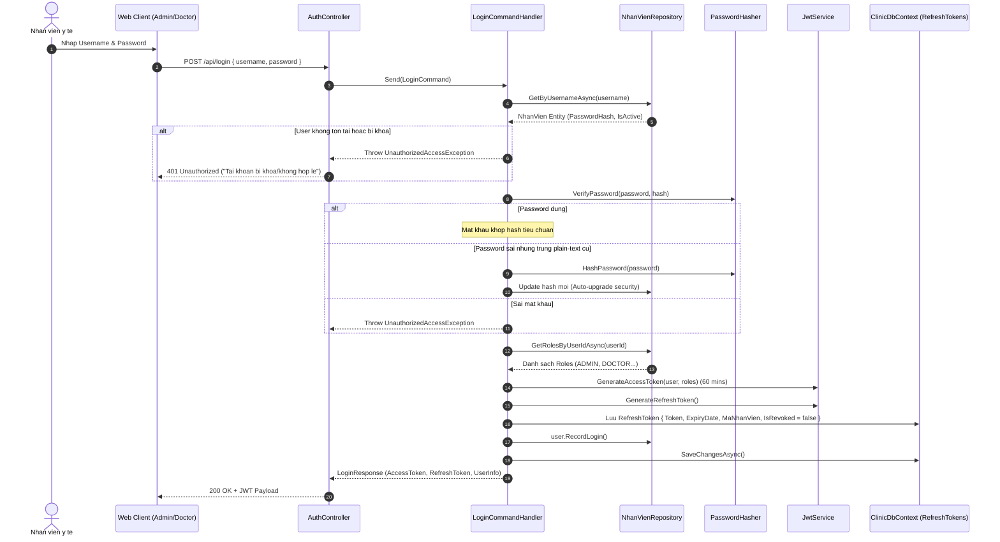
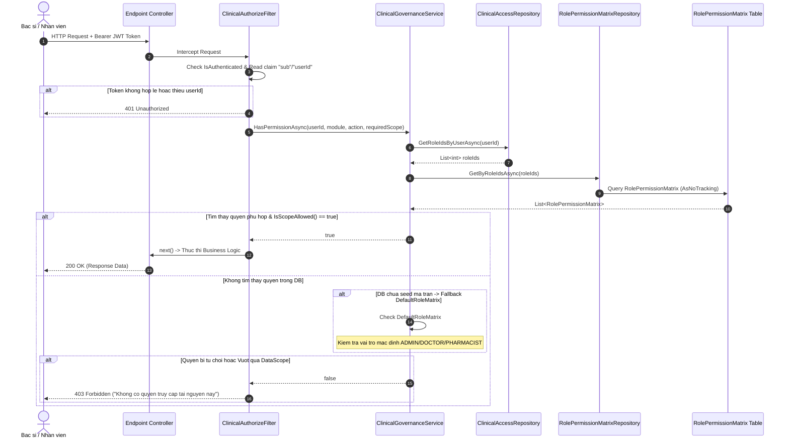
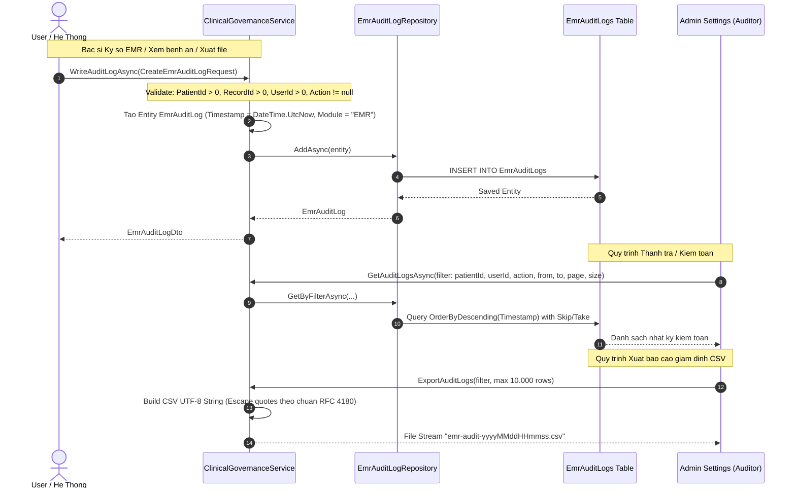
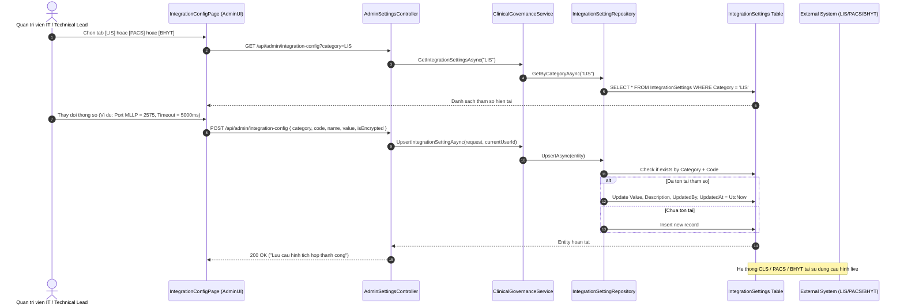
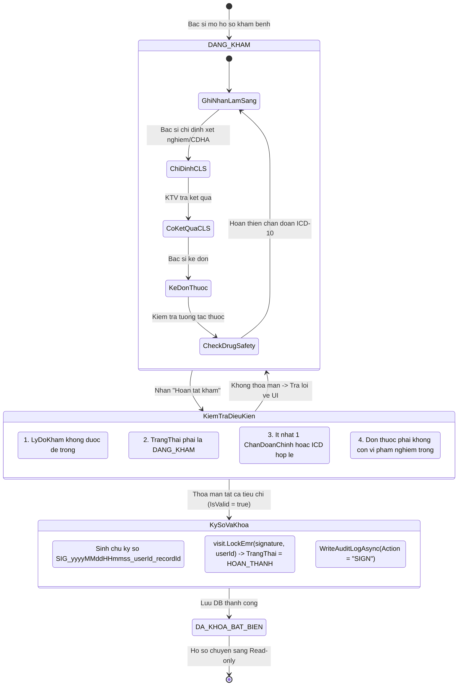

# 07 · FLOW QUẢN TRỊ HỆ THỐNG, PHÂN QUYỀN VÀ GIÁM SÁT LÂM SÀNG (SYSTEM & CLINICAL GOVERNANCE FLOW)

---

## Metadata

| Trường | Giá trị |
|---|---|
| **Tài liệu** | Đặc tả Luồng Hành vi Nghiệp vụ System Domain & Clinical Governance |
| **Mã flow** | `FL-007` (FLOW-07) |
| **Phiên bản** | 1.0.0 |
| **Ngày lập** | 2026-09-16 |
| **Tác giả** | Lead Business Analyst kiêm Technical Lead HIS/EMR |
| **Domain** | `ClinicManagement.Domain.System` |
| **Phân hệ phụ trách** | Core Governance, IAM, RBAC, EMR Compliance, Gateways |
| **Trạng thái** | `OFFICIAL / IMPLEMENTED` |
| **Liên quan** | FL-001 (Tiếp đón), FL-002 (Khám bệnh & EMR), FL-003 (Cận lâm sàng), FL-004 (Kê đơn), FL-005 (Viện phí), FL-006 (AI) |

---

## 1. Mô tả Tổng quan

Phân hệ **System Domain** (Quản trị Hệ thống và Giám sát Lâm sàng) là "hệ thần kinh trung ương" điều phối và bảo vệ toàn bộ kiến trúc HIS/EMR của phòng khám đa khoa / bệnh viện. Không chỉ dừng lại ở vai trò cấu hình phần cứng hay xác thực tài khoản thông thường, System Domain chịu trách nhiệm thực thi 5 trụ cột cốt lõi:

1. **Quản trị Danh tính & Vòng đời Phiên làm việc (IAM & Session Lifecycle):**
   - Xác thực đa nhân viên (`NhanVien`, `BenhNhan`), quản lý phiên thông qua cơ chế JWT kép (`AccessToken` ngắn hạn + `RefreshToken` kiểm soát thu hồi `IsRevoked`).
2. **Ma trận Phân quyền & Giới hạn Phạm vi Dữ liệu Đa tầng (Granular RBAC & DataScope Engine):**
   - Phân quyền chi tiết tới từng Hành động (`VIEW`, `CREATE`, `EDIT`, `DELETE`, `APPROVE`) trên từng Phân hệ (`patient`, `examination`, `cls`, `inventory`, `billing`, `audit`, `settings`).
   - Kiểm soát biên dữ liệu theo 4 cấp bậc (`ALL_FACILITIES` -> `FACILITY_ONLY` -> `BRANCH` -> `DEPARTMENT_ONLY`), bảo vệ quyền riêng tư bệnh án theo phòng ban điều trị.
3. **Nhật ký Kiểm toán Kép & Tuân thủ Pháp lý EMR (Dual Audit Trail - TT 46/2018/TT-BYT):**
   - Phân tách độc lập giữa **System AuditLog** (biến động CSDL vật lý) và **EmrAuditLog** (nhật ký y khoa bất biến chuyên biệt cho bệnh án điện tử, ghi nhận định danh người xem, người sửa, mã hồ sơ, hành vi và IP).
4. **Cấu hình Cổng Tích hợp Thiết bị & Chuẩn Y tế Ngoại vi (Integration Gateway Manager):**
   - Quản trị động cấu hình các giao thức kết nối: Cận lâm sàng LIS (HL7 MLLP port 2575), Chẩn đoán hình ảnh PACS (DICOM C-STORE, C-FIND, AE Title port 104, URL DICOM Viewer), và Cổng giám định BHYT (chuẩn XML 4210 / Quyết định 130/QĐ-BYT).
5. **Tham số Vận hành Đa cơ sở (Multi-Facility System Parameters):**
   - Quản lý các biến môi trường và chính sách viện phí theo từng chi nhánh/cơ sở (`MaCoSo`).

---

## 2. Các Actors Tham Gia

| Actor | Vai trò trong System Domain | Quyền hạn & Tương tác |
|---|---|---|
| **Super Admin / Giám đốc Hệ thống** | Quản trị tối cao | Xem/Sửa toàn bộ cấu hình, ma trận quyền toàn hệ thống (`ALL_FACILITIES`), xuất nhật ký kiểm toán EMR. |
| **Quản trị Cơ sở (Branch Admin)** | Quản lý chi nhánh | Quản lý phân quyền nội bộ cơ sở (`FACILITY_ONLY`), cấu hình cổng kết nối máy xét nghiệm/PACS tại cơ sở. |
| **Bác sĩ Điều trị (Doctor)** | Người thực hiện lâm sàng | Bị ràng buộc DataScope `DEPARTMENT_ONLY`. Thực hiện ký số EMR (`SIGN`), ghi nhận nhật ký truy cập bệnh án. |
| **Dược sĩ (Pharmacist)** | Quản lý kho dược | Bị ràng buộc DataScope `FACILITY_ONLY`. Phê duyệt xuất/nhập/cấp phát thuốc. |
| **Thu ngân (Cashier)** | Quản lý viện phí | Bị ràng buộc DataScope `FACILITY_ONLY`. Mở/đóng ca thu ngân, phát hành hóa đơn. |
| **Bộ phận Pháp chế & Giám định BHYT** | Kiểm toán & Thanh tra | Truy xuất nhật ký EMR Audit Trail để đối chiếu sai sót, chứng minh tính toàn vẹn hồ sơ bệnh án theo pháp luật. |
| **Máy chủ Thiết bị Ngoại vi (LIS/PACS/BHYT)** | External System Agents | Tiếp nhận/Gửi dữ liệu qua các endpoint tích hợp dựa trên tham số được cấu hình tại `IntegrationSetting`. |

---

## 3. Pre-conditions & Post-conditions

### 3.1 Pre-conditions
- CSDL đã chạy Migration tạo bảng cấu trúc `RolePermissionMatrix`, `EmrAuditLog`, `IntegrationSetting`, `AuditLog`, `RefreshToken`, `ThamSoHeThong`.
- Người dùng thực hiện thao tác quản trị phải sở hữu JWT Token hợp lệ chứa claim `sub` / `userId` và có quyền `settings:VIEW` hoặc `settings:EDIT` với Scope `ALL_FACILITIES`.
- Khóa bí mật (Secret Key) dùng để mã hóa các thông tin nhạy cảm (`IsEncrypted`) trong `IntegrationSetting` được cấu hình an toàn trên server.

### 3.2 Post-conditions
- Mọi thao tác tác động vào cấu hình hoặc bệnh án phải được ghi nhận vào `EmrAuditLog` hoặc `AuditLog` với đầy đủ timestamp UTC, Actor ID và IP Address.
- Việc thay đổi ma trận phân quyền có hiệu lực ngay lập tức trong chu kỳ kiểm tra tiếp theo của `ClinicalAuthorizeFilter` mà không cần khởi động lại dịch vụ Backend.
- Hồ sơ EMR khi bị khóa (`LockEmr`) chuyển sang chế độ bất biến (Read-only), ngăn chặn hoàn toàn thao tác EDIT/DELETE từ tầng ứng dụng.

---

## 4. Kiến Trúc Vận Hành Toàn Cục (Global Architecture)

```
┌──────────────────────────────────────────────────────────────────────────┐
│                             CLIENT LAYERS                                │
│   ┌───────────────────────────┐          ┌───────────────────────────┐   │
│   │   ClinicManagement.AdminUI│          │  ClinicManagement.DoctorUI│   │
│   │  - RoleManagementPage     │          │  - ElectronicRecord       │   │
│   │  - AuditLogPage           │          │  - TreatmentWorkspace     │   │
│   │  - IntegrationConfigPage  │          │  - Sticky Allergy Banner  │   │
│   └─────────────┬─────────────┘          └─────────────┬─────────────┘   │
└─────────────────┼──────────────────────────────────────┼─────────────────┘
                  │ HTTPS REST                           │ HTTPS REST
┌─────────────────▼──────────────────────────────────────▼─────────────────┐
│                      API GATEWAY & AUTHORIZATION                         │
│                                                                          │
│   [ClinicalAuthorizeAttribute] ──► [ClinicalAuthorizeFilter]             │
│                                                   │                      │
│                                                   ▼                      │
│                                     [ClinicalGovernanceService]          │
│                                     - HasPermissionAsync()               │
│                                     - IsScopeAllowed()                   │
└───────────────────────────────────────────────────┬──────────────────────┘
                                                    │
┌───────────────────────────────────────────────────▼──────────────────────┐
│                    APPLICATION & GOVERNANCE CORE                         │
│                                                                          │
│   ┌──────────────────────────┐           ┌───────────────────────────┐   │
│   │  IAM & RBAC Resolution   │           │   EMR Legal Compliance    │   │
│   │  - GetRoleMatrixAsync    │           │   - LockEmrAsync          │   │
│   │  - SaveRoleMatrixAsync   │           │   - ValidateCompletion    │   │
│   │  - Scope Enforcement     │           │   - WriteAuditLogAsync    │   │
│   └─────────────┬────────────┘           └─────────────┬─────────────┘   │
│                 │                                      │                 │
│   ┌─────────────▼────────────┐           ┌─────────────▼─────────────┐   │
│   │  Gateway Integrations    │           │    Clinical Drug Safety   │   │
│   │  - LIS / PACS / BHYT     │           │   - Allergy Cross-Check   │   │
│   │  - Sensitive Encryption  │           │   - Duplicate Ingredients │   │
│   └─────────────┬────────────┘           └─────────────┬─────────────┘   │
└─────────────────┼──────────────────────────────────────┼─────────────────┘
                  │ EF Core DbContext                    │
┌─────────────────▼──────────────────────────────────────▼─────────────────┐
│                    PERSISTENCE & REPOSITORIES LAYER                      │
│                                                                          │
│   ┌──────────────────────────────────────────────────────────────────┐   │
│   │  ClinicDbContext (AuditLogs, EmrAuditLogs, IntegrationSettings,  │   │
│   │                   RefreshTokens, RolePermissionMatrix, ThamSo)   │   │
│   └──────────────────────────────────────────────────────────────────┘   │
│      ├── RolePermissionMatrixRepository (ReplaceRoleAsync)               │
│      ├── EmrAuditLogRepository (GetByFilterAsync, AddAsync)              │
│      ├── IntegrationSettingRepository (UpsertAsync, GetByCategory)       │
│      └── ClinicalAccessRepository (GetRoleNamesByUser, GetRoleIds)       │
└──────────────────────────────────────────────────────────────────────────┘
```

---

## 5. Chi Tiết 5 Sub-Flow Nghiệp Vụ Hành Vi

### SUB-FLOW 01: Quản Trị Danh Tính & Vòng Đời Phiên Làm Việc (IAM & Session Flow)

Mục tiêu: Đảm bảo xác thực chặt chẽ, hỗ trợ cả mật khẩu mã hóa BCrypt/PBKDF2 lẫn kế thừa mật khẩu cũ an toàn, cấp phát cặp JWT Token và kiểm soát thu hồi tức thời.



---

### SUB-FLOW 02: Ma Trận Phân Quyền & Kiểm Soát Phạm Vi Dữ Liệu (Granular RBAC & DataScope Engine)

Mục tiêu: Đảm bảo nguyên tắc đặc quyền tối thiểu (Least Privilege). Mỗi request API được chặn bởi Filter để kiểm tra module, hành động và phạm vi địa bàn.

#### Ma trận Quy tắc Kế thừa Phạm vi Dữ liệu (Scope Hierarchy)
Quy tắc xử lý trong `ClinicalGovernanceService.IsScopeAllowed(granted, requested)`:
- `ALL_FACILITIES`: Cấp cao nhất, có quyền xem/sửa dữ liệu của toàn bộ phòng khám và chi nhánh.
- `FACILITY_ONLY`: Chỉ được phép tác động trên dữ liệu cùng cơ sở (`MaCoSo`). Cho phép truy cập tài nguyên cấp con `BRANCH`.
- `BRANCH`: Tương đương hoặc trực thuộc `FACILITY_ONLY`.
- `DEPARTMENT_ONLY`: Bị cô lập nghiêm ngặt, chỉ được thao tác trên dữ liệu thuộc Khoa/Phòng mà người dùng được phân công công tác trong ngày.



#### Quy trình Cập nhật Động Ma trận Quyền (`POST /api/admin/roles`)
1. Client Admin gửi JSON chứa `id` (RoleId), `dataScope`, và `permissions` (Dictionary: module -> danh sách actions).
2. `ClinicalGovernanceService.SaveRoleMatrixAsync`:
   - Xác thực: `RoleId > 0`, `Code` không rỗng.
   - Gọi `IRolePermissionMatrixRepository.ReplaceRoleAsync`:
     - Xóa toàn bộ các dòng hiện có của `RoleId` trong bảng `RolePermissionMatrix`.
     - Chèn hàng loạt (Bulk Insert) danh sách `RolePermissionMatrix` mới với cờ `IsAllowed = true`.
     - Lưu giao dịch CSDL (`SaveChangesAsync`).
   - Có hiệu lực ngay lập tức cho toàn bộ các request sau đó mà không cần khởi động lại backend.

---

### SUB-FLOW 03: Nhật Ký Kiểm Toán Bệnh Án Điện Tử (EMR Legal Audit Trail Flow)

Mục tiêu: Tuân thủ quy định tại Điều 7 và Điều 12 **Thông tư 46/2018/TT-BYT** về Bệnh án điện tử: Mọi hành vi đọc, sửa, xóa, ký số, xuất file hồ sơ bệnh án phải được ghi nhận vết điện tử bất biến, không thể chỉnh sửa hay làm sai lệch.



#### Quy cách Bảng Ghi EMR Audit Log

| Trường Dữ Liệu | Kiểu Dữ Liệu | Ràng Buộc | Ý Nghĩa Nghiệp Vụ Lâm Sàng |
|---|---|---|---|
| `Id` | `int` | Primary Key | Định danh duy nhất của bản ghi nhật ký kiểm toán |
| `PatientId` | `int` | Bắt buộc | Mã định danh duy nhất của bệnh nhân sở hữu hồ sơ |
| `RecordId` | `int` | Bắt buộc | Mã lượt khám (`LuotKhamId`) hoặc bệnh án điện tử tương ứng |
| `UserId` | `int` | Bắt buộc | Mã nhân viên y tế thực hiện thao tác |
| `Action` | `string` | Bắt buộc | Hành động pháp lý: `VIEW`, `EDIT`, `SIGN`, `LOCK`, `EXPORT`, `DELETE` |
| `Module` | `string` | Default "EMR" | Phân hệ phát sinh: `EMR`, `RX` (Đơn thuốc), `LAB` (Cận lâm sàng), `BILLING` |
| `IpAddress` | `string` | IPv4/IPv6 | Địa chỉ IP của máy trạm thực hiện thao tác (chống chối bỏ) |
| `Timestamp` | `DateTime` | UTC | Thời khắc chuẩn phát sinh hành động |
| `Details` | `string` | Nullable | Chi tiết tóm tắt nội dung can thiệp y khoa / lý do khám |
| `Status` | `string` | SUCCESS/FAIL | Trạng thái thực thi thao tác |

---

### SUB-FLOW 04: Quản Trị Cổng Tích Hợp Ngoại Vi (LIS / PACS / BHYT Gateways)

Mục tiêu: Cho phép đội ngũ kỹ thuật cấu hình tham số kết nối các thiết bị cận lâm sàng và cổng bảo hiểm xã hội tập trung, mã hóa bảo vệ các tham số nhạy cảm (mật khẩu API, token bí mật) và lưu vết người cập nhật.



#### Ma trận Cấu hình Cổng Tích hợp Mặc định (Integration Matrix)

| Danh mục (`Category`) | Mã cấu hình (`Code`) | Tên hiển thị | Giá trị mặc định | Mô tả kỹ thuật |
|---|---|---|---|---|
| **LIS** | `LIS_HOST` | Địa chỉ máy chủ LIS | `192.168.1.50` | IP máy chủ LIS nhận gói tin HL7 |
| **LIS** | `LIS_PORT` | Cổng kết nối MLLP | `2575` | Chuẩn Minimal Lower Layer Protocol (MLLP) |
| **LIS** | `LIS_CHARSET` | Bảng mã ký tự | `UTF-8` | Định dạng font tiếng Việt cho kết quả xét nghiệm |
| **PACS** | `PACS_AE_TITLE` | Application Entity Title | `CLINIC_PACS` | AE Title định danh máy trạm trong mạng DICOM |
| **PACS** | `PACS_PORT` | Cổng DICOM Storage | `104` | Cổng chuẩn DICOM C-STORE / C-FIND |
| **PACS** | `PACS_VIEWER_URL` | Đường dẫn DICOM Web Viewer | `https://pacs.clinic.local/viewer/{studyUid}` | Template URL xem phim trực tiếp trên DoctorUI |
| **BHYT** | `BHYT_FACILITY_CODE`| Mã định danh cơ sở KCB | `79001` | Mã số khám chữa bệnh theo danh mục Bộ Y tế |
| **BHYT** | `BHYT_GATEWAY_URL` | URL Cổng giám định BHYT | `https://giamdinhbhyt.baohiemxahoi.gov.vn/api` | Endpoint tiếp nhận gói XML 4210/QĐ 130 |
| **BHYT** | `BHYT_API_KEY` | Khóa xác thực Cổng BHYT | `********` | `isEncrypted = true` - Bảo mật chuỗi khóa |

---

### SUB-FLOW 05: Khóa Bệnh Án Điện Tử & Giám Sát Điều Kiện Hoàn Tất (EMR Lock & Validation)

Mục tiêu: Đảm bảo tính hợp lệ y khoa trước khi hoàn tất đợt khám và đóng vĩnh viễn hồ sơ bệnh án, không cho phép chỉnh sửa hồi tố (Anti-Tampering).



---

## 6. Đặc Tả DTOs & API Contracts (System Domain)

### 6.1 Nhóm API Ma Trận Quyền (`/api/admin/roles`)

#### `GET /api/admin/roles`
- **Quyền yêu cầu:** `[ClinicalAuthorize("settings", PermissionAction.VIEW, DataScope.ALL_FACILITIES)]`
- **Response Model:** `ApiResponse<List<RolePermissionMatrixDto>>`
```json
{
  "success": true,
  "data": [
    {
      "id": 1,
      "code": "ADMIN",
      "name": "Quản trị viên",
      "description": "Toàn quyền hệ thống",
      "dataScope": "ALL_FACILITIES",
      "permissions": {
        "patient": ["VIEW", "CREATE", "EDIT", "DELETE", "APPROVE"],
        "examination": ["VIEW", "CREATE", "EDIT", "DELETE", "APPROVE"],
        "cls": ["VIEW", "CREATE", "EDIT", "DELETE", "APPROVE"],
        "inventory": ["VIEW", "CREATE", "EDIT", "DELETE", "APPROVE"],
        "billing": ["VIEW", "CREATE", "EDIT", "DELETE", "APPROVE"],
        "audit": ["VIEW", "CREATE", "EDIT", "DELETE", "APPROVE"],
        "settings": ["VIEW", "CREATE", "EDIT", "DELETE", "APPROVE"]
      }
    },
    {
      "id": 2,
      "code": "DOCTOR",
      "name": "Bác sĩ điều trị",
      "description": "Khám chữa bệnh, chỉ định cận lâm sàng, kê đơn",
      "dataScope": "DEPARTMENT_ONLY",
      "permissions": {
        "patient": ["VIEW"],
        "examination": ["VIEW", "CREATE", "EDIT", "APPROVE"],
        "cls": ["VIEW", "CREATE"],
        "inventory": ["VIEW"],
        "billing": ["VIEW"],
        "audit": ["VIEW"]
      }
    }
  ],
  "message": "Thành công"
}
```

#### `POST /api/admin/roles`
- **Quyền yêu cầu:** `[ClinicalAuthorize("settings", PermissionAction.EDIT, DataScope.ALL_FACILITIES)]`
- **Request Model:** `UpdateRolePermissionRequest`
```json
{
  "id": 2,
  "code": "DOCTOR",
  "name": "Bác sĩ điều trị",
  "description": "Cập nhật quyền duyệt kết quả cận lâm sàng",
  "dataScope": 3,
  "permissions": {
    "patient": [1],
    "examination": [1, 2, 3, 5],
    "cls": [1, 2, 5],
    "inventory": [1],
    "billing": [1],
    "audit": [1]
  }
}
```

---

### 6.2 Nhóm API Kiểm Toán EMR (`/api/admin/audit-logs`)

#### `GET /api/admin/audit-logs`
- **Query Params:** `patientId`, `userId`, `action`, `module`, `from`, `to`, `pageIndex`, `pageSize`
- **Quyền yêu cầu:** `[ClinicalAuthorize("audit", PermissionAction.VIEW, DataScope.ALL_FACILITIES)]`
- **Response Model:** `ApiResponse<List<EmrAuditLogDto>>`
```json
{
  "success": true,
  "data": [
    {
      "id": 1045,
      "patientId": 42,
      "recordId": 128,
      "userId": 5,
      "userName": "bs_nam",
      "userRole": "DOCTOR",
      "action": "SIGN",
      "module": "EMR",
      "ipAddress": "192.168.1.120",
      "timestamp": "2026-09-16T14:30:00Z",
      "details": "Bác sĩ hoàn tất khám và ký số hồ sơ bệnh án",
      "status": "SUCCESS"
    }
  ],
  "message": "Thành công"
}
```

#### `GET /api/admin/audit-logs/export`
- **Mục đích:** Xuất báo cáo thanh tra pháp lý bệnh án điện tử định dạng CSV (tối đa 10.000 dòng).
- **Headers:** `Content-Type: text/csv; charset=utf-8`, `Content-Disposition: attachment; filename="emr-audit-20260916143000.csv"`

---

## 7. RACI Matrix của System Domain

| Nghiệp vụ / Hành vi | Admin Hệ Thống | Trưởng Khoa / Bác sĩ Lead | Bác sĩ Thực Hiện | Kỹ Sư Hệ Thống (DevOps/IT) | Giám Định / Pháp Chế |
|---|:---:|:---:|:---:|:---:|:---:|
| Khởi tạo & Cấp phát Tài khoản | **A / R** | C | I | R | I |
| Cấu hình Ma trận Quyền & DataScope | **A** | C | I | R | C |
| Khóa Hồ Sơ Bệnh Án Điện Tử (`SIGN`) | I | A | **R** | I | I |
| Cấu hình Cổng Tích hợp LIS/PACS/BHYT | A | I | I | **R** | C |
| Xem & Xuất Báo Cáo EMR Audit Trail | **A** | I | I | R | **R** |
| Thu hồi RefreshToken phiên làm việc | **A / R** | I | I | R | I |

*Ghi chú: **A** - Accountable (Chịu trách nhiệm chính), **R** - Responsible (Người thực thi), **C** - Consulted (Tham vấn), **I** - Informed (Nhận thông báo).*

---

## 8. Bảng Đối Chiếu Mã Nguồn Hiện Hữu (Codebase Alignment)

| Khái niệm / Thành phần | Vị trí Source Code Backend | Vị trí Source Code Frontend | Trạng thái Nghiệm thu |
|---|---|---|:---:|
| **Role Permission Matrix** | `Domain/System/RolePermissionMatrix.cs`<br>`Infrastructure/Persistence/Repositories/System/RolePermissionMatrixRepository.cs` | `AdminUI/src/settings/pages/RoleManagementPage.jsx`<br>`AdminUI/src/settings/api/settings.api.ts` | **ĐÃ HOÀN THIỆN 100%** |
| **DataScope Enforcement** | `Domain/Common/Enums/DataScope.cs`<br>`API/Authorization/ClinicalAuthorizeFilter.cs`<br>`Application/Services/ClinicalGovernanceService.cs` | `RoleManagementPage.jsx` (Lựa chọn DataScope cấp độ Cơ sở/Khoa) | **ĐÃ HOÀN THIỆN 100%** |
| **EMR Legal Audit Trail** | `Domain/System/EmrAuditLog.cs`<br>`Infrastructure/Persistence/Repositories/System/EmrAuditLogRepository.cs`<br>`API/Controllers/AdminSettingsController.cs` | `AdminUI/src/settings/pages/AuditLogPage.jsx` (Bộ lọc + Phân trang + Export CSV) | **ĐÃ HOÀN THIỆN 100%** |
| **Integration Settings** | `Domain/System/IntegrationSetting.cs`<br>`Infrastructure/Persistence/Repositories/System/IntegrationSettingRepository.cs` | `AdminUI/src/settings/pages/IntegrationConfigPage.jsx` (Tabs LIS/PACS/BHYT) | **ĐÃ HOÀN THIỆN 100%** |
| **EMR Lock & Signature** | `Domain/Examination/LuotKham/LuotKham.cs` (`LockEmr`)<br>`Application/Services/ClinicalGovernanceService.cs` (`LockEmrAsync`) | `DoctorUI/src/examination/components/workspaces/ElectronicRecordWorkspace.tsx` | **ĐÃ HOÀN THIỆN 100%** |
| **Multi-Facility System Parameters** | `Domain/System/ThamSoHeThong.cs`<br>`Infrastructure/Persistence/ClinicDbContext.cs` | Bảng cấu hình tham số cơ sở | **ĐÃ HOÀN THIỆN 100%** |
