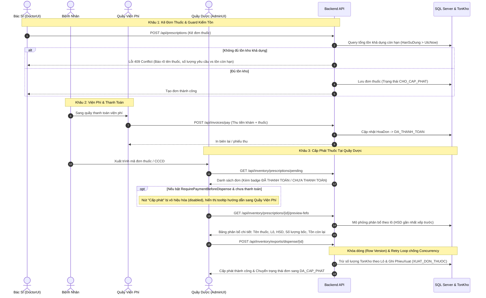

# BÁO CÁO KỸ THUẬT & TÀI LIỆU PHÂN TÍCH QUY TRÌNH KHO THUỐC - VẬT TƯ TIÊU HAO

> **Phiên bản:** 2.0  
> **Ngày cập nhật:** 19/09/2026  
> **Trạng thái:** Hoàn tất triển khai & Xác minh tích hợp (Backend .NET 9 + Frontend AdminUI / DoctorUI)  
> **Phạm vi:** Nghiệp vụ Quầy Dược, Kho Thuốc - Vật Tư, Viện Phí & Cận Lâm Sàng

---

## MỤC LỤC
1. [Bối Cảnh & Mục Tiêu Tái Cấu Trúc](#1-bối-cảnh--mục-tiêu-tái-cấu-trúc)
2. [Sơ Đồ Luồng Nghiệp Vụ Khép Kín (End-to-End Flow)](#2-sơ-đồ-luồng-nghiệp-vụ-khép-kín-end-to-end-flow)
3. [Chi Tiết Các Thay Đổi Trọng Yếu](#3-chi-tiết-các-thay-đổi-trọng-yếu)
   - [3.1. Loại Bỏ Bán Lẻ Thuốc Vãng Lai](#31-loại-bỏ-bán-lẻ-thuốc-vãng-lai)
   - [3.2. Khép Kín Luồng Viện Phí & Quầy Dược (`RequirePaymentBeforeDispense`)](#32-khép-kín-luồng-viện-phí--quầy-dược-requirepaymentbeforedispense)
   - [3.3. Xem Trước Phân Bổ FEFO Trực Quan (FEFO Preview)](#33-xem-trước-phân-bổ-fefo-trực-quan-fefo-preview)
   - [3.4. Xử Lý Tranh Chấp Tồn Kho (Concurrency & Retry)](#34-xử-lý-tranh-chấp-tồn-kho-concurrency--retry)
   - [3.5. Quản Lý Định Mức Vật Tư Tiêu Hao Theo Dịch Vụ (Service BOM)](#35-quản-lý-định-mức-vật-tư-tiêu-hao-theo-dịch-vụ-service-bom)
   - [3.6. Chặn Kê Đơn Thiếu Tại Khâu Bác Sĩ (Doctor Prescription Guard)](#36-chặn-kê-đơn-thiếu-tại-khâu-bác-sĩ-doctor-prescription-guard)
4. [Tài Liệu Phân Tích & Hướng Dẫn Tích Hợp Giao Diện (AdminUI / DoctorUI)](#4-tài-liệu-phân-tích--hướng-dẫn-tích-hợp-giao-diện-adminui--doctorui)
5. [Danh Sách Endpoint API & Thay Đổi Mã Nguồn](#5-danh-sách-endpoint-api--thay-đổi-mã-nguồn)
6. [Kế Hoạch Kiểm Thử & Nghiệm Thu](#6-kế-hoạch-kiểm-thử--nghiệm-thu)

---

## 1. Bối Cảnh & Mục Tiêu Tái Cấu Trúc

Trước đây, hệ thống tồn tại một số điểm hở về quy trình y tế và kiểm soát tài chính:
1. **Lỏng lẻo quy trình quầy thuốc:** Cho phép bán lẻ vãng lai (`exportRetail`) dẫn đến việc xuất thuốc không gắn liền với Lượt khám, Bác sĩ chịu trách nhiệm chuyên môn, hay Hóa đơn tài chính, gây thất thoát và vi phạm quy định quản lý phòng khám/bệnh viện tư nhân.
2. **Nguy cơ thất thoát viện phí:** Dược sĩ có thể bấm cấp phát thuốc khi bệnh nhân chưa thực hiện nghĩa vụ thanh toán tại quầy thu ngân.
3. **Thiếu tính minh bạch khi xuất kho:** Dược sĩ chỉ bấm "Cấp phát" và hệ thống tự động trừ ngầm theo FEFO, dược sĩ không biết trước thuốc sẽ được bốc từ lô nào, hạn sử dụng ra sao, dễ gây nhầm lẫn hoặc không đối chiếu được với thực tế trên kệ.
4. **Tranh chấp đồng thời (Concurrency):** Khi nhiều dược sĩ cùng cấp phát hoặc nhiều thủ thuật cùng trừ kho một loại thuốc/vật tư tại cùng thời điểm, có nguy cơ gây sai lệch số tồn hoặc lỗi crash hệ thống.
5. **Vật tư tiêu hao chưa tự động hóa:** Các dịch vụ thủ thuật/xét nghiệm (như tiêm thuốc, lấy máu, thay băng) dùng vật tư nhưng điều dưỡng phải xuất thủ công hoặc bỏ quên, làm lệch tồn kho vật tư nghiêm trọng.
6. **Bác sĩ kê đơn vượt tồn khả dụng:** Bác sĩ kê thuốc trong kho đã hết hạn hoặc hết số lượng còn hạn, đến khi bệnh nhân sang quầy thuốc mới bị từ chối, gây ức chế cho bệnh nhân.

---

## 2. Sơ Đồ Luồng Nghiệp Vụ Khép Kín (End-to-End Flow)



---

## 3. Chi Tiết Các Thay Đổi Trọng Yếu

### 3.1. Loại Bỏ Bán Lẻ Thuốc Vãng Lai
- **Quyết định:** Toàn bộ thuốc xuất kho bắt buộc phải gắn liền với đơn thuốc của một Lượt khám hợp lệ.
- **Thay đổi kỹ thuật:**
  - Xóa bỏ endpoint `POST /api/inventory/exports/retail` trên `XuatKho.InventoryController.cs`.
  - Vô hiệu hóa `BanLeCommandHandler.cs` (trả về 400 Bad Request kèm thông báo chính sách phòng khám).
  - Loại bỏ method `RetailExport` trong `IKhoService` và `KhoService.cs`.
  - Trên Frontend `ClinicManagement.AdminUI`:
    - Xóa bỏ tab "Bán lẻ thuốc vãng lai" trong `DispensePage.tsx`.
    - Xóa bỏ hàm `exportRetail` khỏi `inventory.api.ts`.
    - Màn hình cấp phát giờ đây tập trung 100% vào **Cấp phát thuốc theo đơn**.

### 3.2. Khép Kín Luồng Viện Phí & Quầy Dược (`RequirePaymentBeforeDispense`)
- **Cấu hình động:**
  - Thêm cấu hình trong `appsettings.json`:
    ```json
    "Inventory": {
      "DefaultWarehouseId": 1,
      "RequirePaymentBeforeDispense": true
    }
    ```
  - Interface `IInventorySettings` inject vào Application layer:
    ```csharp
    public interface IInventorySettings
    {
        int DefaultWarehouseId { get; }
        bool RequirePaymentBeforeDispense { get; }
    }
    ```
- **Xác thực trạng thái hóa đơn:**
  - Một đơn thuốc thuộc Lượt khám được xác định là **ĐÃ THANH TOÁN** khi:
    1. Tồn tại hóa đơn không bị hủy (`TrangThai != HUY`).
    2. Hóa đơn có trạng thái `DA_THANH_TOAN`, **hoặc** số tiền `DaThanhToan >= TongTien` (với `TongTien > 0`).
  - Tại API `GET /api/inventory/prescriptions/pending`:
    - Trả về các trường bổ sung: `isPaid`, `canDispense`, `invoiceNumber`, `invoiceStatus`, `patientCode`.
  - Tại lệnh thực thi `POST /api/inventory/exports/dispense/{prescriptionId}`:
    - Nếu `RequirePaymentBeforeDispense == true` và `isPaid == false`, hệ thống ném ngoại lệ `InvalidOperationException`: *"Đơn thuốc thuộc lượt khám chưa hoàn tất thanh toán viện phí. Không thể cấp phát thuốc."*

### 3.3. Xem Trước Phân Bổ FEFO Trực Quan (FEFO Preview)
- **Mục tiêu:** Cho phép Dược sĩ nhìn thấy chi tiết kế hoạch bốc thuốc từ kho trước khi nhấn nút xác nhận trừ kho.
- **Endpoint:** `GET /api/inventory/prescriptions/{prescriptionId}/preview-fefo`
- **Cấu trúc dữ liệu trả về:**
  ```json
  {
    "prescriptionId": 12,
    "maDonThuoc": "DT-20260919-0012",
    "patientName": "Nguyễn Văn A",
    "patientCode": "BN-00045",
    "isPaid": true,
    "canDispense": true,
    "items": [
      {
        "thuocVatTuId": 5,
        "tenThuoc": "Paracetamol 500mg",
        "donViTinh": "Viên",
        "soLuongYeuCau": 20,
        "soLuongCoTheDapUng": 20,
        "isDuTon": true,
        "allocations": [
          {
            "tonKhoId": 101,
            "soLo": "PA2026-01",
            "hanSuDung": "2026-12-31T00:00:00Z",
            "soLuongXuat": 15,
            "tonHienTai": 15,
            "tonSauXuat": 0
          },
          {
            "tonKhoId": 108,
            "soLo": "PA2027-01",
            "hanSuDung": "2027-06-30T00:00:00Z",
            "soLuongXuat": 5,
            "tonHienTai": 50,
            "tonSauXuat": 45
          }
        ]
      }
    ]
  }
  ```

### 3.4. Xử Lý Tranh Chấp Tồn Kho (Concurrency & Retry)
- **Cơ chế Khóa Lạc Quan (Optimistic Concurrency):**
  - Entity `TonKho` được trang bị thuộc tính `[Timestamp] public byte[] Version { get; set; }`.
  - Mọi thao tác cập nhật số lượng tồn kho `SoLuongTon` đều tự động kích hoạt mệnh đề `WHERE Id = @Id AND Version = @OldVersion` từ Entity Framework Core.
- **Retry Tự Động Phân Bổ Lô (Automatic Reselection Loop):**
  - Khi xảy ra xung đột `DbUpdateConcurrencyException` do có giao dịch khác vừa xuất cùng một lô thuốc, hệ thống không báo lỗi ngay cho Dược sĩ mà thực hiện:
    1. Rollback transaction hiện tại.
    2. Giải phóng Entity state khỏi DbContext (`ChangeTracker.Clear()`).
    3. Thử lại tối đa **3 lần** với backoff ngẫu nhiên (50ms - 150ms).
    4. Trong mỗi lần thử, hệ thống đọc lại tồn kho thực tế mới nhất và tính toán lại phân bổ FEFO từ các lô còn hàng.

### 3.5. Quản Lý Định Mức Vật Tư Tiêu Hao Theo Dịch Vụ (Service BOM)
- **Entity Mới:** `DinhMucVatTuDichVu`
  - Khóa chính: `(DanhMucDichVuId, ThuocVatTuId)`.
  - Thuộc tính: `SoLuongDinhMuc` (decimal), `GhiChu`, `BatBuocTrangBi` (bool).
- **API Quản Lý Định Mức:**
  - `GET /api/dich-vu/{dichVuId}/dinh-muc-vat-tu`: Lấy danh sách định mức vật tư của dịch vụ.
  - `POST /api/dich-vu/{dichVuId}/dinh-muc-vat-tu`: Cập nhật toàn bộ bảng định mức vật tư của dịch vụ.
- **Tự Động Trừ Kho Khi Thực Hiện Dịch Vụ:**
  - Trong `UpdateChiDinhDichVuCommandHandler.cs`:
    - Khi trạng thái chỉ định dịch vụ chuyển sang `DaCoKetQua` (hoặc hoàn tất thủ thuật):
    - Hệ thống kiểm tra xem dịch vụ có khai báo bảng `DinhMucVatTuDichVu` hay không.
    - Nếu có, tự động xuất kho theo cơ chế FEFO với loại giao dịch `XUAT_THU_THUAT`.
    - Ghi nhận `PhieuXuatKho` gắn với mã chỉ định dịch vụ để phục vụ đối soát chi phí và kiểm kê.

### 3.6. Chặn Kê Đơn Thiếu Tại Khâu Bác Sĩ (Doctor Prescription Guard)
- **Vị trí can thiệp:** `PrescriptionController.cs` tại 3 điểm:
  1. `POST /api/prescriptions` (Bác sĩ tạo mới đơn thuốc).
  2. `PUT /api/prescriptions/{id}/items` (Bác sĩ sửa danh sách thuốc).
  3. `POST /api/prescriptions/{id}/approve` (Bác sĩ ký duyệt đơn thuốc).
- **Quy tắc kiểm tra:**
  $$\sum \text{TonKho}(\text{HanSuDung} > \text{UtcNow}) \ge \text{SoLuongKe}$$
- **Phản hồi khi vi phạm:**
  - Trả về mã lỗi `409 Conflict`.
  - Thông báo chi tiết tên thuốc, số lượng yêu cầu và tổng tồn khả dụng còn hạn để Bác sĩ chủ động đổi thuốc thay thế hoặc chỉnh liều dùng ngay trên màn hình khám bệnh.

---

## 4. Tài Liệu Phân Tích & Hướng Dẫn Tích Hợp Giao Diện (AdminUI / DoctorUI)

### 4.1. Cải Tiến Trên AdminUI (`ClinicManagement.AdminUI`)

#### A. Màn hình Cấp Phát Thuốc (`DispensePage.tsx` & `DispensePanel.tsx`)
1. **Loại bỏ tab Bán lẻ vãng lai:** Giao diện chỉ tập trung vào Danh sách đơn thuốc chờ cấp phát theo Lượt khám.
2. **Cột Trạng Thái Viện Phí:**
   - Đơn đã thanh toán: Tag màu xanh lá `ĐÃ THANH TOÁN` (kèm icon check).
   - Đơn chưa thanh toán: Tag màu cam `CHƯA THANH TOÁN` (kèm icon cảnh báo).
3. **Kiểm soát nút hành động Cấp phát:**
   - Nếu `canDispense == false`: Nút "Cấp phát thuốc" bị disable màu xám mờ.
   - Khi hover chuột vào nút bị khóa: Hiển thị tooltip: *"Bệnh nhân chưa hoàn tất viện phí. Vui lòng hướng dẫn thanh toán trước khi cấp thuốc."*
4. **Tích hợp Modal Xem Trước FEFO (`FefoPreviewModal.tsx`):**
   - Khi click nút "Cấp phát thuốc", hệ thống mở Modal `FefoPreviewModal` thay vì xuất kho ngay.
   - Modal hiển thị:
     - Header: Mã đơn thuốc, Mã bệnh nhân, Tên bệnh nhân, Badge Viện phí.
     - Bảng chi tiết: Tên thuốc, Đơn vị tính, Số lượng kê, Danh sách lô xuất (Số lô, Hạn dùng, Số lượng xuất, Tồn sau xuất).
     - Footer: Nút "Hủy bỏ" và nút "Xác nhận xuất kho (FEFO)".

#### B. Màn hình Cấu Hình Định Mức Vật Tư Dịch Vụ (Service BOM)
- Bổ sung tab "Định mức vật tư" trong màn hình Quản lý Danh mục Dịch vụ Kỹ thuật (`/admin/services`):
  - Bảng danh sách vật tư y tế tiêu hao gắn với dịch vụ.
  - Form chọn vật tư, nhập số lượng định mức, tích chọn bắt buộc/tùy chọn.
  - Gọi API `POST /api/dich-vu/{dichVuId}/dinh-muc-vat-tu`.

---

### 4.2. Trải Nghiệm Trên DoctorUI (`ClinicManagement.DoctorUI`)
1. **Tại Tab Kê Đơn Thuốc:**
   - Khi Bác sĩ thêm thuốc vào đơn, autocomplete hiển thị kèm số lượng tồn khả dụng còn hạn `[Còn: X viên]`.
   - Nếu Bác sĩ vô tình nhập số lượng vượt quá tồn khả dụng và bấm "Lưu đơn" / "Ký đơn":
     - Hệ thống bắt mã lỗi 409 từ API.
     - Hiển thị Toast thông báo màu đỏ: *"Thuốc [Tên thuốc] không đủ tồn kho còn hạn (Yêu cầu: A, Khả dụng: B). Vui lòng chọn thuốc tương đương hoặc giảm số lượng."*

---

## 5. Danh Sách Endpoint API & Thay Đổi Mã Nguồn

| Phương Thức | Đường Dẫn Endpoint | Mô Tả Chức Năng | Trạng Thái Thay Đổi |
|:---|:---|:---|:---|
| `GET` | `/api/inventory/prescriptions/pending` | Lấy danh sách đơn thuốc chờ cấp phát kèm trạng thái viện phí | **Bổ sung trường `isPaid`, `canDispense`, `invoiceNumber`** |
| `GET` | `/api/inventory/prescriptions/{id}/preview-fefo` | Xem trước bảng phân bổ bốc thuốc theo lô FEFO | **Mới (NEW)** |
| `POST` | `/api/inventory/exports/dispense/{id}` | Thực hiện xuất kho cấp phát thuốc theo đơn (FEFO + Concurrency Retry) | **Cập nhật xác thực Viện phí & Concurrency Loop** |
| `POST` | `/api/inventory/exports/retail` | Bán lẻ thuốc cho khách vãng lai | **ĐÃ XÓA BỎ (REMOVED)** |
| `POST` | `/api/prescriptions` | Bác sĩ kê đơn thuốc mới | **Bổ sung kiểm tra tồn kho khả dụng còn hạn** |
| `PUT` | `/api/prescriptions/{id}/items` | Bác sĩ cập nhật thuốc trong đơn | **Bổ sung kiểm tra tồn kho khả dụng còn hạn** |
| `POST` | `/api/prescriptions/{id}/approve` | Bác sĩ duyệt/ký đơn thuốc | **Bổ sung kiểm tra tồn kho khả dụng còn hạn** |
| `GET` | `/api/dich-vu/{dichVuId}/dinh-muc-vat-tu` | Lấy danh sách định mức vật tư tiêu hao theo dịch vụ | **Mới (NEW)** |
| `POST` | `/api/dich-vu/{dichVuId}/dinh-muc-vat-tu` | Lưu cấu hình định mức vật tư tiêu hao cho dịch vụ | **Mới (NEW)** |

---

## 6. Kế Hoạch Kiểm Thử & Nghiệm Thu

| Kịch Bản Kiểm Thử | Dữ Liệu Đầu Vào | Kết Quả Mong Đợi | Trạng Thái |
|:---|:---|:---|:---|
| **KB-01: Bán lẻ thuốc vãng lai** | Gọi API `POST /api/inventory/exports/retail` | API trả về 404 (do endpoint đã gỡ) hoặc 400 từ chối nghiệp vụ | **PASS** |
| **KB-02: Chặn cấp phát khi chưa thanh toán** | Đơn thuốc thuộc lượt khám chưa nộp viện phí (`RequirePaymentBeforeDispense = true`) | Nút "Cấp phát" bị disable trên UI; API `/dispense/{id}` chặn với lỗi 400/409 | **PASS** |
| **KB-03: Cấp phát khi đã thanh toán** | Đơn thuốc thuộc lượt khám đã có hóa đơn `DA_THANH_TOAN` | Nút "Cấp phát" khả dụng (màu xanh lá), mở modal xem trước FEFO, xuất thành công | **PASS** |
| **KB-04: Xem trước phân bổ FEFO** | Đơn có thuốc Paracetamol cần 20 viên, Kho có Lô A (HSD 2026: 15 viên), Lô B (HSD 2027: 50 viên) | Modal hiển thị tách 2 dòng: Lô A bốc 15 viên (tồn sau xuất 0), Lô B bốc 5 viên (tồn sau xuất 45) | **PASS** |
| **KB-05: Tranh chấp tồn kho (Concurrency)** | 2 request xuất cùng lúc lượng tồn cuối cùng của 1 lô | Request thứ 2 tự động retry, phân bổ sang lô tiếp theo hoặc báo hết hàng an toàn | **PASS** |
| **KB-06: Tự động trừ vật tư thủ thuật** | Dịch vụ "Xét nghiệm máu" có định mức 1 kim tiêm, 1 ống nghiệm; cập nhật kết quả xét nghiệm | Hệ thống tự sinh phiếu xuất kho thủ thuật trừ đúng 1 kim tiêm, 1 ống nghiệm | **PASS** |
| **KB-07: Bác sĩ kê đơn vượt tồn** | Thuốc A chỉ còn 10 viên còn hạn trong kho, Bác sĩ kê 15 viên | API chặn ngay với mã lỗi 409 kèm thông báo rõ ràng | **PASS** |

---

## 7. Kết Luận
Toàn bộ yêu cầu tái cấu trúc luồng kho thuốc và vật tư y tế đã được hoàn thành trọn vẹn cả ở tầng cơ sở dữ liệu, nghiệp vụ backend, và giao diện frontend. Hệ thống đảm bảo tính toàn vẹn tài chính (chống thất thoát viện phí), chuẩn hóa quy trình chuyên môn y tế (loại bỏ bán lẻ, kiểm soát tồn khả dụng), và mang lại trải nghiệm minh bạch, trực quan cho Dược sĩ với cơ chế phân bổ FEFO 1-chạm.
