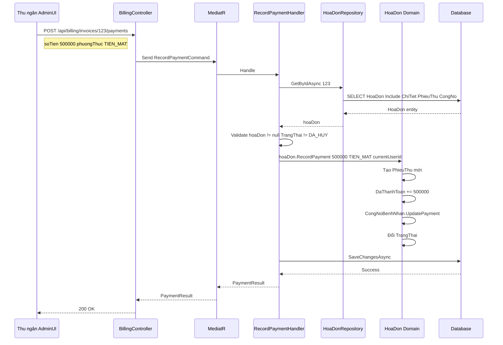
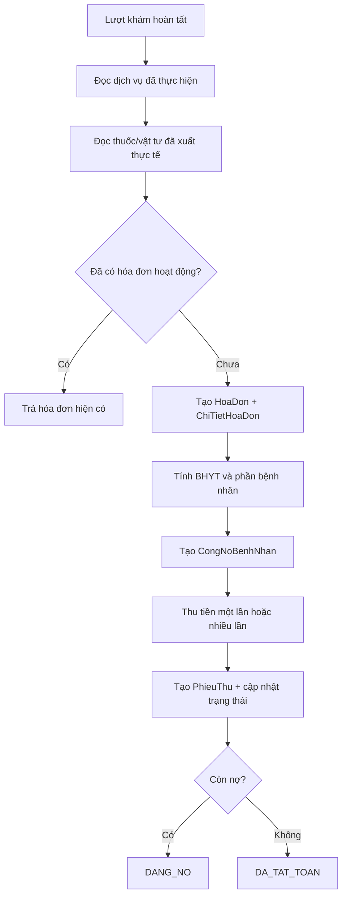

# Kế hoạch triển khai Quản lý Tài chính (Billing) — ClinicManagement

**Ngày lập:** 2026-09-08
**Phạm vi:** Module Quản lý Tài chính (Billing) — từ phân tích domain đến kế hoạch triển khai

## Bối cảnh

Hệ thống ClinicManagement hiện có **4 entity** Billing trong Domain (`HoaDon`, `ChiTietHoaDon`, `PhieuThu`, `CongNoBenhNhan`) và đã cấu hình EF Core + migration đầy đủ. Ngoài ra, tầng Application đã có một số DTO và Query liên quan. Tuy nhiên, Billing chỉ được sử dụng như **tác vụ phụ** trong flow bán lẻ thuốc (`KhoService.ExportRetailAsync`). Chưa có module Billing độc lập hoàn chỉnh ở tầng Application, API hay UI.

Tài liệu này phân tích toàn bộ dữ liệu từ Domain hiện tại và đề xuất kế hoạch triển khai **module Quản lý Tài chính Billing** hoàn chỉnh.

> **Trạng thái cập nhật 2026-09-08:** Billing Phase 1 đã bắt đầu triển khai backend gồm repository,
> các query đọc hóa đơn/công nợ, command thanh toán–BHYT–hủy hóa đơn và `BillingController`.
> Phase 2 (tạo hóa đơn gộp tự động theo lượt khám), Phase 3 (báo cáo) và Phase 4 (hoàn tiền)
> vẫn đang ở trạng thái kế hoạch.

---

## 1. Phân tích Domain hiện tại

### 1.1. Sơ đồ tổng quan quan hệ giữa các Domain

```mermaid
erDiagram
    BenhNhan ||--o{ LuotKham : "có nhiều"
    BenhNhan ||--o{ BaoHiem : "có nhiều"
    BenhNhan ||--o{ HoaDon : "MaBenhNhan"
    BenhNhan ||--o{ CongNoBenhNhan : "MaBenhNhan"

    LuotKham ||--o{ HoaDon : "MaLuotKham"
    LuotKham ||--o{ DonThuoc : "MaLuotKham"
    LuotKham ||--o{ ChiDinhDichVu : "MaLuotKham"
    LuotKham }o--|| CoSo : "MaCoSo"
    LuotKham }o--o| NhanVien : "MaBacSi"

    HoaDon ||--o{ ChiTietHoaDon : "MaHoaDon"
    HoaDon ||--o{ PhieuThu : "MaHoaDon"
    HoaDon ||--o| CongNoBenhNhan : "1-1"
    HoaDon }o--|| CoSo : "MaCoSo"

    DonThuoc ||--o{ ChiTietDonThuoc : "MaDonThuoc"
    ChiTietDonThuoc }o--|| Item : "MaItem"

    Item ||--o{ TonKho : "MaItem"
    Item ||--o{ DonViTinhQuyDoi : "MaItem"
    TonKho }o--|| Kho : "MaKho"

    PhieuXuatKho ||--o{ ChiTietXuatKho : "MaPhieuXuat"
    PhieuXuatKho --> InventoryTransaction : "ghi sổ"

    ChiDinhDichVu }o--|| DanhMucDichVu : "MaDanhMuc"
    ChiDinhDichVu ||--o{ ChiTietKetQuaXetNghiem : "MaChiDinh"

    PhieuThu }o--o| NhanVien : "MaNguoiThu"
```

### 1.2. Chi tiết 4 Entity Billing

#### `HoaDon` — Aggregate Root

File: `ClinicManagement.Domain/Billing/HoaDon/HoaDon.cs`

| Property | Type | Mô tả |
|---|---|---|
| `SoHoaDon` | string | Mã hóa đơn duy nhất (unique index) |
| `MaLuotKham` | int | FK → LuotKham (Restrict) |
| `MaBenhNhan` | int | FK → BenhNhan (Restrict) |
| `MaCoSo` | int | FK → CoSo (Restrict) |
| `NgayLap` | DateTime | Thời điểm lập hóa đơn |
| `TongTien` | decimal | Tổng tiền trước bảo hiểm |
| `SoTienBaoHiemChiTra` | decimal | BHYT/BHTN hỗ trợ |
| `SoTienBenhNhanChiTra` | decimal | = TongTien - SoTienBaoHiemChiTra |
| `DaThanhToan` | decimal | Tổng đã thu qua các PhieuThu |
| `TrangThai` | TrangThaiHoaDon | Enum |
| `GhiChu` | string | Ghi chú |

Phương thức domain:

- `HoaDon(maLuotKham, maBenhNhan, maCoSo, soHoaDon, createdBy)` — Constructor.
- `AddServiceOrDrug(loaiDoiTuong, maDoiTuong, moTa, soLuong, donGia)` — Thêm dòng chi tiết, tính lại tổng. Không cho thêm khi đã hủy hoặc đã thanh toán.
- `ApplyInsurance(baoHiemChiTra)` — Validate + áp dụng bảo hiểm, tính lại `SoTienBenhNhanChiTra`.
- `RecordPayment(amount, phuongThuc, nguoiThu)` — Tạo `PhieuThu` + cập nhật `DaThanhToan` + đồng bộ `CongNoBenhNhan` + đổi trạng thái.
- `HuyHoaDon()` — Hủy (chỉ khi chưa có thanh toán).
- `SoTienConNo()` — Tính nợ còn lại.
- `IsFullyPaid()` — Kiểm tra đã thanh toán đủ.

#### `ChiTietHoaDon`

File: `ClinicManagement.Domain/Billing/HoaDon/ChiTietHoaDon.cs`

| Property | Type | Mô tả |
|---|---|---|
| `LoaiDoiTuong` | string | "THUOC", "DICH_VU", "VAT_TU" |
| `MaDoiTuong` | int | FK tới Item hoặc DanhMucDichVu |
| `MoTa` | string | Tên mặt hàng/dịch vụ thời điểm lập |
| `SoLuong` | decimal | Số lượng |
| `DonGia` | decimal | Đơn giá |
| `ThanhTien` | decimal | = SoLuong × DonGia |
| `MaHoaDon` | int | FK → HoaDon |

Index `(LoaiDoiTuong, MaDoiTuong)` đã được cấu hình trong EF Core.

#### `PhieuThu`

File: `ClinicManagement.Domain/Billing/HoaDon/PhieuThu.cs`

| Property | Type | Mô tả |
|---|---|---|
| `SoPhieuThu` | string | Mã phiếu thu duy nhất (unique index) |
| `MaBenhNhan` | int | FK → BenhNhan |
| `MaLuotKham` | int? | FK → LuotKham (SetNull) |
| `MaHoaDon` | int | FK → HoaDon |
| `SoTien` | decimal | Số tiền thu |
| `PhuongThuc` | PhuongThucThanhToan | TIEN_MAT / CHUYEN_KHOAN / THE / BAO_HIEM |
| `MaNguoiThu` | int | FK → NhanVien |
| `NgayThu` | DateTime | Thời điểm thu |
| `GhiChu` | string | Ghi chú |

#### `CongNoBenhNhan`

File: `ClinicManagement.Domain/Billing/HoaDon/CongNoBenhNhan.cs`

| Property | Type | Mô tả |
|---|---|---|
| `MaBenhNhan` | int | FK → BenhNhan |
| `MaHoaDon` | int | FK → HoaDon (1-1 unique) |
| `SoTienNo` | decimal | Tổng nợ ban đầu |
| `SoTienDaTra` | decimal | Đã trả |
| `SoTienConLai` | decimal | = SoTienNo - SoTienDaTra |
| `HanThanhToan` | DateTime? | Hạn chót |
| `TrangThai` | TrangThaiCongNo | DANG_NO / DA_TAT_TOAN / QUA_HAN |

Phương thức:

- `UpdatePayment(amount)` — Ghi nhận trả nợ, tự chuyển trạng thái.
- `MarkOverdue()` — Đánh dấu quá hạn.

### 1.3. Enum liên quan đến Billing

| Enum | Giá trị | File |
|---|---|---|
| `TrangThaiHoaDon` | CHO_THANH_TOAN, THANH_TOAN_MOT_PHAN, DA_THANH_TOAN, DA_HUY | Common/Enums |
| `PhuongThucThanhToan` | TIEN_MAT, CHUYEN_KHOAN, THE, BAO_HIEM | Common/Enums |
| `TrangThaiCongNo` | DANG_NO, DA_TAT_TOAN, QUA_HAN | Common/Enums |
| `LoaiXuatKho` | BAN_THUOC, XUAT_DON, XUAT_THU_THUAT, ... | Common/Enums |
| `LoaiGiaoDichKho` | NHAP, XUAT_BAN_LE, XUAT_DON, ... | Common/Enums |

### 1.4. DTO đã có trong Application

| DTO | Vị trí | Mô tả |
|---|---|---|
| `HoaDonDto` | DTOs/BenhNhan/HoaDon/ | Full invoice + chi tiết + phiếu thu + công nợ |
| `HoaDonDetailDto` | DTOs/BenhNhan/HoaDon/ | Chi tiết hóa đơn (dùng cho xem detail) |
| `HoaDonSummaryDto` | DTOs/BenhNhan/HoaDon/ | Tóm lược: Id, SoHoaDon, TongTien, DaThanhToan, TrangThai, ConNo |
| `HoaDonListDto` | DTOs/LuotKham/HoaDon/ | Danh sách hóa đơn theo lượt khám (chưa có query dùng) |
| `ChiTietHoaDonDto` | DTOs/BenhNhan/HoaDon/ | Dòng chi tiết |
| `PhieuThuDto` | DTOs/BenhNhan/HoaDon/ | Phiếu thu |
| `CongNoDto` | DTOs/BenhNhan/HoaDon/ | Công nợ bệnh nhân |

### 1.5. Handler/Query đã có

| Handler | Mô tả |
|---|---|
| `GetBenhNhanInvoicesQuery` + Handler | Lấy danh sách hóa đơn phân trang theo PatientId, status. Dùng `BenhNhanRepository` |
| `GetBenhNhanProfileQuery` + Handler | Profile bệnh nhân kèm 5 hóa đơn gần nhất + thống kê tài chính |
| `BanLeCommand` + Handler | Tạo HoaDon + PhieuThu trong flow bán lẻ qua `KhoService.RetailExport` |

### 1.6. EF Core Configuration đã có

| Config | Bảng | Highlights |
|---|---|---|
| `HoaDonConfiguration` | `HoaDon` | SoHoaDon unique varchar(50), FK Restrict, Index (MaBenhNhan), (TrangThai), (NgayLap) |
| `ChiTietHoaDonConfiguration` | `ChiTietHoaDon` | Index (MaHoaDon), (LoaiDoiTuong, MaDoiTuong) |
| `PhieuThuConfiguration` | `PhieuThu` | SoPhieuThu unique, FK NguoiThu → NhanVien, Index (NgayThu) |
| `CongNoBenhNhanConfiguration` | `CongNoBenhNhan` | 1-1 với HoaDon, Index (MaBenhNhan), (TrangThai, HanThanhToan) |

### 1.7. API Endpoint hiện có liên quan Billing

```text
GET  /api/BenhNhan/{id}/invoices           → Danh sách hóa đơn theo bệnh nhân (phân trang)
GET  /api/BenhNhan/{id}/profile            → Profile bệnh nhân kèm 5 hóa đơn + thống kê tài chính
POST /api/inventory/exports/retail         → Bán lẻ thuốc (tạo HoaDon + PhieuThu tự động)
```

### 1.8. UI hiện có

- `AdminUI/BillingTab.tsx` — Tab hóa đơn trong chi tiết bệnh nhân, gọi API lấy danh sách.
  Nút "Xem" chỉ hiển thị `alert()` placeholder.
- `AdminUI/ExportRetailForm.tsx` — Form bán lẻ thuốc, gửi đến `POST /api/inventory/exports/retail`.
- `AdminUI/ExaminationFinance.tsx` — Widget tài chính khám bệnh, hiện dùng 100% dữ liệu mock.
- Sidebar menu đã liệt kê routes `/invoices`, `/receipts`, `/debts`, `/transactions`,
  `/finance-reports` nhưng chưa có page/route thật nào.
- `DoctorUI` — Không có component billing nào.

### 1.9. Repository hiện trạng

- `IHoaDonRepository.cs` — File tồn tại nhưng **rỗng** (0 bytes).
- `HoaDonRepository.cs` — **Chưa tồn tại** trong Infrastructure.
- `BenhNhanRepository` — Có `GetInvoicesByPatientIdAsync` truy vấn trực tiếp `_context.HoaDons`.
- `KhoRepository` — Expose `IQueryable<HoaDon>` và `Add<TEntity>` cho flow bán lẻ.
- `LuotKhamRepository` — Có method `GetHoaDonPagedAsync` nhưng **đang bị comment-out**.

---

## 2. Ma trận hiện trạng vs. cần xây dựng

| # | Chức năng | Domain | DB/EF | DTO | Query/Handler | API | AdminUI |
|---|---|---|---|---|---|---|---|
| 1 | Tạo hóa đơn thuốc (flow bán lẻ) | ✅ | ✅ | ✅ | ✅ (KhoService) | ✅ retail | ❌ |
| 2 | Tạo hóa đơn gộp theo lượt khám (dịch vụ + thuốc + vật tư) | ✅ entity | ✅ | ⚠️ partial | ❌ | ❌ | ❌ |
| 3 | Ghi nhận thanh toán (flow bán lẻ) | ✅ | ✅ | ✅ | ✅ (KhoService) | ✅ retail | ❌ |
| 4 | Ghi nhận thanh toán (standalone) | ✅ | ✅ | ✅ | ✅ | ✅ | ❌ |
| 5 | Áp dụng bảo hiểm | ✅ | ✅ | ✅ | ✅ | ✅ | ❌ |
| 6 | Hủy hóa đơn | ✅ | ✅ | ✅ | ✅ | ✅ | ❌ |
| 7 | Xem danh sách hóa đơn (theo BN) | — | ✅ | ✅ | ✅ | ✅ | ⚠️ partial |
| 8 | Xem danh sách hóa đơn (theo CoSo) | — | ✅ | ✅ | ✅ | ✅ | ❌ |
| 9 | Xem chi tiết hóa đơn | — | ✅ | ✅ | ✅ | ✅ | ❌ |
| 10 | Quản lý công nợ | ✅ | ✅ | ✅ | ✅ | ✅ | ❌ |
| 11 | Lịch sử thanh toán | — | ✅ | ✅ | ✅ | ✅ | ❌ |
| 12 | Báo cáo doanh thu | ❌ | ❌ | ❌ | ❌ | ❌ | ❌ |
| 13 | Hoàn tiền / phiếu giảm | ❌ | ❌ | ❌ | ❌ | ❌ | ❌ |
| 14 | Hóa đơn tổng hợp lượt khám | ✅ entity | ✅ | ⚠️ partial | ❌ | ❌ | ❌ |

Điểm mạnh: Domain entity + EF Config + DTO cơ bản đã hoàn thiện.
Chỉ cần xây dựng tầng Command/Query/Handler + Repository + API Controller + UI là đã cover
được phần lớn chức năng.

---

## 3. Quyết định nghiệp vụ đã xác nhận

Các quyết định dưới đây là phạm vi chính thức để triển khai Billing Phase 1:

1. **Mô hình hóa đơn:** Gộp toàn bộ dịch vụ y tế, cận lâm sàng, thuốc và vật tư phát sinh
   trong cùng một lượt khám vào **một hóa đơn duy nhất**. Không tạo hóa đơn dịch vụ và hóa đơn
   thuốc riêng cho cùng lượt khám.
2. **Thời điểm tạo hóa đơn:** Khi lượt khám được hoàn tất và đã có ít nhất một khoản phải thu.
   Các chỉ định chưa thực hiện, thuốc chưa cấp phát hoặc dịch vụ bị hủy không được đưa vào hóa đơn.
3. **BHYT:** Phase 1 phải ghi nhận và tính được phần BHYT chi trả cùng phần bệnh nhân phải trả.
   Quy tắc nâng cao theo từng danh mục sẽ được bổ sung sau, nhưng dữ liệu hóa đơn phải lưu được
   số tiền BHYT tại thời điểm lập hóa đơn để bảo toàn lịch sử.
4. **Thanh toán:** Cho phép thanh toán một lần hoặc nhiều lần. Mỗi lần thu tạo một `PhieuThu`,
   không cập nhật trực tiếp làm mất lịch sử giao dịch.
5. **Hoàn tiền:** Chưa bắt buộc trong Phase 1; triển khai thành Phase 4 với entity và quy trình
   phê duyệt riêng.
6. **Báo cáo ưu tiên:** Doanh thu theo ngày/tháng, công nợ bệnh nhân và thống kê theo phương
   thức thanh toán là nhóm báo cáo ưu tiên sau khi flow thanh toán ổn định.

### 3.1. Nguyên tắc bất biến tài chính

- `TongTien` là tổng tiền trước BHYT; `SoTienBaoHiemChiTra` không được âm hoặc vượt `TongTien`.
- `SoTienBenhNhanChiTra = TongTien - SoTienBaoHiemChiTra`.
- `DaThanhToan` không được vượt `SoTienBenhNhanChiTra` (trừ giao dịch BHYT được ghi nhận
  riêng theo quy tắc nghiệp vụ).
- `SoTienConNo = SoTienBenhNhanChiTra - DaThanhToan`.
- Hóa đơn đã hủy không được thêm dòng, áp dụng BHYT hoặc ghi nhận thanh toán.
- Mọi thao tác ghi nhận thanh toán/hủy hóa đơn phải lấy `currentUserId` từ claims và lưu audit.

---

## 4. Kế hoạch triển khai

### Phase 1: Nền tảng — Repository + Queries + Commands + BillingController **(đã triển khai backend nền tảng)**

Mục tiêu: Xây dựng module Billing độc lập hoàn chỉnh, tận dụng tối đa Domain entity + DTO đã có.
Không cần database migration mới.

#### Domain Layer

`ClinicManagement.Domain/Repositories/IHoaDonRepository.cs` **(đã triển khai)**

Repository interface cho Billing aggregate:

```csharp
public interface IHoaDonRepository
{
    Task<HoaDon?> GetByIdAsync(int id);
    Task<HoaDon?> GetBySoHoaDonAsync(string soHoaDon);
    Task<List<HoaDon>> GetByLuotKhamAsync(int maLuotKham);
    Task<(List<HoaDon> Items, int TotalCount)> GetByCoSoAsync(
        int maCoSo, DateTime? fromDate, DateTime? toDate,
        TrangThaiHoaDon? trangThai, int pageIndex, int pageSize);
    Task<List<CongNoBenhNhan>> GetCongNoByBenhNhanAsync(int maBenhNhan);
    Task<List<CongNoBenhNhan>> GetCongNoQuaHanAsync(int maCoSo);
    Task AddAsync(HoaDon hoaDon);
    void Update(HoaDon hoaDon);
}
```

#### Application Layer — Queries (tận dụng DTO đã có)

`Features/Billing/BillingQueries.cs` **(đã triển khai)**

```text
GetHoaDonByIdQuery.cs          → Request: int HoaDonId
GetHoaDonByIdQueryHandler.cs   → Dùng IHoaDonRepository, map sang HoaDonDetailDto (đã có)
```

Các query trong `BillingQueries.cs` **(đã triển khai)**

```text
GetHoaDonsByCoSoQuery.cs       → Lọc: MaCoSo, DateRange, TrangThai, phân trang
GetHoaDonsByCoSoQueryHandler.cs → Map sang HoaDonListDto (đã có)
```

Query hóa đơn theo lượt khám **(đã triển khai)**

```text
GetHoaDonsByLuotKhamQuery.cs   → Request: int LuotKhamId
Handler                        → Trả List<HoaDonSummaryDto> (đã có)
```

Query lịch sử thanh toán **(đã triển khai)**

```text
GetPaymentHistoryQuery.cs      → Request: int HoaDonId
Handler                        → Trả List<PhieuThuDto> (đã có)
```

Query công nợ theo bệnh nhân **(đã triển khai)**

```text
GetCongNoByBenhNhanQuery.cs    → Request: int MaBenhNhan
Handler                        → Trả List<CongNoDto> (đã có)
```

Query công nợ quá hạn **(đã triển khai)**

```text
GetCongNoQuaHanQuery.cs        → Request: int MaCoSo
Handler                        → Danh sách công nợ quá hạn theo cơ sở
```

#### Application Layer — Commands

`Features/Billing/BillingCommands.cs` — Record payment **(đã triển khai)**

```text
RecordPaymentCommand.cs        → int HoaDonId, decimal SoTien, PhuongThucThanhToan PhuongThuc
RecordPaymentCommandHandler.cs → Load HoaDon → gọi RecordPayment() → save
RecordPaymentCommandValidator.cs → Validate SoTien > 0, PhuongThuc hợp lệ
```

Command hủy hóa đơn **(đã triển khai)**

```text
CancelHoaDonCommand.cs         → int HoaDonId, string? LyDoHuy
CancelHoaDonCommandHandler.cs  → Load HoaDon → gọi HuyHoaDon() → kiểm tra quyền → save
```

Command áp dụng BHYT **(đã triển khai)**

```text
ApplyInsuranceCommand.cs       → int HoaDonId, decimal SoTienBaoHiem
ApplyInsuranceCommandHandler.cs → Load HoaDon → gọi ApplyInsurance() → save
```

#### Infrastructure Layer

`ClinicManagement.Infrastructure/Persistence/Repositories/HoaDonRepository.cs` **(đã triển khai)**

Implementation cho `IHoaDonRepository`:

- Sử dụng EF Core queries với Include cho ChiTietHoaDons, PhieuThus, CongNoBenhNhan.
- `GetByCoSoAsync` dùng `AsNoTracking()` + phân trang server-side.
- `GetCongNoQuaHanAsync` lọc theo `TrangThaiCongNo.QUA_HAN` hoặc `HanThanhToan < DateTime.UtcNow`.

Đăng ký DI trong `ClinicManagement.Infrastructure/DependencyInjection.cs`.

#### API Layer

`ClinicManagement.API/Controllers/BillingController.cs` **(đã triển khai)**

```text
GET    /api/billing/invoices                         → Danh sách hóa đơn (theo CoSo, lọc, phân trang)
GET    /api/billing/invoices/{id}                    → Chi tiết hóa đơn
GET    /api/billing/invoices/by-visit/{visitId}      → Hóa đơn theo lượt khám
GET    /api/billing/invoices/{id}/payments           → Lịch sử thanh toán
POST   /api/billing/invoices/{id}/payments           → Ghi nhận thanh toán
POST   /api/billing/invoices/{id}/cancel             → Hủy hóa đơn
POST   /api/billing/invoices/{id}/insurance          → Áp dụng bảo hiểm
GET    /api/billing/debts/by-patient/{patientId}     → Công nợ bệnh nhân
GET    /api/billing/debts/overdue                    → Công nợ quá hạn
```

#### Sequence Diagram — Flow thanh toán standalone



---

### Phase 2: Hoàn thiện hóa đơn gộp theo lượt khám

Mục tiêu: biến flow tạo hóa đơn thành một quy trình tổng hợp thống nhất cho toàn bộ lượt khám.
Phase này **không tạo hóa đơn riêng theo loại dịch vụ**; mỗi lượt khám chỉ có tối đa một hóa đơn
đang hoạt động.

**[NEW] `Features/Billing/Commands/CreateVisitInvoice/`**

Tạo hóa đơn khi lượt khám hoàn tất:

- Validate lượt khám tồn tại, đã hoàn tất và thuộc cơ sở hiện tại.
- Thu thập dịch vụ đã thực hiện từ `ChiDinhDichVu`/kết quả tương ứng.
- Thu thập thuốc đã cấp phát thực tế từ `PhieuXuatKho` và `ChiTietXuatKho`, không lấy số lượng
  chỉ định chưa xuất.
- Gộp các dòng vào một `HoaDon`; `LoaiDoiTuong` lần lượt là `DICH_VU`, `THUOC` hoặc `VAT_TU`.
- Chụp tên, số lượng và đơn giá tại thời điểm lập để hóa đơn không thay đổi khi bảng danh mục
  thay đổi.
- Đọc thông tin `BaoHiem` hợp lệ, tính phần BHYT và phần bệnh nhân trả.
- Tạo hoặc cập nhật `CongNoBenhNhan` theo phần bệnh nhân phải trả.
- Bảo đảm idempotent: gọi lại với cùng `MaLuotKham` trả hóa đơn hiện có, không nhân đôi dòng.

**[NEW] `Features/Billing/Queries/GetVisitBillingSummary/`**

Trả tổng hợp tài chính của một lượt khám:

- `VisitBillingSummaryDto`: hóa đơn, tổng tiền, BHYT chi trả, bệnh nhân phải trả, đã thu,
  còn nợ và trạng thái.
- Danh sách nguồn phát sinh (dịch vụ/thuốc/vật tư) để UI giải thích cách hình thành hóa đơn.
- Trạng thái `CHUA_TAO`, `CHO_THANH_TOAN`, `THANH_TOAN_MOT_PHAN`, `DA_THANH_TOAN`, `DA_HUY`.

API đã triển khai:

```text
POST   /api/luotkham/{visitId}/complete                 → Hoàn tất lượt khám, tạo hóa đơn và công nợ
GET    /api/billing/visits/{visitId}/summary          → Tổng hợp billing lượt khám
```

#### Flow nghiệp vụ end-to-end



#### Hợp đồng dữ liệu chính cho UI

API tạo/tổng hợp hóa đơn nên trả cấu trúc tương đương:

```json
{
  "hoaDonId": 123,
  "soHoaDon": "HD-20260908-000123",
  "maLuotKham": 3006,
  "maBenhNhan": 1002,
  "tongTien": 850000,
  "soTienBaoHiemChiTra": 300000,
  "soTienBenhNhanChiTra": 550000,
  "daThanhToan": 200000,
  "soTienConLai": 350000,
  "trangThai": "THANH_TOAN_MOT_PHAN",
  "chiTiet": [
    {
      "loaiDoiTuong": "DICH_VU",
      "maDoiTuong": 10,
      "moTa": "Khám nội tổng quát",
      "soLuong": 1,
      "donGia": 200000,
      "thanhTien": 200000
    },
    {
      "loaiDoiTuong": "THUOC",
      "maDoiTuong": 501,
      "moTa": "Paracetamol 500mg",
      "soLuong": 10,
      "donGia": 65000,
      "thanhTien": 650000
    }
  ],
  "congNo": {
    "soTienNo": 550000,
    "soTienDaTra": 200000,
    "soTienConLai": 350000,
    "trangThai": "DANG_NO"
  }
}
```

UI phải hiển thị riêng ba giá trị `tongTien`, `soTienBaoHiemChiTra` và
`soTienBenhNhanChiTra`; không tự suy diễn lại số tiền từ giá danh mục.

#### Quy tắc chống trùng và cập nhật hóa đơn

- Khóa nghiệp vụ duy nhất của hóa đơn gộp là `MaLuotKham` đối với hóa đơn chưa hủy.
- Handler phải kiểm tra hóa đơn hiện có trong cùng transaction trước khi tạo mới.
- Sau khi hóa đơn đã có thanh toán, không tự động thêm dòng phát sinh; phần phát sinh bổ sung
  phải đi qua quy trình điều chỉnh/hủy theo chính sách tài chính.
- Nếu lượt khám chưa phát sinh dịch vụ hoặc thuốc hợp lệ, API trả kết quả không có khoản phải
  thu thay vì tạo hóa đơn rỗng.

---

### Phase 3: Báo cáo tài chính và Dashboard

Mục tiêu: Cung cấp dữ liệu báo cáo cho quản lý.
Không cần database migration mới.

**[NEW] `Features/Billing/Queries/Reports/`**

| Query | Mô tả |
|---|---|
| `RevenueReportQuery` | Doanh thu theo ngày/tuần/tháng, theo cơ sở |
| `OutstandingBalanceQuery` | Tổng hợp công nợ chưa thanh toán |
| `PaymentMethodSummaryQuery` | Thống kê theo phương thức thanh toán |
| `DailyRevenueQuery` | Doanh thu trong ngày |
| `RevenueByCategoryQuery` | Doanh thu theo loại (thuốc vs dịch vụ) |

DTOs báo cáo:

```text
RevenueReportDto:
  - TotalRevenue, TotalPaid, TotalOutstanding
  - ByDay[] / ByMonth[]
  - ByCategory (THUOC vs DICH_VU)

OutstandingBalanceSummaryDto:
  - TotalCongNo, SoBenhNhanNo
  - DanhSachNo[] (BenhNhan, SoTien, HanThanhToan)
  - CongNoQuaHan[]

PaymentMethodSummaryDto:
  - TIEN_MAT: { SoTien, SoGiaoDich }
  - CHUYEN_KHOAN: { SoTien, SoGiaoDich }
  - THE: { SoTien, SoGiaoDich }
  - BAO_HIEM: { SoTien, SoGiaoDich }
```

API bổ sung:

```text
GET    /api/billing/reports/revenue?from=&to=&coSoId=
GET    /api/billing/reports/outstanding?coSoId=
GET    /api/billing/reports/payment-methods?from=&to=
GET    /api/billing/reports/daily?date=
GET    /api/billing/reports/by-category?from=&to=
```

---

### Phase 4: Hoàn tiền và mở rộng

Mục tiêu: Xử lý các nghiệp vụ tài chính nâng cao.
Cần database migration mới.

**[NEW] `ClinicManagement.Domain/Billing/PhieuHoanTien.cs`**

```csharp
public class PhieuHoanTien : BaseEntity
{
    public string SoPhieuHoan { get; private set; }
    public int MaHoaDon { get; private set; }
    public int MaBenhNhan { get; private set; }
    public decimal SoTienHoan { get; private set; }
    public string LyDoHoan { get; private set; }
    public int MaNguoiTao { get; private set; }
    public int? MaNguoiDuyet { get; private set; }
    public DateTime NgayTao { get; private set; }
    public DateTime? NgayDuyet { get; private set; }
    public TrangThaiPhieuHoan TrangThai { get; private set; }
}
```

Bổ sung enum:

```text
TrangThaiPhieuHoan: CHO_DUYET, DA_DUYET, DA_HOAN, DA_HUY
```

Commands hoàn tiền:

- `CreateRefundCommand` — Tạo yêu cầu hoàn tiền (validate: không vượt `DaThanhToan`).
- `ApproveRefundCommand` — Duyệt (kiểm tra quyền quản lý).
- `ProcessRefundCommand` — Thực hiện hoàn tiền, cập nhật `HoaDon.DaThanhToan` giảm.

Bổ sung navigation trên `HoaDon`:

```csharp
public virtual ICollection<PhieuHoanTien> PhieuHoanTiens { get; private set; }
```

---

## 5. Cấu trúc thư mục đề xuất

```text
ClinicManagement.Domain/
  Billing/
    HoaDon/
      HoaDon.cs                   ← (có sẵn, modify nhỏ)
      ChiTietHoaDon.cs            ← (có sẵn, giữ nguyên)
      PhieuThu.cs                 ← (có sẵn, giữ nguyên)
      CongNoBenhNhan.cs           ← (có sẵn, giữ nguyên)
    PhieuHoanTien.cs              ← (new, Phase 4)
  Repositories/
    IHoaDonRepository.cs          ← (đã triển khai, Phase 1)

ClinicManagement.Application/
  DTOs/
    BenhNhan/HoaDon/              ← (có sẵn: HoaDonDto, ChiTietHoaDonDto, PhieuThuDto, CongNoDto)
    LuotKham/HoaDon/              ← (có sẵn: HoaDonListDto)
    Billing/                      ← (đã bổ sung contract)
      BillingRequests.cs
      VisitBillingSummaryDto.cs      Phase 2
      RevenueReportDto.cs            Phase 3
      OutstandingBalanceSummaryDto.cs Phase 3
      PaymentMethodSummaryDto.cs     Phase 3
  Features/
    Billing/
      BillingCommands.cs          ← (đã triển khai, Phase 1)
      BillingQueries.cs           ← (đã triển khai, Phase 1)
      BillingMapper.cs            ← (đã triển khai, Phase 1)
      CreateVisitInvoice/         ← Phase 2
      Reports/                    ← Phase 3

ClinicManagement.Infrastructure/
  Persistence/
    Repositories/
      HoaDonRepository.cs        ← (đã triển khai, Phase 1)
    Configurations/
      PhieuHoanTienConfiguration.cs  ← Phase 4

ClinicManagement.API/
  Controllers/
    BillingController.cs          ← (đã triển khai, Phase 1)
```

---

## 6. Verification Plan

### Automated Tests

Unit Tests — Domain (Phase 1):

- `HoaDon.AddServiceOrDrug()` tính đúng `TongTien` và `SoTienBenhNhanChiTra`.
- `HoaDon.RecordPayment()` tạo PhieuThu + cập nhật DaThanhToan + đổi TrangThai.
- `HoaDon.RecordPayment()` với thanh toán đủ chuyển `DA_THANH_TOAN`.
- `HoaDon.RecordPayment()` với thanh toán một phần chuyển `THANH_TOAN_MOT_PHAN`.
- `HoaDon.ApplyInsurance()` validate không vượt TongTien.
- `HoaDon.HuyHoaDon()` thành công khi `CHO_THANH_TOAN`, thất bại khi trạng thái khác.
- `CongNoBenhNhan.UpdatePayment()` tính lại SoTienConLai.
- `CongNoBenhNhan.MarkOverdue()` đánh dấu đúng khi quá hạn.

Unit Tests — Application (Phase 1):

- `RecordPaymentCommandHandler` happy path.
- `RecordPaymentCommandValidator` từ chối SoTien <= 0.
- `CancelHoaDonCommandHandler` kiểm tra trạng thái trước khi hủy.
- `ApplyInsuranceCommandHandler` validate số tiền bảo hiểm.

Integration Tests (Phase 1):

- `POST /api/billing/invoices/{id}/payments` tạo PhieuThu + cập nhật HoaDon.
- `POST /api/billing/invoices/{id}/cancel` hủy chỉ khi chưa thanh toán.
- `GET /api/billing/invoices` phân trang, lọc đúng theo CoSo, TrangThai, DateRange.
- `GET /api/billing/invoices/{id}` trả đủ chi tiết + phiếu thu + công nợ.
- `GET /api/billing/debts/overdue` chỉ trả công nợ quá hạn.
- Flow bán lẻ (`KhoService`) tạo hóa đơn, rồi hóa đơn xuất hiện qua API billing.

Unit/Integration Tests — Flow gộp lượt khám (Phase 2):

- Lượt khám hoàn tất có dịch vụ và thuốc tạo đúng một hóa đơn với nhiều loại dòng.
- Chỉ định dịch vụ chưa thực hiện và thuốc chưa cấp phát không xuất hiện trong chi tiết.
- Gọi lại API tạo hóa đơn không tạo bản ghi hoặc dòng chi tiết trùng.
- Tính đúng `TongTien`, BHYT, phần bệnh nhân trả và công nợ.
- Lượt khám không phát sinh khoản phải thu không tạo hóa đơn rỗng.
- Không cho phép ghi nhận thanh toán vượt số tiền bệnh nhân phải trả.

### Manual Verification

- Deploy staging, verify thu ngân xem được danh sách hóa đơn.
- Verify flow: bán thuốc → hóa đơn tự động xuất hiện trong billing API.
- Verify flow: ghi nhận thanh toán → trạng thái + công nợ cập nhật đúng.
- Verify flow: hủy hóa đơn → chỉ hủy được khi chưa thanh toán.
- Verify quyền: chỉ role phù hợp mới ghi nhận thanh toán / hủy hóa đơn.
- Verify flow gộp: hoàn tất lượt khám → một hóa đơn chứa cả dòng dịch vụ và thuốc.
- Verify BHYT: UI hiển thị tổng tiền, BHYT chi trả, bệnh nhân trả và còn nợ bằng dữ liệu API.
- Verify idempotency: refresh/retry thao tác tạo hóa đơn không nhân đôi hóa đơn hoặc chi tiết.

---

## 7. Thứ tự ưu tiên và ước lượng

| Phase | Nội dung | Ước lượng | Cần migration? |
|---|---|---|---|
| P1 | Repository + 6 Queries + 3 Commands + BillingController + Tests | 3-4 ngày | Không |
| P2 | Hóa đơn gộp lượt khám + tổng hợp dịch vụ/thuốc/vật tư + BHYT | 3-4 ngày | Không |
| P3 | 5 Query báo cáo + Dashboard DTOs | 2-3 ngày | Không |
| P4 | PhieuHoanTien entity + Commands + Migration | 2-3 ngày | Có |

Phase 1-3 không cần migration mới vì tận dụng 100% domain entity + DB schema đã có.
Chỉ Phase 4 (hoàn tiền) mới cần tạo bảng mới.
