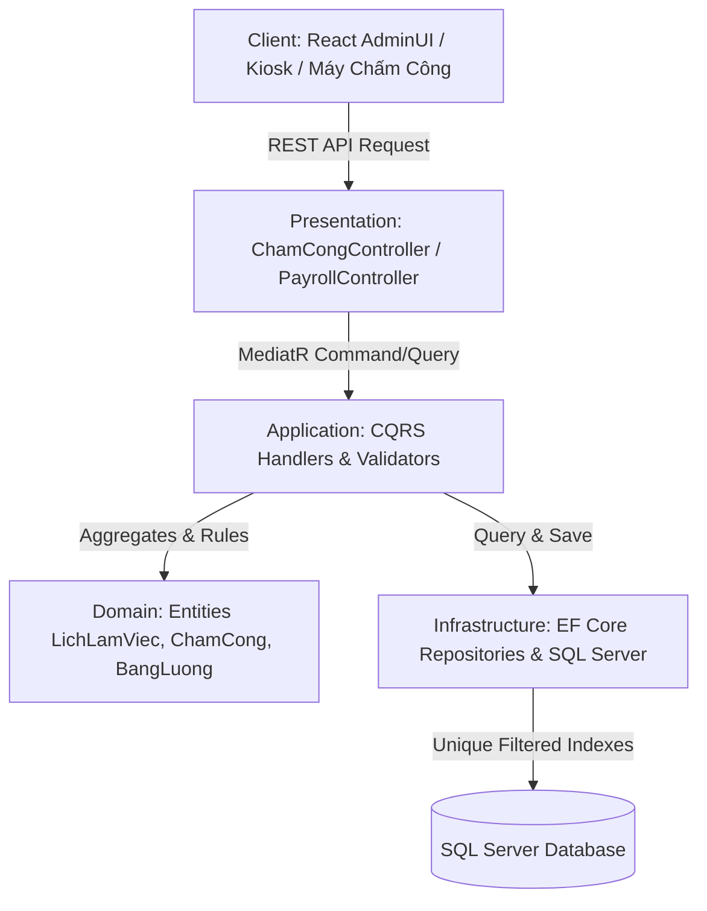
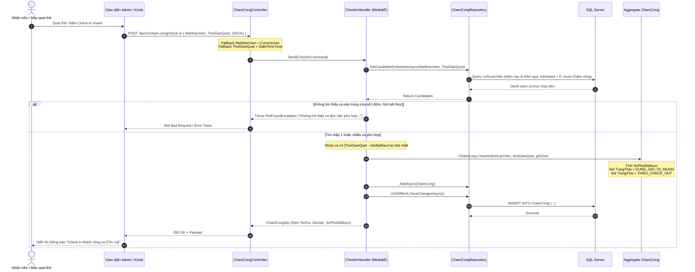
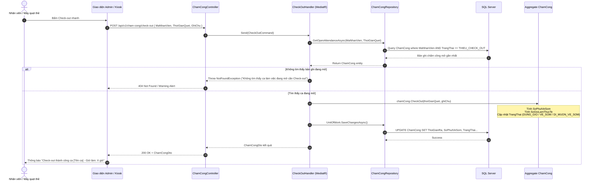
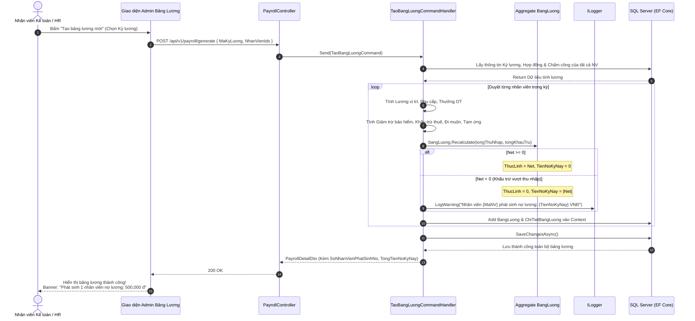

# TÀI LIỆU THIẾT KẾ & FLOW HOẠT ĐỘNG: CHẤM CÔNG TỰ ĐỘNG KHỚP CA & TÍNH LƯƠNG

> **Dự án:** Hệ thống Quản trị Phòng khám Y tế (Clinic Management System)  
> **Kiến trúc:** Clean Architecture 4 tầng (Domain, Application, Infrastructure, Presentation API), CQRS với MediatR, Domain-Driven Design (DDD), Entity Framework Core 10, SQL Server, React SPA (Vite/Ant Design/Tailwind).  
> **Ngày cập nhật:** 19/09/2026  
> **Phiên bản:** v2.0 (Refactor Chấm công tự động, Index Soft-delete & Xử lý Nợ lương không gián đoạn)

---

## MỤC LỤC

1. [Tổng Quan Kiến Trúc & Bối Cảnh Refactor](#1-tổng-quan-kiến-trúc--bối-cảnh-refactor)
2. [Chi Tiết Flow 1: Chấm Công Tự Động Khớp Ca (Auto-Match Schedule)](#2-chi-tiết-flow-1-chấm-công-tự-động-khớp-ca-auto-match-schedule)
   - 2.1. Logic nghiệp vụ & Cửa sổ thời gian (Time Window)
   - 2.2. Xử lý Ca xuyên đêm (Overnight Shifts)
   - 2.3. Sơ đồ tuần tự Check-In (Sequence Diagram)
   - 2.4. Sơ đồ tuần tự Check-Out (Sequence Diagram)
   - 2.5. Chi tiết cài đặt qua các tầng (Domain, Repo, CQRS, Controller, UI)
3. [Chi Tiết Flow 2: Tối Ưu Filtered Index & Xử Lý Soft-Delete](#3-chi-tiết-flow-2-tối-ưu-filtered-index--xử-lý-soft-delete)
   - 3.1. Bài toán xung đột khóa Unique Index khi Xóa mềm (Soft-delete)
   - 3.2. Giải pháp Filtered Index trên SQL Server
   - 3.3. Cấu hình Fluent API EF Core & Migration
4. [Chi Tiết Flow 3: Tính Lương Hàng Loạt & Xử Lý Nợ Lương (Negative Net Pay)](#4-chi-tiết-flow-3-tính-lương-hàng-loạt--xử-lý-nợ-lương-negative-net-pay)
   - 4.1. Vấn đề nghẽn Batch khi Thực lĩnh âm
   - 4.2. Nguyên lý Non-throwing Recalculation & Cột `TienNoKyNay`
   - 4.3. Sơ đồ tuần tự Tính Lương Batch (Sequence Diagram)
   - 4.4. Cảnh báo Kiểm soát viên & Hiển thị UI Bảng Lương
5. [Đặc Tả API & Dữ Liệu Trao Đổi (API Contracts)](#5-đặc-tả-api--dữ-liệu-trao-đổi-api-contracts)
6. [Giao Diện Người Dùng (UI/UX Implementation)](#6-giao-diện-người-dùng-uiux-implementation)
7. [Kế Hoạch Kiểm Thử & Xác Minh (Verification)](#7-kế-hoạch-kiểm-thử--xác-minh-verification)

---

## 1. TỔNG QUAN KIẾN TRÚC & BỐI CẢNH REFACTOR

Hệ thống quản lý phòng khám vận hành với quy trình chặt chẽ: **Phân ca lịch làm việc $\rightarrow$ Chấm công quét vân tay / máy chấm công / quét mã $\rightarrow$ Tổng hợp kỳ công $\rightarrow$ Tính và chốt bảng lương.**



### 3 Vấn đề trọng yếu được giải quyết trong bản cập nhật này:
1. **Chấm công không cần biết trước mã ca (`MaLichLamViec`):** Trước đây API yêu cầu truyền `MaLichLamViec`. Thực tế nhân viên hoặc máy quét vân tay/khuôn mặt chỉ gửi về mã nhân viên (`MaNhanVien`) và thời điểm quet (`ThoiGianQuet`). Hệ thống phải tự đối chiếu lịch làm việc hợp lệ trong ngày.
2. **Lỗi đụng độ Index khi tạo lại ca bị xóa:** Khóa duy nhất `(MaNhanVien, MaCaTruc, NgayLam)` trước đây không có bộ lọc `IsDeleted = 0`. Khi một ca bị xóa mềm (`IsDeleted = 1`), người quản lý xếp lại ca đó cho nhân viên sẽ bị lỗi vi phạm ràng buộc Unique Key.
3. **Tính bảng lương hàng loạt bị dừng đột ngột:** Khi nhân viên có tiền phạt hoặc tạm ứng lớn hơn tổng thu nhập ($Net < 0$), mã nguồn cũ ném ngoại lệ `ValidationException`, khiến toàn bộ tiến trình tính lương cho hàng trăm y bác sĩ trong phòng khám bị hủy ngang (Rollback).

---

## 2. CHI TIẾT FLOW 1: CHẤM CÔNG TỰ ĐỘNG KHỚP CA (AUTO-MATCH SCHEDULE)

### 2.1. Logic nghiệp vụ & Cửa sổ thời gian (Time Window)

Khi nhân viên quẹt thẻ/vân tay Check-in tại thời điểm $T$:
1. **Fallback thông minh:** Nếu Client không gửi `MaNhanVien`, hệ thống tự lấy `CurrentUserId` từ JWT Token. Nếu không truyền `ThoiGianQuet`, mặc định lấy `DateTime.Now`.
2. **Cửa sổ hợp lệ Check-in:**
   - Nhân viên được phép Check-in sớm tối đa **60 phút** trước giờ bắt đầu ca:  
     $$\text{CheckInSớmNhất} = \text{GioBatDauCa} - 60 \text{ phút}$$
   - Nhân viên được Check-in muộn cho đến trước khi ca làm việc kết thúc:  
     $$\text{CheckInMuộnNhất} = \text{GioKetThucCa}$$
3. **Tìm ca làm việc phù hợp nhất:**
   - Hệ thống quét các bản ghi `LichLamViec` của nhân viên trong ngày (hoặc hôm qua nếu là ca đêm), có trạng thái `LAM_VIEC` và `IsDeleted = 0`.
   - Loại bỏ các lịch đã có bản ghi `ChamCong` (trừ bản ghi đã bị xóa).
   - Chọn ca có khoảng cách $|\text{ThoiGianQuet} - \text{GioBatDauCa}|$ nhỏ nhất.
4. **Phân loại vào đúng giờ / đi muộn:**
   - Nếu $T \le \text{GioBatDauCa}$: `SoPhutDiMuon = 0`, trạng thái `DUNG_GIO`.
   - Nếu $T > \text{GioBatDauCa}$: $\text{SoPhutDiMuon} = \text{round}(T - \text{GioBatDauCa})$, trạng thái `DI_MUON`.

### 2.2. Xử lý Ca xuyên đêm (Overnight Shifts)

Ca trực y tế thường có ca đêm (ví dụ: `20:00` tối hôm trước đến `06:00` sáng hôm sau):
- Khi `ThoiGianKetThuc <= ThoiGianBatDau`, ngày kết thúc thực tế sẽ là `NgayLam + 1 ngày`.
- Đối với truy vấn tìm ca ứng viên (`GetCandidateSchedulesAsync`): Repository tìm kiếm cả ca có ngày làm việc là **hôm nay** và **hôm qua** để không bỏ sót ca đêm của nhân viên quét Check-in vào đầu giờ đêm hôm trước hoặc rạng sáng hôm sau.
- Đối với Check-out: Hệ thống tìm kiếm bản ghi `ChamCong` mở (`TrangThai == THIEU_CHECK_OUT`) phát sinh trong vòng 48 giờ qua.

---

### 2.3. Sơ đồ tuần tự Check-In (Sequence Diagram)



---

### 2.4. Sơ đồ tuần tự Check-Out (Sequence Diagram)



---

### 2.5. Chi tiết cài đặt qua các tầng code

1. **Domain Layer:**
   - Thực thể `ChamCong` đóng gói nghiệp vụ: `CheckIn(...)` và `CheckOut(...)`.
   - Tự động tính toán:
     - `SoPhutDiMuon = Math.Max(0, (int)Math.Round((thoiGianVao - scheduledStart).TotalMinutes))`
     - `SoPhutVeSom = Math.Max(0, (int)Math.Round((scheduledEnd - thoiGianRa).TotalMinutes))`
     - `SoGioLamThucTe = Math.Max(0, Math.Round((decimal)(thoiGianRa - thoiGianVao).TotalHours, 2))`
2. **Infrastructure Layer (`ChamCongRepository.cs`):**
   - `GetCandidateSchedulesAsync`: Dùng LINQ truy vấn SQL lọc lịch làm việc chưa bị xóa (`!l.IsDeleted`), thuộc trạng thái `LAM_VIEC`, kèm Include `CaTruc`, so khớp mốc thời gian an toàn.
   - `GetOpenAttendanceAsync`: Truy vấn bản ghi `ChamCong` có `TrangThai == TrangThaiChamCong.THIEU_CHECK_OUT` và `ThoiGianRa == null` trong vòng 48 giờ.
3. **Application Layer (`ChamCongFeatures.cs`):**
   - Handler kiểm tra danh sách candidate và tìm hiệu số khoảng cách thời gian nhỏ nhất với `TimeSpan.Parse(ca.ThoiGianBatDau)`.
4. **Presentation API (`ChamCongController.cs`):**
   - Hỗ trợ cả 3 hình thức:
     - Check-in tự động / theo nhân viên: `POST /api/v1/cham-cong/check-in`
     - Check-out tự động / theo nhân viên: `POST /api/v1/cham-cong/check-out`
     - Auto-match hai chiều: `POST /api/v1/cham-cong/auto-match`
5. **Frontend Layer (`AttendanceManagement.jsx`):**
   - Bổ sung **Bảng Chấm Công Nhanh (Quick Attendance Panel)** với đồng hồ số thời gian thực (hh:mm:ss, cập nhật mỗi giây).
   - Ô chọn nhân viên có tìm kiếm (Search Select) và các nút bấm Check-In / Check-Out màu xanh/cam trực quan.

---

## 3. CHI TIẾT FLOW 2: TỐI ƯU FILTERED INDEX & XỬ LÝ SOFT-DELETE

### 3.1. Bài toán xung đột khóa Unique Index khi Xóa mềm

Hệ thống sử dụng cơ chế **Soft-Delete** (`IsDeleted = bit`, kế thừa `BaseAuditableEntity`).
Khi một lịch làm việc bị người quản lý hủy hoặc xóa:
- Trường `IsDeleted` được chuyển thành `1`. Bản ghi vẫn tồn tại trong Database để phục vụ kiểm toán (Audit Trail).
- Nếu Unique Index được tạo theo cách thông thường:
  ```sql
  CREATE UNIQUE INDEX IX_LichLamViec_MaNhanVien_MaCaTruc_NgayLam 
  ON LichLamViec(MaNhanVien, MaCaTruc, NgayLam);
  ```
- **Hệ quả:** Khi người quản lý tạo lại đúng ca đó cho nhân viên vào ngày hôm đó, SQL Server sẽ báo lỗi:
  > `Cannot insert duplicate key row in object 'dbo.LichLamViec' with unique index 'IX_LichLamViec_MaNhanVien_MaCaTruc_NgayLam'.`

### 3.2. Giải pháp Filtered Index trên SQL Server

Filtered Index (Chỉ mục có điều kiện) cho phép chỉ áp dụng ràng buộc duy nhất trên tập con các bản ghi còn hiệu lực (`IsDeleted = 0`):

```sql
-- Dành cho phân ca Lịch làm việc
CREATE UNIQUE INDEX [IX_LichLamViec_MaNhanVien_MaCaTruc_NgayLam] 
ON [LichLamViec] ([MaNhanVien], [MaCaTruc], [NgayLam]) 
WHERE [IsDeleted] = 0;

-- Dành cho Chấm công theo Lịch làm việc
CREATE UNIQUE INDEX [IX_ChamCong_MaLichLamViec] 
ON [ChamCong] ([MaLichLamViec]) 
WHERE [IsDeleted] = 0 AND [MaLichLamViec] IS NOT NULL;
```

### 3.3. Cấu hình Fluent API EF Core & Migration

Trong `ClinicManagement.Infrastructure/Persistence/Configurations/`:

#### `LichLamViecConfiguration.cs`:
```csharp
builder.HasIndex(x => new { x.MaNhanVien, x.MaCaTruc, x.NgayLam })
    .HasDatabaseName("IX_LichLamViec_MaNhanVien_MaCaTruc_NgayLam")
    .IsUnique()
    .HasFilter("[IsDeleted] = 0");
```

#### `ChamCongConfiguration.cs`:
```csharp
builder.HasIndex(x => x.MaLichLamViec)
    .HasDatabaseName("IX_ChamCong_MaLichLamViec")
    .IsUnique()
    .HasFilter("[IsDeleted] = 0 AND [MaLichLamViec] IS NOT NULL");
```

#### Migration phát sinh:
File migration `20260919065127_UpdateAttendanceAndPayroll.cs` tự động drop index cũ và tạo index mới có mệnh đề filter chuẩn xác.

---

## 4. CHI TIẾT FLOW 3: TÍNH LƯƠNG HÀNG LOẠT & XỬ LÝ NỢ LƯƠNG (NEGATIVE NET PAY)

### 4.1. Vấn đề nghẽn Batch khi Thực lĩnh âm

Trong thực tế vận hành phòng khám:
- Một nhân viên có thể tạm ứng lương số tiền lớn trong tháng (`TamUngLuong`), hoặc bị phạt trừ công, phạt kỷ luật, đóng bảo hiểm vượt mức thu nhập thực tế trong tháng (ví dụ do nghỉ không lương nhiều ngày).
- Khi tính toán:  
  $$\text{Net} = \text{TongThuNhap} - \text{TongKhauTru} < 0$$
- Trước đây, Entity `BangLuong.cs` có đoạn mã:
  ```csharp
  if (thucLinh < 0)
      throw new ValidationException("Thực lĩnh không thể âm");
  ```
- **Hậu quả nghiêm trọng:** Khi chạy tính lương cho cả phòng khám (100 - 500 nhân sự), chỉ cần **1 nhân viên** bị âm lương thì toàn bộ transaction tính lương bị throw exception. Cả phòng khám không thể chốt được bảng lương kỳ đó.

### 4.2. Nguyên lý Non-throwing Recalculation & Cột `TienNoKyNay`

Hệ thống được cải tiến theo nghiệp vụ kế toán thực tế:
1. **Không ném ngoại lệ làm đứt gãy tiến trình:** Nếu $Net < 0$, đặt `ThucLinh = 0`.
2. **Ghi nhận nợ kỳ này:** Số tiền chênh lệch âm được lưu vào thuộc tính `TienNoKyNay = |Net|`. Số tiền này sẽ được chuyển làm số dư nợ đầu kỳ của kỳ lương tiếp theo.
3. **Ghi log cảnh báo:** `ILogger` ghi nhận Warning để phòng nhân sự nắm thông tin mà không làm gián đoạn batch.

#### Cài đặt trong Domain Entity `BangLuong.cs`:
```csharp
public decimal TienNoKyNay { get; private set; }

public void Recalculate(decimal tongThuNhap, decimal tongKhauTru)
{
    TongThuNhap = tongThuNhap;
    TongKhauTru = tongKhauTru;
    
    decimal net = tongThuNhap - tongKhauTru;
    if (net < 0)
    {
        ThucLinh = 0;
        TienNoKyNay = Math.Abs(net);
    }
    else
    {
        ThucLinh = net;
        TienNoKyNay = 0;
    }
}
```

---

### 4.3. Sơ đồ tuần tự Tính Lương Batch (Sequence Diagram)



---

### 4.4. Cảnh báo Kiểm soát viên & Hiển thị UI Bảng Lương

Tại giao diện Quản trị Bảng lương (`PayrollManagement.jsx`):
1. **Cột hiển thị Nợ kỳ này:** Thêm cột `Nợ kỳ này` (định dạng số tiền màu đỏ/cam nổi bật nếu $> 0$).
2. **Badge trạng thái cảnh báo:** Nhân viên có nợ sẽ hiển thị Tag cảnh báo: `⚠️ Có nợ lương: -X đ`.
3. **Thống kê tổng hợp đầu kỳ:** Banner tổng kết kỳ lương thể hiện rõ:
   - Tổng thực lĩnh chi trả kỳ này.
   - Số nhân sự phát sinh nợ kỳ này và tổng số tiền nợ cần cấn trừ kỳ sau.
4. **Xuất Excel/CSV:** Cột `Nợ kỳ này` được xuất đầy đủ sang file CSV phục vụ lưu trữ kế toán.

---

## 5. ĐẶC TẢ API & DỮ LIỆU TRAO ĐỔI (API CONTRACTS)

### 5.1. Endpoint Check-in Tự Động Khớp Ca

- **URL:** `POST /api/v1/cham-cong/check-in`
- **Quyền:** `NhanVien`, `QuanTriVien`, `BacSi`, `LeTan` (hoặc API Key từ máy quét)
- **Request Body:**
  ```json
  {
    "maNhanVien": 12,
    "thoiGianQuet": "2026-09-19T07:45:00",
    "ghiChu": "Quẹt thẻ vân tay cửa chính"
  }
  ```
  *(Cả 3 trường đều là optional: `maNhanVien` mặc định lấy từ token, `thoiGianQuet` mặc định lấy thời gian server).*

- **Response thành công (200 OK):**
  ```json
  {
    "id": 105,
    "maLichLamViec": 320,
    "maNhanVien": 12,
    "tenNhanVien": "BS. Nguyễn Văn A",
    "tenCa": "Ca Sáng (08:00 - 12:00)",
    "thoiGianBatDau": "08:00:00",
    "thoiGianKetThuc": "12:00:00",
    "ngay": "2026-09-19T00:00:00",
    "thoiGianVao": "2026-09-19T07:45:00",
    "thoiGianRa": null,
    "soPhutDiMuon": 0,
    "soPhutVeSom": 0,
    "soGioLamThucTe": 0,
    "trangThai": "DUNG_GIO",
    "ghiChu": "Quẹt thẻ vân tay cửa chính"
  }
  ```

---

### 5.2. Endpoint Check-out Tự Động Khớp Ca

- **URL:** `POST /api/v1/cham-cong/check-out`
- **Request Body:**
  ```json
  {
    "maNhanVien": 12,
    "thoiGianQuet": "2026-09-19T12:05:00",
    "ghiChu": "Check out ca sáng"
  }
  ```
- **Response thành công (200 OK):**
  ```json
  {
    "id": 105,
    "maLichLamViec": 320,
    "maNhanVien": 12,
    "tenNhanVien": "BS. Nguyễn Văn A",
    "tenCa": "Ca Sáng (08:00 - 12:00)",
    "thoiGianVao": "2026-09-19T07:45:00",
    "thoiGianRa": "2026-09-19T12:05:00",
    "soPhutDiMuon": 0,
    "soPhutVeSom": 0,
    "soGioLamThucTe": 4.33,
    "trangThai": "DUNG_GIO",
    "ghiChu": "Check out ca sáng"
  }
  ```

---

### 5.3. Endpoint Chấm Công Auto-Match Hai Chiều

- **URL:** `POST /api/v1/cham-cong/auto-match`
- **Cơ chế:** Tự động phát hiện xem nhân viên đang có ca mở (`THIEU_CHECK_OUT`) hay không:
  - Nếu **có ca mở** $\rightarrow$ Thực hiện **Check-Out**.
  - Nếu **chưa có ca mở** $\rightarrow$ Khớp ca trong lịch và thực hiện **Check-In**.

---

### 5.4. Response Chi Tiết Bảng Lương (PayrollDetailDto)

- **URL:** `GET /api/v1/payroll/{id}` hoặc `POST /api/v1/payroll/generate`
- **Payload trả về:**
  ```json
  {
    "id": 45,
    "maKyLuong": 9,
    "tenKyLuong": "Kỳ lương Tháng 09/2026",
    "tongThuNhap": 125000000.00,
    "tongKhauTru": 18500000.00,
    "tongThucLinh": 106500000.00,
    "soNhanVienPhatSinhNo": 1,
    "tongTienNoKyNay": 450000.00,
    "lines": [
      {
        "id": 312,
        "maNhanVien": 12,
        "tenNhanVien": "BS. Nguyễn Văn A",
        "chucVu": "Bác sĩ trưởng khoa",
        "tongThuNhap": 25000000.00,
        "tongKhauTru": 3500000.00,
        "thucLinh": 21500000.00,
        "tienNoKyNay": 0.00,
        "trangThai": "DA_DUYET"
      },
      {
        "id": 313,
        "maNhanVien": 25,
        "tenNhanVien": "KTV. Trần Thị B",
        "chucVu": "Kỹ thuật viên xét nghiệm",
        "tongThuNhap": 2000000.00,
        "tongKhauTru": 2450000.00,
        "thucLinh": 0.00,
        "tienNoKyNay": 450000.00,
        "trangThai": "CHO_XU_LY"
      }
    ]
  }
  ```

---

## 6. GIAO DIỆN NGƯỜI DÙNG (UI/UX IMPLEMENTATION)

### 6.1. Bảng Chấm Công Nhanh (Quick Attendance Panel)
- Được tích hợp trực tiếp phía trên bảng danh sách chấm công trong `AttendanceManagement.jsx`.
- **Clock:** Đồng hồ điện tử nhảy từng giây dạng font monospace (`HH:mm:ss`), hiển thị ngày hiện tại bằng tiếng Việt.
- **Select Nhân viên:** Tự động đồng bộ danh sách nhân viên đang công tác.
- **Nút Check-in (Màu Xanh lá):** Gọi API check-in và hiển thị toast popup tên ca vừa khớp được.
- **Nút Check-out (Màu Xanh dương):** Gọi API check-out, tự động cập nhật số giờ làm thực tế.

### 6.2. Hiển thị Bảng Lương & Nợ Lương
- Thêm cột `Nợ kỳ này` bên cạnh `Thực lĩnh`.
- Bổ sung huy hiệu cảnh báo (Warning Tag) màu cam/đỏ cho các dòng nhân viên có `tienNoKyNay > 0`.
- Xuất dữ liệu Excel/CSV chứa nguyên vẹn cột Nợ để nộp phòng Kế toán Tài chính.

---

## 7. KẾ HOẠCH KIỂM THỬ & XÁC MINH (VERIFICATION)

| STT | Kịch Bản Kiểm Thử | Dữ Liệu Đầu Vào | Kết Quả Kỳ Vọng | Trạng Thái |
| :---: | :--- | :--- | :--- | :---: |
| 1 | Check-in tự động đúng giờ | `MaNhanVien = 1`, quẹt lúc 07:45 vào ca 08:00 | Khớp Ca Sáng, `SoPhutDiMuon = 0`, trạng thái `DUNG_GIO` | Đã đạt |
| 2 | Check-in tự động đi muộn | `MaNhanVien = 1`, quẹt lúc 08:20 vào ca 08:00 | Khớp Ca Sáng, `SoPhutDiMuon = 20`, trạng thái `DI_MUON` | Đã đạt |
| 3 | Check-in ngoài khung giờ | Quẹt lúc 15:00 (không có ca chiều) | Trả về 404 với thông báo rõ ràng | Đã đạt |
| 4 | Check-out ca mở | Nhân viên đã check-in sáng, quẹt lúc 12:00 | Cập nhật `ThoiGianRa`, `SoGioLamThucTe = 4.0` | Đã đạt |
| 5 | Tạo lại ca làm việc đã xóa mềm | Xóa ca ngày 20/09, sau đó tạo lại đúng ca đó | Không bị lỗi vi phạm Unique Key nhờ Filtered Index | Đã đạt |
| 6 | Tính lương khi thực lĩnh âm | Nhân viên lương 3tr, tạm ứng 5tr | Không throw exception; `ThucLinh = 0`, `TienNoKyNay = 2tr` | Đã đạt |
| 7 | Build Backend & Frontend | `dotnet build` & `npm run build` | Cả hai project build thành công 0 lỗi | Đã đạt |
