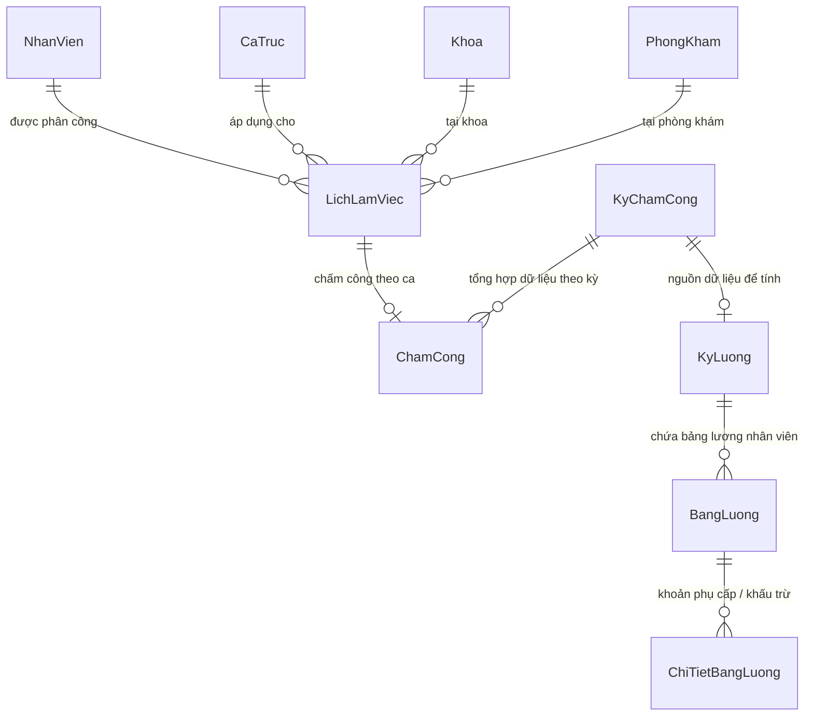

# HƯỚNG DẪN CHI TIẾT THÊM DỮ LIỆU SQL MÔ HÌNH LỊCH LÀM VIỆC & TÍNH LƯƠNG BACKEND

> **Hệ thống:** Clinic Management System  
> **Cơ sở dữ liệu:** Microsoft SQL Server  
> **Backend Framework:** .NET 10 (Clean Architecture, EF Core, MediatR)

---

## MỤC LỤC
1. [Tổng Quan Kiến Trúc Mô Hình](#1-tổng-quan-kiến-trúc-mô-hình)
2. [Chi Tiết Cấu Trúc Bảng SQL Liên Quan](#2-chi-tiết-cấu-trúc-bảng-sql-liên-quan)
3. [Quy Trình Hoạt Động (Workflow: Lịch -> Chấm Công -> Bảng Lương)](#3-quy-trình-hoạt-động)
4. [Bộ Script SQL Thêm Dữ Liệu Mẫu Chuẩn](#4-bộ-script-sql-thêm-dữ-liệu-mẫu-chuẩn)
5. [Công Thức & Cơ Chế Tính Lương Của Backend](#5-công-thức--cơ-chế-tính-lương-của-backend)
6. [Ví Dụ Minh Họa Bằng Số Liệu Cụ Thể](#6-ví-dụ-minh-họa-bằng-số-liệu-cụ-thể)
7. [Các Lưu Ý Sống Còn Khi Thao Tác SQL Trực Tiếp](#7-các-lưu-ý-sống-còn-khi-thao-tác-sql-trực-tiếp)

---

## 1. TỔNG QUAN KIẾN TRÚC MÔ HÌNH

Hệ thống quản lý chấm công và lương được liên kết chặt chẽ qua chuỗi thực thể:



### Các thành phần chính:
1. **Nhân sự & Hợp đồng:** Bảng `NhanVien` lưu thông tin nhân sự kèm thông tin lương cơ bản (`LuongCoBan`), phụ cấp cố định (`PhuCapCoDinh`) và tỷ lệ trích bảo hiểm (`TyLeBaoHiem`).
2. **Định nghĩa ca trực:** Bảng `LoaiCa` và `CaTruc` định nghĩa thời gian làm việc chuẩn (bắt đầu, kết thúc, số giờ ca, hệ số lương).
3. **Phân ca lịch làm việc:** Bảng `LichLamViec` gán nhân viên vào một ca trực cụ thể, một ngày cụ thể, tại một khoa/phòng khám cụ thể.
4. **Ghi nhận thực tế:** Bảng `ChamCong` ghi nhận giờ Check-In, Check-Out, tính ra phút đi muộn, phút về sớm, số giờ làm thực tế và trạng thái điểm danh.
5. **Tổng hợp kỳ chấm công:** Bảng `KyChamCong` định nghĩa khoảng thời gian tổng kết (từ ngày đến ngày) và trạng thái khóa kỳ (`DaKhoa`).
6. **Tính toán & chốt lương:** Bảng `KyLuong`, `BangLuong`, `ChiTietBangLuong` tính toán thu nhập thực lĩnh, thưởng OT, trừ đi muộn về sớm, trừ bảo hiểm và thuế/khấu trừ.

---

## 2. CHI TIẾT CẤU TRÚC BẢNG SQL LIÊN QUAN

### 2.1. Bảng `LichLamViec` (Bảng phân ca làm việc)
| Tên cột | Kiểu dữ liệu | Nullable | Ràng buộc / Ý nghĩa |
| :--- | :--- | :---: | :--- |
| `Id` | `int IDENTITY(1,1)` | ❌ PK | Khóa chính |
| `MaNhanVien` | `int` | ❌ FK | Khóa ngoại trỏ đến `NhanVien(Id)` |
| `MaKhoa` | `int` | ❌ FK | Khóa ngoại trỏ đến `Khoa(Id)` |
| `MaCaTruc` | `int` | ❌ FK | Khóa ngoại trỏ đến `CaTruc(Id)` |
| `MaPhongKham` | `int` | ✔️ FK | Khóa ngoại trỏ đến `PhongKham(Id)` (có thể NULL) |
| `MaLichLamViecCoDinh`| `int` | ✔️ FK | Trỏ về lịch cố định mẫu (nếu sinh từ lịch lặp) |
| `NgayLam` | `datetime2(7)` | ❌ | Ngày làm việc (phần giờ thường là `00:00:00`) |
| `NguonLich` | `nvarchar(20)` | ❌ | Nguồn tạo: `'PHAT_SINH'`, `'CO_DINH'` |
| `TrangThai` | `nvarchar(20)` | ❌ | Trạng thái: `'LAM_VIEC'`, `'NGHI'`, `'HUY'` |
| `GhiChu` | `nvarchar(500)` | ✔️ | Ghi chú thêm |
| `CreatedAt` | `datetime2(7)` | ❌ | Thời gian tạo (UTC) |
| `CreatedBy` | `int` | ✔️ | Người tạo |
| `UpdatedAt` | `datetime2(7)` | ✔️ | Thời gian cập nhật |
| `UpdatedBy` | `int` | ✔️ | Người cập nhật |
| `IsDeleted` | `bit` | ❌ | Đánh dấu xóa mềm (`0`: Hoạt động, `1`: Đã xóa) |
| `DeletedAt` | `datetime2(7)` | ✔️ | Thời gian xóa |
| `DeletedBy` | `int` | ✔️ | Người thực hiện xóa |

> **Chỉ mục quan trọng (Unique Constraint):**  
> `UNIQUE (MaNhanVien, MaCaTruc, NgayLam)` -> Một nhân viên không thể phân công 2 lần vào cùng 1 ca trong cùng 1 ngày.

---

### 2.2. Bảng `CaTruc` (Danh mục ca trực)
| Tên cột | Kiểu dữ liệu | Ràng buộc / Mặc định |
| :--- | :--- | :--- |
| `Id` | `int IDENTITY(1,1)` | Khóa chính |
| `MaLoaiCa` | `int` | FK trỏ đến `LoaiCa(Id)` |
| `TenCa` | `nvarchar(100)` | Tên hiển thị (VD: "Ca Sáng", "Ca Chiều", "Ca Đêm") |
| `ThoiGianBatDau` | `time(7)` | Giờ bắt đầu (VD: `07:30:00`) |
| `ThoiGianKetThuc` | `time(7)` | Giờ kết thúc (VD: `11:30:00` hoặc `17:00:00`) |
| `HeSo` | `decimal(5,2)` | Hệ số ca lương (Mặc định: `1.00`, trực đêm: `1.30` - `1.50`) |
| `MoTa` | `nvarchar(255)` | Mô tả |
| `IsDeleted` | `bit` | Mặc định: `0` |

---

### 2.3. Bảng `ChamCong` (Dữ liệu điểm danh thực tế)
| Tên cột | Kiểu dữ liệu | Ràng buộc / Ý nghĩa |
| :--- | :--- | :--- |
| `Id` | `int IDENTITY(1,1)` | Khóa chính |
| `MaNhanVien` | `int` | FK trỏ đến `NhanVien(Id)` |
| `MaLichLamViec` | `int` (Nullable) | FK trỏ đến `LichLamViec(Id)`. Unique khi NOT NULL |
| `NgayChamCong` | `datetime2(7)` | Ngày làm việc |
| `CheckIn` | `datetime2(7)` | Giờ quét vân tay / chấm công vào thực tế |
| `CheckOut` | `datetime2(7)` | Giờ quét vân tay / chấm công ra thực tế |
| `GioLamThucTe` | `float` | Tổng số giờ làm việc thực tế = (CheckOut - CheckIn) |
| `PhutDiMuon` | `int` | Số phút đến muộn so với lịch |
| `PhutVeSom` | `int` | Số phút ra về sớm so với lịch |
| `TrangThai` | `nvarchar(30)` | Chuỗi giá trị: `'CHUA_CHAM_CONG'`, `'DI_DUNG_GIO'`, `'DI_MUON'`, `'VE_SOM'`, `'DI_MUON_VE_SOM'`, `'THIEU_CHECK_OUT'`, `'NGHI_PHEP'`, `'VANG_MAT'` |
| `LoaiNghi` | `int` (Nullable) | Enum `LoaiNghiPhep`: `1` (Phép năm), `2` (Phép bệnh), `3` (Không lương), `4` (Khác) |
| `IsDeleted` | `bit` | Mặc định: `0` |

---

### 2.4. Bảng `KyChamCong` & `KyLuong`
- **`KyChamCong`**:
  - `Id`, `TuNgay`, `DenNgay`, `DaKhoa` (`bit`, phải là `1` mới được tính lương), `ThoiGianKhoa`, `GhiChu`, `IsDeleted`.
- **`KyLuong`**:
  - `Id`, `Thang`, `Nam`, `TuNgay`, `DenNgay`, `MaKyChamCong` (FK), `TrangThai` (`'NHAP'`, `'DA_DUYET'`, `'DA_CHOT'`, `'DA_THANH_TOAN'`), `IsDeleted`.
- **`BangLuong`**:
  - `Id`, `MaKyLuong`, `MaNhanVien`, `MaKyChamCong`, `LuongCoBan`, `SoNgayCong`, `SoNgayNghiKhongLuong`, `LuongTheoNgayCong`, `KhauTruNghiKhongLuong`, `TienTangCa`, `KhauTruDiMuonVeSom`, `TienBaoHiem`, `TongPhuCap`, `TongKhauTru`, `ThucLinh`.

---

## 3. QUY TRÌNH HOẠT ĐỘNG

```
1. Lập Lịch (LichLamViec)
       │
       ▼
2. Điểm danh / Check-in Check-out (ChamCong)
       │
       ▼
3. Khóa kỳ chấm công (KyChamCong.DaKhoa = 1)
       │
       ▼
4. Tạo kỳ lương & Chạy tính lương (KyLuong -> BangLuong)
       │
       ▼
5. Duyệt & Chốt thanh toán (KyLuong.TrangThai = 'DA_CHOT' / 'DA_THANH_TOAN')
```

---

## 4. BỘ SCRIPT SQL THÊM DỮ LIỆU MẪU CHUẨN

Dưới đây là kịch bản SQL hoàn chỉnh để thêm dữ liệu kiểm thử từ đầu đến cuối (có thể mở SSMS hoặc Azure Data Studio chạy trực tiếp).

### Bước 1: Kiểm tra hoặc tạo Ca Trực mẫu
```sql
USE ClinicManagementDb;
GO

-- 1. Thêm loại ca nếu chưa có
IF NOT EXISTS (SELECT 1 FROM LoaiCa WHERE TenLoaiCa = N'Ca Hành Chính')
BEGIN
    INSERT INTO LoaiCa (TenLoaiCa, MoTa, CreatedAt, IsDeleted)
    VALUES (N'Ca Hành Chính', N'Ca làm việc giờ chuẩn ban ngày', GETUTCDATE(), 0);
END
GO

DECLARE @MaLoaiCa INT = (SELECT TOP 1 Id FROM LoaiCa WHERE TenLoaiCa = N'Ca Hành Chính');

-- 2. Thêm Ca Sáng (07:30 - 11:30, 4 tiếng) và Ca Hành Chính (08:00 - 17:00, 8 tiếng)
IF NOT EXISTS (SELECT 1 FROM CaTruc WHERE TenCa = N'Ca Sáng 4H')
BEGIN
    INSERT INTO CaTruc (MaLoaiCa, TenCa, ThoiGianBatDau, ThoiGianKetThuc, HeSo, MoTa, CreatedAt, IsDeleted)
    VALUES (@MaLoaiCa, N'Ca Sáng 4H', '07:30:00', '11:30:00', 1.00, N'Ca làm việc buổi sáng', GETUTCDATE(), 0);
END

IF NOT EXISTS (SELECT 1 FROM CaTruc WHERE TenCa = N'Ca Hành Chính 8H')
BEGIN
    INSERT INTO CaTruc (MaLoaiCa, TenCa, ThoiGianBatDau, ThoiGianKetThuc, HeSo, MoTa, CreatedAt, IsDeleted)
    VALUES (@MaLoaiCa, N'Ca Hành Chính 8H', '08:00:00', '17:00:00', 1.00, N'Ca làm việc nguyên ngày 8 giờ', GETUTCDATE(), 0);
END
GO
```

---

### Bước 2: Thêm Lịch Làm Việc (`LichLamViec`)
Giả sử ta phân ca cho nhân viên có `Id = 1` trong tuần làm việc từ ngày **01/09/2026** đến **05/09/2026**:

```sql
DECLARE @MaNhanVien INT = 1;
DECLARE @MaKhoa INT = (SELECT TOP 1 Id FROM Khoa WHERE IsDeleted = 0);
DECLARE @MaCaTruc INT = (SELECT TOP 1 Id FROM CaTruc WHERE TenCa = N'Ca Hành Chính 8H');
DECLARE @MaPhongKham INT = (SELECT TOP 1 Id FROM PhongKham WHERE MaKhoa = @MaKhoa AND IsDeleted = 0);

-- Ngày 1: Đi làm đúng giờ
IF NOT EXISTS (SELECT 1 FROM LichLamViec WHERE MaNhanVien = @MaNhanVien AND MaCaTruc = @MaCaTruc AND NgayLam = '2026-09-01')
INSERT INTO LichLamViec (MaNhanVien, MaKhoa, MaCaTruc, MaPhongKham, NgayLam, NguonLich, TrangThai, GhiChu, CreatedAt, IsDeleted)
VALUES (@MaNhanVien, @MaKhoa, @MaCaTruc, @MaPhongKham, '2026-09-01', 'PHAT_SINH', 'LAM_VIEC', N'Trực phòng khám ngày 01/09', GETUTCDATE(), 0);

-- Ngày 2: Đi làm (sẽ đi muộn)
IF NOT EXISTS (SELECT 1 FROM LichLamViec WHERE MaNhanVien = @MaNhanVien AND MaCaTruc = @MaCaTruc AND NgayLam = '2026-09-02')
INSERT INTO LichLamViec (MaNhanVien, MaKhoa, MaCaTruc, MaPhongKham, NgayLam, NguonLich, TrangThai, GhiChu, CreatedAt, IsDeleted)
VALUES (@MaNhanVien, @MaKhoa, @MaCaTruc, @MaPhongKham, '2026-09-02', 'PHAT_SINH', 'LAM_VIEC', N'Trực phòng khám ngày 02/09', GETUTCDATE(), 0);

-- Ngày 3: Đi làm (sẽ tăng ca OT)
IF NOT EXISTS (SELECT 1 FROM LichLamViec WHERE MaNhanVien = @MaNhanVien AND MaCaTruc = @MaCaTruc AND NgayLam = '2026-09-03')
INSERT INTO LichLamViec (MaNhanVien, MaKhoa, MaCaTruc, MaPhongKham, NgayLam, NguonLich, TrangThai, GhiChu, CreatedAt, IsDeleted)
VALUES (@MaNhanVien, @MaKhoa, @MaCaTruc, @MaPhongKham, '2026-09-03', 'PHAT_SINH', 'LAM_VIEC', N'Trực phòng khám ngày 03/09', GETUTCDATE(), 0);

-- Ngày 4: Nghỉ không lương
IF NOT EXISTS (SELECT 1 FROM LichLamViec WHERE MaNhanVien = @MaNhanVien AND MaCaTruc = @MaCaTruc AND NgayLam = '2026-09-04')
INSERT INTO LichLamViec (MaNhanVien, MaKhoa, MaCaTruc, MaPhongKham, NgayLam, NguonLich, TrangThai, GhiChu, CreatedAt, IsDeleted)
VALUES (@MaNhanVien, @MaKhoa, @MaCaTruc, @MaPhongKham, '2026-09-04', 'PHAT_SINH', 'NGHI', N'Xin nghỉ việc riêng', GETUTCDATE(), 0);

-- Ngày 5: Vắng mặt không phép
IF NOT EXISTS (SELECT 1 FROM LichLamViec WHERE MaNhanVien = @MaNhanVien AND MaCaTruc = @MaCaTruc AND NgayLam = '2026-09-05')
INSERT INTO LichLamViec (MaNhanVien, MaKhoa, MaCaTruc, MaPhongKham, NgayLam, NguonLich, TrangThai, GhiChu, CreatedAt, IsDeleted)
VALUES (@MaNhanVien, @MaKhoa, @MaCaTruc, @MaPhongKham, '2026-09-05', 'PHAT_SINH', 'LAM_VIEC', N'Lịch ca trực bình thường', GETUTCDATE(), 0);
GO
```

---

### Bước 3: Thêm Dữ Liệu Chấm Công Thực Tế (`ChamCong`)
Mỗi bản ghi chấm công được gắn trực tiếp với `MaLichLamViec`:

```sql
DECLARE @MaNhanVien INT = 1;

-- 1. Ngày 01/09: Đi đúng giờ (08:00 - 17:00, làm 9 tiếng tính cả trưa / 8 tiếng thực tế)
DECLARE @Lich1 INT = (SELECT TOP 1 Id FROM LichLamViec WHERE MaNhanVien = @MaNhanVien AND NgayLam = '2026-09-01');
INSERT INTO ChamCong (MaNhanVien, MaLichLamViec, NgayChamCong, CheckIn, CheckOut, GioLamThucTe, PhutDiMuon, PhutVeSom, TrangThai, LoaiNghi, GhiChu, CreatedAt, IsDeleted)
VALUES (@MaNhanVien, @Lich1, '2026-09-01', '2026-09-01 08:00:00', '2026-09-01 17:00:00', 9.00, 0, 0, 'DI_DUNG_GIO', NULL, N'Đúng giờ', GETUTCDATE(), 0);

-- 2. Ngày 02/09: Đến muộn 30 phút (CheckIn 08:30) và về sớm 15 phút (CheckOut 16:45)
DECLARE @Lich2 INT = (SELECT TOP 1 Id FROM LichLamViec WHERE MaNhanVien = @MaNhanVien AND NgayLam = '2026-09-02');
INSERT INTO ChamCong (MaNhanVien, MaLichLamViec, NgayChamCong, CheckIn, CheckOut, GioLamThucTe, PhutDiMuon, PhutVeSom, TrangThai, LoaiNghi, GhiChu, CreatedAt, IsDeleted)
VALUES (@MaNhanVien, @Lich2, '2026-09-02', '2026-09-02 08:30:00', '2026-09-02 16:45:00', 8.25, 30, 15, 'DI_MUON_VE_SOM', NULL, N'Đi muộn về sớm', GETUTCDATE(), 0);

-- 3. Ngày 03/09: Đi đúng giờ và Tăng ca 2 tiếng (Làm tới 19:00, tổng cộng 11 tiếng)
DECLARE @Lich3 INT = (SELECT TOP 1 Id FROM LichLamViec WHERE MaNhanVien = @MaNhanVien AND NgayLam = '2026-09-03');
INSERT INTO ChamCong (MaNhanVien, MaLichLamViec, NgayChamCong, CheckIn, CheckOut, GioLamThucTe, PhutDiMuon, PhutVeSom, TrangThai, LoaiNghi, GhiChu, CreatedAt, IsDeleted)
VALUES (@MaNhanVien, @Lich3, '2026-09-03', '2026-09-03 08:00:00', '2026-09-03 19:00:00', 11.00, 0, 0, 'DI_DUNG_GIO', NULL, N'Tăng ca trực ca tối', GETUTCDATE(), 0);

-- 4. Ngày 04/09: Nghỉ phép không hưởng lương (LoaiNghi = 3)
DECLARE @Lich4 INT = (SELECT TOP 1 Id FROM LichLamViec WHERE MaNhanVien = @MaNhanVien AND NgayLam = '2026-09-04');
INSERT INTO ChamCong (MaNhanVien, MaLichLamViec, NgayChamCong, CheckIn, CheckOut, GioLamThucTe, PhutDiMuon, PhutVeSom, TrangThai, LoaiNghi, GhiChu, CreatedAt, IsDeleted)
VALUES (@MaNhanVien, @Lich4, '2026-09-04', NULL, NULL, 0, 0, 0, 'NGHI_PHEP', 3, N'Nghỉ phép không lương', GETUTCDATE(), 0);

-- 5. Ngày 05/09: Vắng mặt không phép (VANG_MAT)
DECLARE @Lich5 INT = (SELECT TOP 1 Id FROM LichLamViec WHERE MaNhanVien = @MaNhanVien AND NgayLam = '2026-09-05');
INSERT INTO ChamCong (MaNhanVien, MaLichLamViec, NgayChamCong, CheckIn, CheckOut, GioLamThucTe, PhutDiMuon, PhutVeSom, TrangThai, LoaiNghi, GhiChu, CreatedAt, IsDeleted)
VALUES (@MaNhanVien, @Lich5, '2026-09-05', NULL, NULL, 0, 0, 0, 'VANG_MAT', NULL, N'Vắng mặt không báo', GETUTCDATE(), 0);
GO
```

---

### Bước 4: Tạo & Khóa Kỳ Chấm Công (`KyChamCong`)
> **Rất quan trọng:** Backend bắt buộc `DaKhoa = 1` mới cho phép sinh bảng lương!

```sql
INSERT INTO KyChamCong (TuNgay, DenNgay, DaKhoa, NguoiKhoa, ThoiGianKhoa, GhiChu, CreatedAt, IsDeleted)
VALUES ('2026-09-01', '2026-09-30', 1, 1, GETUTCDATE(), N'Kỳ chấm công tháng 09/2026', GETUTCDATE(), 0);
GO
```

---

### Bước 5: Tạo Kỳ Lương (`KyLuong`)
```sql
DECLARE @MaKyChamCong INT = (SELECT TOP 1 Id FROM KyChamCong WHERE TuNgay = '2026-09-01' AND IsDeleted = 0);

INSERT INTO KyLuong (Thang, Nam, TuNgay, DenNgay, MaKyChamCong, TrangThai, CreatedAt, IsDeleted)
VALUES (9, 2026, '2026-09-01', '2026-09-30', @MaKyChamCong, 'NHAP', GETUTCDATE(), 0);
GO
```

---

## 5. CÔNG THỨC & CƠ CHẾ TÍNH LƯƠNG CỦA BACKEND

Logic cốt lõi được định nghĩa trong `GeneratePayrollHandler` và `BangLuong.Recalculate()` như sau:

### 5.1. Các tỷ lệ tính toán cơ bản:
- **Số ngày công tiêu chuẩn trong tháng:** 26 ngày.
- **Số giờ làm tiêu chuẩn mỗi ngày:** 8 giờ.
- **Đơn giá ngày công (`dailyRate`):**
  $$\text{dailyRate} = \frac{\text{LuongCoBan}}{26}$$
- **Đơn giá giờ công (`hourlyRate`):**
  $$\text{hourlyRate} = \frac{\text{dailyRate}}{8} = \frac{\text{LuongCoBan}}{26 \times 8}$$

---

### 5.2. Các chỉ số được tổng hợp từ dữ liệu Chấm công (`ChamCong`):
1. **Số ngày công hợp lệ (`worked`):**
   Đếm tất cả bản ghi `ChamCong` có `TrangThai` thuộc:
   - `DI_DUNG_GIO`
   - `DI_MUON`
   - `VE_SOM`
   - `DI_MUON_VE_SOM`
2. **Số ngày nghỉ không lương (`unpaid`):**
   Đếm các bản ghi có:
   - `TrangThai = 'VANG_MAT'` **hoặc**
   - `TrangThai = 'NGHI_PHEP'` với `LoaiNghi = 3 (KHONG_LUONG)`
3. **Số giờ làm thêm / Tăng ca (`overtimeHours`):**
   $$\text{overtimeHours} = \sum \max(0, \text{GioLamThucTe} - \text{SoGioLamCaTruc})$$
   *(Mặc định nếu ca trực không cấu hình thì trừ 8 giờ chuẩn).*
4. **Tổng số phút đi muộn & về sớm:**
   $$\text{TongPhutMuonSom} = \sum (\text{PhutDiMuon} + \text{PhutVeSom})$$

---

### 5.3. Các thành phần tiền lương:
1. **Lương theo ngày công (`LuongTheoNgayCong`):**
   $$\text{LuongTheoNgayCong} = \text{dailyRate} \times \text{worked}$$
2. **Khấu trừ nghỉ không lương (`KhauTruNghiKhongLuong`):**
   $$\text{KhauTruNghiKhongLuong} = \text{dailyRate} \times \text{unpaid}$$
3. **Tiền làm thêm giờ / Tăng ca (`TienTangCa`):**
   Hệ số OT quy định là $150\%$ ($1.5$):
   $$\text{TienTangCa} = \text{hourlyRate} \times \text{overtimeHours} \times 1.5$$
4. **Khấu trừ đi muộn / về sớm (`KhauTruDiMuonVeSom`):**
   $$\text{KhauTruDiMuonVeSom} = \text{hourlyRate} \times \frac{\text{TongPhutMuonSom}}{60}$$
5. **Tiền bảo hiểm bắt buộc (`TienBaoHiem`):**
   Mặc định tỷ lệ bảo hiểm nhân viên đóng là $10.5\%$ (`TyLeBaoHiem` trong `NhanVien`):
   $$\text{TienBaoHiem} = \text{LuongCoBan} \times \frac{\text{TyLeBaoHiem}}{100}$$
6. **Phụ cấp cố định (`PhuCapCoDinh`):**
   Nếu `NhanVien.PhuCapCoDinh > 0`, hệ thống tự sinh 1 dòng trong `ChiTietBangLuong` với `LoaiKhoan = 'PHU_CAP'`.

---

### 5.4. Công thức Thực Lĩnh (`ThucLinh`):
$$\boxed{
\begin{aligned}
\text{Thực Lĩnh} = & \ (\text{LuongTheoNgayCong} + \text{TienTangCa} + \text{TongPhuCap}) \\
& - (\text{KhauTruNghiKhongLuong} + \text{KhauTruDiMuonVeSom} + \text{TienBaoHiem} + \text{TongKhauTru})
\end{aligned}
}$$

---

## 6. VÍ DỤ MINH HỌA BẰNG SỐ LIỆU CỤ THỂ

Giả sử nhân viên **Bác sĩ A** có thông số:
- **Lương cơ bản (`LuongCoBan`):** $13.000.000$ VNĐ
- **Phụ cấp cố định (`PhuCapCoDinh`):** $2.000.000$ VNĐ
- **Tỷ lệ bảo hiểm (`TyLeBaoHiem`):** $10.5\%$

### Bước tính đơn giá:
- $\text{dailyRate} = \frac{13.000.000}{26} = 500.000$ VNĐ/ngày
- $\text{hourlyRate} = \frac{500.000}{8} = 62.500$ VNĐ/giờ

### Kết quả chấm công từ script mẫu mục 4 (5 ngày):
- Số ngày công hợp lệ (`worked`): $3$ ngày (ngày 1, ngày 2, ngày 3)
- Số ngày nghỉ không lương (`unpaid`): $2$ ngày (ngày 4 nghỉ không phép, ngày 5 vắng mặt)
- Đi muộn/về sớm: Ngày 2 bị muộn 30 phút + về sớm 15 phút = $45$ phút = $0.75$ giờ
- Tăng ca OT: Ngày 3 làm 11 giờ, ca quy định 8 giờ $\rightarrow \text{OT} = 11 - 8 = 3$ giờ

### Tính toán các khoản tiền:
1. **Lương ngày công:** $500.000 \times 3 = 1.500.000$ VNĐ
2. **Khấu trừ nghỉ không lương:** $500.000 \times 2 = 1.000.000$ VNĐ
3. **Tiền tăng ca OT:** $62.500 \times 3 \times 1.5 = 281.250$ VNĐ
4. **Khấu trừ đi muộn về sớm:** $62.500 \times 0.75 = 46.875$ VNĐ
5. **Tiền bảo hiểm:** $13.000.000 \times 10.5\% = 1.365.000$ VNĐ
6. **Phụ cấp cố định:** $2.000.000$ VNĐ

### Thực Lĩnh:
$$\begin{aligned}
\text{Thu nhập} & = 1.500.000 (\text{Công}) + 281.250 (\text{OT}) + 2.000.000 (\text{Phụ cấp}) = 3.781.250 \text{ VNĐ} \\
\text{Khấu trừ} & = 1.000.000 (\text{Nghỉ}) + 46.875 (\text{Muộn/Sớm}) + 1.365.000 (\text{Bảo hiểm}) = 2.411.875 \text{ VNĐ} \\
\mathbf{Thực\ Lĩnh} & = 3.781.250 - 2.411.875 = \mathbf{1.369.375 \text{ VNĐ}}
\end{aligned}$$

---

## 7. CÁC LƯU Ý SỐNG CÒN KHI THAO TÁC SQL TRỰC TIẾP

1. **Ràng buộc Xóa Mềm (`IsDeleted = 0`):**
   EF Core trong project này sử dụng Global Query Filter `HasQueryFilter(e => !e.IsDeleted)`. Nếu khi `INSERT` thủ công bằng SQL mà quên set `IsDeleted = 0` (hoặc để `NULL`), backend sẽ **hoàn toàn bỏ qua** không query được dữ liệu đó.
2. **Định Dạng Trạng Thái (Enum chuỗi):**
   Trong SQL, cột `TrangThai` của `LichLamViec`, `ChamCong`, `KyLuong` được lưu dưới dạng `nvarchar` chính xác:
   - `LichLamViec`: `'LAM_VIEC'`, `'NGHI'`, `'HUY'`.
   - `ChamCong`: `'DI_DUNG_GIO'`, `'DI_MUON'`, `'VE_SOM'`, `'DI_MUON_VE_SOM'`, `'NGHI_PHEP'`, `'VANG_MAT'`.
   - `KyLuong`: `'NHAP'`, `'DA_DUYET'`, `'DA_CHOT'`, `'DA_THANH_TOAN'`.
3. **Quan hệ 1-1 giữa `ChamCong` và `LichLamViec`:**
   Cột `MaLichLamViec` trong `ChamCong` có Unique Filter Index: một lịch làm việc chỉ được có duy nhất **một** bản ghi chấm công tương ứng.
4. **Cách tính tự động qua Backend API thay vì chèn tay bảng lương:**
   Sau khi chèn dữ liệu `LichLamViec`, `ChamCong` và `KyChamCong` (đã set `DaKhoa = 1`), bạn chỉ cần gọi 1 API Backend duy nhất:
   ```http
   POST /api/payroll/ky-luong/{id}/generate
   ```
   Backend sẽ tự động duyệt toàn bộ nhân viên, tính toán chi tiết tất cả các công thức trên và ghi dữ liệu chuẩn xác vào `BangLuong` và `ChiTietBangLuong` mà không cần viết SQL tính toán thủ công!
