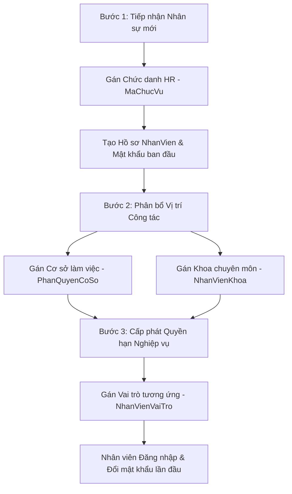

# HƯỚNG DẪN KHỞI TẠO DỮ LIỆU HỆ THỐNG & THIẾT LẬP PHÂN QUYỀN NHÂN VIÊN
**Dự án:** ClinicManagement System  
**Cập nhật:** Tháng 09/2026  
**Kiến trúc:** Clean Architecture (.NET 10 Web API + Entity Framework Core + SQL Server)  
**Mô hình phân quyền:** Phân quyền 3 chiều (Module x Action x DataScope) + RBAC tách biệt Chức vụ HR

---

## MỤC LỤC
1. [Tổng quan Kiến trúc & Nguyên tắc Phân quyền](#1-tổng-quan-kiến-trúc--nguyên-tắc-phân-quyền)
2. [Thứ tự phụ thuộc dữ liệu (Dependency Pipeline)](#2-thứ-tự-phụ-thuộc-dữ-liệu-dependency-pipeline)
3. [Phương pháp 1: Khởi tạo nhanh bằng T-SQL Script (Khuyên dùng)](#3-phương-pháp-1-khởi-tạo-nhanh-bằng-t-sql-script-khuyên-dùng)
4. [Phương pháp 2: Khởi tạo & Quản lý thông qua RESTful API](#4-phương-pháp-2-khởi-tạo--quản-lý-thông-qua-restful-api)
5. [Quy trình Phân quyền cho một Nhân viên mới](#5-quy-trình-phân-quyền-cho-một-nhân-viên-mới)
6. [Kiểm thử & Xác thực Phân quyền (Verification)](#6-kiểm-thử--xác-thực-phân-quyền-verification)
7. [Bảng tra cứu Danh mục & Enums (Reference)](#7-bảng-tra-cứu-danh-mục--enums-reference)

---

## 1. TỔNG QUAN KIẾN TRÚC & NGUYÊN TẮC PHÂN QUYỀN

Hệ thống **ClinicManagement** phân định rạch ròi giữa hai khái niệm thường bị nhầm lẫn trong y tế:

```
┌─────────────────────────────────────────────────────────────┐
│                 HỒ SƠ NHÂN VIÊN (NhanVien)                  │
└──────────────┬───────────────────────────────┬──────────────┘
               │                               │
               ▼ (Quan hệ 1 - n)               ▼ (Quan hệ n - n)
┌──────────────────────────────┐ ┌──────────────────────────────┐
│     PHÂN HỆ NHÂN SỰ (HR)     │ │    PHÂN HỆ BẢO MẬT & QUYỀN   │
├──────────────────────────────┤ ├──────────────────────────────┤
│ Bảng: ChucVu                 │ │ Bảng: VaiTro, NhanVienVaiTro │
│ - Bác sĩ điều trị            │ │ - QUAN_TRI_HE_THONG          │
│ - Bác sĩ trưởng khoa         │ │ - BAC_SI_KHAM_BENH           │
│ - Điều dưỡng trưởng          │ │ - DUOC_SI                    │
│ - Dược sĩ lâm sàng           │ │ - THU_NGAN_KE_TOAN           │
│ - Kế toán viện phí           │ │                              │
│ 👉 Mục đích:                 │ │ 👉 MaTranPhanQuyen:          │
│ In ấn hồ sơ bệnh án, chức    │ │ Quyết định API nào được gọi, │
│ danh chuyên môn, bảng lương  │ │ hành động gì & phạm vi dữ    │
│ (KHÔNG can thiệp phân quyền) │ │ liệu (Hệ thống/Cơ sở/Khoa)   │
└──────────────────────────────┘ └──────────────────────────────┘
```

### Nguyên tắc cốt lõi:
1. **Chức vụ (`ChucVu`)**: Thuộc tính hành chính nhân sự. Không kiểm tra `MaChucVu` để cấp phát quyền gọi API.
2. **Vai trò (`VaiTro`)**: Nhóm các quyền hạn nghiệp vụ được gán cho nhân viên qua bảng liên kết `NhanVienVaiTro`.
3. **Ma trận phân quyền (`MaTranPhanQuyen`)**: Cấu hình chi tiết 3 chiều:
   - **Phân hệ (`PhanHe`)**: `patient`, `examination`, `cls`, `inventory`, `billing`, `audit`, `settings`, `hr`...
   - **Hành động (`HanhDong`)**: `XEM`, `TAO`, `SUA`, `XOA`, `DUYET`.
   - **Phạm vi dữ liệu (`PhamViDuLieu`)**: `TOAN_HE_THONG` > `CO_SO` > `KHOA_PHONG` (`CHI_NHANH`).
4. **Bộ lọc y tế `[ClinicalAuthorize]`**: Chặn các truy cập trái phép ở cấp Controller/Action dựa trên thông tin định danh từ JWT Token, bảng `NhanVienVaiTro` và `MaTranPhanQuyen`.

---

## 2. THỨ TỰ PHỤ THUỘC DỮ LIỆU (DEPENDENCY PIPELINE)

Để đảm bảo không bị lỗi vi phạm ràng buộc khóa ngoại (Foreign Key Constraints), quá trình nhập dữ liệu cần tuân thủ đúng thứ tự:

```text
Bước 1: Cơ sở y tế (CoSo)
  └─► Bước 2: Khoa/Phòng chức năng (Khoa)
        └─► Bước 3: Phòng khám chi tiết (PhongKham)
Bước 4: Danh mục Chức danh HR (ChucVu)
Bước 5: Danh mục Vai trò bảo mật (VaiTro)
  └─► Bước 6: Thiết lập Ma trận phân quyền (MaTranPhanQuyen)
Bước 7: Hồ sơ Nhân viên y tế (NhanVien)
  ├─► Bước 8: Gán vai trò cho nhân viên (NhanVienVaiTro)
  ├─► Bước 9: Phân quyền làm việc tại cơ sở (PhanQuyenCoSo)
  └─► Bước 10: Phân bổ nhân viên vào khoa phụ trách (NhanVienKhoa)
```

---

## 3. PHƯƠNG PHÁP 1: KHỞI TẠO NHANH BẰNG T-SQL SCRIPT (KHUYÊN DÙNG)

Bạn có thể chạy toàn bộ kịch bản script dưới đây trong SQL Server Management Studio (SSMS), Azure Data Studio, hoặc chạy thông qua Docker Container.

> [!NOTE]
> Mật khẩu mặc định cho các tài khoản tạo sẵn bên dưới là: `Admin@123`  
> Hash chuẩn BCrypt (work factor 11): `$2a$11$N9qo8uLOickgx2ZMRZoMyeIjZAgcfl7p92ldGxad68LJZdL17lhWy`  
> Hệ thống cũng hỗ trợ fallback nhận diện plain-text trong môi trường Development.

```sql
-- ==============================================================================
-- KỊCH BẢN SEED DỮ LIỆU HỆ THỐNG & PHÂN QUYỀN CLINICMANAGEMENT
-- ==============================================================================
USE [ClinicManagementDb];
GO

SET NOCOUNT ON;
BEGIN TRANSACTION;

BEGIN TRY

    PRINT N'==> 1. KHỞI TẠO CƠ SỞ KHÁM CHỮA BỆNH (CoSo)...';
    IF NOT EXISTS (SELECT 1 FROM [CoSo] WHERE [Ma] = 'CS-CHINH')
    BEGIN
        INSERT INTO [CoSo] ([Ma], [Ten], [LoaiCoSo], [DiaChi], [DienThoai], [Email], [TrangThai], [CreatedAt], [IsDeleted])
        VALUES ('CS-CHINH', N'Bệnh viện Đa khoa Trung tâm', 'BENH_VIEN', N'123 Nguyễn Trãi, Thanh Xuân, Hà Nội', '02438889999', 'contact@clinicmanagement.vn', 'ACTIVE', GETUTCDATE(), 0);
    END
    DECLARE @CoSoId INT = (SELECT TOP 1 [Id] FROM [CoSo] WHERE [Ma] = 'CS-CHINH');

    PRINT N'==> 2. KHỞI TẠO KHOA PHÒNG (Khoa)...';
    IF NOT EXISTS (SELECT 1 FROM [Khoa] WHERE [Ma] = 'K-KHAMBENH' AND [MaCoSo] = @CoSoId)
    BEGIN
        INSERT INTO [Khoa] ([MaCoSo], [Ma], [Ten], [CreatedAt], [IsDeleted])
        VALUES 
            (@CoSoId, 'K-KHAMBENH', N'Khoa Khám Bệnh', GETUTCDATE(), 0),
            (@CoSoId, 'K-NOI',       N'Khoa Nội Tổng Hợp', GETUTCDATE(), 0),
            (@CoSoId, 'K-DUOC',      N'Khoa Dược - Vật tư y tế', GETUTCDATE(), 0),
            (@CoSoId, 'K-TAICHINH',  N'Phòng Tài chính - Kế toán', GETUTCDATE(), 0);
    END
    DECLARE @KhoaKhamBenhId INT = (SELECT TOP 1 [Id] FROM [Khoa] WHERE [Ma] = 'K-KHAMBENH' AND [MaCoSo] = @CoSoId);
    DECLARE @KhoaDuocId INT      = (SELECT TOP 1 [Id] FROM [Khoa] WHERE [Ma] = 'K-DUOC' AND [MaCoSo] = @CoSoId);
    DECLARE @KhoaTaiChinhId INT  = (SELECT TOP 1 [Id] FROM [Khoa] WHERE [Ma] = 'K-TAICHINH' AND [MaCoSo] = @CoSoId);

    PRINT N'==> 3. KHỞI TẠO PHÒNG KHÁM CỤ THỂ (PhongKham)...';
    IF NOT EXISTS (SELECT 1 FROM [PhongKham] WHERE [Ma] = 'PK-101')
    BEGIN
        INSERT INTO [PhongKham] ([MaKhoa], [Ma], [Ten], [TrangThai], [CreatedAt], [IsDeleted])
        VALUES 
            (@KhoaKhamBenhId, 'PK-101', N'Phòng Khám Nội 01', 'HOAT_DONG', GETUTCDATE(), 0),
            (@KhoaKhamBenhId, 'PK-102', N'Phòng Khám Nội 02', 'HOAT_DONG', GETUTCDATE(), 0),
            (@KhoaDuocId,     'KHO-01', N'Kho Thuốc Trung Tâm', 'HOAT_DONG', GETUTCDATE(), 0);
    END

    PRINT N'==> 4. KHỞI TẠO DANH MỤC CHỨC VỤ NHÂN SỰ (ChucVu - Phân hệ HR)...';
    MERGE INTO [ChucVu] AS Target
    USING (VALUES 
        (N'Giám đốc điều hành', N'Lãnh đạo toàn diện phòng khám / bệnh viện'),
        (N'Bác sĩ chuyên khoa', N'Khám bệnh, chẩn đoán, ra y lệnh và kê đơn thuốc'),
        (N'Bác sĩ trưởng khoa', N'Quản lý chuyên môn khoa, phê duyệt hồ sơ phức tạp'),
        (N'Điều dưỡng viên',    N'Tiếp đón, đo sinh hiệu, sơ cứu ban đầu'),
        (N'Dược sĩ lâm sàng',   N'Quản lý kho dược phẩm, duyệt cấp phát thuốc'),
        (N'Kế toán viện phí',   N'Thu ngân, xuất hóa đơn, quản lý công nợ và bảo hiểm')
    ) AS Source ([TenChucVu], [MoTa])
    ON Target.[TenChucVu] = Source.[TenChucVu]
    WHEN NOT MATCHED THEN
        INSERT ([TenChucVu], [MoTa], [CreatedAt], [IsDeleted])
        VALUES (Source.[TenChucVu], Source.[MoTa], GETUTCDATE(), 0);

    DECLARE @ChucVuAdminId   INT = (SELECT TOP 1 [Id] FROM [ChucVu] WHERE [TenChucVu] = N'Giám đốc điều hành');
    DECLARE @ChucVuBacSiId   INT = (SELECT TOP 1 [Id] FROM [ChucVu] WHERE [TenChucVu] = N'Bác sĩ chuyên khoa');
    DECLARE @ChucVuDuocSiId  INT = (SELECT TOP 1 [Id] FROM [ChucVu] WHERE [TenChucVu] = N'Dược sĩ lâm sàng');
    DECLARE @ChucVuKeToanId  INT = (SELECT TOP 1 [Id] FROM [ChucVu] WHERE [TenChucVu] = N'Kế toán viện phí');

    PRINT N'==> 5. KHỞI TẠO DANH MỤC VAI TRÒ BẢO MẬT (VaiTro - Phân hệ Security/RBAC)...';
    MERGE INTO [VaiTro] AS Target
    USING (VALUES 
        (N'QUAN_TRI_HE_THONG', N'Quản trị viên kỹ thuật toàn hệ thống'),
        (N'BAC_SI_KHAM_BENH',   N'Bác sĩ khám chữa bệnh, kê đơn và chỉ định CLS'),
        (N'DUOC_SI',            N'Quản lý kho dược phẩm, nhập xuất và cấp phát thuốc'),
        (N'THU_NGAN_VIEN_PHI',  N'Thu ngân, quản lý viện phí và thanh toán hóa đơn'),
        (N'DIEU_DUONG_TIEP_DON',N'Tiếp đón bệnh nhân, phân luồng, đo sinh hiệu')
    ) AS Source ([TenVaiTro], [MoTa])
    ON Target.[TenVaiTro] = Source.[TenVaiTro]
    WHEN NOT MATCHED THEN
        INSERT ([TenVaiTro], [MoTa], [CreatedAt], [IsDeleted])
        VALUES (Source.[TenVaiTro], Source.[MoTa], GETUTCDATE(), 0);

    DECLARE @RoleAdminId    INT = (SELECT TOP 1 [Id] FROM [VaiTro] WHERE [TenVaiTro] = N'QUAN_TRI_HE_THONG');
    DECLARE @RoleBacSiId    INT = (SELECT TOP 1 [Id] FROM [VaiTro] WHERE [TenVaiTro] = N'BAC_SI_KHAM_BENH');
    DECLARE @RoleDuocSiId   INT = (SELECT TOP 1 [Id] FROM [VaiTro] WHERE [TenVaiTro] = N'DUOC_SI');
    DECLARE @RoleThuNganId  INT = (SELECT TOP 1 [Id] FROM [VaiTro] WHERE [TenVaiTro] = N'THU_NGAN_VIEN_PHI');

    PRINT N'==> 6. THIẾT LẬP MA TRẬN PHÂN QUYỀN CHI TIẾT (MaTranPhanQuyen)...';
    -- Xóa các cấu hình cũ của các vai trò này để cập nhật đồng bộ
    DELETE FROM [MaTranPhanQuyen] WHERE [MaVaiTro] IN (@RoleAdminId, @RoleBacSiId, @RoleDuocSiId, @RoleThuNganId);

    -- 6.1. QUAN_TRI_HE_THONG (Toàn quyền trên mọi phân hệ)
    INSERT INTO [MaTranPhanQuyen] ([MaVaiTro], [PhanHe], [HanhDong], [PhamViDuLieu], [DuocPhep], [CreatedAt], [IsDeleted])
    SELECT @RoleAdminId, M.PhanHe, A.HanhDong, 'TOAN_HE_THONG', 1, GETUTCDATE(), 0
    FROM (VALUES ('patient'), ('examination'), ('cls'), ('inventory'), ('billing'), ('audit'), ('settings'), ('hr')) AS M(PhanHe)
    CROSS JOIN (VALUES ('XEM'), ('TAO'), ('SUA'), ('XOA'), ('DUYET')) AS A(HanhDong);

    -- 6.2. BAC_SI_KHAM_BENH (Khám bệnh, kê đơn, xem hồ sơ, xem kho)
    INSERT INTO [MaTranPhanQuyen] ([MaVaiTro], [PhanHe], [HanhDong], [PhamViDuLieu], [DuocPhep], [CreatedAt], [IsDeleted])
    VALUES
        -- Hồ sơ bệnh nhân
        (@RoleBacSiId, 'patient',     'XEM',   'KHOA_PHONG', 1, GETUTCDATE(), 0),
        -- Khám bệnh & chẩn đoán
        (@RoleBacSiId, 'examination', 'XEM',   'KHOA_PHONG', 1, GETUTCDATE(), 0),
        (@RoleBacSiId, 'examination', 'TAO',   'KHOA_PHONG', 1, GETUTCDATE(), 0),
        (@RoleBacSiId, 'examination', 'SUA',   'KHOA_PHONG', 1, GETUTCDATE(), 0),
        (@RoleBacSiId, 'examination', 'DUYET', 'KHOA_PHONG', 1, GETUTCDATE(), 0),
        -- Chỉ định cận lâm sàng (CLS)
        (@RoleBacSiId, 'cls',         'XEM',   'KHOA_PHONG', 1, GETUTCDATE(), 0),
        (@RoleBacSiId, 'cls',         'TAO',   'KHOA_PHONG', 1, GETUTCDATE(), 0),
        -- Xem tồn kho thuốc để kê đơn
        (@RoleBacSiId, 'inventory',   'XEM',   'CO_SO',      1, GETUTCDATE(), 0),
        -- Xem tình trạng viện phí
        (@RoleBacSiId, 'billing',     'XEM',   'KHOA_PHONG', 1, GETUTCDATE(), 0);

    -- 6.3. DUOC_SI (Quản lý kho dược & cấp phát thuốc)
    INSERT INTO [MaTranPhanQuyen] ([MaVaiTro], [PhanHe], [HanhDong], [PhamViDuLieu], [DuocPhep], [CreatedAt], [IsDeleted])
    VALUES
        (@RoleDuocSiId, 'inventory',   'XEM',   'CO_SO', 1, GETUTCDATE(), 0),
        (@RoleDuocSiId, 'inventory',   'TAO',   'CO_SO', 1, GETUTCDATE(), 0),
        (@RoleDuocSiId, 'inventory',   'SUA',   'CO_SO', 1, GETUTCDATE(), 0),
        (@RoleDuocSiId, 'inventory',   'DUYET', 'CO_SO', 1, GETUTCDATE(), 0),
        (@RoleDuocSiId, 'examination', 'XEM',   'CO_SO', 1, GETUTCDATE(), 0),
        (@RoleDuocSiId, 'billing',     'XEM',   'CO_SO', 1, GETUTCDATE(), 0);

    -- 6.4. THU_NGAN_VIEN_PHI (Quản lý hóa đơn, thu tiền)
    INSERT INTO [MaTranPhanQuyen] ([MaVaiTro], [PhanHe], [HanhDong], [PhamViDuLieu], [DuocPhep], [CreatedAt], [IsDeleted])
    VALUES
        (@RoleThuNganId, 'billing',     'XEM', 'CO_SO', 1, GETUTCDATE(), 0),
        (@RoleThuNganId, 'billing',     'TAO', 'CO_SO', 1, GETUTCDATE(), 0),
        (@RoleThuNganId, 'billing',     'SUA', 'CO_SO', 1, GETUTCDATE(), 0),
        (@RoleThuNganId, 'patient',     'XEM', 'CO_SO', 1, GETUTCDATE(), 0),
        (@RoleThuNganId, 'examination', 'XEM', 'CO_SO', 1, GETUTCDATE(), 0);

    PRINT N'==> 7. KHỞI TẠO TÀI KHOẢN NHÂN VIÊN MẪU (NhanVien)...';
    DECLARE @PasswordHash NVARCHAR(500) = N'$2a$11$N9qo8uLOickgx2ZMRZoMyeIjZAgcfl7p92ldGxad68LJZdL17lhWy'; -- Pass: Admin@123

    -- 7.1. Admin
    IF NOT EXISTS (SELECT 1 FROM [NhanVien] WHERE [Username] = 'admin')
    BEGIN
        INSERT INTO [NhanVien] ([Username], [PasswordHash], [HoTen], [GioiTinh], [Email], [DienThoai], [MaChucVu], [IsActive], [CreatedAt], [IsDeleted])
        VALUES ('admin', @PasswordHash, N'Quản Trị Viên Hệ Thống', 'NAM', 'admin@clinicmanagement.vn', '0901234567', @ChucVuAdminId, 1, GETUTCDATE(), 0);
    END
    DECLARE @AdminUserId INT = (SELECT TOP 1 [Id] FROM [NhanVien] WHERE [Username] = 'admin');

    -- 7.2. Bác sĩ Nguyễn Văn An
    IF NOT EXISTS (SELECT 1 FROM [NhanVien] WHERE [Username] = 'bs_an')
    BEGIN
        INSERT INTO [NhanVien] ([Username], [PasswordHash], [HoTen], [GioiTinh], [Email], [DienThoai], [MaChucVu], [ChuyenKhoa], [SoHanhNghe], [IsActive], [CreatedAt], [IsDeleted])
        VALUES ('bs_an', @PasswordHash, N'BS.CKI Nguyễn Văn An', 'NAM', 'an.nguyen@clinicmanagement.vn', '0912345678', @ChucVuBacSiId, N'Nội Tổng Quát', 'CCHN-001234-HN', 1, GETUTCDATE(), 0);
    END
    DECLARE @DoctorUserId INT = (SELECT TOP 1 [Id] FROM [NhanVien] WHERE [Username] = 'bs_an');

    -- 7.3. Dược sĩ Trần Thị Bình
    IF NOT EXISTS (SELECT 1 FROM [NhanVien] WHERE [Username] = 'ds_binh')
    BEGIN
        INSERT INTO [NhanVien] ([Username], [PasswordHash], [HoTen], [GioiTinh], [Email], [DienThoai], [MaChucVu], [ChuyenKhoa], [SoHanhNghe], [IsActive], [CreatedAt], [IsDeleted])
        VALUES ('ds_binh', @PasswordHash, N'DS. Trần Thị Bình', 'NU', 'binh.tran@clinicmanagement.vn', '0923456789', @ChucVuDuocSiId, N'Dược Lâm Sàng', 'CCHN-DUOC-0056', 1, GETUTCDATE(), 0);
    END
    DECLARE @PharmUserId INT = (SELECT TOP 1 [Id] FROM [NhanVien] WHERE [Username] = 'ds_binh');

    -- 7.4. Thu ngân Lê Thị Cúc
    IF NOT EXISTS (SELECT 1 FROM [NhanVien] WHERE [Username] = 'tn_cuc')
    BEGIN
        INSERT INTO [NhanVien] ([Username], [PasswordHash], [HoTen], [GioiTinh], [Email], [DienThoai], [MaChucVu], [IsActive], [CreatedAt], [IsDeleted])
        VALUES ('tn_cuc', @PasswordHash, N'Lê Thị Cúc', 'NU', 'cuc.le@clinicmanagement.vn', '0934567890', @ChucVuKeToanId, 1, GETUTCDATE(), 0);
    END
    DECLARE @CashierUserId INT = (SELECT TOP 1 [Id] FROM [NhanVien] WHERE [Username] = 'tn_cuc');

    PRINT N'==> 8. GÁN VAI TRÒ CHO NHÂN VIÊN (NhanVienVaiTro)...';
    DELETE FROM [NhanVienVaiTro] WHERE [MaNhanVien] IN (@AdminUserId, @DoctorUserId, @PharmUserId, @CashierUserId);
    INSERT INTO [NhanVienVaiTro] ([MaNhanVien], [MaVaiTro], [NgayBatDau], [CreatedAt], [IsDeleted])
    VALUES 
        (@AdminUserId,   @RoleAdminId,   GETUTCDATE(), GETUTCDATE(), 0),
        (@DoctorUserId,  @RoleBacSiId,   GETUTCDATE(), GETUTCDATE(), 0),
        (@PharmUserId,   @RoleDuocSiId,  GETUTCDATE(), GETUTCDATE(), 0),
        (@CashierUserId, @RoleThuNganId, GETUTCDATE(), GETUTCDATE(), 0);

    PRINT N'==> 9. PHÂN QUYỀN THEO CƠ SỞ (PhanQuyenCoSo)...';
    DELETE FROM [PhanQuyenCoSo] WHERE [MaNhanVien] IN (@AdminUserId, @DoctorUserId, @PharmUserId, @CashierUserId);
    INSERT INTO [PhanQuyenCoSo] ([MaNhanVien], [MaCoSo], [MaVaiTro], [NgayBatDau], [CreatedAt], [IsDeleted])
    VALUES 
        (@AdminUserId,   @CoSoId, @RoleAdminId,   GETUTCDATE(), GETUTCDATE(), 0),
        (@DoctorUserId,  @CoSoId, @RoleBacSiId,   GETUTCDATE(), GETUTCDATE(), 0),
        (@PharmUserId,   @CoSoId, @RoleDuocSiId,  GETUTCDATE(), GETUTCDATE(), 0),
        (@CashierUserId, @CoSoId, @RoleThuNganId, GETUTCDATE(), GETUTCDATE(), 0);

    PRINT N'==> 10. PHÂN BỔ NHÂN VIÊN VÀO KHOA PHỤ TRÁCH (NhanVienKhoa)...';
    DELETE FROM [NhanVienKhoa] WHERE [MaNhanVien] IN (@AdminUserId, @DoctorUserId, @PharmUserId, @CashierUserId);
    INSERT INTO [NhanVienKhoa] ([MaNhanVien], [MaKhoa], [TuNgay], [LaKhoaChinh], [CreatedAt], [IsDeleted])
    VALUES 
        (@AdminUserId,   @KhoaKhamBenhId, GETUTCDATE(), 1, GETUTCDATE(), 0),
        (@DoctorUserId,  @KhoaKhamBenhId, GETUTCDATE(), 1, GETUTCDATE(), 0),
        (@PharmUserId,   @KhoaDuocId,      GETUTCDATE(), 1, GETUTCDATE(), 0),
        (@CashierUserId, @KhoaTaiChinhId,  GETUTCDATE(), 1, GETUTCDATE(), 0);

    COMMIT TRANSACTION;
    PRINT N'==============================================================================';
    PRINT N'✅ ĐÃ KHỞI TẠO TOÀN BỘ DỮ LIỆU & PHÂN QUYỀN HỆ THỐNG THÀNH CÔNG!';
    PRINT N'==============================================================================';
END TRY
BEGIN CATCH
    ROLLBACK TRANSACTION;
    PRINT N'❌ LỖI TRONG QUÁ TRÌNH KHỞI TẠO DỮ LIỆU:';
    PRINT ERROR_MESSAGE();
END CATCH;
GO
```

---

## 4. PHƯƠNG PHÁP 2: KHỞI TẠO & QUẢN LÝ THÔNG QUA RESTFUL API

Nếu bạn muốn tạo nhân viên và gán quyền trực tiếp từ **Admin Portal** hoặc qua **Postman / cURL**, thực hiện theo các bước sau:

### Bước 4.1: Đăng nhập với tài khoản Quản trị để lấy Bearer Token
* **Endpoint**: `POST /api/auth/login`
* **Request Body**:
```json
{
  "username": "admin",
  "password": "Admin@123"
}
```
* **Response Trả về**:
```json
{
  "success": true,
  "data": {
    "accessToken": "eyJhbGciOi...",
    "refreshToken": "48b11b93-...",
    "user": {
      "id": 1,
      "username": "admin",
      "fullName": "Quản Trị Viên Hệ Thống",
      "roles": ["QUAN_TRI_HE_THONG"]
    }
  }
}
```
*(Gắn header `Authorization: Bearer <accessToken>` cho tất cả các request tiếp theo)*

---

### Bước 4.2: Tải danh mục Chức vụ & Vai trò có sẵn
1. **Lấy danh mục Chức vụ (HR)**:
   * `GET /api/nhan-vien/positions` (hoặc `GET /api/nhan-vien/chuc-vu`)
   * Trả về: Danh sách ID chức vụ (`MaChucVu`) như: Bác sĩ chuyên khoa (`Id: 2`), Điều dưỡng (`Id: 4`)...
2. **Lấy danh mục Vai trò bảo mật (RBAC)**:
   * `GET /api/nhan-vien/roles`
   * Trả về: `[ { "id": 2, "tenVaiTro": "BAC_SI_KHAM_BENH", "moTa": "..." } ]`

---

### Bước 4.3: Tạo hồ sơ Nhân viên mới
* **Endpoint**: `POST /api/nhan-vien`
* **Quyền yêu cầu**: Có quyền phân hệ `hr` hoặc quyền quản trị
* **Request Body**:
```json
{
  "username": "bs_minh",
  "password": "Password@123",
  "hoTen": "BS. CKI Hoàng Nhật Minh",
  "ngaySinh": "1988-06-15T00:00:00Z",
  "gioiTinh": 1,
  "email": "minh.hoang@clinicmanagement.vn",
  "dienThoai": "0987654321",
  "maChucVu": 2,
  "chuyenKhoa": "Tai Mũi Họng",
  "soHanhNghe": "CCHN-009876-HN"
}
```
*(Lưu ý: `gioiTinh`: 1 = NAM, 2 = NU, 3 = KHAC. Sau khi gọi thành công, ghi nhận `id` của nhân viên, ví dụ `id: 5`)*

---

### Bước 4.4: Gán Vai trò cho Nhân viên
* **Endpoint**: `PUT /api/nhan-vien/{id}/roles`
* **Request Body**:
```json
{
  "roleIds": [2],
  "ngayBatDau": "2026-09-18T00:00:00Z",
  "ngayKetThuc": null
}
```
* **Response**: `200 OK` - `"Cập nhật vai trò nhân viên thành công."`

---

### Bước 4.5: Cấu hình Ma trận phân quyền cho Vai trò (Admin Settings)
Nếu muốn thay đổi hoặc mở rộng quyền của một Vai trò:
* **Endpoint**: `POST /api/admin/roles`
* **Quyền yêu cầu**: `[ClinicalAuthorize("settings", HanhDongQuyen.SUA, PhamViDuLieu.TOAN_HE_THONG)]`
* **Request Body**:
```json
{
  "id": 2,
  "maCode": "BAC_SI_KHAM_BENH",
  "ten": "Bác sĩ khám bệnh",
  "moTa": "Khám chữa bệnh, chỉ định cận lâm sàng và kê đơn",
  "phamViDuLieu": 3,
  "phanQuyen": {
    "examination": [1, 2, 3, 5],
    "cls": [1, 2],
    "patient": [1],
    "inventory": [1],
    "billing": [1]
  }
}
```
*(Trong đó: Action `1: XEM`, `2: TAO`, `3: SUA`, `4: XOA`, `5: DUYET` - Phạm vi `3: KHOA_PHONG`)*

---

## 5. QUY TRÌNH PHÂN QUYỀN CHO MỘT NHÂN VIÊN MỚI

Khi tuyển dụng một nhân sự mới vào phòng khám, quy trình 3 bước chuẩn hóa:



---

## 6. KIỂM THỬ & XÁC THỰC PHÂN QUYỀN (VERIFICATION)

Sau khi tạo dữ liệu và phân quyền, bạn có thể kiểm tra hiệu lực bảo mật bằng các kịch bản test:

### Kịch bản 1: Bác sĩ gọi API Nghiệp vụ khám bệnh (Thành công)
1. Đăng nhập tài khoản `bs_an` / `Admin@123` -> Nhận `Token_BS`.
2. Gọi `GET /api/examinations/records/queue` với Header `Bearer Token_BS`.
3. **Kết quả**: `HTTP 200 OK` (Bác sĩ có quyền `examination:XEM` phạm vi `KHOA_PHONG`).

### Kịch bản 2: Bác sĩ cố tình truy cập Dashboard Doanh thu Admin (Bị chặn)
1. Sử dụng `Token_BS` của Bác sĩ.
2. Gọi `GET /api/admin/dashboard` hoặc `GET /api/admin/roles`.
3. **Kết quả**: `HTTP 403 Forbidden` (Bác sĩ không có quyền `settings` hoặc `audit` phạm vi `TOAN_HE_THONG`).

### Kịch bản 3: Thu ngân gọi API Hóa đơn & Viện phí (Thành công)
1. Đăng nhập tài khoản `tn_cuc` / `Admin@123` -> Nhận `Token_ThuNgan`.
2. Gọi `POST /api/billing/invoices/{id}/pay` với Header `Bearer Token_ThuNgan`.
3. **Kết quả**: `HTTP 200 OK` (Thu ngân có quyền `billing:TAO` / `SUA`).

### Kịch bản 4: Kiểm tra Chu trình Refresh Token & Thu hồi Token
1. Gọi `POST /api/auth/refresh-token` gửi `{ "refreshToken": "<chuỗi_token>" }`.
   * **Kết quả**: Nhận Access Token mới, Token cũ được xoay vòng.
2. Gọi `POST /api/auth/logout` gửi `{ "refreshToken": "<chuỗi_token>" }`.
   * **Kết quả**: Token được đánh dấu `DaHuyBo = 1` trong CSDL; các request kế tiếp dùng token này đều bị từ chối `HTTP 401 Unauthorized`.

---

## 7. BẢNG TRA CỨU DANH MỤC & ENUMS (REFERENCE)

### 7.1. Bảng Phân hệ Nghiệp vụ (`PhanHe`)
| Mã Phân Hệ | Tên Hiển Thị | Chức năng chính |
|---|---|---|
| `patient` | Tiếp đón & Bệnh nhân | Quản lý hồ sơ bệnh nhân, thẻ BHYT, tiền sử bệnh |
| `examination` | Khám bệnh & Điều trị | Hàng đợi khám, chẩn đoán ICD, đơn thuốc, ra y lệnh |
| `cls` | Cận lâm sàng | Xét nghiệm, chẩn đoán hình ảnh (X-Quang, Siêu âm, CT) |
| `inventory` | Dược & Vật tư | Danh mục thuốc, nhập/xuất kho, tồn kho, cấp phát |
| `billing` | Viện phí & Tài chính | Hóa đơn khám, thu viện phí, công nợ, bảo hiểm |
| `hr` | Quản lý Nhân sự | Hồ sơ nhân viên, chức vụ, lịch làm việc, chấm công |
| `audit` | Kiểm toán & Nhật ký | Xem nhật ký EMR, lịch sử truy cập và sửa đổi bệnh án |
| `settings` | Cấu hình Hệ thống | Ma trận phân quyền, tham số hệ thống, tích hợp |

---

### 7.2. Enum Hành động Quyền (`HanhDongQuyen`)
| Enum Code | Giá trị Số | Tên Tiếng Việt | Mô tả |
|---|---|---|---|
| `XEM` | `1` | Xem / Đọc | Quyền tra cứu dữ liệu (GET APIs) |
| `TAO` | `2` | Tạo mới | Quyền thêm bản ghi mới (POST APIs) |
| `SUA` | `3` | Cập nhật / Sửa | Quyền điều chỉnh thông tin (PUT/PATCH APIs) |
| `XOA` | `4` | Xóa / Hủy | Quyền hủy hoặc xóa mềm bản ghi (DELETE APIs) |
| `DUYET` | `5` | Phê duyệt | Quyền ký số, khóa bệnh án, duyệt xuất kho |

---

### 7.3. Enum Phạm vi Dữ liệu (`PhamViDuLieu`)
| Enum Code | Giá trị Số | Mức Ưu Tiên | Ý Nghĩa |
|---|---|---|---|
| `TOAN_HE_THONG` | `1` | Cao nhất (Toàn cục) | Được xem/thao tác dữ liệu trên mọi cơ sở & chi nhánh |
| `CO_SO` | `2` | Cấp Chi nhánh/Cơ sở | Chỉ được thao tác dữ liệu thuộc Cơ sở y tế mình làm việc |
| `KHOA_PHONG` | `3` | Cấp Khoa phòng | Chỉ được thao tác bệnh nhân và hồ sơ trong Khoa của mình |
| `CHI_NHANH` | `4` | Tương đương Cơ sở | Dành cho các phòng khám vệ tinh phụ thuộc |

---

### 7.4. Enum Giới tính (`GioiTinh`)
| Enum Code | Giá trị Lưu DB | Mô tả |
|---|---|---|
| `M` (1) | `NAM` | Nam giới |
| `F` (2) | `NU` | Nữ giới |
| `O` (3) | `KHAC` | Khác |

---

*Tài liệu được thiết kế đồng bộ với codebase của ClinicManagement. Mọi thắc mắc kỹ thuật vui lòng kiểm tra tại [ClinicalAuthorizeAttribute.cs](file:///Users/jtuong/Documents/ClinicManagement.worktrees/clinicmanagement-ui-layout-update/ClinicManagement.API/Authorization/ClinicalAuthorizeAttribute.cs) và [ClinicalGovernanceService.cs](file:///Users/jtuong/Documents/ClinicManagement.worktrees/clinicmanagement-ui-layout-update/ClinicManagement.Application/Services/ClinicalGovernanceService.cs).*
